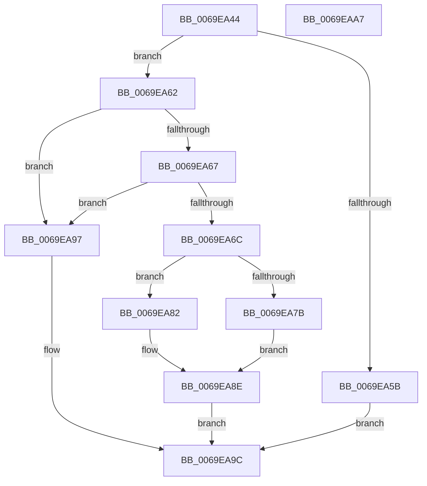

# BgQueryBootGraphicsInformation

- RVA: `0x0069EA44`–`0x0069EAA8` (길이 `100` bytes)
- VA: `0x000000014069EA44`
- 실행 섹션: `.text`
- PDB 이름 있음: `예`; PDB Function 태그: `아니요`
- unwind 정보 RVA: `0x0005CAAC`
- 디코드: `33`개 명령, `100/100` bytes 표시
- 미해석 바이트: `0` (있으면 어셈블리에 `.byte`로 보존)

> 이 문서는 커널 이미지의 기계어와 PDB 기호를 분석해 생성했습니다. 4번과 5번은 함수 원형과 자료형을 바이너리 사용 방식에서 추정한 C 해석이며 원본 소스 복구 결과는 아닙니다.

## 1. Dependencies

- 직접 호출 지점: **3**; 고유 호출 대상: **3**
- 직접 호출자로 확인된 함수: **1**
- RIP 상대 이미지 참조: **1**

### Outgoing calls
- `0x0069EA6C` → [BgpFwAcquireLock](../4B/BgpFwAcquireLock_function_004B3AA4.md) (function, `0x004B3AA4`)
- `0x0069EA87` → [BgpFwQueryBootGraphicsInformation](../4C/BgpFwQueryBootGraphicsInformation_function_004CF524.md) (function, `0x004CF524`)
- `0x0069EA8E` → [BgpFwReleaseLock](../4B/BgpFwReleaseLock_function_004B357C.md) (function, `0x004B357C`)

### Direct callers
- [BgkQueryBootGraphicsInformation](../../pagebgfx/BC/BgkQueryBootGraphicsInformation_function_00BC0064.md) at `0x00BC0078`

### Static image references
- `0x0069EA71` → RVA `0x00EF0450` (`.data`; read)

## 2. Other-region calls and transfers

- 다른 실행 섹션으로 향하는 call: **0**
- 별도 외부 분기/꼬리 이동을 확인하지 못했습니다.

## 3. Assembly (complete function range)

```asm
0069EA44  48 89 5C 24 08                  mov qword ptr [rsp + 8], rbx
0069EA49  57                              push rdi
0069EA4A  48 83 EC 20                     sub rsp, 0x20
0069EA4E  48 8B FA                        mov rdi, rdx
0069EA51  8B D9                           mov ebx, ecx
0069EA53  44 0F 20 C0                     mov rax, cr8
0069EA57  84 C0                           test al, al
0069EA59  74 07                           je 0x14069ea62
0069EA5B  B8 01 00 00 C0                  mov eax, 0xc0000001
0069EA60  EB 3A                           jmp 0x14069ea9c
0069EA62  48 85 FF                        test rdi, rdi
0069EA65  74 30                           je 0x14069ea97
0069EA67  83 FB 04                        cmp ebx, 4
0069EA6A  7D 2B                           jge 0x14069ea97
0069EA6C  E8 33 50 E1 FF                  call 0x1404b3aa4
0069EA71  8B 05 D9 19 85 00               mov eax, dword ptr [rip + 0x8519d9]
0069EA77  A8 01                           test al, 1
0069EA79  75 07                           jne 0x14069ea82
0069EA7B  BB 01 00 00 C0                  mov ebx, 0xc0000001
0069EA80  EB 0C                           jmp 0x14069ea8e
0069EA82  48 8B D7                        mov rdx, rdi
0069EA85  8B CB                           mov ecx, ebx
0069EA87  E8 98 0A E3 FF                  call 0x1404cf524
0069EA8C  8B D8                           mov ebx, eax
0069EA8E  E8 E9 4A E1 FF                  call 0x1404b357c
0069EA93  8B C3                           mov eax, ebx
0069EA95  EB 05                           jmp 0x14069ea9c
0069EA97  B8 0D 00 00 C0                  mov eax, 0xc000000d
0069EA9C  48 8B 5C 24 30                  mov rbx, qword ptr [rsp + 0x30]
0069EAA1  48 83 C4 20                     add rsp, 0x20
0069EAA5  5F                              pop rdi
0069EAA6  C3                              ret
0069EAA7  CC                              int3
```

## 4. C-style interpretation (structured pseudocode)

```c
__int64 __fastcall BgQueryBootGraphicsInformation(int a1, __int64 a2)
{
    __int64 result;
    __int64 v_rsp;
    unsigned __int64 v_stack_p8;

    v_stack_p8 = v_rbx;
    v_rsp = (v_rsp) - (32);
    if ((unsigned __int8)(v_cr8) == 0) goto loc_0069EA62;
    goto loc_0069EA9C;
loc_0069EA62:
    if (a2 == 0) goto loc_0069EA97;
    if (((unsigned int)((unsigned int)(a1))) >= 4) goto loc_0069EA97;
    result = BgpFwAcquireLock(a1, a2, a3, a4);
    if ((((unsigned __int8)((unsigned int)(*(unsigned int *)(v_rip + 8722905)))) & (1)) != 0) goto loc_0069EA82;
    goto loc_0069EA8E;
loc_0069EA82:
    result = BgpFwQueryBootGraphicsInformation((unsigned int)((unsigned int)((unsigned int)(0xC0000001ULL))), a2, a3, a4);
loc_0069EA8E:
    result = BgpFwReleaseLock((unsigned int)((unsigned int)((unsigned int)(0xC0000001ULL))), a2, a3, a4);
    goto loc_0069EA9C;
loc_0069EA97:
loc_0069EA9C:
    v_rsp = (v_rsp) + (32);
    return (unsigned int)(0xC000000DULL);
}
```

## 5. (Beta) C Style

```c
int64_t BgQueryBootGraphicsInformation(int32_t Arg1, int64_t Arg2)
{
    int64_t result;
    int64_t local_rsp;
    uint64_t v_stack_p8;

    v_stack_p8 = local_rbx;
    local_rsp = (local_rsp) - (32);
    if ((uint8_t)(v_cr8) == 0) goto loc_0069EA62;
    goto loc_0069EA9C;
loc_0069EA62:
    if (Arg2 == 0) goto loc_0069EA97;
    if (((uint32_t)((uint32_t)(Arg1))) >= 4) goto loc_0069EA97;
    result = BgpFwAcquireLock(Arg1, Arg2, a3, a4);
    if ((((uint8_t)((uint32_t)(*(uint32_t *)(v_rip + 0x8519D9)))) & (1)) != 0) goto loc_0069EA82;
    goto loc_0069EA8E;
loc_0069EA82:
    result = BgpFwQueryBootGraphicsInformation((uint32_t)((uint32_t)((uint32_t)(0xC0000001ULL))), Arg2, a3, a4);
loc_0069EA8E:
    result = BgpFwReleaseLock((uint32_t)((uint32_t)((uint32_t)(0xC0000001ULL))), Arg2, a3, a4);
    goto loc_0069EA9C;
loc_0069EA97:
loc_0069EA9C:
    local_rsp = (local_rsp) + (32);
    return (uint32_t)(0xC000000DULL);
}
```

## 6. Execution-region graph

[열기: 2D/3D 그래프와 함수 탐색 컨트롤 패널](../../../control-panel.html?section=text&rva=0x0069EA44&view=graph)

- 2D 그래프는 위에서 아래로 흐르고, 3D 그래프는 빈 공간을 드래그해 회전합니다. Shift+드래그는 이동, 휠은 확대·축소, 함수 노드 선택은 대상 보고서 이동입니다.

### Static fallback


