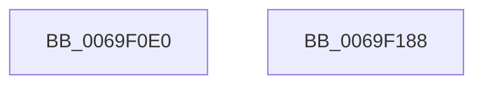

# BgfxGrowDirtyRect

- RVA: `0x0069F0E0`–`0x0069F189` (길이 `169` bytes)
- VA: `0x000000014069F0E0`
- 실행 섹션: `.text`
- PDB 이름 있음: `예`; PDB Function 태그: `아니요`
- unwind 정보 RVA: `0x00060BC4`
- 디코드: `48`개 명령, `169/169` bytes 표시
- 미해석 바이트: `0` (있으면 어셈블리에 `.byte`로 보존)

> 이 문서는 커널 이미지의 기계어와 PDB 기호를 분석해 생성했습니다. 4번과 5번은 함수 원형과 자료형을 바이너리 사용 방식에서 추정한 C 해석이며 원본 소스 복구 결과는 아닙니다.

## 1. Dependencies

- 직접 호출 지점: **2**; 고유 호출 대상: **2**
- 직접 호출자로 확인된 함수: **1**
- RIP 상대 이미지 참조: **3**

### Outgoing calls
- `0x0069F0FF` → [KeAcquireSpinLockAtDpcLevel](../20/KeAcquireSpinLockAtDpcLevel_function_00208430.md) (function, `0x00208430`)
- `0x0069F173` → [KxReleaseSpinLock](../20/KxReleaseSpinLock_function_00206670.md) (function, `0x00206670`)

### Direct callers
- [GxpWriteFrameBufferPixels](../48/GxpWriteFrameBufferPixels_function_0048C9F4.md) at `0x0048CD86`

### Static image references
- `0x0069F0F5` → RVA `0x00EF05C8` (`.data`; read)
- `0x0069F106` → RVA `0x00EF05C0` (`.data`; read)
- `0x0069F163` → RVA `0x00EF05B0` (`.data`; read)

## 2. Other-region calls and transfers

- 다른 실행 섹션으로 향하는 call: **0**
- 별도 외부 분기/꼬리 이동을 확인하지 못했습니다.

## 3. Assembly (complete function range)

```asm
0069F0E0  48 89 5C 24 08                  mov qword ptr [rsp + 8], rbx
0069F0E5  48 89 74 24 10                  mov qword ptr [rsp + 0x10], rsi
0069F0EA  57                              push rdi
0069F0EB  48 83 EC 20                     sub rsp, 0x20
0069F0EF  48 8B F9                        mov rdi, rcx
0069F0F2  41 8B D8                        mov ebx, r8d
0069F0F5  48 8B 0D CC 14 85 00            mov rcx, qword ptr [rip + 0x8514cc]
0069F0FC  48 8B F2                        mov rsi, rdx
0069F0FF  E8 2C 93 B6 FF                  call 0x140208430
0069F104  8B 06                           mov eax, dword ptr [rsi]
0069F106  4C 8B 15 B3 14 85 00            mov r10, qword ptr [rip + 0x8514b3]
0069F10D  45 8B 0A                        mov r9d, dword ptr [r10]
0069F110  44 3B C8                        cmp r9d, eax
0069F113  44 0F 47 C8                     cmova r9d, eax
0069F117  8B 07                           mov eax, dword ptr [rdi]
0069F119  45 89 0A                        mov dword ptr [r10], r9d
0069F11C  33 D2                           xor edx, edx
0069F11E  48 8B 0D 9B 14 85 00            mov rcx, qword ptr [rip + 0x85149b]
0069F125  F7 F3                           div ebx
0069F127  8B 16                           mov edx, dword ptr [rsi]
0069F129  03 D0                           add edx, eax
0069F12B  8B 41 04                        mov eax, dword ptr [rcx + 4]
0069F12E  3B C2                           cmp eax, edx
0069F130  0F 42 C2                        cmovb eax, edx
0069F133  89 41 04                        mov dword ptr [rcx + 4], eax
0069F136  8B 46 04                        mov eax, dword ptr [rsi + 4]
0069F139  48 8B 15 80 14 85 00            mov rdx, qword ptr [rip + 0x851480]
0069F140  8B 4A 08                        mov ecx, dword ptr [rdx + 8]
0069F143  3B C8                           cmp ecx, eax
0069F145  0F 47 C8                        cmova ecx, eax
0069F148  89 4A 08                        mov dword ptr [rdx + 8], ecx
0069F14B  48 8B 0D 6E 14 85 00            mov rcx, qword ptr [rip + 0x85146e]
0069F152  8B 57 04                        mov edx, dword ptr [rdi + 4]
0069F155  03 56 04                        add edx, dword ptr [rsi + 4]
0069F158  8B 41 0C                        mov eax, dword ptr [rcx + 0xc]
0069F15B  3B C2                           cmp eax, edx
0069F15D  0F 42 C2                        cmovb eax, edx
0069F160  89 41 0C                        mov dword ptr [rcx + 0xc], eax
0069F163  48 8B 05 46 14 85 00            mov rax, qword ptr [rip + 0x851446]
0069F16A  FF 00                           inc dword ptr [rax]
0069F16C  48 8B 0D 55 14 85 00            mov rcx, qword ptr [rip + 0x851455]
0069F173  E8 F8 74 B6 FF                  call 0x140206670
0069F178  48 8B 5C 24 30                  mov rbx, qword ptr [rsp + 0x30]
0069F17D  48 8B 74 24 38                  mov rsi, qword ptr [rsp + 0x38]
0069F182  48 83 C4 20                     add rsp, 0x20
0069F186  5F                              pop rdi
0069F187  C3                              ret
0069F188  CC                              int3
```

## 4. C-style interpretation (structured pseudocode)

```c
__int64 __fastcall BgfxGrowDirtyRect(__int64 a1, __int64 a2, int a3)
{
    __int64 result;
    __int64 v_rsp;
    unsigned __int64 v_stack_p10;
    unsigned __int64 v_stack_p8;

    v_stack_p8 = v_rbx;
    v_stack_p10 = v_rsi;
    v_rsp = (v_rsp) - (32);
    result = KeAcquireSpinLockAtDpcLevel(*(unsigned __int64 *)(v_rip + 8721612), a2, a3, a4);
    a4 = (unsigned int)(*(unsigned int *)(*(unsigned __int64 *)(v_rip + 8721587)));
    if (((unsigned int)((unsigned int)(*(unsigned int *)(*(unsigned __int64 *)(v_rip + 8721587))))) > ((unsigned int)((unsigned int)(*(unsigned int *)(a2))))) { a4 = (unsigned int)((unsigned int)(*(unsigned int *)(a2))); }
    *(unsigned int *)(*(unsigned __int64 *)(v_rip + 8721587)) = (unsigned int)(a4);
    a2 = 0;
    a2 = (unsigned int)(((unsigned int)(*(unsigned int *)(a2))) + ((unsigned int)((unsigned int)(*(unsigned int *)(a1)))));
    result = (unsigned int)(*(unsigned int *)(*(unsigned __int64 *)(v_rip + 8721563) + 4));
    if (((unsigned int)((unsigned int)(*(unsigned int *)(*(unsigned __int64 *)(v_rip + 8721563) + 4)))) < ((unsigned int)(a2))) { result = (unsigned int)(a2); }
    *(unsigned int *)(*(unsigned __int64 *)(v_rip + 8721563) + 4) = (unsigned int)(result);
    a1 = (unsigned int)(*(unsigned int *)(*(unsigned __int64 *)(v_rip + 8721536) + 8));
    if (((unsigned int)((unsigned int)(*(unsigned int *)(*(unsigned __int64 *)(v_rip + 8721536) + 8)))) > ((unsigned int)((unsigned int)(*(unsigned int *)(a2 + 4))))) { a1 = (unsigned int)((unsigned int)(*(unsigned int *)(a2 + 4))); }
    *(unsigned int *)(*(unsigned __int64 *)(v_rip + 8721536) + 8) = (unsigned int)(a1);
    a2 = (unsigned int)(((unsigned int)(*(unsigned int *)(a1 + 4))) + (*(unsigned int *)(a2 + 4)));
    result = (unsigned int)(*(unsigned int *)(*(unsigned __int64 *)(v_rip + 8721518) + 12));
    if (((unsigned int)((unsigned int)(*(unsigned int *)(*(unsigned __int64 *)(v_rip + 8721518) + 12)))) < ((unsigned int)(a2))) { result = (unsigned int)(a2); }
    *(unsigned int *)(*(unsigned __int64 *)(v_rip + 8721518) + 12) = (unsigned int)(result);
    result = KxReleaseSpinLock(*(unsigned __int64 *)(v_rip + 8721493), a2, a3, a4);
    v_rsp = (v_rsp) + (32);
    return result;
}
```

## 5. (Beta) C Style

```c
int64_t BgfxGrowDirtyRect(void *Arg1, void *Arg2, int32_t Arg3)
{
    uint8_t *arg1 = (uint8_t *)Arg1;
    uint8_t *arg2 = (uint8_t *)Arg2;

    int64_t result;
    int64_t local_rsp;
    uint64_t v_stack_p10;
    uint64_t v_stack_p8;

    v_stack_p8 = local_rbx;
    v_stack_p10 = local_rsi;
    local_rsp = (local_rsp) - (32);
    result = KeAcquireSpinLockAtDpcLevel(*(uint64_t *)(v_rip + 0x8514CC), Arg2, Arg3, a4);
    a4 = (uint32_t)(*(uint32_t *)(*(uint64_t *)(v_rip + 0x8514B3)));
    if (((uint32_t)((uint32_t)(*(uint32_t *)(*(uint64_t *)(v_rip + 0x8514B3))))) > ((uint32_t)((uint32_t)(*(uint32_t *)(arg2))))) { a4 = (uint32_t)((uint32_t)(*(uint32_t *)(arg2))); }
    *(uint32_t *)(*(uint64_t *)(v_rip + 0x8514B3)) = (uint32_t)(a4);
    Arg2 = 0;
    Arg2 = (uint32_t)(((uint32_t)(*(uint32_t *)(arg2))) + ((uint32_t)((uint32_t)(*(uint32_t *)(arg1)))));
    result = (uint32_t)(*(uint32_t *)(*(uint64_t *)(v_rip + 0x85149B) + 0x4));
    if (((uint32_t)((uint32_t)(*(uint32_t *)(*(uint64_t *)(v_rip + 0x85149B) + 0x4)))) < ((uint32_t)(Arg2))) { result = (uint32_t)(Arg2); }
    *(uint32_t *)(*(uint64_t *)(v_rip + 0x85149B) + 0x4) = (uint32_t)(result);
    Arg1 = (uint32_t)(*(uint32_t *)(*(uint64_t *)(v_rip + 0x851480) + 0x8));
    if (((uint32_t)((uint32_t)(*(uint32_t *)(*(uint64_t *)(v_rip + 0x851480) + 0x8)))) > ((uint32_t)((uint32_t)(*(uint32_t *)(arg2 + 0x4))))) { Arg1 = (uint32_t)((uint32_t)(*(uint32_t *)(arg2 + 0x4))); }
    *(uint32_t *)(*(uint64_t *)(v_rip + 0x851480) + 0x8) = (uint32_t)(Arg1);
    Arg2 = (uint32_t)(((uint32_t)(*(uint32_t *)(arg1 + 0x4))) + (*(uint32_t *)(arg2 + 0x4)));
    result = (uint32_t)(*(uint32_t *)(*(uint64_t *)(v_rip + 0x85146E) + 0xC));
    if (((uint32_t)((uint32_t)(*(uint32_t *)(*(uint64_t *)(v_rip + 0x85146E) + 0xC)))) < ((uint32_t)(Arg2))) { result = (uint32_t)(Arg2); }
    *(uint32_t *)(*(uint64_t *)(v_rip + 0x85146E) + 0xC) = (uint32_t)(result);
    result = KxReleaseSpinLock(*(uint64_t *)(v_rip + 0x851455), Arg2, Arg3, a4);
    local_rsp = (local_rsp) + (32);
    return result;
}
```

### 관측된 메모리 오프셋

구조체 형식이 확인되지 않은 접근은 인자 기준의 오프셋으로만 기록했습니다.

| 기준 인자 | 오프셋 표현 | 폭 (bit) | 접근 |
|---|---:|---:|---|
| `Arg1` | `+ 0x0` | `32` | `R` |
| `Arg1` | `+ 0x4` | `32` | `R` |
| `Arg2` | `+ 0x0` | `32` | `R` |
| `Arg2` | `+ 0x4` | `32` | `R` |

## 6. Execution-region graph

[열기: 2D/3D 그래프와 함수 탐색 컨트롤 패널](../../../control-panel.html?section=text&rva=0x0069F0E0&view=graph)

- 2D 그래프는 위에서 아래로 흐르고, 3D 그래프는 빈 공간을 드래그해 회전합니다. Shift+드래그는 이동, 휠은 확대·축소, 함수 노드 선택은 대상 보고서 이동입니다.

### Static fallback


