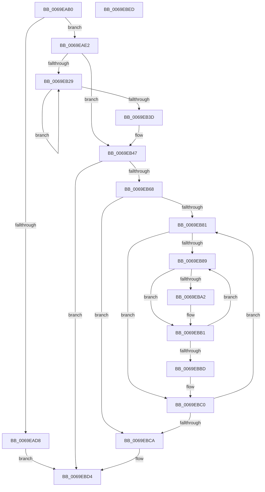

# BgpClearScreen

- RVA: `0x0069EAB0`–`0x0069EBEE` (길이 `318` bytes)
- VA: `0x000000014069EAB0`
- 실행 섹션: `.text`
- PDB 이름 있음: `예`; PDB Function 태그: `아니요`
- unwind 정보 RVA: `0x000DA3F0`
- 디코드: `91`개 명령, `318/318` bytes 표시
- 미해석 바이트: `0` (있으면 어셈블리에 `.byte`로 보존)

> 이 문서는 커널 이미지의 기계어와 PDB 기호를 분석해 생성했습니다. 4번과 5번은 함수 원형과 자료형을 바이너리 사용 방식에서 추정한 C 해석이며 원본 소스 복구 결과는 아닙니다.

## 1. Dependencies

- 직접 호출 지점: **6**; 고유 호출 대상: **4**
- 직접 호출자로 확인된 함수: **7**
- RIP 상대 이미지 참조: **7**

### Outgoing calls
- `0x0069EAF6` → [BgpGetBitsPerPixel](../48/BgpGetBitsPerPixel_function_0048CDA0.md) (function, `0x0048CDA0`)
- `0x0069EB47` → [BgpGetBitsPerPixel](../48/BgpGetBitsPerPixel_function_0048CDA0.md) (function, `0x0048CDA0`)
- `0x0069EB5F` → [BgpGxInitializeRectangle](BgpGxInitializeRectangle_function_0069F1E4.md) (function, `0x0069F1E4`)
- `0x0069EB72` → [BgpGxFillRectangle](../47/BgpGxFillRectangle_function_0047F808.md) (function, `0x0047F808`)
- `0x0069EB94` → [BgpGxDrawRectangle](../48/BgpGxDrawRectangle_function_0048C91C.md) (function, `0x0048C91C`)
- `0x0069EBAC` → [BgpGxFillRectangle](../47/BgpGxFillRectangle_function_0047F808.md) (function, `0x0047F808`)

### Direct callers
- [BgpDisplaySafeToPowerOffScreen](../6A/BgpDisplaySafeToPowerOffScreen_function_006A0D74.md) at `0x006A0DD1`
- [BgpFwDisplayBugCheckScreen](../6A/BgpFwDisplayBugCheckScreen_function_006A0FE8.md) at `0x006A10A4`
- [BgpFwDisplayBugCheckScreen](../6A/BgpFwDisplayBugCheckScreen_function_006A0FE8.md) at `0x006A1301`
- [BgpFwDisplayBugCheckScreenModernized](../6A/BgpFwDisplayBugCheckScreenModernized_function_006A1338.md) at `0x006A1454`
- [BgpFwDisplayBugCheckScreenModernized](../6A/BgpFwDisplayBugCheckScreenModernized_function_006A1338.md) at `0x006A1801`
- [BgpConsoleClearScreenEx](../../pagebgfx/BC/BgpConsoleClearScreenEx_function_00BC0A28.md) at `0x00BC0A40`
- [AnFwDisplayBackgroundUpdate](../../pagebgfx/BC/AnFwDisplayBackgroundUpdate_function_00BC1E44.md) at `0x00BC1F0E`
- [AnFwDisplayBackgroundUpdate](../../pagebgfx/BC/AnFwDisplayBackgroundUpdate_function_00BC1E44.md) at `0x00BC1F9E`
- [AnFwpBackgroundUpdateTimer](../../pagebgfx/BC/AnFwpBackgroundUpdateTimer_function_00BC21B0.md) at `0x00BC223C`
- [AnFwpBackgroundUpdateTimer](../../pagebgfx/BC/AnFwpBackgroundUpdateTimer_function_00BC21B0.md) at `0x00BC225E`
- [AnFwDisplayFade](../../pagebgfx/BC/AnFwDisplayFade_function_00BC36EC.md) at `0x00BC3C8C`

### Static image references
- `0x0069EACB` → RVA `0x00EF0450` (`.data`; read)
- `0x0069EAE2` → RVA `0x00EF03E8` (`.data`; read)
- `0x0069EAE8` → RVA `0x00EF03E4` (`.data`; read)
- `0x0069EAEF` → RVA `0x00EF03EC` (`.data`; read)
- `0x0069EB58` → RVA `0x00E62750` (`.data`; read)
- `0x0069EB99` → RVA `0x00E62760` (`.data`; read)
- `0x0069EBCA` → RVA `0x00EF0450` (`.data`; read/write)

## 2. Other-region calls and transfers

- 다른 실행 섹션으로 향하는 call: **0**
- 별도 외부 분기/꼬리 이동을 확인하지 못했습니다.

## 3. Assembly (complete function range)

```asm
0069EAB0  48 89 5C 24 08                  mov qword ptr [rsp + 8], rbx
0069EAB5  48 89 74 24 18                  mov qword ptr [rsp + 0x18], rsi
0069EABA  48 89 7C 24 20                  mov qword ptr [rsp + 0x20], rdi
0069EABF  55                              push rbp
0069EAC0  41 56                           push r14
0069EAC2  41 57                           push r15
0069EAC4  48 8B EC                        mov rbp, rsp
0069EAC7  48 83 EC 30                     sub rsp, 0x30
0069EACB  8B 05 7F 19 85 00               mov eax, dword ptr [rip + 0x85197f]
0069EAD1  44 8B F9                        mov r15d, ecx
0069EAD4  A8 01                           test al, 1
0069EAD6  75 0A                           jne 0x14069eae2
0069EAD8  B8 01 00 00 C0                  mov eax, 0xc0000001
0069EADD  E9 F2 00 00 00                  jmp 0x14069ebd4
0069EAE2  8B 35 00 19 85 00               mov esi, dword ptr [rip + 0x851900]
0069EAE8  44 8B 35 F5 18 85 00            mov r14d, dword ptr [rip + 0x8518f5]
0069EAEF  44 8B 05 F6 18 85 00            mov r8d, dword ptr [rip + 0x8518f6]
0069EAF6  E8 A5 E2 DE FF                  call 0x14048cda0
0069EAFB  44 8B C8                        mov r9d, eax
0069EAFE  89 75 F0                        mov dword ptr [rbp - 0x10], esi
0069EB01  41 C1 E9 03                     shr r9d, 3
0069EB05  B9 B8 1F 00 00                  mov ecx, 0x1fb8
0069EB0A  8B C6                           mov eax, esi
0069EB0C  44 89 45 F8                     mov dword ptr [rbp - 8], r8d
0069EB10  41 0F AF C6                     imul eax, r14d
0069EB14  41 8B DE                        mov ebx, r14d
0069EB17  8B FE                           mov edi, esi
0069EB19  89 5D F4                        mov dword ptr [rbp - 0xc], ebx
0069EB1C  41 0F AF C1                     imul eax, r9d
0069EB20  3B C1                           cmp eax, ecx
0069EB22  0F 42 C8                        cmovb ecx, eax
0069EB25  3B C1                           cmp eax, ecx
0069EB27  76 1E                           jbe 0x14069eb47
0069EB29  D1 EF                           shr edi, 1
0069EB2B  D1 EB                           shr ebx, 1
0069EB2D  8B C7                           mov eax, edi
0069EB2F  0F AF C3                        imul eax, ebx
0069EB32  41 D1 E8                        shr r8d, 1
0069EB35  41 0F AF C1                     imul eax, r9d
0069EB39  3B C1                           cmp eax, ecx
0069EB3B  77 EC                           ja 0x14069eb29
0069EB3D  89 5D F4                        mov dword ptr [rbp - 0xc], ebx
0069EB40  89 7D F0                        mov dword ptr [rbp - 0x10], edi
0069EB43  44 89 45 F8                     mov dword ptr [rbp - 8], r8d
0069EB47  E8 54 E2 DE FF                  call 0x14048cda0
0069EB4C  8B D0                           mov edx, eax
0069EB4E  48 8D 4D F0                     lea rcx, [rbp - 0x10]
0069EB52  41 B9 00 20 00 00               mov r9d, 0x2000
0069EB58  4C 8D 05 F1 3B 7C 00            lea r8, [rip + 0x7c3bf1]
0069EB5F  E8 80 06 00 00                  call 0x14069f1e4
0069EB64  85 C0                           test eax, eax
0069EB66  78 6C                           js 0x14069ebd4
0069EB68  41 8B D7                        mov edx, r15d
0069EB6B  48 8D 0D DE 3B 7C 00            lea rcx, [rip + 0x7c3bde]
0069EB72  E8 91 0C DE FF                  call 0x14047f808
0069EB77  33 C9                           xor ecx, ecx
0069EB79  89 4D 2C                        mov dword ptr [rbp + 0x2c], ecx
0069EB7C  45 85 F6                        test r14d, r14d
0069EB7F  74 49                           je 0x14069ebca
0069EB81  83 65 28 00                     and dword ptr [rbp + 0x28], 0
0069EB85  85 F6                           test esi, esi
0069EB87  74 37                           je 0x14069ebc0
0069EB89  48 8D 55 28                     lea rdx, [rbp + 0x28]
0069EB8D  48 8D 0D BC 3B 7C 00            lea rcx, [rip + 0x7c3bbc]
0069EB94  E8 83 DD DE FF                  call 0x14048c91c
0069EB99  F6 05 C0 3B 7C 00 10            test byte ptr [rip + 0x7c3bc0], 0x10
0069EBA0  74 0F                           je 0x14069ebb1
0069EBA2  41 8B D7                        mov edx, r15d
0069EBA5  48 8D 0D A4 3B 7C 00            lea rcx, [rip + 0x7c3ba4]
0069EBAC  E8 57 0C DE FF                  call 0x14047f808
0069EBB1  8B 45 28                        mov eax, dword ptr [rbp + 0x28]
0069EBB4  03 C7                           add eax, edi
0069EBB6  89 45 28                        mov dword ptr [rbp + 0x28], eax
0069EBB9  3B C6                           cmp eax, esi
0069EBBB  72 CC                           jb 0x14069eb89
0069EBBD  8B 4D 2C                        mov ecx, dword ptr [rbp + 0x2c]
0069EBC0  03 CB                           add ecx, ebx
0069EBC2  89 4D 2C                        mov dword ptr [rbp + 0x2c], ecx
0069EBC5  41 3B CE                        cmp ecx, r14d
0069EBC8  72 B7                           jb 0x14069eb81
0069EBCA  0F BA 2D 7E 18 85 00 0D         bts dword ptr [rip + 0x85187e], 0xd
0069EBD2  33 C0                           xor eax, eax
0069EBD4  48 8B 5C 24 50                  mov rbx, qword ptr [rsp + 0x50]
0069EBD9  48 8B 74 24 60                  mov rsi, qword ptr [rsp + 0x60]
0069EBDE  48 8B 7C 24 68                  mov rdi, qword ptr [rsp + 0x68]
0069EBE3  48 83 C4 30                     add rsp, 0x30
0069EBE7  41 5F                           pop r15
0069EBE9  41 5E                           pop r14
0069EBEB  5D                              pop rbp
0069EBEC  C3                              ret
0069EBED  CC                              int3
```

## 4. C-style interpretation (structured pseudocode)

```c
__int64 __fastcall BgpClearScreen(int a1)
{
    __int64 result;
    __int64 v_rbx;
    __int64 v_rdi;
    __int64 v_rsp;
    unsigned int v_stack_m20;
    unsigned int v_stack_m24;
    unsigned int v_stack_m28;
    unsigned int v_stack_p10;
    unsigned int v_stack_p14;
    unsigned __int64 v_stack_p18;
    unsigned __int64 v_stack_p20;
    unsigned __int64 v_stack_p8;

    v_stack_p8 = v_rbx;
    v_stack_p18 = v_rsi;
    v_stack_p20 = v_rdi;
    v_rsp = (v_rsp) - (48);
    if ((((unsigned __int8)((unsigned int)(*(unsigned int *)(v_rip + 8722815)))) & (1)) != 0) goto loc_0069EAE2;
    goto loc_0069EBD4;
loc_0069EAE2:
    result = BgpGetBitsPerPixel(a1, a2, (unsigned int)(*(unsigned int *)(v_rip + 8722678)), a4);
    v_stack_m28 = (unsigned int)((unsigned int)(*(unsigned int *)(v_rip + 8722688)));
    a4 = (unsigned int)(((unsigned int)((unsigned int)(result))) >> (3));
    v_stack_m20 = (unsigned int)((unsigned int)(*(unsigned int *)(v_rip + 8722678)));
    result = (unsigned int)(((unsigned int)((unsigned int)((unsigned int)(*(unsigned int *)(v_rip + 8722688))))) * ((unsigned int)((unsigned int)(*(unsigned int *)(v_rip + 8722677)))));
    v_stack_m24 = (unsigned int)((unsigned int)((unsigned int)((unsigned int)(*(unsigned int *)(v_rip + 8722677)))));
    result = (unsigned int)((result) * ((unsigned int)(a4)));
    a1 = (unsigned int)(0x1FB8ULL);
    if (((unsigned int)(result)) < ((unsigned int)((unsigned int)(0x1FB8ULL)))) { a1 = (unsigned int)(result); }
    if (((unsigned int)(result)) <= a1) goto loc_0069EB47;
loc_0069EB29:
    v_rdi = (unsigned int)(((unsigned int)((unsigned int)((unsigned int)(*(unsigned int *)(v_rip + 8722688))))) >> (1));
    v_rbx = (unsigned int)(((unsigned int)((unsigned int)((unsigned int)(*(unsigned int *)(v_rip + 8722677))))) >> (1));
    result = (unsigned int)(((unsigned int)((unsigned int)(v_rdi))) * ((unsigned int)(v_rbx)));
    a3 = (unsigned int)(((unsigned int)(*(unsigned int *)(v_rip + 8722678))) >> (1));
    result = (unsigned int)((result) * ((unsigned int)(a4)));
    if (((unsigned int)(result)) > a1) goto loc_0069EB29;
    v_stack_m24 = (unsigned int)(v_rbx);
    v_stack_m28 = (unsigned int)(v_rdi);
    v_stack_m20 = (unsigned int)(a3);
loc_0069EB47:
    result = BgpGetBitsPerPixel(a1, a2, a3, a4);
    result = BgpGxInitializeRectangle(v_stack_m28, (unsigned int)((unsigned int)(result)), v_rip + 8141809, (unsigned int)(0x2000ULL));
    if (sign_flag) goto loc_0069EBD4;
    result = BgpGxFillRectangle(v_rip + 8141790, (unsigned int)((unsigned int)((unsigned int)(a1))), v_rip + 8141809, (unsigned int)(0x2000ULL));
    a1 = 0;
    v_stack_p14 = 0;
    if ((unsigned int)((unsigned int)(*(unsigned int *)(v_rip + 8722677))) == 0) goto loc_0069EBCA;
loc_0069EB81:
    if ((unsigned int)((unsigned int)(*(unsigned int *)(v_rip + 8722688))) == 0) goto loc_0069EBC0;
loc_0069EB89:
    result = BgpGxDrawRectangle(v_rip + 8141756, v_stack_p10, v_rip + 8141809, (unsigned int)(0x2000ULL));
    if (((*(unsigned __int8 *)(v_rip + 8141760)) & (16)) != 0) {
        a2 = (unsigned int)((unsigned int)(a1));
        a1 = v_rip + 8141732;
        result = BgpGxFillRectangle(a1, a2, v_rip + 8141809, (unsigned int)(0x2000ULL));
    }
    result = (unsigned int)(((unsigned int)(v_stack_p10)) + ((unsigned int)(v_rdi)));
    v_stack_p10 = (unsigned int)(result);
    if (((unsigned int)(result)) < ((unsigned int)((unsigned int)(*(unsigned int *)(v_rip + 8722688))))) goto loc_0069EB89;
loc_0069EBC0:
    a1 = (unsigned int)(((unsigned int)(v_stack_p14)) + ((unsigned int)(v_rbx)));
    v_stack_p14 = a1;
    if (a1 < ((unsigned int)((unsigned int)(*(unsigned int *)(v_rip + 8722677))))) goto loc_0069EB81;
loc_0069EBCA:
    result = 0;
loc_0069EBD4:
    v_rsp = (v_rsp) + (48);
    return result;
}
```

## 5. (Beta) C Style

```c
int64_t BgpClearScreen(int32_t Arg1)
{
    int64_t result;
    int64_t local_rbx;
    int64_t local_rdi;
    int64_t local_rsp;
    uint32_t v_stack_m20;
    uint32_t v_stack_m24;
    uint32_t v_stack_m28;
    uint32_t v_stack_p10;
    uint32_t v_stack_p14;
    uint64_t v_stack_p18;
    uint64_t v_stack_p20;
    uint64_t v_stack_p8;

    v_stack_p8 = local_rbx;
    v_stack_p18 = local_rsi;
    v_stack_p20 = local_rdi;
    local_rsp = (local_rsp) - (48);
    if ((((uint8_t)((uint32_t)(*(uint32_t *)(v_rip + 0x85197F)))) & (1)) != 0) goto loc_0069EAE2;
    goto loc_0069EBD4;
loc_0069EAE2:
    result = BgpGetBitsPerPixel(Arg1, a2, (uint32_t)(*(uint32_t *)(v_rip + 0x8518F6)), a4);
    v_stack_m28 = (uint32_t)((uint32_t)(*(uint32_t *)(v_rip + 0x851900)));
    a4 = (uint32_t)(((uint32_t)((uint32_t)(result))) >> (3));
    v_stack_m20 = (uint32_t)((uint32_t)(*(uint32_t *)(v_rip + 0x8518F6)));
    result = (uint32_t)(((uint32_t)((uint32_t)((uint32_t)(*(uint32_t *)(v_rip + 0x851900))))) * ((uint32_t)((uint32_t)(*(uint32_t *)(v_rip + 0x8518F5)))));
    v_stack_m24 = (uint32_t)((uint32_t)((uint32_t)((uint32_t)(*(uint32_t *)(v_rip + 0x8518F5)))));
    result = (uint32_t)((result) * ((uint32_t)(a4)));
    Arg1 = (uint32_t)(0x1FB8ULL);
    if (((uint32_t)(result)) < ((uint32_t)((uint32_t)(0x1FB8ULL)))) { Arg1 = (uint32_t)(result); }
    if (((uint32_t)(result)) <= Arg1) goto loc_0069EB47;
loc_0069EB29:
    local_rdi = (uint32_t)(((uint32_t)((uint32_t)((uint32_t)(*(uint32_t *)(v_rip + 0x851900))))) >> (1));
    local_rbx = (uint32_t)(((uint32_t)((uint32_t)((uint32_t)(*(uint32_t *)(v_rip + 0x8518F5))))) >> (1));
    result = (uint32_t)(((uint32_t)((uint32_t)(local_rdi))) * ((uint32_t)(local_rbx)));
    a3 = (uint32_t)(((uint32_t)(*(uint32_t *)(v_rip + 0x8518F6))) >> (1));
    result = (uint32_t)((result) * ((uint32_t)(a4)));
    if (((uint32_t)(result)) > Arg1) goto loc_0069EB29;
    v_stack_m24 = (uint32_t)(local_rbx);
    v_stack_m28 = (uint32_t)(local_rdi);
    v_stack_m20 = (uint32_t)(a3);
loc_0069EB47:
    result = BgpGetBitsPerPixel(Arg1, a2, a3, a4);
    result = BgpGxInitializeRectangle(v_stack_m28, (uint32_t)((uint32_t)(result)), v_rip + 8141809, (uint32_t)(0x2000ULL));
    if (sign_flag) goto loc_0069EBD4;
    result = BgpGxFillRectangle(v_rip + 8141790, (uint32_t)((uint32_t)((uint32_t)(Arg1))), v_rip + 8141809, (uint32_t)(0x2000ULL));
    Arg1 = 0;
    v_stack_p14 = 0;
    if ((uint32_t)((uint32_t)(*(uint32_t *)(v_rip + 0x8518F5))) == 0) goto loc_0069EBCA;
loc_0069EB81:
    if ((uint32_t)((uint32_t)(*(uint32_t *)(v_rip + 0x851900))) == 0) goto loc_0069EBC0;
loc_0069EB89:
    result = BgpGxDrawRectangle(v_rip + 8141756, v_stack_p10, v_rip + 8141809, (uint32_t)(0x2000ULL));
    if (((*(uint8_t *)(v_rip + 0x7C3BC0)) & (16)) != 0) {
        a2 = (uint32_t)((uint32_t)(Arg1));
        Arg1 = v_rip + 8141732;
        result = BgpGxFillRectangle(Arg1, a2, v_rip + 8141809, (uint32_t)(0x2000ULL));
    }
    result = (uint32_t)(((uint32_t)(v_stack_p10)) + ((uint32_t)(local_rdi)));
    v_stack_p10 = (uint32_t)(result);
    if (((uint32_t)(result)) < ((uint32_t)((uint32_t)(*(uint32_t *)(v_rip + 0x851900))))) goto loc_0069EB89;
loc_0069EBC0:
    Arg1 = (uint32_t)(((uint32_t)(v_stack_p14)) + ((uint32_t)(local_rbx)));
    v_stack_p14 = Arg1;
    if (Arg1 < ((uint32_t)((uint32_t)(*(uint32_t *)(v_rip + 0x8518F5))))) goto loc_0069EB81;
loc_0069EBCA:
    result = 0;
loc_0069EBD4:
    local_rsp = (local_rsp) + (48);
    return result;
}
```

## 6. Execution-region graph

[열기: 2D/3D 그래프와 함수 탐색 컨트롤 패널](../../../control-panel.html?section=text&rva=0x0069EAB0&view=graph)

- 2D 그래프는 위에서 아래로 흐르고, 3D 그래프는 빈 공간을 드래그해 회전합니다. Shift+드래그는 이동, 휠은 확대·축소, 함수 노드 선택은 대상 보고서 이동입니다.

### Static fallback


