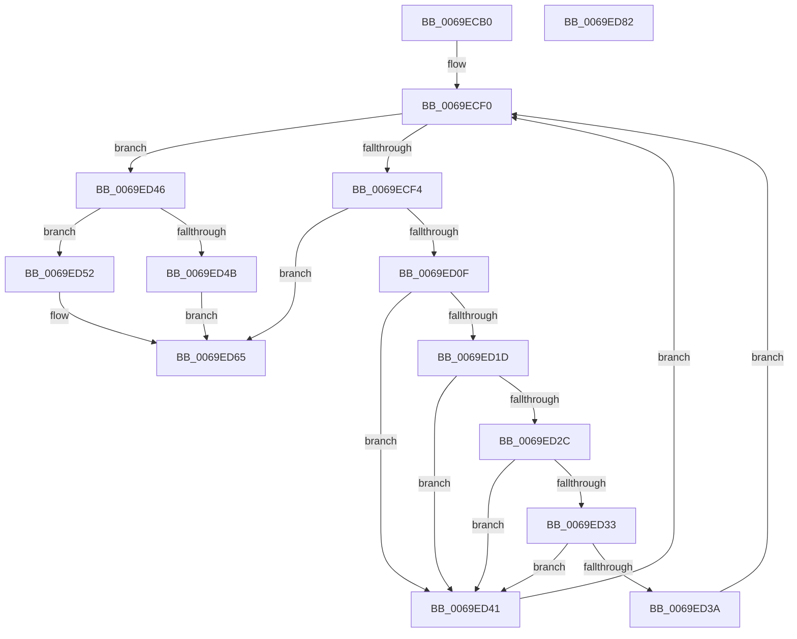

# BgpConsoleSetPointSize

- RVA: `0x0069ECB0`–`0x0069ED83` (길이 `211` bytes)
- VA: `0x000000014069ECB0`
- 실행 섹션: `.text`
- PDB 이름 있음: `예`; PDB Function 태그: `아니요`
- unwind 정보 RVA: `0x000C5200`
- 디코드: `68`개 명령, `211/211` bytes 표시
- 미해석 바이트: `0` (있으면 어셈블리에 `.byte`로 보존)

> 이 문서는 커널 이미지의 기계어와 PDB 기호를 분석해 생성했습니다. 4번과 5번은 함수 원형과 자료형을 바이너리 사용 방식에서 추정한 C 해석이며 원본 소스 복구 결과는 아닙니다.

## 1. Dependencies

- 직접 호출 지점: **2**; 고유 호출 대상: **1**
- 직접 호출자로 확인된 함수: **1**
- RIP 상대 이미지 참조: **0**

### Outgoing calls
- `0x0069ED06` → [BgpFoGetTextMetrics](../4E/BgpFoGetTextMetrics_function_004E3FC4.md) (function, `0x004E3FC4`)
- `0x0069ED60` → [BgpFoGetTextMetrics](../4E/BgpFoGetTextMetrics_function_004E3FC4.md) (function, `0x004E3FC4`)

### Direct callers
- [BgpConsoleInitialize](../../pagebgfx/BC/BgpConsoleInitialize_function_00BC10B0.md) at `0x00BC11DA`

### Static image references
- 디코드된 RIP-relative 메모리 참조가 없습니다.

## 2. Other-region calls and transfers

- 다른 실행 섹션으로 향하는 call: **0**
- 별도 외부 분기/꼬리 이동을 확인하지 못했습니다.

## 3. Assembly (complete function range)

```asm
0069ECB0  48 8B C4                        mov rax, rsp
0069ECB3  48 89 58 08                     mov qword ptr [rax + 8], rbx
0069ECB7  48 89 68 18                     mov qword ptr [rax + 0x18], rbp
0069ECBB  48 89 70 20                     mov qword ptr [rax + 0x20], rsi
0069ECBF  89 50 10                        mov dword ptr [rax + 0x10], edx
0069ECC2  57                              push rdi
0069ECC3  41 54                           push r12
0069ECC5  41 55                           push r13
0069ECC7  41 56                           push r14
0069ECC9  41 57                           push r15
0069ECCB  48 83 EC 30                     sub rsp, 0x30
0069ECCF  48 83 60 C8 00                  and qword ptr [rax - 0x38], 0
0069ECD4  BB 05 00 00 00                  mov ebx, 5
0069ECD9  48 8B B4 24 80 00 00 00         mov rsi, qword ptr [rsp + 0x80]
0069ECE1  45 8B E9                        mov r13d, r9d
0069ECE4  45 8B F8                        mov r15d, r8d
0069ECE7  44 8B E1                        mov r12d, ecx
0069ECEA  45 32 F6                        xor r14b, r14b
0069ECED  8D 6B 1B                        lea ebp, [rbx + 0x1b]
0069ECF0  3B DD                           cmp ebx, ebp
0069ECF2  74 52                           je 0x14069ed46
0069ECF4  8D 7B 01                        lea edi, [rbx + 1]
0069ECF7  48 8B CE                        mov rcx, rsi
0069ECFA  03 FD                           add edi, ebp
0069ECFC  48 8D 54 24 20                  lea rdx, [rsp + 0x20]
0069ED01  D1 EF                           shr edi, 1
0069ED03  89 7E 10                        mov dword ptr [rsi + 0x10], edi
0069ED06  E8 B9 52 E4 FF                  call 0x1404e3fc4
0069ED0B  85 C0                           test eax, eax
0069ED0D  78 56                           js 0x14069ed65
0069ED0F  33 D2                           xor edx, edx
0069ED11  41 8B C7                        mov eax, r15d
0069ED14  F7 74 24 24                     div dword ptr [rsp + 0x24]
0069ED18  44 3B E0                        cmp r12d, eax
0069ED1B  77 24                           ja 0x14069ed41
0069ED1D  33 D2                           xor edx, edx
0069ED1F  41 8B C5                        mov eax, r13d
0069ED22  F7 74 24 20                     div dword ptr [rsp + 0x20]
0069ED26  39 44 24 68                     cmp dword ptr [rsp + 0x68], eax
0069ED2A  77 15                           ja 0x14069ed41
0069ED2C  83 7C 24 24 3B                  cmp dword ptr [rsp + 0x24], 0x3b
0069ED31  77 0E                           ja 0x14069ed41
0069ED33  83 7C 24 20 1A                  cmp dword ptr [rsp + 0x20], 0x1a
0069ED38  77 07                           ja 0x14069ed41
0069ED3A  41 B6 01                        mov r14b, 1
0069ED3D  8B DF                           mov ebx, edi
0069ED3F  EB AF                           jmp 0x14069ecf0
0069ED41  8D 6F FF                        lea ebp, [rdi - 1]
0069ED44  EB AA                           jmp 0x14069ecf0
0069ED46  45 84 F6                        test r14b, r14b
0069ED49  75 07                           jne 0x14069ed52
0069ED4B  B8 01 00 00 C0                  mov eax, 0xc0000001
0069ED50  EB 13                           jmp 0x14069ed65
0069ED52  48 8B 94 24 88 00 00 00         mov rdx, qword ptr [rsp + 0x88]
0069ED5A  48 8B CE                        mov rcx, rsi
0069ED5D  89 5E 10                        mov dword ptr [rsi + 0x10], ebx
0069ED60  E8 5F 52 E4 FF                  call 0x1404e3fc4
0069ED65  48 8B 5C 24 60                  mov rbx, qword ptr [rsp + 0x60]
0069ED6A  48 8B 6C 24 70                  mov rbp, qword ptr [rsp + 0x70]
0069ED6F  48 8B 74 24 78                  mov rsi, qword ptr [rsp + 0x78]
0069ED74  48 83 C4 30                     add rsp, 0x30
0069ED78  41 5F                           pop r15
0069ED7A  41 5E                           pop r14
0069ED7C  41 5D                           pop r13
0069ED7E  41 5C                           pop r12
0069ED80  5F                              pop rdi
0069ED81  C3                              ret
0069ED82  CC                              int3
```

## 4. C-style interpretation (structured pseudocode)

```c
__int64 __fastcall BgpConsoleSetPointSize(int a1, int a2, int a3, int a4, __int64 a5, __int64 a6)
{
    __int64 result;
    __int64 v_r14;
    __int64 v_rdi;
    __int64 v_rsp;
    unsigned int v_stack_m34;
    unsigned __int64 v_stack_m38;
    unsigned int v_stack_p10;
    unsigned __int64 v_stack_p18;
    unsigned __int64 v_stack_p20;
    unsigned __int64 v_stack_p8;

    *(unsigned __int64 *)(v_rsp + 8) = v_rbx;
    *(unsigned __int64 *)(v_rsp + 24) = v_rbp;
    *(unsigned __int64 *)(v_rsp + 32) = v_rsi;
    *(unsigned int *)(v_rsp + 16) = a2;
    v_rsp = (v_rsp) - (48);
    v_r14 = 0;
loc_0069ECF0:
    if (5 == ((unsigned int)(5 + 27))) goto loc_0069ED46;
    v_rdi = (unsigned int)((5 + 1) + ((unsigned int)(5 + 27)));
    v_rdi = (unsigned int)((v_rdi) >> (1));
    *(unsigned int *)(a5 + 16) = (unsigned int)(v_rdi);
    result = BgpFoGetTextMetrics(a5, v_stack_m38, a3, a4);
    if (sign_flag) goto loc_0069ED65;
    a2 = 0;
    if (((unsigned int)((unsigned int)(a1))) > ((unsigned int)((unsigned int)((unsigned int)((unsigned int)(a3)))))) goto loc_0069ED41;
    a2 = 0;
    if (v_stack_p10 > ((unsigned int)((unsigned int)((unsigned int)((unsigned int)(a4)))))) goto loc_0069ED41;
    if (v_stack_m34 > 59) goto loc_0069ED41;
    if (v_stack_m38 > 26) goto loc_0069ED41;
    goto loc_0069ECF0;
loc_0069ED41:
    goto loc_0069ECF0;
loc_0069ED46:
    if (1 != 0) goto loc_0069ED52;
    goto loc_0069ED65;
loc_0069ED52:
    *(unsigned int *)(a5 + 16) = (unsigned int)((unsigned int)((unsigned int)(v_rdi)));
    result = BgpFoGetTextMetrics(a5, a6, a3, a4);
loc_0069ED65:
    v_rsp = (v_rsp) + (48);
    return result;
}
```

## 5. (Beta) C Style

```c
int64_t BgpConsoleSetPointSize(int32_t Arg1, int32_t Arg2, int32_t Arg3, int32_t Arg4, void *Arg5, int64_t Arg6)
{
    uint8_t *arg5 = (uint8_t *)Arg5;

    int64_t result;
    int64_t local_r14;
    int64_t local_rdi;
    int64_t local_rsp;
    uint32_t v_stack_m34;
    uint64_t v_stack_m38;
    uint32_t v_stack_p10;
    uint64_t v_stack_p18;
    uint64_t v_stack_p20;
    uint64_t v_stack_p8;

    *(uint64_t *)(local_rsp + 0x8) = local_rbx;
    *(uint64_t *)(local_rsp + 0x18) = local_rbp;
    *(uint64_t *)(local_rsp + 0x20) = local_rsi;
    *(uint32_t *)(local_rsp + 0x10) = Arg2;
    local_rsp = (local_rsp) - (48);
    local_r14 = 0;
loc_0069ECF0:
    if (5 == ((uint32_t)(5 + 27))) goto loc_0069ED46;
    local_rdi = (uint32_t)((5 + 1) + ((uint32_t)(5 + 27)));
    local_rdi = (uint32_t)((local_rdi) >> (1));
    *(uint32_t *)(arg5 + 0x10) = (uint32_t)(local_rdi);
    result = BgpFoGetTextMetrics(Arg5, v_stack_m38, Arg3, Arg4);
    if (sign_flag) goto loc_0069ED65;
    Arg2 = 0;
    if (((uint32_t)((uint32_t)(Arg1))) > ((uint32_t)((uint32_t)((uint32_t)((uint32_t)(Arg3)))))) goto loc_0069ED41;
    Arg2 = 0;
    if (v_stack_p10 > ((uint32_t)((uint32_t)((uint32_t)((uint32_t)(Arg4)))))) goto loc_0069ED41;
    if (v_stack_m34 > 59) goto loc_0069ED41;
    if (v_stack_m38 > 26) goto loc_0069ED41;
    goto loc_0069ECF0;
loc_0069ED41:
    goto loc_0069ECF0;
loc_0069ED46:
    if (1 != 0) goto loc_0069ED52;
    goto loc_0069ED65;
loc_0069ED52:
    *(uint32_t *)(arg5 + 0x10) = (uint32_t)((uint32_t)((uint32_t)(local_rdi)));
    result = BgpFoGetTextMetrics(Arg5, Arg6, Arg3, Arg4);
loc_0069ED65:
    local_rsp = (local_rsp) + (48);
    return result;
}
```

### 관측된 메모리 오프셋

구조체 형식이 확인되지 않은 접근은 인자 기준의 오프셋으로만 기록했습니다.

| 기준 인자 | 오프셋 표현 | 폭 (bit) | 접근 |
|---|---:|---:|---|
| `Arg5` | `+ 0x10` | `32` | `W` |

## 6. Execution-region graph

[열기: 2D/3D 그래프와 함수 탐색 컨트롤 패널](../../../control-panel.html?section=text&rva=0x0069ECB0&view=graph)

- 2D 그래프는 위에서 아래로 흐르고, 3D 그래프는 빈 공간을 드래그해 회전합니다. Shift+드래그는 이동, 휠은 확대·축소, 함수 노드 선택은 대상 보고서 이동입니다.

### Static fallback


