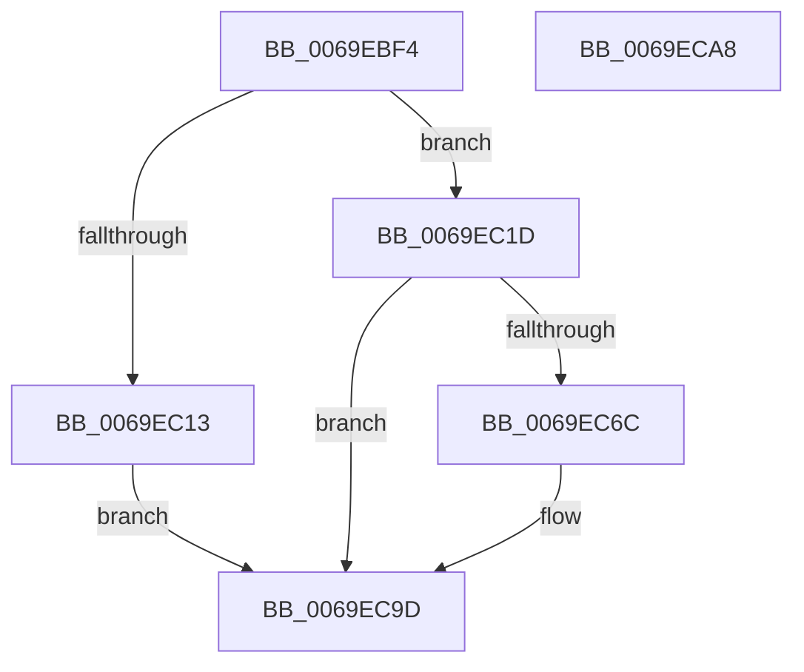

# BgpDisplayCharacterEx

- RVA: `0x0069EBF4`–`0x0069ECA9` (길이 `181` bytes)
- VA: `0x000000014069EBF4`
- 실행 섹션: `.text`
- PDB 이름 있음: `예`; PDB Function 태그: `아니요`
- unwind 정보 RVA: `0x0007D148`
- 디코드: `41`개 명령, `181/181` bytes 표시
- 미해석 바이트: `0` (있으면 어셈블리에 `.byte`로 보존)

> 이 문서는 커널 이미지의 기계어와 PDB 기호를 분석해 생성했습니다. 4번과 5번은 함수 원형과 자료형을 바이너리 사용 방식에서 추정한 C 해석이며 원본 소스 복구 결과는 아닙니다.

## 1. Dependencies

- 직접 호출 지점: **2**; 고유 호출 대상: **2**
- 직접 호출자로 확인된 함수: **9**
- RIP 상대 이미지 참조: **1**

### Outgoing calls
- `0x0069EC63` → [BgpTxtAdjustStaticRegion](BgpTxtAdjustStaticRegion_function_0069F410.md) (function, `0x0069F410`)
- `0x0069EC98` → [BgpTxtDisplayCharacter](../47/BgpTxtDisplayCharacter_function_0047F120.md) (function, `0x0047F120`)

### Direct callers
- [BcpDisplayCriticalCharacter](BcpDisplayCriticalCharacter_function_0069F678.md) at `0x0069F70B`
- [BcpDisplayCriticalString](BcpDisplayCriticalString_function_0069F754.md) at `0x0069FA55`
- [BcpDisplayCriticalStringCentered](BcpDisplayCriticalStringCentered_function_0069FAB8.md) at `0x0069FE09`
- [BcpDisplayProgress](../6A/BcpDisplayProgress_function_006A047C.md) at `0x006A061A`
- [BcpPrintSpaces](../6A/BcpPrintSpaces_function_006A0BF0.md) at `0x006A0C5B`
- [BgpConsoleDisplayCharacter](../../pagebgfx/BC/BgpConsoleDisplayCharacter_function_00BC0AB0.md) at `0x00BC0B7C`
- [BgpConsoleDisplayCharacterEx](../../pagebgfx/BC/BgpConsoleDisplayCharacterEx_function_00BC0BC4.md) at `0x00BC0C7C`
- [BgpConsoleDisplayCharacterEx](../../pagebgfx/BC/BgpConsoleDisplayCharacterEx_function_00BC0BC4.md) at `0x00BC0D2A`
- [BgpConsoleDisplayCharacterEx](../../pagebgfx/BC/BgpConsoleDisplayCharacterEx_function_00BC0BC4.md) at `0x00BC0DD0`
- [BgpConsoleDrawCursor](../../pagebgfx/BC/BgpConsoleDrawCursor_function_00BC0F18.md) at `0x00BC0FBE`
- [BgpConsoleScrollScreen](../../pagebgfx/BC/BgpConsoleScrollScreen_function_00BC1314.md) at `0x00BC13FB`
- [BgpConsoleScrollScreen](../../pagebgfx/BC/BgpConsoleScrollScreen_function_00BC1314.md) at `0x00BC14AC`

### Static image references
- `0x0069EC06` → RVA `0x00EF0450` (`.data`; read)

## 2. Other-region calls and transfers

- 다른 실행 섹션으로 향하는 call: **0**
- 별도 외부 분기/꼬리 이동을 확인하지 못했습니다.

## 3. Assembly (complete function range)

```asm
0069EBF4  48 89 5C 24 08                  mov qword ptr [rsp + 8], rbx
0069EBF9  57                              push rdi
0069EBFA  48 83 EC 60                     sub rsp, 0x60
0069EBFE  83 64 24 54 00                  and dword ptr [rsp + 0x54], 0
0069EC03  48 8B DA                        mov rbx, rdx
0069EC06  8B 05 44 18 85 00               mov eax, dword ptr [rip + 0x851844]
0069EC0C  0F B7 F9                        movzx edi, cx
0069EC0F  A8 01                           test al, 1
0069EC11  75 0A                           jne 0x14069ec1d
0069EC13  B8 01 00 00 C0                  mov eax, 0xc0000001
0069EC18  E9 80 00 00 00                  jmp 0x14069ec9d
0069EC1D  8B 84 24 90 00 00 00            mov eax, dword ptr [rsp + 0x90]
0069EC24  48 8B 4B 18                     mov rcx, qword ptr [rbx + 0x18]
0069EC28  89 44 24 40                     mov dword ptr [rsp + 0x40], eax
0069EC2C  8B 84 24 98 00 00 00            mov eax, dword ptr [rsp + 0x98]
0069EC33  89 44 24 44                     mov dword ptr [rsp + 0x44], eax
0069EC37  8B 42 08                        mov eax, dword ptr [rdx + 8]
0069EC3A  89 44 24 50                     mov dword ptr [rsp + 0x50], eax
0069EC3E  48 8B 02                        mov rax, qword ptr [rdx]
0069EC41  48 8D 94 24 B0 00 00 00         lea rdx, [rsp + 0xb0]
0069EC49  44 89 84 24 B0 00 00 00         mov dword ptr [rsp + 0xb0], r8d
0069EC51  4C 8D 44 24 40                  lea r8, [rsp + 0x40]
0069EC56  48 89 44 24 48                  mov qword ptr [rsp + 0x48], rax
0069EC5B  44 89 8C 24 B4 00 00 00         mov dword ptr [rsp + 0xb4], r9d
0069EC63  E8 A8 07 00 00                  call 0x14069f410
0069EC68  85 C0                           test eax, eax
0069EC6A  78 31                           js 0x14069ec9d
0069EC6C  48 8B 84 24 B8 00 00 00         mov rax, qword ptr [rsp + 0xb8]
0069EC74  45 33 C0                        xor r8d, r8d
0069EC77  4C 8B 8C 24 A0 00 00 00         mov r9, qword ptr [rsp + 0xa0]
0069EC7F  0F B7 D7                        movzx edx, di
0069EC82  48 8B 4B 18                     mov rcx, qword ptr [rbx + 0x18]
0069EC86  48 89 44 24 30                  mov qword ptr [rsp + 0x30], rax
0069EC8B  48 8B 84 24 A8 00 00 00         mov rax, qword ptr [rsp + 0xa8]
0069EC93  48 89 44 24 20                  mov qword ptr [rsp + 0x20], rax
0069EC98  E8 83 04 DE FF                  call 0x14047f120
0069EC9D  48 8B 5C 24 70                  mov rbx, qword ptr [rsp + 0x70]
0069ECA2  48 83 C4 60                     add rsp, 0x60
0069ECA6  5F                              pop rdi
0069ECA7  C3                              ret
0069ECA8  CC                              int3
```

## 4. C-style interpretation (structured pseudocode)

```c
__int64 __fastcall BgpDisplayCharacterEx(unsigned __int16 a1, __int64 a2, int a3, int a4, unsigned int a5, unsigned int a6, __int64 a7, __int64 a8, __int64 a9, __int64 a10)
{
    __int64 result;
    __int64 v_rsp;
    unsigned int v_stack_m14;
    unsigned int v_stack_m18;
    unsigned __int64 v_stack_m20;
    unsigned int v_stack_m24;
    unsigned int v_stack_m28;
    unsigned __int64 v_stack_m38;
    unsigned __int64 v_stack_m48;
    unsigned int v_stack_p48;
    unsigned int v_stack_p4C;
    unsigned __int64 v_stack_p8;

    v_stack_p8 = v_rbx;
    v_rsp = (v_rsp) - (96);
    if ((((unsigned __int8)((unsigned int)(*(unsigned int *)(v_rip + 8722500)))) & (1)) != 0) goto loc_0069EC1D;
    goto loc_0069EC9D;
loc_0069EC1D:
    v_stack_m28 = (unsigned int)((unsigned int)(a5));
    v_stack_m24 = (unsigned int)((unsigned int)(a6));
    v_stack_m18 = (unsigned int)((unsigned int)(*(unsigned int *)(a2 + 8)));
    v_stack_p48 = a3;
    v_stack_m20 = *(unsigned __int64 *)(a2);
    v_stack_p4C = a4;
    result = BgpTxtAdjustStaticRegion(*(unsigned __int64 *)(a2 + 24), a9, v_stack_m28, a4);
    if (!(sign_flag)) {
        result = a10;
        a3 = 0;
        a4 = a7;
        a2 = a1;
        a1 = *(unsigned __int64 *)(a2 + 24);
        v_stack_m38 = result;
        result = a8;
        v_stack_m48 = result;
        result = BgpTxtDisplayCharacter(a1, a2, a3, a4);
    }
    v_rsp = (v_rsp) + (96);
    return result;
}
```

## 5. (Beta) C Style

```c
int64_t BgpDisplayCharacterEx(uint16_t Arg1, void *Arg2, int32_t Arg3, int32_t Arg4, uint32_t Arg5, uint32_t Arg6, int64_t Arg7, int64_t Arg8, int64_t Arg9, int64_t Arg10)
{
    uint8_t *arg2 = (uint8_t *)Arg2;

    int64_t result;
    int64_t local_rsp;
    uint32_t v_stack_m14;
    uint32_t v_stack_m18;
    uint64_t v_stack_m20;
    uint32_t v_stack_m24;
    uint32_t v_stack_m28;
    uint64_t v_stack_m38;
    uint64_t v_stack_m48;
    uint32_t v_stack_p48;
    uint32_t v_stack_p4C;
    uint64_t v_stack_p8;

    v_stack_p8 = local_rbx;
    local_rsp = (local_rsp) - (96);
    if ((((uint8_t)((uint32_t)(*(uint32_t *)(v_rip + 0x851844)))) & (1)) != 0) goto loc_0069EC1D;
    goto loc_0069EC9D;
loc_0069EC1D:
    v_stack_m28 = (uint32_t)((uint32_t)(Arg5));
    v_stack_m24 = (uint32_t)((uint32_t)(Arg6));
    v_stack_m18 = (uint32_t)((uint32_t)(*(uint32_t *)(arg2 + 0x8)));
    v_stack_p48 = Arg3;
    v_stack_m20 = *(uint64_t *)(arg2);
    v_stack_p4C = Arg4;
    result = BgpTxtAdjustStaticRegion(*(uint64_t *)(arg2 + 0x18), Arg9, v_stack_m28, Arg4);
    if (!(sign_flag)) {
        result = Arg10;
        Arg3 = 0;
        Arg4 = Arg7;
        Arg2 = Arg1;
        Arg1 = *(uint64_t *)(arg2 + 0x18);
        v_stack_m38 = result;
        result = Arg8;
        v_stack_m48 = result;
        result = BgpTxtDisplayCharacter(Arg1, Arg2, Arg3, Arg4);
    }
    local_rsp = (local_rsp) + (96);
    return result;
}
```

### 관측된 메모리 오프셋

구조체 형식이 확인되지 않은 접근은 인자 기준의 오프셋으로만 기록했습니다.

| 기준 인자 | 오프셋 표현 | 폭 (bit) | 접근 |
|---|---:|---:|---|
| `Arg2` | `+ 0x0` | `64` | `R` |
| `Arg2` | `+ 0x8` | `32` | `R` |
| `Arg2` | `+ 0x18` | `64` | `R` |

## 6. Execution-region graph

[열기: 2D/3D 그래프와 함수 탐색 컨트롤 패널](../../../control-panel.html?section=text&rva=0x0069EBF4&view=graph)

- 2D 그래프는 위에서 아래로 흐르고, 3D 그래프는 빈 공간을 드래그해 회전합니다. Shift+드래그는 이동, 휠은 확대·축소, 함수 노드 선택은 대상 보고서 이동입니다.

### Static fallback


