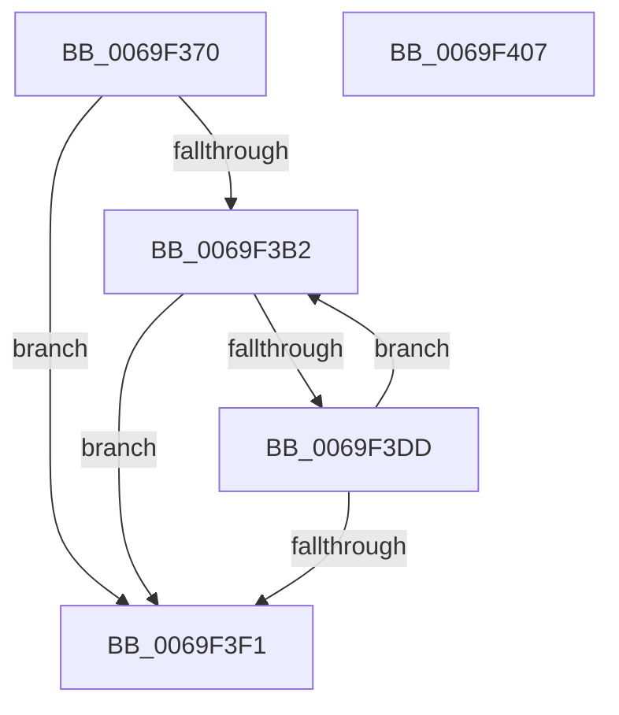

# BgpFoGetStringAdvanceWidth

- RVA: `0x0069F370`–`0x0069F408` (길이 `152` bytes)
- VA: `0x000000014069F370`
- 실행 섹션: `.text`
- PDB 이름 있음: `예`; PDB Function 태그: `아니요`
- unwind 정보 RVA: `0x000DA508`
- 디코드: `48`개 명령, `152/152` bytes 표시
- 미해석 바이트: `0` (있으면 어셈블리에 `.byte`로 보존)

> 이 문서는 커널 이미지의 기계어와 PDB 기호를 분석해 생성했습니다. 4번과 5번은 함수 원형과 자료형을 바이너리 사용 방식에서 추정한 C 해석이며 원본 소스 복구 결과는 아닙니다.

## 1. Dependencies

- 직접 호출 지점: **1**; 고유 호출 대상: **1**
- 직접 호출자로 확인된 함수: **3**
- RIP 상대 이미지 참조: **1**

### Outgoing calls
- `0x0069F3D1` → [BgpRasGetGlyphAdvanceWidth](../6A/BgpRasGetGlyphAdvanceWidth_function_006A1888.md) (function, `0x006A1888`)

### Direct callers
- [BcpDisplayCriticalString](BcpDisplayCriticalString_function_0069F754.md) at `0x0069F817`
- [BcpDisplayCriticalStringCentered](BcpDisplayCriticalStringCentered_function_0069FAB8.md) at `0x0069FBA2`
- [BgpFwDisplayBugCheckScreenModernized](../6A/BgpFwDisplayBugCheckScreenModernized_function_006A1338.md) at `0x006A15C4`
- [BgpFwDisplayBugCheckScreenModernized](../6A/BgpFwDisplayBugCheckScreenModernized_function_006A1338.md) at `0x006A15FE`

### Static image references
- `0x0069F3B6` → RVA `0x00EF0360` (`.data`; read)

## 2. Other-region calls and transfers

- 다른 실행 섹션으로 향하는 call: **0**
- 별도 외부 분기/꼬리 이동을 확인하지 못했습니다.

## 3. Assembly (complete function range)

```asm
0069F370  48 8B C4                        mov rax, rsp
0069F373  48 89 58 08                     mov qword ptr [rax + 8], rbx
0069F377  48 89 68 10                     mov qword ptr [rax + 0x10], rbp
0069F37B  4C 89 48 20                     mov qword ptr [rax + 0x20], r9
0069F37F  56                              push rsi
0069F380  57                              push rdi
0069F381  41 56                           push r14
0069F383  48 83 EC 30                     sub rsp, 0x30
0069F387  45 33 F6                        xor r14d, r14d
0069F38A  48 8B E9                        mov rbp, rcx
0069F38D  44 89 70 20                     mov dword ptr [rax + 0x20], r14d
0069F391  B9 FE FF 00 00                  mov ecx, 0xfffe
0069F396  0F B7 02                        movzx eax, word ptr [rdx]
0069F399  49 8B F8                        mov rdi, r8
0069F39C  66 23 C1                        and ax, cx
0069F39F  45 89 30                        mov dword ptr [r8], r14d
0069F3A2  48 8B F2                        mov rsi, rdx
0069F3A5  45 8B CE                        mov r9d, r14d
0069F3A8  41 0F B7 DE                     movzx ebx, r14w
0069F3AC  66 44 3B F0                     cmp r14w, ax
0069F3B0  73 3F                           jae 0x14069f3f1
0069F3B2  48 8B 56 08                     mov rdx, qword ptr [rsi + 8]
0069F3B6  48 8D 0D A3 0F 85 00            lea rcx, [rip + 0x850fa3]
0069F3BD  0F B7 C3                        movzx eax, bx
0069F3C0  4C 8D 44 24 68                  lea r8, [rsp + 0x68]
0069F3C5  48 89 4C 24 20                  mov qword ptr [rsp + 0x20], rcx
0069F3CA  48 8B CD                        mov rcx, rbp
0069F3CD  0F B7 14 42                     movzx edx, word ptr [rdx + rax*2]
0069F3D1  E8 B2 24 00 00                  call 0x1406a1888
0069F3D6  44 8B C8                        mov r9d, eax
0069F3D9  85 C0                           test eax, eax
0069F3DB  78 14                           js 0x14069f3f1
0069F3DD  8B 4C 24 68                     mov ecx, dword ptr [rsp + 0x68]
0069F3E1  66 FF C3                        inc bx
0069F3E4  01 0F                           add dword ptr [rdi], ecx
0069F3E6  0F B7 0E                        movzx ecx, word ptr [rsi]
0069F3E9  66 D1 E9                        shr cx, 1
0069F3EC  66 3B D9                        cmp bx, cx
0069F3EF  72 C1                           jb 0x14069f3b2
0069F3F1  48 8B 5C 24 50                  mov rbx, qword ptr [rsp + 0x50]
0069F3F6  41 8B C1                        mov eax, r9d
0069F3F9  48 8B 6C 24 58                  mov rbp, qword ptr [rsp + 0x58]
0069F3FE  48 83 C4 30                     add rsp, 0x30
0069F402  41 5E                           pop r14
0069F404  5F                              pop rdi
0069F405  5E                              pop rsi
0069F406  C3                              ret
0069F407  CC                              int3
```

## 4. C-style interpretation (structured pseudocode)

```c
__int64 __fastcall BgpFoGetStringAdvanceWidth(__int64 a1, __int64 a2, __int64 a3, __int64 a4)
{
    __int64 result;
    __int64 v_r14;
    __int64 v_rbx;
    __int64 v_rsp;
    unsigned __int64 v_stack_m28;
    unsigned __int64 v_stack_p10;
    unsigned __int64 v_stack_p20;
    unsigned __int64 v_stack_p8;

    *(unsigned __int64 *)(v_rsp + 8) = v_rbx;
    *(unsigned __int64 *)(v_rsp + 16) = v_rbp;
    *(unsigned __int64 *)(v_rsp + 32) = a4;
    v_rsp = (v_rsp) - (48);
    v_r14 = 0;
    *(unsigned int *)(v_rsp + 32) = 0;
    result = (unsigned __int16)((*(unsigned __int16 *)(a2)) & ((unsigned __int16)((unsigned int)(0xFFFEULL))));
    *(unsigned int *)(a3) = 0;
    if (0 >= ((unsigned __int16)(result))) goto loc_0069F3F1;
loc_0069F3B2:
    v_stack_m28 = v_rip + 8720291;
    result = BgpRasGetGlyphAdvanceWidth(a1, *(unsigned __int16 *)(*(unsigned __int64 *)(a2 + 8) + 0 * 2), v_stack_p20, 0);
    if (sign_flag) goto loc_0069F3F1;
    v_rbx = (unsigned __int16)((0) + 1);
    a1 = (unsigned __int16)((*(unsigned __int16 *)(a2)) >> (1));
    if (((unsigned __int16)(v_rbx)) < ((unsigned __int16)(a1))) goto loc_0069F3B2;
loc_0069F3F1:
    v_rsp = (v_rsp) + (48);
    return (unsigned int)((unsigned int)((unsigned int)((unsigned int)(result))));
}
```

## 5. (Beta) C Style

```c
int64_t BgpFoGetStringAdvanceWidth(int64_t Arg1, void *Arg2, void *Arg3, int64_t Arg4)
{
    uint8_t *arg2 = (uint8_t *)Arg2;
    uint8_t *arg3 = (uint8_t *)Arg3;

    int64_t result;
    int64_t local_r14;
    int64_t local_rbx;
    int64_t local_rsp;
    uint64_t v_stack_m28;
    uint64_t v_stack_p10;
    uint64_t v_stack_p20;
    uint64_t v_stack_p8;

    *(uint64_t *)(local_rsp + 0x8) = local_rbx;
    *(uint64_t *)(local_rsp + 0x10) = local_rbp;
    *(uint64_t *)(local_rsp + 0x20) = Arg4;
    local_rsp = (local_rsp) - (48);
    local_r14 = 0;
    *(uint32_t *)(local_rsp + 0x20) = 0;
    result = (uint16_t)((*(uint16_t *)(arg2)) & ((uint16_t)((uint32_t)(0xFFFEULL))));
    *(uint32_t *)(arg3) = 0;
    if (0 >= ((uint16_t)(result))) goto loc_0069F3F1;
loc_0069F3B2:
    v_stack_m28 = v_rip + 8720291;
    result = BgpRasGetGlyphAdvanceWidth(Arg1, *(uint16_t *)(*(uint64_t *)(arg2 + 0x8) + 0x0 * 2), v_stack_p20, 0);
    if (sign_flag) goto loc_0069F3F1;
    local_rbx = (uint16_t)((0) + 1);
    Arg1 = (uint16_t)((*(uint16_t *)(arg2)) >> (1));
    if (((uint16_t)(local_rbx)) < ((uint16_t)(Arg1))) goto loc_0069F3B2;
loc_0069F3F1:
    local_rsp = (local_rsp) + (48);
    return (uint32_t)((uint32_t)((uint32_t)((uint32_t)(result))));
}
```

### 관측된 메모리 오프셋

구조체 형식이 확인되지 않은 접근은 인자 기준의 오프셋으로만 기록했습니다.

| 기준 인자 | 오프셋 표현 | 폭 (bit) | 접근 |
|---|---:|---:|---|
| `Arg2` | `+ 0x0` | `16` | `R` |
| `Arg2` | `+ 0x8` | `64` | `R` |
| `Arg3` | `+ 0x0` | `32` | `R/W` |
| `Arg3` | `+ 0x0` | `32` | `W` |

## 6. Execution-region graph

[열기: 2D/3D 그래프와 함수 탐색 컨트롤 패널](../../../control-panel.html?section=text&rva=0x0069F370&view=graph)

- 2D 그래프는 위에서 아래로 흐르고, 3D 그래프는 빈 공간을 드래그해 회전합니다. Shift+드래그는 이동, 휠은 확대·축소, 함수 노드 선택은 대상 보고서 이동입니다.

### Static fallback


