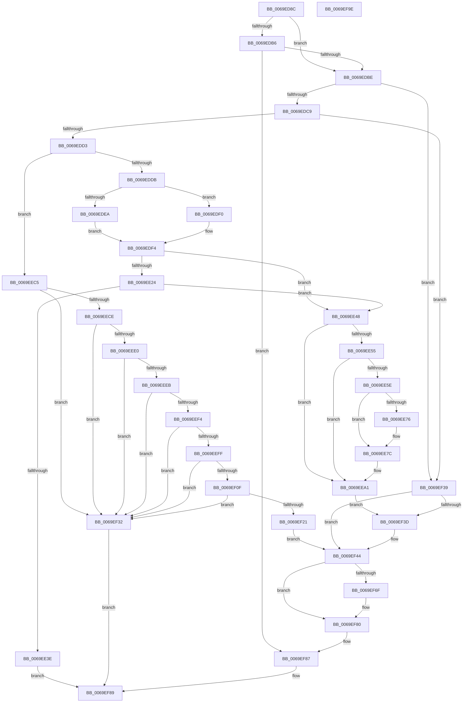

# BgpFwLibraryEnable

- RVA: `0x0069ED8C`–`0x0069EF9F` (길이 `531` bytes)
- VA: `0x000000014069ED8C`
- 실행 섹션: `.text`
- PDB 이름 있음: `예`; PDB Function 태그: `아니요`
- unwind 정보 RVA: `0x0005C954`
- 디코드: `133`개 명령, `531/531` bytes 표시
- 미해석 바이트: `0` (있으면 어셈블리에 `.byte`로 보존)

> 이 문서는 커널 이미지의 기계어와 PDB 기호를 분석해 생성했습니다. 4번과 5번은 함수 원형과 자료형을 바이너리 사용 방식에서 추정한 C 해석이며 원본 소스 복구 결과는 아닙니다.

## 1. Dependencies

- 직접 호출 지점: **5**; 고유 호출 대상: **4**
- 직접 호출자로 확인된 함수: **2**
- RIP 상대 이미지 참조: **15**

### Outgoing calls
- `0x0069EE16` → [MmMapIoSpaceEx](../32/MmMapIoSpaceEx_function_00327830.md) (function, `0x00327830`)
- `0x0069EE30` → [MmMapIoSpaceEx](../32/MmMapIoSpaceEx_function_00327830.md) (function, `0x00327830`)
- `0x0069EE9C` → [MiUnmapContiguousMemory](../3F/MiUnmapContiguousMemory_function_003F7908.md) (function, `0x003F7908`)
- `0x0069EF16` → [MmGetPhysicalAddress](../23/MmGetPhysicalAddress_function_0023A500.md) (function, `0x0023A500`)
- `0x0069EF3F` → [ResFwBackgroundTransition](../../pagebgfx/BC/ResFwBackgroundTransition_function_00BC5D28.md) (function, `0x00BC5D28`)

### Direct callers
- [BgLibraryEnable](BgLibraryEnable_function_0069E9CC.md) at `0x0069EA29`
- [BgpFwLibraryInitialize](../../pagebgfx/BC/BgpFwLibraryInitialize_function_00BC5400.md) at `0x00BC54A2`
- [BgpFwLibraryInitialize](../../pagebgfx/BC/BgpFwLibraryInitialize_function_00BC5400.md) at `0x00BC558B`
- [BgpFwLibraryInitialize](../../pagebgfx/BC/BgpFwLibraryInitialize_function_00BC5400.md) at `0x00BC5650`

### Static image references
- `0x0069EDA0` → RVA `0x00EF0450` (`.data`; read)
- `0x0069EE4C` → RVA `0x00EF0408` (`.data`; read)
- `0x0069EE55` → RVA `0x00EF0409` (`.data`; read)
- `0x0069EE5E` → RVA `0x00EF040A` (`.data`; read)
- `0x0069EE64` → RVA `0x00EF0418` (`.data`; read)
- `0x0069EE6E` → RVA `0x00EF040C` (`.data`; read)
- `0x0069EE76` → RVA `0x00EF0410` (`.data`; read)
- `0x0069EE7C` → RVA `0x00EF0414` (`.data`; read)
- `0x0069EE89` → RVA `0x00EF0428` (`.data`; read)
- `0x0069EEBB` → RVA `0x00EF0428` (`.data`; write)
- `0x0069EF47` → RVA `0x00EF03E0` (`.data`; read)
- `0x0069EF56` → RVA `0x00EF03F0` (`.data`; read)
- `0x0069EF62` → RVA `0x00EF0400` (`.data`; write)
- `0x0069EF6F` → RVA `0x00EF0450` (`.data`; read/write)
- `0x0069EF76` → RVA `0x00EF03F0` (`.data`; write)

## 2. Other-region calls and transfers

- 다른 실행 섹션으로 향하는 call: **1**
  - `0x0069EF3F` → [ResFwBackgroundTransition](../../pagebgfx/BC/ResFwBackgroundTransition_function_00BC5D28.md) (`.text` → `PAGEBGFX`)
- 별도 외부 분기/꼬리 이동을 확인하지 못했습니다.

## 3. Assembly (complete function range)

```asm
0069ED8C  48 89 5C 24 08                  mov qword ptr [rsp + 8], rbx
0069ED91  48 89 6C 24 10                  mov qword ptr [rsp + 0x10], rbp
0069ED96  48 89 74 24 18                  mov qword ptr [rsp + 0x18], rsi
0069ED9B  57                              push rdi
0069ED9C  48 83 EC 20                     sub rsp, 0x20
0069EDA0  8B 05 AA 16 85 00               mov eax, dword ptr [rip + 0x8516aa]
0069EDA6  48 8B F9                        mov rdi, rcx
0069EDA9  8B C8                           mov ecx, eax
0069EDAB  BA 00 0C 00 00                  mov edx, 0xc00
0069EDB0  23 CA                           and ecx, edx
0069EDB2  A8 02                           test al, 2
0069EDB4  74 08                           je 0x14069edbe
0069EDB6  3B CA                           cmp ecx, edx
0069EDB8  0F 85 C9 01 00 00               jne 0x14069ef87
0069EDBE  33 F6                           xor esi, esi
0069EDC0  40 38 37                        cmp byte ptr [rdi], sil
0069EDC3  0F 84 70 01 00 00               je 0x14069ef39
0069EDC9  40 38 77 01                     cmp byte ptr [rdi + 1], sil
0069EDCD  0F 85 66 01 00 00               jne 0x14069ef39
0069EDD3  3B CA                           cmp ecx, edx
0069EDD5  0F 84 EA 00 00 00               je 0x14069eec5
0069EDDB  8A 47 02                        mov al, byte ptr [rdi + 2]
0069EDDE  8B 4F 10                        mov ecx, dword ptr [rdi + 0x10]
0069EDE1  FE C8                           dec al
0069EDE3  A8 FD                           test al, 0xfd
0069EDE5  8B 47 0C                        mov eax, dword ptr [rdi + 0xc]
0069EDE8  74 06                           je 0x14069edf0
0069EDEA  0F AF 47 04                     imul eax, dword ptr [rdi + 4]
0069EDEE  EB 04                           jmp 0x14069edf4
0069EDF0  0F AF 47 08                     imul eax, dword ptr [rdi + 8]
0069EDF4  48 8B 5F 20                     mov rbx, qword ptr [rdi + 0x20]
0069EDF8  83 F9 04                        cmp ecx, 4
0069EDFB  48 8B EE                        mov rbp, rsi
0069EDFE  41 B8 04 04 00 00               mov r8d, 0x404
0069EE04  40 0F 95 C5                     setne bpl
0069EE08  48 8B CB                        mov rcx, rbx
0069EE0B  48 83 C5 03                     add rbp, 3
0069EE0F  48 0F AF E8                     imul rbp, rax
0069EE13  48 8B D5                        mov rdx, rbp
0069EE16  E8 15 8A C8 FF                  call 0x140327830
0069EE1B  48 89 47 20                     mov qword ptr [rdi + 0x20], rax
0069EE1F  48 85 C0                        test rax, rax
0069EE22  75 24                           jne 0x14069ee48
0069EE24  41 B8 04 02 00 00               mov r8d, 0x204
0069EE2A  48 8B D5                        mov rdx, rbp
0069EE2D  48 8B CB                        mov rcx, rbx
0069EE30  E8 FB 89 C8 FF                  call 0x140327830
0069EE35  48 89 47 20                     mov qword ptr [rdi + 0x20], rax
0069EE39  48 85 C0                        test rax, rax
0069EE3C  75 0A                           jne 0x14069ee48
0069EE3E  B8 9A 00 00 C0                  mov eax, 0xc000009a
0069EE43  E9 41 01 00 00                  jmp 0x14069ef89
0069EE48  C6 47 01 01                     mov byte ptr [rdi + 1], 1
0069EE4C  40 38 35 B5 15 85 00            cmp byte ptr [rip + 0x8515b5], sil
0069EE53  74 4C                           je 0x14069eea1
0069EE55  40 38 35 AD 15 85 00            cmp byte ptr [rip + 0x8515ad], sil
0069EE5C  74 43                           je 0x14069eea1
0069EE5E  8A 05 A6 15 85 00               mov al, byte ptr [rip + 0x8515a6]
0069EE64  8B 0D AE 15 85 00               mov ecx, dword ptr [rip + 0x8515ae]
0069EE6A  FE C8                           dec al
0069EE6C  A8 FD                           test al, 0xfd
0069EE6E  8B 05 98 15 85 00               mov eax, dword ptr [rip + 0x851598]
0069EE74  75 06                           jne 0x14069ee7c
0069EE76  8B 05 94 15 85 00               mov eax, dword ptr [rip + 0x851594]
0069EE7C  0F AF 05 91 15 85 00            imul eax, dword ptr [rip + 0x851591]
0069EE83  41 B0 01                        mov r8b, 1
0069EE86  83 F9 04                        cmp ecx, 4
0069EE89  48 8B 0D 98 15 85 00            mov rcx, qword ptr [rip + 0x851598]
0069EE90  40 0F 95 C6                     setne sil
0069EE94  48 8D 56 03                     lea rdx, [rsi + 3]
0069EE98  48 0F AF D0                     imul rdx, rax
0069EE9C  E8 67 8A D5 FF                  call 0x1403f7908
0069EEA1  0F 10 07                        movups xmm0, xmmword ptr [rdi]
0069EEA4  0F 11 05 5D 15 85 00            movups xmmword ptr [rip + 0x85155d], xmm0
0069EEAB  0F 10 4F 10                     movups xmm1, xmmword ptr [rdi + 0x10]
0069EEAF  0F 11 0D 62 15 85 00            movups xmmword ptr [rip + 0x851562], xmm1
0069EEB6  F2 0F 10 47 20                  movsd xmm0, qword ptr [rdi + 0x20]
0069EEBB  F2 0F 11 05 65 15 85 00         movsd qword ptr [rip + 0x851565], xmm0
0069EEC3  EB 78                           jmp 0x14069ef3d
0069EEC5  40 38 35 3C 15 85 00            cmp byte ptr [rip + 0x85153c], sil
0069EECC  74 64                           je 0x14069ef32
0069EECE  48 8B 0D 33 15 85 00            mov rcx, qword ptr [rip + 0x851533]
0069EED5  48 8B C1                        mov rax, rcx
0069EED8  48 C1 E8 08                     shr rax, 8
0069EEDC  84 C0                           test al, al
0069EEDE  74 52                           je 0x14069ef32
0069EEE0  8B 05 32 15 85 00               mov eax, dword ptr [rip + 0x851532]
0069EEE6  39 47 10                        cmp dword ptr [rdi + 0x10], eax
0069EEE9  75 47                           jne 0x14069ef32
0069EEEB  48 C1 E9 20                     shr rcx, 0x20
0069EEEF  39 4F 04                        cmp dword ptr [rdi + 4], ecx
0069EEF2  75 3E                           jne 0x14069ef32
0069EEF4  8B 05 16 15 85 00               mov eax, dword ptr [rip + 0x851516]
0069EEFA  39 47 08                        cmp dword ptr [rdi + 8], eax
0069EEFD  75 33                           jne 0x14069ef32
0069EEFF  48 8B 05 0A 15 85 00            mov rax, qword ptr [rip + 0x85150a]
0069EF06  48 C1 E8 20                     shr rax, 0x20
0069EF0A  39 47 0C                        cmp dword ptr [rdi + 0xc], eax
0069EF0D  75 23                           jne 0x14069ef32
0069EF0F  48 8B 0D 12 15 85 00            mov rcx, qword ptr [rip + 0x851512]
0069EF16  E8 E5 B5 B9 FF                  call 0x14023a500
0069EF1B  48 39 47 20                     cmp qword ptr [rdi + 0x20], rax
0069EF1F  75 11                           jne 0x14069ef32
0069EF21  C6 47 01 01                     mov byte ptr [rdi + 1], 1
0069EF25  48 8B 05 FC 14 85 00            mov rax, qword ptr [rip + 0x8514fc]
0069EF2C  48 89 47 20                     mov qword ptr [rdi + 0x20], rax
0069EF30  EB 12                           jmp 0x14069ef44
0069EF32  B8 BB 00 00 C0                  mov eax, 0xc00000bb
0069EF37  EB 50                           jmp 0x14069ef89
0069EF39  3B CA                           cmp ecx, edx
0069EF3B  74 07                           je 0x14069ef44
0069EF3D  33 C9                           xor ecx, ecx
0069EF3F  E8 E4 6D 52 00                  call 0x140bc5d28
0069EF44  0F 10 07                        movups xmm0, xmmword ptr [rdi]
0069EF47  0F 11 05 92 14 85 00            movups xmmword ptr [rip + 0x851492], xmm0
0069EF4E  0F 10 4F 10                     movups xmm1, xmmword ptr [rdi + 0x10]
0069EF52  66 0F 7E C8                     movd eax, xmm1
0069EF56  0F 11 0D 93 14 85 00            movups xmmword ptr [rip + 0x851493], xmm1
0069EF5D  F2 0F 10 47 20                  movsd xmm0, qword ptr [rdi + 0x20]
0069EF62  F2 0F 11 05 96 14 85 00         movsd qword ptr [rip + 0x851496], xmm0
0069EF6A  83 F8 01                        cmp eax, 1
0069EF6D  75 11                           jne 0x14069ef80
0069EF6F  83 0D DA 14 85 00 08            or dword ptr [rip + 0x8514da], 8
0069EF76  C7 05 70 14 85 00 05 00 00 00   mov dword ptr [rip + 0x851470], 5
0069EF80  83 0D C9 14 85 00 02            or dword ptr [rip + 0x8514c9], 2
0069EF87  33 C0                           xor eax, eax
0069EF89  48 8B 5C 24 30                  mov rbx, qword ptr [rsp + 0x30]
0069EF8E  48 8B 6C 24 38                  mov rbp, qword ptr [rsp + 0x38]
0069EF93  48 8B 74 24 40                  mov rsi, qword ptr [rsp + 0x40]
0069EF98  48 83 C4 20                     add rsp, 0x20
0069EF9C  5F                              pop rdi
0069EF9D  C3                              ret
0069EF9E  CC                              int3
```

## 4. C-style interpretation (structured pseudocode)

```c
__int64 __fastcall BgpFwLibraryEnable(__int64 a1)
{
    __int64 result;
    __int64 v_rbp;
    __int64 v_rsi;
    __int64 v_rsp;
    unsigned __int64 v_stack_p10;
    unsigned __int64 v_stack_p18;
    unsigned __int64 v_stack_p8;

    v_stack_p8 = v_rbx;
    v_stack_p10 = v_rbp;
    v_stack_p18 = v_rsi;
    v_rsp = (v_rsp) - (32);
    a1 = (unsigned int)(((unsigned int)((unsigned int)((unsigned int)(*(unsigned int *)(v_rip + 8722090))))) & ((unsigned int)((unsigned int)(0xC00ULL))));
    if ((((unsigned __int8)((unsigned int)(*(unsigned int *)(v_rip + 8722090)))) & (2)) == 0) goto loc_0069EDBE;
    if (((unsigned int)(a1)) != ((unsigned int)((unsigned int)(0xC00ULL)))) goto loc_0069EF87;
loc_0069EDBE:
    v_rsi = 0;
    if ((*(unsigned __int8 *)(a1)) == 0) goto loc_0069EF39;
    if ((*(unsigned __int8 *)(a1 + 1)) != 0) goto loc_0069EF39;
    if (((unsigned int)(a1)) == ((unsigned int)((unsigned int)(0xC00ULL)))) goto loc_0069EEC5;
    result = (unsigned __int8)((*(unsigned __int8 *)(a1 + 2)) - 1);
    if ((((unsigned __int8)(result)) & (253)) == 0) goto loc_0069EDF0;
    result = (unsigned int)(((unsigned int)(*(unsigned int *)(a1 + 12))) * (*(unsigned int *)(a1 + 4)));
    goto loc_0069EDF4;
loc_0069EDF0:
    result = (unsigned int)((result) * (*(unsigned int *)(a1 + 8)));
loc_0069EDF4:
    v_rbp = (((unsigned int)((unsigned int)(*(unsigned int *)(a1 + 16)))) != 4) ? 1 : 0;
    v_rbp = (v_rbp) + (3);
    v_rbp = (v_rbp) * (result);
    result = MmMapIoSpaceEx(*(unsigned __int64 *)(a1 + 32), v_rbp, (unsigned int)(0x404ULL), a4);
    *(unsigned __int64 *)(a1 + 32) = result;
    if (result != 0) goto loc_0069EE48;
    result = MmMapIoSpaceEx(*(unsigned __int64 *)(a1 + 32), v_rbp, 516, a4);
    *(unsigned __int64 *)(a1 + 32) = result;
    if (result != 0) goto loc_0069EE48;
    goto loc_0069EF89;
loc_0069EE48:
    *(unsigned __int8 *)(a1 + 1) = 1;
    if ((*(unsigned __int8 *)(v_rip + 8721845)) == 0) goto loc_0069EEA1;
    if ((*(unsigned __int8 *)(v_rip + 8721837)) == 0) goto loc_0069EEA1;
    result = (unsigned __int8)((*(unsigned __int8 *)(v_rip + 8721830)) - 1);
    result = (unsigned int)(*(unsigned int *)(v_rip + 8721816));
    if ((((unsigned __int8)(result)) & (253)) == 0) {
        result = *(unsigned int *)(v_rip + 8721812);
    }
    result = (unsigned int)((result) * (*(unsigned int *)(v_rip + 8721809)));
    v_rsi = (((unsigned int)((unsigned int)(*(unsigned int *)(v_rip + 8721838)))) != 4) ? 1 : 0;
    a2 = (v_rsi + 3) * (result);
    result = MiUnmapContiguousMemory(*(unsigned __int64 *)(v_rip + 8721816), a2, 1, a4);
loc_0069EEA1:
    *(unsigned __int64 *)(v_rip + 8721757) = v_xmm0;
    *(unsigned __int64 *)(v_rip + 8721762) = v_xmm1;
    *(unsigned __int64 *)(v_rip + 8721765) = v_xmm0;
    goto loc_0069EF3D;
loc_0069EEC5:
    if ((*(unsigned __int8 *)(v_rip + 8721724)) == ((unsigned __int8)(v_rsi))) goto loc_0069EF32;
    result = (*(unsigned __int64 *)(v_rip + 8721715)) >> (8);
    if ((unsigned __int8)(result) == 0) goto loc_0069EF32;
    if ((*(unsigned int *)(a1 + 16)) != ((unsigned int)((unsigned int)(*(unsigned int *)(v_rip + 8721714))))) goto loc_0069EF32;
    a1 = (*(unsigned __int64 *)(v_rip + 8721715)) >> (32);
    if ((*(unsigned int *)(a1 + 4)) != ((unsigned int)(a1))) goto loc_0069EF32;
    if ((*(unsigned int *)(a1 + 8)) != ((unsigned int)((unsigned int)(*(unsigned int *)(v_rip + 8721686))))) goto loc_0069EF32;
    result = (*(unsigned __int64 *)(v_rip + 8721674)) >> (32);
    if ((*(unsigned int *)(a1 + 12)) != ((unsigned int)(result))) goto loc_0069EF32;
    result = MmGetPhysicalAddress(*(unsigned __int64 *)(v_rip + 8721682), a2, 1, a4);
    if ((*(unsigned __int64 *)(a1 + 32)) != result) goto loc_0069EF32;
    *(unsigned __int8 *)(a1 + 1) = 1;
    *(unsigned __int64 *)(a1 + 32) = *(unsigned __int64 *)(v_rip + 8721660);
    goto loc_0069EF44;
loc_0069EF32:
    goto loc_0069EF89;
loc_0069EF39:
    result = (unsigned int)(0xC00000BBULL);
    if (((unsigned int)(*(unsigned __int64 *)(v_rip + 8721682))) != ((unsigned int)(a2))) {
        a1 = 0;
        result = ResFwBackgroundTransition(a1, a2, 1, a4);
    }
    *(unsigned __int64 *)(v_rip + 8721554) = v_xmm0;
    *(unsigned __int64 *)(v_rip + 8721555) = v_xmm1;
    *(unsigned __int64 *)(v_rip + 8721558) = v_xmm0;
    if (((unsigned int)(result)) == 1) {
        *(unsigned int *)(v_rip + 8721520) = 5;
    }
loc_0069EF87:
    result = 0;
loc_0069EF89:
    v_rsp = (v_rsp) + (32);
    return result;
}
```

## 5. (Beta) C Style

```c
int64_t BgpFwLibraryEnable(void *Arg1)
{
    uint8_t *arg1 = (uint8_t *)Arg1;

    int64_t result;
    int64_t local_rbp;
    int64_t local_rsi;
    int64_t local_rsp;
    uint64_t v_stack_p10;
    uint64_t v_stack_p18;
    uint64_t v_stack_p8;

    v_stack_p8 = local_rbx;
    v_stack_p10 = local_rbp;
    v_stack_p18 = local_rsi;
    local_rsp = (local_rsp) - (32);
    Arg1 = (uint32_t)(((uint32_t)((uint32_t)((uint32_t)(*(uint32_t *)(v_rip + 0x8516AA))))) & ((uint32_t)((uint32_t)(0xC00ULL))));
    if ((((uint8_t)((uint32_t)(*(uint32_t *)(v_rip + 0x8516AA)))) & (2)) == 0) goto loc_0069EDBE;
    if (((uint32_t)(Arg1)) != ((uint32_t)((uint32_t)(0xC00ULL)))) goto loc_0069EF87;
loc_0069EDBE:
    local_rsi = 0;
    if ((*(uint8_t *)(arg1)) == 0) goto loc_0069EF39;
    if ((*(uint8_t *)(arg1 + 0x1)) != 0) goto loc_0069EF39;
    if (((uint32_t)(Arg1)) == ((uint32_t)((uint32_t)(0xC00ULL)))) goto loc_0069EEC5;
    result = (uint8_t)((*(uint8_t *)(arg1 + 0x2)) - 1);
    if ((((uint8_t)(result)) & (253)) == 0) goto loc_0069EDF0;
    result = (uint32_t)(((uint32_t)(*(uint32_t *)(arg1 + 0xC))) * (*(uint32_t *)(arg1 + 0x4)));
    goto loc_0069EDF4;
loc_0069EDF0:
    result = (uint32_t)((result) * (*(uint32_t *)(arg1 + 0x8)));
loc_0069EDF4:
    local_rbp = (((uint32_t)((uint32_t)(*(uint32_t *)(arg1 + 0x10)))) != 4) ? 1 : 0;
    local_rbp = (local_rbp) + (3);
    local_rbp = (local_rbp) * (result);
    result = MmMapIoSpaceEx(*(uint64_t *)(arg1 + 0x20), local_rbp, (uint32_t)(0x404ULL), a4);
    *(uint64_t *)(arg1 + 0x20) = result;
    if (result != 0) goto loc_0069EE48;
    result = MmMapIoSpaceEx(*(uint64_t *)(arg1 + 0x20), local_rbp, 516, a4);
    *(uint64_t *)(arg1 + 0x20) = result;
    if (result != 0) goto loc_0069EE48;
    goto loc_0069EF89;
loc_0069EE48:
    *(uint8_t *)(arg1 + 0x1) = 1;
    if ((*(uint8_t *)(v_rip + 0x8515B5)) == 0) goto loc_0069EEA1;
    if ((*(uint8_t *)(v_rip + 0x8515AD)) == 0) goto loc_0069EEA1;
    result = (uint8_t)((*(uint8_t *)(v_rip + 0x8515A6)) - 1);
    result = (uint32_t)(*(uint32_t *)(v_rip + 0x851598));
    if ((((uint8_t)(result)) & (253)) == 0) {
        result = *(uint32_t *)(v_rip + 0x851594);
    }
    result = (uint32_t)((result) * (*(uint32_t *)(v_rip + 0x851591)));
    local_rsi = (((uint32_t)((uint32_t)(*(uint32_t *)(v_rip + 0x8515AE)))) != 4) ? 1 : 0;
    a2 = (local_rsi + 3) * (result);
    result = MiUnmapContiguousMemory(*(uint64_t *)(v_rip + 0x851598), a2, 1, a4);
loc_0069EEA1:
    *(uint64_t *)(v_rip + 0x85155D) = v_xmm0;
    *(uint64_t *)(v_rip + 0x851562) = v_xmm1;
    *(uint64_t *)(v_rip + 0x851565) = v_xmm0;
    goto loc_0069EF3D;
loc_0069EEC5:
    if ((*(uint8_t *)(v_rip + 0x85153C)) == ((uint8_t)(local_rsi))) goto loc_0069EF32;
    result = (*(uint64_t *)(v_rip + 0x851533)) >> (8);
    if ((uint8_t)(result) == 0) goto loc_0069EF32;
    if ((*(uint32_t *)(arg1 + 0x10)) != ((uint32_t)((uint32_t)(*(uint32_t *)(v_rip + 0x851532))))) goto loc_0069EF32;
    Arg1 = (*(uint64_t *)(v_rip + 0x851533)) >> (32);
    if ((*(uint32_t *)(arg1 + 0x4)) != ((uint32_t)(Arg1))) goto loc_0069EF32;
    if ((*(uint32_t *)(arg1 + 0x8)) != ((uint32_t)((uint32_t)(*(uint32_t *)(v_rip + 0x851516))))) goto loc_0069EF32;
    result = (*(uint64_t *)(v_rip + 0x85150A)) >> (32);
    if ((*(uint32_t *)(arg1 + 0xC)) != ((uint32_t)(result))) goto loc_0069EF32;
    result = MmGetPhysicalAddress(*(uint64_t *)(v_rip + 0x851512), a2, 1, a4);
    if ((*(uint64_t *)(arg1 + 0x20)) != result) goto loc_0069EF32;
    *(uint8_t *)(arg1 + 0x1) = 1;
    *(uint64_t *)(arg1 + 0x20) = *(uint64_t *)(v_rip + 0x8514FC);
    goto loc_0069EF44;
loc_0069EF32:
    goto loc_0069EF89;
loc_0069EF39:
    result = (uint32_t)(0xC00000BBULL);
    if (((uint32_t)(*(uint64_t *)(v_rip + 0x851512))) != ((uint32_t)(a2))) {
        Arg1 = 0;
        result = ResFwBackgroundTransition(Arg1, a2, 1, a4);
    }
    *(uint64_t *)(v_rip + 0x851492) = v_xmm0;
    *(uint64_t *)(v_rip + 0x851493) = v_xmm1;
    *(uint64_t *)(v_rip + 0x851496) = v_xmm0;
    if (((uint32_t)(result)) == 1) {
        *(uint32_t *)(v_rip + 0x851470) = 5;
    }
loc_0069EF87:
    result = 0;
loc_0069EF89:
    local_rsp = (local_rsp) + (32);
    return result;
}
```

### 관측된 메모리 오프셋

구조체 형식이 확인되지 않은 접근은 인자 기준의 오프셋으로만 기록했습니다.

| 기준 인자 | 오프셋 표현 | 폭 (bit) | 접근 |
|---|---:|---:|---|
| `Arg1` | `+ 0x0` | `8` | `R` |
| `Arg1` | `+ 0x0` | `128` | `R` |
| `Arg1` | `+ 0x1` | `8` | `R` |
| `Arg1` | `+ 0x1` | `8` | `W` |
| `Arg1` | `+ 0x2` | `8` | `R` |
| `Arg1` | `+ 0x4` | `32` | `R` |
| `Arg1` | `+ 0x8` | `32` | `R` |
| `Arg1` | `+ 0xC` | `32` | `R` |
| `Arg1` | `+ 0x10` | `32` | `R` |
| `Arg1` | `+ 0x10` | `128` | `R` |
| `Arg1` | `+ 0x20` | `64` | `R` |
| `Arg1` | `+ 0x20` | `64` | `W` |

## 6. Execution-region graph

[열기: 2D/3D 그래프와 함수 탐색 컨트롤 패널](../../../control-panel.html?section=text&rva=0x0069ED8C&view=graph)

- 2D 그래프는 위에서 아래로 흐르고, 3D 그래프는 빈 공간을 드래그해 회전합니다. Shift+드래그는 이동, 휠은 확대·축소, 함수 노드 선택은 대상 보고서 이동입니다.

### Static fallback


