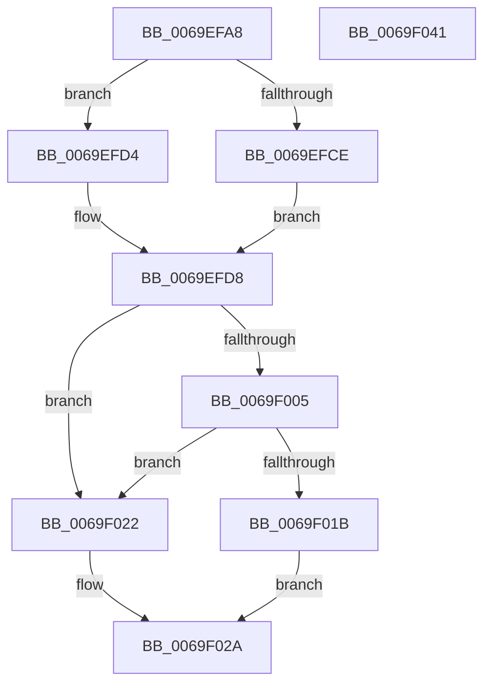

# BgpFwMapFrameBuffer

- RVA: `0x0069EFA8`–`0x0069F042` (길이 `154` bytes)
- VA: `0x000000014069EFA8`
- 실행 섹션: `.text`
- PDB 이름 있음: `예`; PDB Function 태그: `아니요`
- unwind 정보 RVA: `0x0005C954`
- 디코드: `46`개 명령, `154/154` bytes 표시
- 미해석 바이트: `0` (있으면 어셈블리에 `.byte`로 보존)

> 이 문서는 커널 이미지의 기계어와 PDB 기호를 분석해 생성했습니다. 4번과 5번은 함수 원형과 자료형을 바이너리 사용 방식에서 추정한 C 해석이며 원본 소스 복구 결과는 아닙니다.

## 1. Dependencies

- 직접 호출 지점: **2**; 고유 호출 대상: **1**
- 직접 호출자로 확인된 함수: **1**
- RIP 상대 이미지 참조: **0**

### Outgoing calls
- `0x0069EFFB` → [MmMapIoSpaceEx](../32/MmMapIoSpaceEx_function_00327830.md) (function, `0x00327830`)
- `0x0069F011` → [MmMapIoSpaceEx](../32/MmMapIoSpaceEx_function_00327830.md) (function, `0x00327830`)

### Direct callers
- [BgpFwSetBootGraphicsInformation](BgpFwSetBootGraphicsInformation_function_0069F048.md) at `0x0069F0CC`

### Static image references
- 디코드된 RIP-relative 메모리 참조가 없습니다.

## 2. Other-region calls and transfers

- 다른 실행 섹션으로 향하는 call: **0**
- 별도 외부 분기/꼬리 이동을 확인하지 못했습니다.

## 3. Assembly (complete function range)

```asm
0069EFA8  48 89 5C 24 08                  mov qword ptr [rsp + 8], rbx
0069EFAD  48 89 6C 24 10                  mov qword ptr [rsp + 0x10], rbp
0069EFB2  48 89 74 24 18                  mov qword ptr [rsp + 0x18], rsi
0069EFB7  57                              push rdi
0069EFB8  48 83 EC 20                     sub rsp, 0x20
0069EFBC  48 8B F9                        mov rdi, rcx
0069EFBF  8B 49 10                        mov ecx, dword ptr [rcx + 0x10]
0069EFC2  8A 47 02                        mov al, byte ptr [rdi + 2]
0069EFC5  FE C8                           dec al
0069EFC7  A8 FD                           test al, 0xfd
0069EFC9  8B 47 0C                        mov eax, dword ptr [rdi + 0xc]
0069EFCC  74 06                           je 0x14069efd4
0069EFCE  0F AF 47 04                     imul eax, dword ptr [rdi + 4]
0069EFD2  EB 04                           jmp 0x14069efd8
0069EFD4  0F AF 47 08                     imul eax, dword ptr [rdi + 8]
0069EFD8  48 8B 5F 20                     mov rbx, qword ptr [rdi + 0x20]
0069EFDC  33 F6                           xor esi, esi
0069EFDE  83 F9 04                        cmp ecx, 4
0069EFE1  8B EE                           mov ebp, esi
0069EFE3  41 B8 04 04 00 00               mov r8d, 0x404
0069EFE9  48 8B CB                        mov rcx, rbx
0069EFEC  40 0F 95 C5                     setne bpl
0069EFF0  48 83 C5 03                     add rbp, 3
0069EFF4  48 0F AF E8                     imul rbp, rax
0069EFF8  48 8B D5                        mov rdx, rbp
0069EFFB  E8 30 88 C8 FF                  call 0x140327830
0069F000  48 85 C0                        test rax, rax
0069F003  75 1D                           jne 0x14069f022
0069F005  41 B8 04 02 00 00               mov r8d, 0x204
0069F00B  48 8B D5                        mov rdx, rbp
0069F00E  48 8B CB                        mov rcx, rbx
0069F011  E8 1A 88 C8 FF                  call 0x140327830
0069F016  48 85 C0                        test rax, rax
0069F019  75 07                           jne 0x14069f022
0069F01B  BE 9A 00 00 C0                  mov esi, 0xc000009a
0069F020  EB 08                           jmp 0x14069f02a
0069F022  48 89 47 20                     mov qword ptr [rdi + 0x20], rax
0069F026  C6 47 01 01                     mov byte ptr [rdi + 1], 1
0069F02A  48 8B 5C 24 30                  mov rbx, qword ptr [rsp + 0x30]
0069F02F  8B C6                           mov eax, esi
0069F031  48 8B 74 24 40                  mov rsi, qword ptr [rsp + 0x40]
0069F036  48 8B 6C 24 38                  mov rbp, qword ptr [rsp + 0x38]
0069F03B  48 83 C4 20                     add rsp, 0x20
0069F03F  5F                              pop rdi
0069F040  C3                              ret
0069F041  CC                              int3
```

## 4. C-style interpretation (structured pseudocode)

```c
__int64 __fastcall BgpFwMapFrameBuffer(__int64 a1)
{
    __int64 result;
    __int64 v_rbp;
    __int64 v_rsi;
    __int64 v_rsp;
    unsigned __int64 v_stack_p10;
    unsigned __int64 v_stack_p18;
    unsigned __int64 v_stack_p8;

    v_stack_p8 = v_rbx;
    v_stack_p10 = v_rbp;
    v_stack_p18 = v_rsi;
    v_rsp = (v_rsp) - (32);
    result = (unsigned __int8)((*(unsigned __int8 *)(a1 + 2)) - 1);
    if ((((unsigned __int8)(result)) & (253)) == 0) goto loc_0069EFD4;
    result = (unsigned int)(((unsigned int)(*(unsigned int *)(a1 + 12))) * (*(unsigned int *)(a1 + 4)));
    goto loc_0069EFD8;
loc_0069EFD4:
    result = (unsigned int)((result) * (*(unsigned int *)(a1 + 8)));
loc_0069EFD8:
    v_rsi = 0;
    v_rbp = (((unsigned int)((unsigned int)(*(unsigned int *)(a1 + 16)))) != 4) ? 1 : 0;
    v_rbp = (v_rbp) + (3);
    v_rbp = (v_rbp) * (result);
    result = MmMapIoSpaceEx(*(unsigned __int64 *)(a1 + 32), v_rbp, (unsigned int)(0x404ULL), a4);
    if (result != 0) goto loc_0069F022;
    result = MmMapIoSpaceEx(*(unsigned __int64 *)(a1 + 32), v_rbp, 516, a4);
    if (result != 0) goto loc_0069F022;
    goto loc_0069F02A;
loc_0069F022:
    *(unsigned __int64 *)(a1 + 32) = result;
    *(unsigned __int8 *)(a1 + 1) = 1;
loc_0069F02A:
    v_rsp = (v_rsp) + (32);
    return (unsigned int)((unsigned int)((unsigned int)(0xC000009AULL)));
}
```

## 5. (Beta) C Style

```c
int64_t BgpFwMapFrameBuffer(void *Arg1)
{
    uint8_t *arg1 = (uint8_t *)Arg1;

    int64_t result;
    int64_t local_rbp;
    int64_t local_rsi;
    int64_t local_rsp;
    uint64_t v_stack_p10;
    uint64_t v_stack_p18;
    uint64_t v_stack_p8;

    v_stack_p8 = local_rbx;
    v_stack_p10 = local_rbp;
    v_stack_p18 = local_rsi;
    local_rsp = (local_rsp) - (32);
    result = (uint8_t)((*(uint8_t *)(arg1 + 0x2)) - 1);
    if ((((uint8_t)(result)) & (253)) == 0) goto loc_0069EFD4;
    result = (uint32_t)(((uint32_t)(*(uint32_t *)(arg1 + 0xC))) * (*(uint32_t *)(arg1 + 0x4)));
    goto loc_0069EFD8;
loc_0069EFD4:
    result = (uint32_t)((result) * (*(uint32_t *)(arg1 + 0x8)));
loc_0069EFD8:
    local_rsi = 0;
    local_rbp = (((uint32_t)((uint32_t)(*(uint32_t *)(arg1 + 0x10)))) != 4) ? 1 : 0;
    local_rbp = (local_rbp) + (3);
    local_rbp = (local_rbp) * (result);
    result = MmMapIoSpaceEx(*(uint64_t *)(arg1 + 0x20), local_rbp, (uint32_t)(0x404ULL), a4);
    if (result != 0) goto loc_0069F022;
    result = MmMapIoSpaceEx(*(uint64_t *)(arg1 + 0x20), local_rbp, 516, a4);
    if (result != 0) goto loc_0069F022;
    goto loc_0069F02A;
loc_0069F022:
    *(uint64_t *)(arg1 + 0x20) = result;
    *(uint8_t *)(arg1 + 0x1) = 1;
loc_0069F02A:
    local_rsp = (local_rsp) + (32);
    return (uint32_t)((uint32_t)((uint32_t)(0xC000009AULL)));
}
```

### 관측된 메모리 오프셋

구조체 형식이 확인되지 않은 접근은 인자 기준의 오프셋으로만 기록했습니다.

| 기준 인자 | 오프셋 표현 | 폭 (bit) | 접근 |
|---|---:|---:|---|
| `Arg1` | `+ 0x1` | `8` | `W` |
| `Arg1` | `+ 0x2` | `8` | `R` |
| `Arg1` | `+ 0x4` | `32` | `R` |
| `Arg1` | `+ 0x8` | `32` | `R` |
| `Arg1` | `+ 0xC` | `32` | `R` |
| `Arg1` | `+ 0x10` | `32` | `R` |
| `Arg1` | `+ 0x20` | `64` | `R` |
| `Arg1` | `+ 0x20` | `64` | `W` |

## 6. Execution-region graph

[열기: 2D/3D 그래프와 함수 탐색 컨트롤 패널](../../../control-panel.html?section=text&rva=0x0069EFA8&view=graph)

- 2D 그래프는 위에서 아래로 흐르고, 3D 그래프는 빈 공간을 드래그해 회전합니다. Shift+드래그는 이동, 휠은 확대·축소, 함수 노드 선택은 대상 보고서 이동입니다.

### Static fallback


