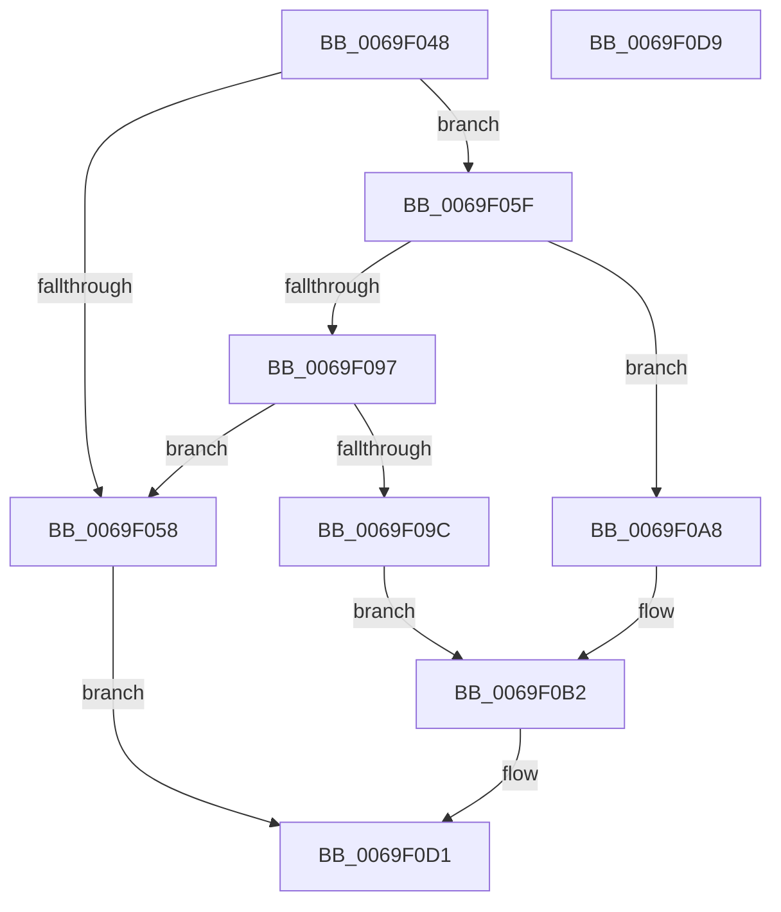

# BgpFwSetBootGraphicsInformation

- RVA: `0x0069F048`–`0x0069F0DA` (길이 `146` bytes)
- VA: `0x000000014069F048`
- 실행 섹션: `.text`
- PDB 이름 있음: `예`; PDB Function 태그: `아니요`
- unwind 정보 RVA: `0x0005CF00`
- 디코드: `35`개 명령, `146/146` bytes 표시
- 미해석 바이트: `0` (있으면 어셈블리에 `.byte`로 보존)

> 이 문서는 커널 이미지의 기계어와 PDB 기호를 분석해 생성했습니다. 4번과 5번은 함수 원형과 자료형을 바이너리 사용 방식에서 추정한 C 해석이며 원본 소스 복구 결과는 아닙니다.

## 1. Dependencies

- 직접 호출 지점: **1**; 고유 호출 대상: **1**
- 직접 호출자로 확인된 함수: **1**
- RIP 상대 이미지 참조: **9**

### Outgoing calls
- `0x0069F0CC` → [BgpFwMapFrameBuffer](BgpFwMapFrameBuffer_function_0069EFA8.md) (function, `0x0069EFA8`)

### Direct callers
- [BgkSetBootGraphicsInformation](../../pagebgfx/BC/BgkSetBootGraphicsInformation_function_00BC0424.md) at `0x00BC046A`

### Static image references
- `0x0069F050` → RVA `0x00EF03E0` (`.data`; read)
- `0x0069F062` → RVA `0x00EF0430` (`.data`; read)
- `0x0069F06D` → RVA `0x00EF0440` (`.data`; read)
- `0x0069F077` → RVA `0x00EF03E8` (`.data`; write)
- `0x0069F080` → RVA `0x00EF03E4` (`.data`; write)
- `0x0069F089` → RVA `0x00EF03EC` (`.data`; write)
- `0x0069F09C` → RVA `0x00EF03F0` (`.data`; write)
- `0x0069F0B2` → RVA `0x00EF03E0` (`.data`; write)
- `0x0069F0BE` → RVA `0x00EF0400` (`.data`; write)

## 2. Other-region calls and transfers

- 다른 실행 섹션으로 향하는 call: **0**
- 별도 외부 분기/꼬리 이동을 확인하지 못했습니다.

## 3. Assembly (complete function range)

```asm
0069F048  40 53                           push rbx
0069F04A  48 83 EC 20                     sub rsp, 0x20
0069F04E  33 DB                           xor ebx, ebx
0069F050  38 1D 8A 13 85 00               cmp byte ptr [rip + 0x85138a], bl
0069F056  74 07                           je 0x14069f05f
0069F058  BB BB 00 00 C0                  mov ebx, 0xc00000bb
0069F05D  EB 72                           jmp 0x14069f0d1
0069F05F  0F 10 02                        movups xmm0, xmmword ptr [rdx]
0069F062  0F 11 05 C7 13 85 00            movups xmmword ptr [rip + 0x8513c7], xmm0
0069F069  0F 10 4A 10                     movups xmm1, xmmword ptr [rdx + 0x10]
0069F06D  0F 11 0D CC 13 85 00            movups xmmword ptr [rip + 0x8513cc], xmm1
0069F074  8B 42 08                        mov eax, dword ptr [rdx + 8]
0069F077  89 05 6B 13 85 00               mov dword ptr [rip + 0x85136b], eax
0069F07D  8B 42 0C                        mov eax, dword ptr [rdx + 0xc]
0069F080  89 05 5E 13 85 00               mov dword ptr [rip + 0x85135e], eax
0069F086  8B 42 10                        mov eax, dword ptr [rdx + 0x10]
0069F089  89 05 5D 13 85 00               mov dword ptr [rip + 0x85135d], eax
0069F08F  8B 4A 18                        mov ecx, dword ptr [rdx + 0x18]
0069F092  83 E9 03                        sub ecx, 3
0069F095  74 11                           je 0x14069f0a8
0069F097  83 F9 01                        cmp ecx, 1
0069F09A  75 BC                           jne 0x14069f058
0069F09C  C7 05 4A 13 85 00 05 00 00 00   mov dword ptr [rip + 0x85134a], 5
0069F0A6  EB 0A                           jmp 0x14069f0b2
0069F0A8  C7 05 3E 13 85 00 04 00 00 00   mov dword ptr [rip + 0x85133e], 4
0069F0B2  66 C7 05 25 13 85 00 01 00      mov word ptr [rip + 0x851325], 1
0069F0BB  48 8B 0A                        mov rcx, qword ptr [rdx]
0069F0BE  48 89 0D 3B 13 85 00            mov qword ptr [rip + 0x85133b], rcx
0069F0C5  48 8D 0D 14 13 85 00            lea rcx, [rip + 0x851314]
0069F0CC  E8 D7 FE FF FF                  call 0x14069efa8
0069F0D1  8B C3                           mov eax, ebx
0069F0D3  48 83 C4 20                     add rsp, 0x20
0069F0D7  5B                              pop rbx
0069F0D8  C3                              ret
0069F0D9  CC                              int3
```

## 4. C-style interpretation (structured pseudocode)

```c
__int64 __fastcall BgpFwSetBootGraphicsInformation(__int64 a1, __int64 a2)
{
    __int64 result;
    __int64 v_rbx;
    __int64 v_rsp;

    v_rsp = (v_rsp) - (32);
    v_rbx = 0;
    if ((*(unsigned __int8 *)(v_rip + 8721290)) == 0) goto loc_0069F05F;
loc_0069F058:
    goto loc_0069F0D1;
loc_0069F05F:
    *(unsigned __int64 *)(v_rip + 8721351) = v_xmm0;
    *(unsigned __int64 *)(v_rip + 8721356) = v_xmm1;
    *(unsigned int *)(v_rip + 8721259) = (unsigned int)((unsigned int)(*(unsigned int *)(a2 + 8)));
    *(unsigned int *)(v_rip + 8721246) = (unsigned int)((unsigned int)(*(unsigned int *)(a2 + 12)));
    *(unsigned int *)(v_rip + 8721245) = (unsigned int)((unsigned int)(*(unsigned int *)(a2 + 16)));
    a1 = (unsigned int)(((unsigned int)(*(unsigned int *)(a2 + 24))) - (3));
    if (condition_is_equal) goto loc_0069F0A8;
    if (((unsigned int)(a1)) != 1) goto loc_0069F058;
    *(unsigned int *)(v_rip + 8721226) = 5;
    goto loc_0069F0B2;
loc_0069F0A8:
    *(unsigned int *)(v_rip + 8721214) = 4;
loc_0069F0B2:
    *(unsigned __int16 *)(v_rip + 8721189) = 1;
    *(unsigned __int64 *)(v_rip + 8721211) = *(unsigned __int64 *)(a2);
    result = BgpFwMapFrameBuffer(v_rip + 8721172, a2, a3, a4);
loc_0069F0D1:
    v_rsp = (v_rsp) + (32);
    return (unsigned int)((unsigned int)((unsigned int)(0xC00000BBULL)));
}
```

## 5. (Beta) C Style

```c
int64_t BgpFwSetBootGraphicsInformation(int64_t Arg1, void *Arg2)
{
    uint8_t *arg2 = (uint8_t *)Arg2;

    int64_t result;
    int64_t local_rbx;
    int64_t local_rsp;

    local_rsp = (local_rsp) - (32);
    local_rbx = 0;
    if ((*(uint8_t *)(v_rip + 0x85138A)) == 0) goto loc_0069F05F;
loc_0069F058:
    goto loc_0069F0D1;
loc_0069F05F:
    *(uint64_t *)(v_rip + 0x8513C7) = v_xmm0;
    *(uint64_t *)(v_rip + 0x8513CC) = v_xmm1;
    *(uint32_t *)(v_rip + 0x85136B) = (uint32_t)((uint32_t)(*(uint32_t *)(arg2 + 0x8)));
    *(uint32_t *)(v_rip + 0x85135E) = (uint32_t)((uint32_t)(*(uint32_t *)(arg2 + 0xC)));
    *(uint32_t *)(v_rip + 0x85135D) = (uint32_t)((uint32_t)(*(uint32_t *)(arg2 + 0x10)));
    Arg1 = (uint32_t)(((uint32_t)(*(uint32_t *)(arg2 + 0x18))) - (3));
    if (condition_is_equal) goto loc_0069F0A8;
    if (((uint32_t)(Arg1)) != 1) goto loc_0069F058;
    *(uint32_t *)(v_rip + 0x85134A) = 5;
    goto loc_0069F0B2;
loc_0069F0A8:
    *(uint32_t *)(v_rip + 0x85133E) = 4;
loc_0069F0B2:
    *(uint16_t *)(v_rip + 0x851325) = 1;
    *(uint64_t *)(v_rip + 0x85133B) = *(uint64_t *)(arg2);
    result = BgpFwMapFrameBuffer(v_rip + 8721172, Arg2, a3, a4);
loc_0069F0D1:
    local_rsp = (local_rsp) + (32);
    return (uint32_t)((uint32_t)((uint32_t)(0xC00000BBULL)));
}
```

### 관측된 메모리 오프셋

구조체 형식이 확인되지 않은 접근은 인자 기준의 오프셋으로만 기록했습니다.

| 기준 인자 | 오프셋 표현 | 폭 (bit) | 접근 |
|---|---:|---:|---|
| `Arg2` | `+ 0x0` | `64` | `R` |
| `Arg2` | `+ 0x0` | `128` | `R` |
| `Arg2` | `+ 0x8` | `32` | `R` |
| `Arg2` | `+ 0xC` | `32` | `R` |
| `Arg2` | `+ 0x10` | `32` | `R` |
| `Arg2` | `+ 0x10` | `128` | `R` |
| `Arg2` | `+ 0x18` | `32` | `R` |

## 6. Execution-region graph

[열기: 2D/3D 그래프와 함수 탐색 컨트롤 패널](../../../control-panel.html?section=text&rva=0x0069F048&view=graph)

- 2D 그래프는 위에서 아래로 흐르고, 3D 그래프는 빈 공간을 드래그해 회전합니다. Shift+드래그는 이동, 휠은 확대·축소, 함수 노드 선택은 대상 보고서 이동입니다.

### Static fallback


