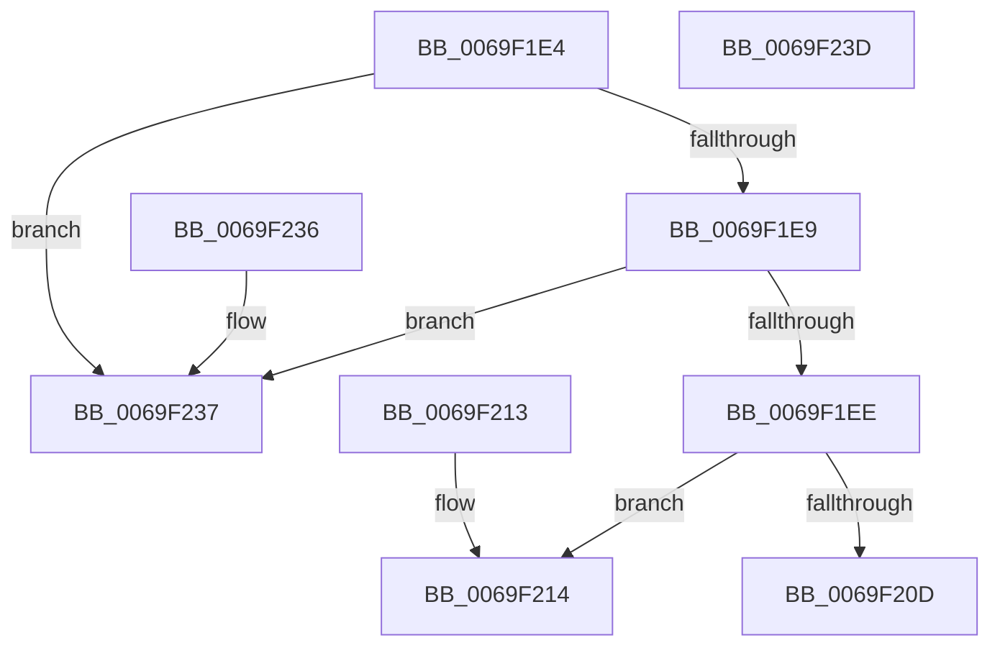

# BgpGxInitializeRectangle

- RVA: `0x0069F1E4`–`0x0069F23E` (길이 `90` bytes)
- VA: `0x000000014069F1E4`
- 실행 섹션: `.text`
- PDB 이름 있음: `예`; PDB Function 태그: `아니요`
- unwind 정보 RVA: `0x000DB714`
- 디코드: `30`개 명령, `90/90` bytes 표시
- 미해석 바이트: `0` (있으면 어셈블리에 `.byte`로 보존)

> 이 문서는 커널 이미지의 기계어와 PDB 기호를 분석해 생성했습니다. 4번과 5번은 함수 원형과 자료형을 바이너리 사용 방식에서 추정한 C 해석이며 원본 소스 복구 결과는 아닙니다.

## 1. Dependencies

- 직접 호출 지점: **0**; 고유 호출 대상: **0**
- 직접 호출자로 확인된 함수: **3**
- RIP 상대 이미지 참조: **0**

### Outgoing calls
- 직접 디코드된 call 명령이 없습니다.

### Direct callers
- [RaspScanConvert](../3E/RaspScanConvert_function_003E3760.md) at `0x003E3B20`
- [RaspScanConvert](../3E/RaspScanConvert_function_003E3760.md) at `0x003E3B48`
- [RaspRectangleCreate](../3E/RaspRectangleCreate_function_003E52D0.md) at `0x003E5320`
- [BgpClearScreen](BgpClearScreen_function_0069EAB0.md) at `0x0069EB5F`

### Static image references
- 디코드된 RIP-relative 메모리 참조가 없습니다.

## 2. Other-region calls and transfers

- 다른 실행 섹션으로 향하는 call: **0**
- 별도 외부 분기/꼬리 이동을 확인하지 못했습니다.

## 3. Assembly (complete function range)

```asm
0069F1E4  48 85 C9                        test rcx, rcx
0069F1E7  74 4E                           je 0x14069f237
0069F1E9  4D 85 C0                        test r8, r8
0069F1EC  74 49                           je 0x14069f237
0069F1EE  44 8B 51 04                     mov r10d, dword ptr [rcx + 4]
0069F1F2  44 8B 19                        mov r11d, dword ptr [rcx]
0069F1F5  41 8B CB                        mov ecx, r11d
0069F1F8  41 0F AF CA                     imul ecx, r10d
0069F1FC  0F AF CA                        imul ecx, edx
0069F1FF  83 C1 07                        add ecx, 7
0069F202  C1 E9 03                        shr ecx, 3
0069F205  8D 41 48                        lea eax, [rcx + 0x48]
0069F208  41 3B C1                        cmp eax, r9d
0069F20B  76 07                           jbe 0x14069f214
0069F20D  B8 9A 00 00 C0                  mov eax, 0xc000009a
0069F212  C3                              ret
0069F213  CC                              int3
0069F214  49 8D 40 48                     lea rax, [r8 + 0x48]
0069F218  45 89 10                        mov dword ptr [r8], r10d
0069F21B  49 89 40 18                     mov qword ptr [r8 + 0x18], rax
0069F21F  33 C0                           xor eax, eax
0069F221  45 89 58 04                     mov dword ptr [r8 + 4], r11d
0069F225  41 89 50 08                     mov dword ptr [r8 + 8], edx
0069F229  41 C7 40 10 08 00 00 00         mov dword ptr [r8 + 0x10], 8
0069F231  41 89 48 0C                     mov dword ptr [r8 + 0xc], ecx
0069F235  C3                              ret
0069F236  CC                              int3
0069F237  B8 0D 00 00 C0                  mov eax, 0xc000000d
0069F23C  C3                              ret
0069F23D  CC                              int3
```

## 4. C-style interpretation (structured pseudocode)

```c
__int64 __fastcall BgpGxInitializeRectangle(__int64 a1, int a2, __int64 a3, int a4)
{
    __int64 result;

    if (a1 == 0) goto loc_0069F237;
    if (a3 == 0) goto loc_0069F237;
    a1 = (unsigned int)(((unsigned int)((unsigned int)((unsigned int)(*(unsigned int *)(a1))))) * ((unsigned int)((unsigned int)(*(unsigned int *)(a1 + 4)))));
    a1 = (unsigned int)((a1) * (a2));
    a1 = (unsigned int)((a1) + (7));
    a1 = (unsigned int)((a1) >> (3));
    if (((unsigned int)(a1 + 72)) <= a4) goto loc_0069F214;
    return (unsigned int)(0xC000009AULL);
loc_0069F214:
    *(unsigned int *)(a3) = (unsigned int)((unsigned int)(*(unsigned int *)(a1 + 4)));
    *(unsigned __int64 *)(a3 + 24) = a3 + 72;
    result = 0;
    *(unsigned int *)(a3 + 4) = (unsigned int)((unsigned int)(*(unsigned int *)(a1)));
    *(unsigned int *)(a3 + 8) = a2;
    *(unsigned int *)(a3 + 16) = 8;
    *(unsigned int *)(a3 + 12) = (unsigned int)(a1);
    return result;
loc_0069F237:
    return (unsigned int)(0xC000000DULL);
}
```

## 5. (Beta) C Style

```c
int64_t BgpGxInitializeRectangle(int64_t Arg1, int32_t Arg2, int64_t Arg3, int32_t Arg4)
{
    int64_t result;

    if (Arg1 == 0) goto loc_0069F237;
    if (Arg3 == 0) goto loc_0069F237;
    Arg1 = (uint32_t)(((uint32_t)((uint32_t)((uint32_t)(*(uint32_t *)(Arg1))))) * ((uint32_t)((uint32_t)(*(uint32_t *)(Arg1 + 0x4)))));
    Arg1 = (uint32_t)((Arg1) * (Arg2));
    Arg1 = (uint32_t)((Arg1) + (7));
    Arg1 = (uint32_t)((Arg1) >> (3));
    if (((uint32_t)(Arg1 + 72)) <= Arg4) goto loc_0069F214;
    return (uint32_t)(0xC000009AULL);
loc_0069F214:
    *(uint32_t *)(Arg3) = (uint32_t)((uint32_t)(*(uint32_t *)(Arg1 + 0x4)));
    *(uint64_t *)(Arg3 + 0x18) = Arg3 + 72;
    result = 0;
    *(uint32_t *)(Arg3 + 0x4) = (uint32_t)((uint32_t)(*(uint32_t *)(Arg1)));
    *(uint32_t *)(Arg3 + 0x8) = Arg2;
    *(uint32_t *)(Arg3 + 0x10) = 8;
    *(uint32_t *)(Arg3 + 0xC) = (uint32_t)(Arg1);
    return result;
loc_0069F237:
    return (uint32_t)(0xC000000DULL);
}
```

## 6. Execution-region graph

[열기: 2D/3D 그래프와 함수 탐색 컨트롤 패널](../../../control-panel.html?section=text&rva=0x0069F1E4&view=graph)

- 2D 그래프는 위에서 아래로 흐르고, 3D 그래프는 빈 공간을 드래그해 회전합니다. Shift+드래그는 이동, 휠은 확대·축소, 함수 노드 선택은 대상 보고서 이동입니다.

### Static fallback


