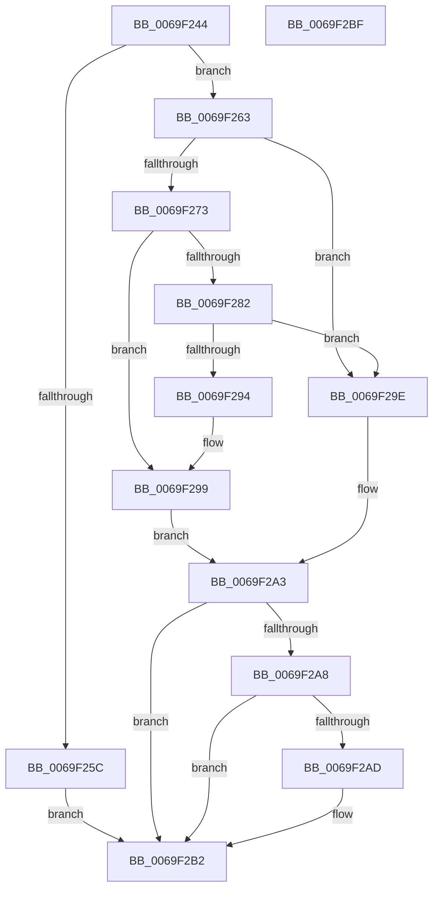

# BgpGxProcessQrCodeBitmap

- RVA: `0x0069F244`–`0x0069F2C0` (길이 `124` bytes)
- VA: `0x000000014069F244`
- 실행 섹션: `.text`
- PDB 이름 있음: `예`; PDB Function 태그: `아니요`
- unwind 정보 RVA: `0x0005CAAC`
- 디코드: `39`개 명령, `124/124` bytes 표시
- 미해석 바이트: `0` (있으면 어셈블리에 `.byte`로 보존)

> 이 문서는 커널 이미지의 기계어와 PDB 기호를 분석해 생성했습니다. 4번과 5번은 함수 원형과 자료형을 바이너리 사용 방식에서 추정한 C 해석이며 원본 소스 복구 결과는 아닙니다.

## 1. Dependencies

- 직접 호출 지점: **4**; 고유 호출 대상: **4**
- 직접 호출자로 확인된 함수: **1**
- RIP 상대 이미지 참조: **0**

### Outgoing calls
- `0x0069F268` → [BgpGxParseBitmap](../../pagebgfx/BC/BgpGxParseBitmap_function_00BC00B8.md) (function, `0x00BC00B8`)
- `0x0069F273` → [BgpGetBitsPerPixel](../48/BgpGetBitsPerPixel_function_0048CDA0.md) (function, `0x0048CDA0`)
- `0x0069F289` → [BgpGxConvertRectangle](BgpGxConvertRectangle_function_0069F190.md) (function, `0x0069F190`)
- `0x0069F2AD` → [BgpGxRectangleDestroy](../../pagebgfx/BC/BgpGxRectangleDestroy_function_00BC3F04.md) (function, `0x00BC3F04`)

### Direct callers
- [BgpFwLibraryInitialize](../../pagebgfx/BC/BgpFwLibraryInitialize_function_00BC5400.md) at `0x00BC5A3F`

### Static image references
- 디코드된 RIP-relative 메모리 참조가 없습니다.

## 2. Other-region calls and transfers

- 다른 실행 섹션으로 향하는 call: **2**
  - `0x0069F268` → [BgpGxParseBitmap](../../pagebgfx/BC/BgpGxParseBitmap_function_00BC00B8.md) (`.text` → `PAGEBGFX`)
  - `0x0069F2AD` → [BgpGxRectangleDestroy](../../pagebgfx/BC/BgpGxRectangleDestroy_function_00BC3F04.md) (`.text` → `PAGEBGFX`)
- 별도 외부 분기/꼬리 이동을 확인하지 못했습니다.

## 3. Assembly (complete function range)

```asm
0069F244  48 89 5C 24 08                  mov qword ptr [rsp + 8], rbx
0069F249  57                              push rdi
0069F24A  48 83 EC 20                     sub rsp, 0x20
0069F24E  48 83 64 24 38 00               and qword ptr [rsp + 0x38], 0
0069F254  48 8B FA                        mov rdi, rdx
0069F257  48 85 D2                        test rdx, rdx
0069F25A  75 07                           jne 0x14069f263
0069F25C  BB 0D 00 00 C0                  mov ebx, 0xc000000d
0069F261  EB 4F                           jmp 0x14069f2b2
0069F263  48 8D 54 24 38                  lea rdx, [rsp + 0x38]
0069F268  E8 4B 0E 52 00                  call 0x140bc00b8
0069F26D  8B D8                           mov ebx, eax
0069F26F  85 C0                           test eax, eax
0069F271  78 2B                           js 0x14069f29e
0069F273  E8 28 DB DE FF                  call 0x14048cda0
0069F278  48 8B 4C 24 38                  mov rcx, qword ptr [rsp + 0x38]
0069F27D  39 41 08                        cmp dword ptr [rcx + 8], eax
0069F280  74 17                           je 0x14069f299
0069F282  8B D0                           mov edx, eax
0069F284  48 8D 4C 24 38                  lea rcx, [rsp + 0x38]
0069F289  E8 02 FF FF FF                  call 0x14069f190
0069F28E  8B D8                           mov ebx, eax
0069F290  85 C0                           test eax, eax
0069F292  78 0A                           js 0x14069f29e
0069F294  48 8B 4C 24 38                  mov rcx, qword ptr [rsp + 0x38]
0069F299  48 89 0F                        mov qword ptr [rdi], rcx
0069F29C  EB 05                           jmp 0x14069f2a3
0069F29E  48 8B 4C 24 38                  mov rcx, qword ptr [rsp + 0x38]
0069F2A3  48 85 C9                        test rcx, rcx
0069F2A6  74 0A                           je 0x14069f2b2
0069F2A8  48 3B 0F                        cmp rcx, qword ptr [rdi]
0069F2AB  74 05                           je 0x14069f2b2
0069F2AD  E8 52 4C 52 00                  call 0x140bc3f04
0069F2B2  8B C3                           mov eax, ebx
0069F2B4  48 8B 5C 24 30                  mov rbx, qword ptr [rsp + 0x30]
0069F2B9  48 83 C4 20                     add rsp, 0x20
0069F2BD  5F                              pop rdi
0069F2BE  C3                              ret
0069F2BF  CC                              int3
```

## 4. C-style interpretation (structured pseudocode)

```c
__int64 __fastcall BgpGxProcessQrCodeBitmap(__int64 a1, __int64 a2)
{
    __int64 result;
    __int64 v_rsp;
    unsigned __int64 v_stack_p10;
    unsigned __int64 v_stack_p8;

    v_stack_p8 = v_rbx;
    v_rsp = (v_rsp) - (32);
    if (a2 != 0) goto loc_0069F263;
    goto loc_0069F2B2;
loc_0069F263:
    result = BgpGxParseBitmap(a1, v_stack_p10, a3, a4);
    if (sign_flag) goto loc_0069F29E;
    result = BgpGetBitsPerPixel(a1, v_stack_p10, a3, a4);
    if ((*(unsigned int *)(v_stack_p10 + 8)) == ((unsigned int)(result))) goto loc_0069F299;
    result = BgpGxConvertRectangle(v_stack_p10, (unsigned int)((unsigned int)(result)), a3, a4);
    if (sign_flag) goto loc_0069F29E;
loc_0069F299:
    *(unsigned __int64 *)(a2) = v_stack_p10;
    goto loc_0069F2A3;
loc_0069F29E:
loc_0069F2A3:
    if (v_stack_p10 == 0) goto loc_0069F2B2;
    if (v_stack_p10 != (*(unsigned __int64 *)(a2))) {
        result = BgpGxRectangleDestroy(v_stack_p10, (unsigned int)((unsigned int)(result)), a3, a4);
    }
    v_rsp = (v_rsp) + (32);
    return (unsigned int)((unsigned int)((unsigned int)((unsigned int)(result))));
}
```

## 5. (Beta) C Style

```c
int64_t BgpGxProcessQrCodeBitmap(int64_t Arg1, void *Arg2)
{
    uint8_t *arg2 = (uint8_t *)Arg2;

    int64_t result;
    int64_t local_rsp;
    uint64_t v_stack_p10;
    uint64_t v_stack_p8;

    v_stack_p8 = local_rbx;
    local_rsp = (local_rsp) - (32);
    if (Arg2 != NULL) goto loc_0069F263;
    goto loc_0069F2B2;
loc_0069F263:
    result = BgpGxParseBitmap(Arg1, v_stack_p10, a3, a4);
    if (sign_flag) goto loc_0069F29E;
    result = BgpGetBitsPerPixel(Arg1, v_stack_p10, a3, a4);
    if ((*(uint32_t *)(v_stack_p10 + 0x8)) == ((uint32_t)(result))) goto loc_0069F299;
    result = BgpGxConvertRectangle(v_stack_p10, (uint32_t)((uint32_t)(result)), a3, a4);
    if (sign_flag) goto loc_0069F29E;
loc_0069F299:
    *(uint64_t *)(arg2) = v_stack_p10;
    goto loc_0069F2A3;
loc_0069F29E:
loc_0069F2A3:
    if (v_stack_p10 == 0) goto loc_0069F2B2;
    if (v_stack_p10 != (*(uint64_t *)(arg2))) {
        result = BgpGxRectangleDestroy(v_stack_p10, (uint32_t)((uint32_t)(result)), a3, a4);
    }
    local_rsp = (local_rsp) + (32);
    return (uint32_t)((uint32_t)((uint32_t)((uint32_t)(result))));
}
```

### 관측된 메모리 오프셋

구조체 형식이 확인되지 않은 접근은 인자 기준의 오프셋으로만 기록했습니다.

| 기준 인자 | 오프셋 표현 | 폭 (bit) | 접근 |
|---|---:|---:|---|
| `Arg2` | `+ 0x0` | `64` | `R` |
| `Arg2` | `+ 0x0` | `64` | `W` |

## 6. Execution-region graph

[열기: 2D/3D 그래프와 함수 탐색 컨트롤 패널](../../../control-panel.html?section=text&rva=0x0069F244&view=graph)

- 2D 그래프는 위에서 아래로 흐르고, 3D 그래프는 빈 공간을 드래그해 회전합니다. Shift+드래그는 이동, 휠은 확대·축소, 함수 노드 선택은 대상 보고서 이동입니다.

### Static fallback


