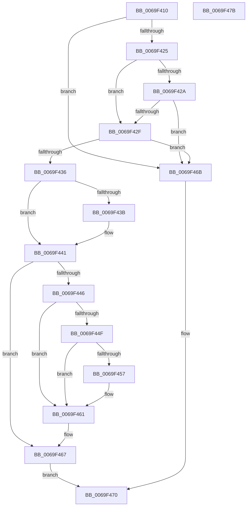

# BgpTxtAdjustStaticRegion

- RVA: `0x0069F410`–`0x0069F47C` (길이 `108` bytes)
- VA: `0x000000014069F410`
- 실행 섹션: `.text`
- PDB 이름 있음: `예`; PDB Function 태그: `아니요`
- unwind 정보 RVA: `0x0005CAAC`
- 디코드: `39`개 명령, `108/108` bytes 표시
- 미해석 바이트: `0` (있으면 어셈블리에 `.byte`로 보존)

> 이 문서는 커널 이미지의 기계어와 PDB 기호를 분석해 생성했습니다. 4번과 5번은 함수 원형과 자료형을 바이너리 사용 방식에서 추정한 C 해석이며 원본 소스 복구 결과는 아닙니다.

## 1. Dependencies

- 직접 호출 지점: **1**; 고유 호출 대상: **1**
- 직접 호출자로 확인된 함수: **1**
- RIP 상대 이미지 참조: **0**

### Outgoing calls
- `0x0069F45C` → [BgpGxFillRectangle](../47/BgpGxFillRectangle_function_0047F808.md) (function, `0x0047F808`)

### Direct callers
- [BgpDisplayCharacterEx](BgpDisplayCharacterEx_function_0069EBF4.md) at `0x0069EC63`

### Static image references
- 디코드된 RIP-relative 메모리 참조가 없습니다.

## 2. Other-region calls and transfers

- 다른 실행 섹션으로 향하는 call: **0**
- 별도 외부 분기/꼬리 이동을 확인하지 못했습니다.

## 3. Assembly (complete function range)

```asm
0069F410  48 89 5C 24 08                  mov qword ptr [rsp + 8], rbx
0069F415  57                              push rdi
0069F416  48 83 EC 20                     sub rsp, 0x20
0069F41A  49 8B F8                        mov rdi, r8
0069F41D  48 8B D9                        mov rbx, rcx
0069F420  48 85 C9                        test rcx, rcx
0069F423  74 46                           je 0x14069f46b
0069F425  48 85 D2                        test rdx, rdx
0069F428  75 05                           jne 0x14069f42f
0069F42A  4D 85 C0                        test r8, r8
0069F42D  74 3C                           je 0x14069f46b
0069F42F  8B 41 48                        mov eax, dword ptr [rcx + 0x48]
0069F432  A8 01                           test al, 1
0069F434  74 35                           je 0x14069f46b
0069F436  48 85 D2                        test rdx, rdx
0069F439  74 06                           je 0x14069f441
0069F43B  48 8B 02                        mov rax, qword ptr [rdx]
0069F43E  48 89 01                        mov qword ptr [rcx], rax
0069F441  48 85 FF                        test rdi, rdi
0069F444  74 21                           je 0x14069f467
0069F446  48 8B 49 18                     mov rcx, qword ptr [rcx + 0x18]
0069F44A  48 85 C9                        test rcx, rcx
0069F44D  74 12                           je 0x14069f461
0069F44F  41 8B 00                        mov eax, dword ptr [r8]
0069F452  39 43 28                        cmp dword ptr [rbx + 0x28], eax
0069F455  74 0A                           je 0x14069f461
0069F457  8B D0                           mov edx, eax
0069F459  89 43 28                        mov dword ptr [rbx + 0x28], eax
0069F45C  E8 A7 03 DE FF                  call 0x14047f808
0069F461  8B 47 04                        mov eax, dword ptr [rdi + 4]
0069F464  89 43 2C                        mov dword ptr [rbx + 0x2c], eax
0069F467  33 C0                           xor eax, eax
0069F469  EB 05                           jmp 0x14069f470
0069F46B  B8 0D 00 00 C0                  mov eax, 0xc000000d
0069F470  48 8B 5C 24 30                  mov rbx, qword ptr [rsp + 0x30]
0069F475  48 83 C4 20                     add rsp, 0x20
0069F479  5F                              pop rdi
0069F47A  C3                              ret
0069F47B  CC                              int3
```

## 4. C-style interpretation (structured pseudocode)

```c
__int64 __fastcall BgpTxtAdjustStaticRegion(__int64 a1, __int64 a2, __int64 a3)
{
    __int64 result;
    __int64 v_rsp;
    unsigned __int64 v_stack_p8;

    v_stack_p8 = v_rbx;
    v_rsp = (v_rsp) - (32);
    if (a1 == 0) goto loc_0069F46B;
    if (a2 != 0) goto loc_0069F42F;
    if (a3 == 0) goto loc_0069F46B;
loc_0069F42F:
    if ((((unsigned __int8)((unsigned int)(*(unsigned int *)(a1 + 72)))) & (1)) == 0) goto loc_0069F46B;
    result = (unsigned int)(*(unsigned int *)(a1 + 72));
    if (a2 != 0) {
        result = *(unsigned __int64 *)(a2);
        *(unsigned __int64 *)(a1) = result;
    }
    if (a3 == 0) goto loc_0069F467;
    if (*(unsigned __int64 *)(a1 + 24) == 0) goto loc_0069F461;
    result = (unsigned int)(*(unsigned int *)(a3));
    if ((*(unsigned int *)(a1 + 40)) != ((unsigned int)((unsigned int)(*(unsigned int *)(a3))))) {
        a2 = (unsigned int)((unsigned int)(*(unsigned int *)(a3)));
        *(unsigned int *)(a1 + 40) = (unsigned int)((unsigned int)(*(unsigned int *)(a3)));
        result = BgpGxFillRectangle(*(unsigned __int64 *)(a1 + 24), a2, a3, a4);
    }
    *(unsigned int *)(a1 + 44) = (unsigned int)((unsigned int)(*(unsigned int *)(a3 + 4)));
loc_0069F467:
    result = 0;
    goto loc_0069F470;
loc_0069F46B:
loc_0069F470:
    v_rsp = (v_rsp) + (32);
    return (unsigned int)(0xC000000DULL);
}
```

## 5. (Beta) C Style

```c
int64_t BgpTxtAdjustStaticRegion(void *Arg1, int64_t Arg2, int64_t Arg3)
{
    uint8_t *arg1 = (uint8_t *)Arg1;

    int64_t result;
    int64_t local_rsp;
    uint64_t v_stack_p8;

    v_stack_p8 = local_rbx;
    local_rsp = (local_rsp) - (32);
    if (Arg1 == NULL) goto loc_0069F46B;
    if (Arg2 != 0) goto loc_0069F42F;
    if (Arg3 == 0) goto loc_0069F46B;
loc_0069F42F:
    if ((((uint8_t)((uint32_t)(*(uint32_t *)(arg1 + 0x48)))) & (1)) == 0) goto loc_0069F46B;
    result = (uint32_t)(*(uint32_t *)(arg1 + 0x48));
    if (Arg2 != 0) {
        result = *(uint64_t *)(Arg2);
        *(uint64_t *)(arg1) = result;
    }
    if (Arg3 == 0) goto loc_0069F467;
    if (*(uint64_t *)(arg1 + 0x18) == 0) goto loc_0069F461;
    result = (uint32_t)(*(uint32_t *)(Arg3));
    if ((*(uint32_t *)(arg1 + 0x28)) != ((uint32_t)((uint32_t)(*(uint32_t *)(Arg3))))) {
        Arg2 = (uint32_t)((uint32_t)(*(uint32_t *)(Arg3)));
        *(uint32_t *)(arg1 + 0x28) = (uint32_t)((uint32_t)(*(uint32_t *)(Arg3)));
        result = BgpGxFillRectangle(*(uint64_t *)(arg1 + 0x18), Arg2, Arg3, a4);
    }
    *(uint32_t *)(arg1 + 0x2C) = (uint32_t)((uint32_t)(*(uint32_t *)(Arg3 + 0x4)));
loc_0069F467:
    result = 0;
    goto loc_0069F470;
loc_0069F46B:
loc_0069F470:
    local_rsp = (local_rsp) + (32);
    return (uint32_t)(0xC000000DULL);
}
```

### 관측된 메모리 오프셋

구조체 형식이 확인되지 않은 접근은 인자 기준의 오프셋으로만 기록했습니다.

| 기준 인자 | 오프셋 표현 | 폭 (bit) | 접근 |
|---|---:|---:|---|
| `Arg1` | `+ 0x28` | `32` | `R` |
| `Arg1` | `+ 0x28` | `32` | `W` |
| `Arg1` | `+ 0x2C` | `32` | `W` |

## 6. Execution-region graph

[열기: 2D/3D 그래프와 함수 탐색 컨트롤 패널](../../../control-panel.html?section=text&rva=0x0069F410&view=graph)

- 2D 그래프는 위에서 아래로 흐르고, 3D 그래프는 빈 공간을 드래그해 회전합니다. Shift+드래그는 이동, 휠은 확대·축소, 함수 노드 선택은 대상 보고서 이동입니다.

### Static fallback


