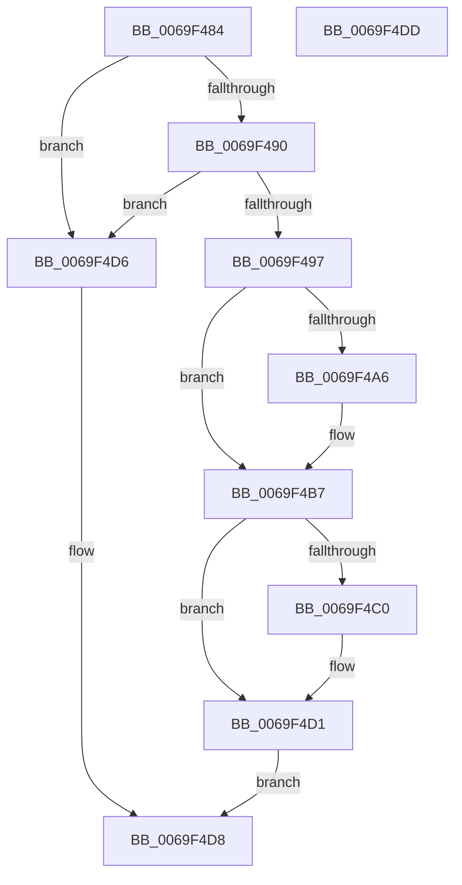

# BgpTxtRegionSize

- RVA: `0x0069F484`–`0x0069F4DE` (길이 `90` bytes)
- VA: `0x000000014069F484`
- 실행 섹션: `.text`
- PDB 이름 있음: `예`; PDB Function 태그: `아니요`
- unwind 정보 RVA: `0x0005C788`
- 디코드: `30`개 명령, `90/90` bytes 표시
- 미해석 바이트: `0` (있으면 어셈블리에 `.byte`로 보존)

> 이 문서는 커널 이미지의 기계어와 PDB 기호를 분석해 생성했습니다. 4번과 5번은 함수 원형과 자료형을 바이너리 사용 방식에서 추정한 C 해석이며 원본 소스 복구 결과는 아닙니다.

## 1. Dependencies

- 직접 호출 지점: **2**; 고유 호출 대상: **1**
- 직접 호출자로 확인된 함수: **2**
- RIP 상대 이미지 참조: **0**

### Outgoing calls
- `0x0069F4AF` → [BgpGxReservePoolRectangleSize](../../pagebgfx/BC/BgpGxReservePoolRectangleSize_function_00BC5C70.md) (function, `0x00BC5C70`)
- `0x0069F4C9` → [BgpGxReservePoolRectangleSize](../../pagebgfx/BC/BgpGxReservePoolRectangleSize_function_00BC5C70.md) (function, `0x00BC5C70`)

### Direct callers
- [ResFwConfigureDisplayStringResources](../../pagebgfx/BC/ResFwConfigureDisplayStringResources_function_00BC18C4.md) at `0x00BC1956`
- [AnFwConfigureProgressResources](../../pagebgfx/BC/AnFwConfigureProgressResources_function_00BC1CFC.md) at `0x00BC1E16`

### Static image references
- 디코드된 RIP-relative 메모리 참조가 없습니다.

## 2. Other-region calls and transfers

- 다른 실행 섹션으로 향하는 call: **2**
  - `0x0069F4AF` → [BgpGxReservePoolRectangleSize](../../pagebgfx/BC/BgpGxReservePoolRectangleSize_function_00BC5C70.md) (`.text` → `PAGEBGFX`)
  - `0x0069F4C9` → [BgpGxReservePoolRectangleSize](../../pagebgfx/BC/BgpGxReservePoolRectangleSize_function_00BC5C70.md) (`.text` → `PAGEBGFX`)
- 별도 외부 분기/꼬리 이동을 확인하지 못했습니다.

## 3. Assembly (complete function range)

```asm
0069F484  48 83 EC 28                     sub rsp, 0x28
0069F488  4C 8B C9                        mov r9, rcx
0069F48B  48 85 C9                        test rcx, rcx
0069F48E  74 46                           je 0x14069f4d6
0069F490  8B 41 48                        mov eax, dword ptr [rcx + 0x48]
0069F493  A8 01                           test al, 1
0069F495  74 3F                           je 0x14069f4d6
0069F497  48 8B 49 18                     mov rcx, qword ptr [rcx + 0x18]
0069F49B  41 BA 70 00 00 00               mov r10d, 0x70
0069F4A1  48 85 C9                        test rcx, rcx
0069F4A4  74 11                           je 0x14069f4b7
0069F4A6  44 8B 41 08                     mov r8d, dword ptr [rcx + 8]
0069F4AA  8B 51 04                        mov edx, dword ptr [rcx + 4]
0069F4AD  8B 09                           mov ecx, dword ptr [rcx]
0069F4AF  E8 BC 67 52 00                  call 0x140bc5c70
0069F4B4  44 03 D0                        add r10d, eax
0069F4B7  49 8B 49 20                     mov rcx, qword ptr [r9 + 0x20]
0069F4BB  48 85 C9                        test rcx, rcx
0069F4BE  74 11                           je 0x14069f4d1
0069F4C0  44 8B 41 08                     mov r8d, dword ptr [rcx + 8]
0069F4C4  8B 51 04                        mov edx, dword ptr [rcx + 4]
0069F4C7  8B 09                           mov ecx, dword ptr [rcx]
0069F4C9  E8 A2 67 52 00                  call 0x140bc5c70
0069F4CE  44 03 D0                        add r10d, eax
0069F4D1  41 8B C2                        mov eax, r10d
0069F4D4  EB 02                           jmp 0x14069f4d8
0069F4D6  33 C0                           xor eax, eax
0069F4D8  48 83 C4 28                     add rsp, 0x28
0069F4DC  C3                              ret
0069F4DD  CC                              int3
```

## 4. C-style interpretation (structured pseudocode)

```c
__int64 __fastcall BgpTxtRegionSize(__int64 a1)
{
    __int64 result;
    __int64 v_r10;
    __int64 v_rsp;

    v_rsp = (v_rsp) - (40);
    if (a1 == 0) goto loc_0069F4D6;
    if ((((unsigned __int8)((unsigned int)(*(unsigned int *)(a1 + 72)))) & (1)) == 0) goto loc_0069F4D6;
    result = (unsigned int)(*(unsigned int *)(a1 + 72));
    v_r10 = 112;
    if (*(unsigned __int64 *)(a1 + 24) != 0) {
        a3 = *(unsigned int *)(*(unsigned __int64 *)(a1 + 24) + 8);
        a2 = *(unsigned int *)(*(unsigned __int64 *)(a1 + 24) + 4);
        a1 = *(unsigned int *)(*(unsigned __int64 *)(a1 + 24));
        result = BgpGxReservePoolRectangleSize(a1, a2, a3, a1);
        v_r10 = (unsigned int)((112) + ((unsigned int)(result)));
    }
    if (*(unsigned __int64 *)(a1 + 32) != 0) {
        a3 = *(unsigned int *)(*(unsigned __int64 *)(a1 + 32) + 8);
        a2 = *(unsigned int *)(*(unsigned __int64 *)(a1 + 32) + 4);
        a1 = *(unsigned int *)(*(unsigned __int64 *)(a1 + 32));
        result = BgpGxReservePoolRectangleSize(a1, a2, a3, a1);
        v_r10 = (unsigned int)((v_r10) + ((unsigned int)(result)));
    }
    goto loc_0069F4D8;
loc_0069F4D6:
    result = 0;
loc_0069F4D8:
    v_rsp = (v_rsp) + (40);
    return result;
}
```

## 5. (Beta) C Style

```c
int64_t BgpTxtRegionSize(int64_t Arg1)
{
    int64_t result;
    int64_t local_r10;
    int64_t local_rsp;

    local_rsp = (local_rsp) - (40);
    if (Arg1 == 0) goto loc_0069F4D6;
    if ((((uint8_t)((uint32_t)(*(uint32_t *)(Arg1 + 0x48)))) & (1)) == 0) goto loc_0069F4D6;
    result = (uint32_t)(*(uint32_t *)(Arg1 + 0x48));
    local_r10 = 112;
    if (*(uint64_t *)(Arg1 + 0x18) != 0) {
        a3 = *(uint32_t *)(*(uint64_t *)(Arg1 + 0x18) + 0x8);
        a2 = *(uint32_t *)(*(uint64_t *)(Arg1 + 0x18) + 0x4);
        Arg1 = *(uint32_t *)(*(uint64_t *)(Arg1 + 0x18));
        result = BgpGxReservePoolRectangleSize(Arg1, a2, a3, Arg1);
        local_r10 = (uint32_t)((112) + ((uint32_t)(result)));
    }
    if (*(uint64_t *)(Arg1 + 0x20) != 0) {
        a3 = *(uint32_t *)(*(uint64_t *)(Arg1 + 0x20) + 0x8);
        a2 = *(uint32_t *)(*(uint64_t *)(Arg1 + 0x20) + 0x4);
        Arg1 = *(uint32_t *)(*(uint64_t *)(Arg1 + 0x20));
        result = BgpGxReservePoolRectangleSize(Arg1, a2, a3, Arg1);
        local_r10 = (uint32_t)((local_r10) + ((uint32_t)(result)));
    }
    goto loc_0069F4D8;
loc_0069F4D6:
    result = 0;
loc_0069F4D8:
    local_rsp = (local_rsp) + (40);
    return result;
}
```

## 6. Execution-region graph

[열기: 2D/3D 그래프와 함수 탐색 컨트롤 패널](../../../control-panel.html?section=text&rva=0x0069F484&view=graph)

- 2D 그래프는 위에서 아래로 흐르고, 3D 그래프는 빈 공간을 드래그해 회전합니다. Shift+드래그는 이동, 휠은 확대·축소, 함수 노드 선택은 대상 보고서 이동입니다.

### Static fallback


