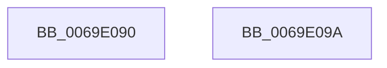

# BiIsSynchFirmwareEntries

- RVA: `0x0069E090`–`0x0069E09B` (길이 `11` bytes)
- VA: `0x000000014069E090`
- 실행 섹션: `.text`
- PDB 이름 있음: `예`; PDB Function 태그: `아니요`
- unwind 정보 RVA: `0x000DB714`
- 디코드: `6`개 명령, `11/11` bytes 표시
- 미해석 바이트: `0` (있으면 어셈블리에 `.byte`로 보존)

> 이 문서는 커널 이미지의 기계어와 PDB 기호를 분석해 생성했습니다. 4번과 5번은 함수 원형과 자료형을 바이너리 사용 방식에서 추정한 C 해석이며 원본 소스 복구 결과는 아닙니다.

## 1. Dependencies

- 직접 호출 지점: **0**; 고유 호출 대상: **0**
- 직접 호출자로 확인된 함수: **2**
- RIP 상대 이미지 참조: **0**

### Outgoing calls
- 직접 디코드된 call 명령이 없습니다.

### Direct callers
- [BcdForciblyUnloadStore](../../page/82/BcdForciblyUnloadStore_function_008232FC.md) at `0x0082334B`
- [BcdCloseStore](../../page/A3/BcdCloseStore_function_00A3C68C.md) at `0x00A3C718`

### Static image references
- 디코드된 RIP-relative 메모리 참조가 없습니다.

## 2. Other-region calls and transfers

- 다른 실행 섹션으로 향하는 call: **0**
- 별도 외부 분기/꼬리 이동을 확인하지 못했습니다.

## 3. Assembly (complete function range)

```asm
0069E090  D0 E9                           shr cl, 1
0069E092  F6 D1                           not cl
0069E094  80 E1 01                        and cl, 1
0069E097  8A C1                           mov al, cl
0069E099  C3                              ret
0069E09A  CC                              int3
```

## 4. C-style interpretation (structured pseudocode)

```c
__int64 __fastcall BiIsSynchFirmwareEntries(unsigned __int8 a1)
{
    a1 = (unsigned __int8)((a1) >> (1));
    a1 = (unsigned __int8)(~(a1));
    a1 = (unsigned __int8)((a1) & (1));
    return a1;
}
```

## 5. (Beta) C Style

```c
int64_t BiIsSynchFirmwareEntries(uint8_t Arg1)
{
    Arg1 = (uint8_t)((Arg1) >> (1));
    Arg1 = (uint8_t)(~(Arg1));
    Arg1 = (uint8_t)((Arg1) & (1));
    return Arg1;
}
```

## 6. Execution-region graph

[열기: 2D/3D 그래프와 함수 탐색 컨트롤 패널](../../../control-panel.html?section=text&rva=0x0069E090&view=graph)

- 2D 그래프는 위에서 아래로 흐르고, 3D 그래프는 빈 공간을 드래그해 회전합니다. Shift+드래그는 이동, 휠은 확대·축소, 함수 노드 선택은 대상 보고서 이동입니다.

### Static fallback


