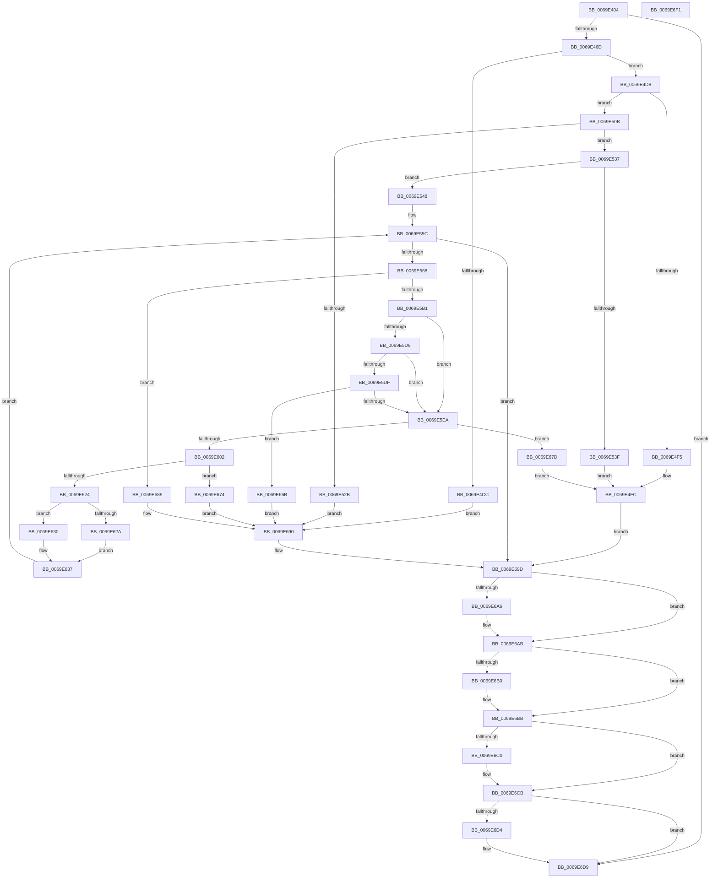

# BiLogFileOwnerProcess

- RVA: `0x0069E404`–`0x0069E6F2` (길이 `750` bytes)
- VA: `0x000000014069E404`
- 실행 섹션: `.text`
- PDB 이름 있음: `예`; PDB Function 태그: `아니요`
- unwind 정보 RVA: `0x000DA38C`
- 디코드: `186`개 명령, `750/750` bytes 표시
- 미해석 바이트: `0` (있으면 어셈블리에 `.byte`로 보존)

> 이 문서는 커널 이미지의 기계어와 PDB 기호를 분석해 생성했습니다. 4번과 5번은 함수 원형과 자료형을 바이너리 사용 방식에서 추정한 C 해석이며 원본 소스 복구 결과는 아닙니다.

## 1. Dependencies

- 직접 호출 지점: **19**; 고유 호출 대상: **9**
- 직접 호출자로 확인된 함수: **1**
- RIP 상대 이미지 참조: **12**

### Outgoing calls
- `0x0069E460` → [BiIsLogEnabled](../../page/70/BiIsLogEnabled_function_00705520.md) (function, `0x00705520`)
- `0x0069E47C` → [BiLogMessage](../../page/A3/BiLogMessage_function_00A3D3A8.md) (function, `0x00A3D3A8`)
- `0x0069E4BD` → [ZwOpenFile](../6A/ZwOpenFile_function_006AD730.md) (function, `0x006AD730`)
- `0x0069E4E8` → [ExAllocatePool2](../../poolcode/B8/ExAllocatePool2_function_00B820F0.md) (function, `0x00B820F0`)
- `0x0069E501` → [BiLogMessage](../../page/A3/BiLogMessage_function_00A3D3A8.md) (function, `0x00A3D3A8`)
- `0x0069E522` → [ZwQueryInformationFile](../6A/ZwQueryInformationFile_function_006AD2F0.md) (function, `0x006AD2F0`)
- `0x0069E554` → [BiLogMessage](../../page/A3/BiLogMessage_function_00A3D3A8.md) (function, `0x00A3D3A8`)
- `0x0069E5A4` → [ZwOpenProcess](../6A/ZwOpenProcess_function_006AD590.md) (function, `0x006AD590`)
- `0x0069E5CC` → [ZwQueryInformationProcess](../6A/ZwQueryInformationProcess_function_006AD3F0.md) (function, `0x006AD3F0`)
- `0x0069E5F5` → [ExAllocatePool2](../../poolcode/B8/ExAllocatePool2_function_00B820F0.md) (function, `0x00B820F0`)
- `0x0069E61B` → [ZwQueryInformationProcess](../6A/ZwQueryInformationProcess_function_006AD3F0.md) (function, `0x006AD3F0`)
- `0x0069E646` → [BiLogMessage](../../page/A3/BiLogMessage_function_00A3D3A8.md) (function, `0x00A3D3A8`)
- `0x0069E64F` → [ZwClose](../6A/ZwClose_function_006AD2B0.md) (function, `0x006AD2B0`)
- `0x0069E65E` → [ExFreePoolWithTag](../../poolcode/B8/ExFreePoolWithTag_function_00B82870.md) (function, `0x00B82870`)
- `0x0069E698` → [BiLogMessage](../../page/A3/BiLogMessage_function_00A3D3A8.md) (function, `0x00A3D3A8`)
- `0x0069E6A6` → [ZwClose](../6A/ZwClose_function_006AD2B0.md) (function, `0x006AD2B0`)
- `0x0069E6B6` → [ExFreePoolWithTag](../../poolcode/B8/ExFreePoolWithTag_function_00B82870.md) (function, `0x00B82870`)
- `0x0069E6C6` → [ExFreePoolWithTag](../../poolcode/B8/ExFreePoolWithTag_function_00B82870.md) (function, `0x00B82870`)
- `0x0069E6D4` → [ZwClose](../6A/ZwClose_function_006AD2B0.md) (function, `0x006AD2B0`)

### Direct callers
- [BiLoadSystemStore](../../page/A3/BiLoadSystemStore_function_00A3C198.md) at `0x00A3C28A`

### Static image references
- `0x0069E471` → RVA `0x006D0A70` (` ?? ::FNODOBFM::`string'`; read)
- `0x0069E4CC` → RVA `0x006D0AD0` (` ?? ::FNODOBFM::`string'`; read)
- `0x0069E4F5` → RVA `0x006D0B30` (` ?? ::FNODOBFM::`string'`; read)
- `0x0069E52B` → RVA `0x006D0B80` (` ?? ::FNODOBFM::`string'`; read)
- `0x0069E53F` → RVA `0x006D0BD0` (` ?? ::FNODOBFM::`string'`; read)
- `0x0069E548` → RVA `0x006D0C20` (` ?? ::FNODOBFM::`string'`; read)
- `0x0069E630` → RVA `0x006D0E40` (` ?? ::FNODOBFM::`string'`; read)
- `0x0069E63A` → RVA `0x006D0E10` (` ?? ::FNODOBFM::`string'`; read)
- `0x0069E66B` → RVA `0x006D0CC0` (` ?? ::FNODOBFM::`string'`; read)
- `0x0069E674` → RVA `0x006D0DB0` (` ?? ::FNODOBFM::`string'`; read)
- `0x0069E67D` → RVA `0x006D0D40` (` ?? ::FNODOBFM::`string'`; read)
- `0x0069E689` → RVA `0x006D0C70` (` ?? ::FNODOBFM::`string'`; read)

## 2. Other-region calls and transfers

- 다른 실행 섹션으로 향하는 call: **11**
  - `0x0069E460` → [BiIsLogEnabled](../../page/70/BiIsLogEnabled_function_00705520.md) (`.text` → `PAGE`)
  - `0x0069E47C` → [BiLogMessage](../../page/A3/BiLogMessage_function_00A3D3A8.md) (`.text` → `PAGE`)
  - `0x0069E4E8` → [ExAllocatePool2](../../poolcode/B8/ExAllocatePool2_function_00B820F0.md) (`.text` → `POOLCODE`)
  - `0x0069E501` → [BiLogMessage](../../page/A3/BiLogMessage_function_00A3D3A8.md) (`.text` → `PAGE`)
  - `0x0069E554` → [BiLogMessage](../../page/A3/BiLogMessage_function_00A3D3A8.md) (`.text` → `PAGE`)
  - `0x0069E5F5` → [ExAllocatePool2](../../poolcode/B8/ExAllocatePool2_function_00B820F0.md) (`.text` → `POOLCODE`)
  - `0x0069E646` → [BiLogMessage](../../page/A3/BiLogMessage_function_00A3D3A8.md) (`.text` → `PAGE`)
  - `0x0069E65E` → [ExFreePoolWithTag](../../poolcode/B8/ExFreePoolWithTag_function_00B82870.md) (`.text` → `POOLCODE`)
  - `0x0069E698` → [BiLogMessage](../../page/A3/BiLogMessage_function_00A3D3A8.md) (`.text` → `PAGE`)
  - `0x0069E6B6` → [ExFreePoolWithTag](../../poolcode/B8/ExFreePoolWithTag_function_00B82870.md) (`.text` → `POOLCODE`)
  - `0x0069E6C6` → [ExFreePoolWithTag](../../poolcode/B8/ExFreePoolWithTag_function_00B82870.md) (`.text` → `POOLCODE`)
- 별도 외부 분기/꼬리 이동을 확인하지 못했습니다.

## 3. Assembly (complete function range)

```asm
0069E404  48 89 74 24 08                  mov qword ptr [rsp + 8], rsi
0069E409  89 54 24 10                     mov dword ptr [rsp + 0x10], edx
0069E40D  55                              push rbp
0069E40E  57                              push rdi
0069E40F  41 54                           push r12
0069E411  41 56                           push r14
0069E413  41 57                           push r15
0069E415  48 8D 6C 24 C9                  lea rbp, [rsp - 0x37]
0069E41A  48 81 EC B0 00 00 00            sub rsp, 0xb0
0069E421  45 33 FF                        xor r15d, r15d
0069E424  0F 57 C0                        xorps xmm0, xmm0
0069E427  33 C0                           xor eax, eax
0069E429  44 89 7D 0B                     mov dword ptr [rbp + 0xb], r15d
0069E42D  0F 57 C9                        xorps xmm1, xmm1
0069E430  44 89 7D 23                     mov dword ptr [rbp + 0x23], r15d
0069E434  0F 11 45 B7                     movups xmmword ptr [rbp - 0x49], xmm0
0069E438  48 89 45 F7                     mov qword ptr [rbp - 9], rax
0069E43C  41 8B F7                        mov esi, r15d
0069E43F  0F 11 4D C7                     movups xmmword ptr [rbp - 0x39], xmm1
0069E443  89 45 FF                        mov dword ptr [rbp - 1], eax
0069E446  41 8B FF                        mov edi, r15d
0069E449  0F 11 45 D7                     movups xmmword ptr [rbp - 0x29], xmm0
0069E44D  44 89 7D 6F                     mov dword ptr [rbp + 0x6f], r15d
0069E451  4C 8B C9                        mov r9, rcx
0069E454  0F 11 45 E7                     movups xmmword ptr [rbp - 0x19], xmm0
0069E458  4C 89 7D 77                     mov qword ptr [rbp + 0x77], r15
0069E45C  4C 89 7D 7F                     mov qword ptr [rbp + 0x7f], r15
0069E460  E8 BB 70 06 00                  call 0x140705520
0069E465  84 C0                           test al, al
0069E467  0F 84 6C 02 00 00               je 0x14069e6d9
0069E46D  4C 8B 41 08                     mov r8, qword ptr [rcx + 8]
0069E471  48 8D 15 F8 25 03 00            lea rdx, [rip + 0x325f8]
0069E478  41 8D 4F 02                     lea ecx, [r15 + 2]
0069E47C  E8 27 EF 39 00                  call 0x140a3d3a8
0069E481  4C 89 4D 17                     mov qword ptr [rbp + 0x17], r9
0069E485  4C 8D 45 07                     lea r8, [rbp + 7]
0069E489  4C 8D 4D C7                     lea r9, [rbp - 0x39]
0069E48D  C7 44 24 28 20 40 00 00         mov dword ptr [rsp + 0x28], 0x4020
0069E495  BA 80 00 10 00                  mov edx, 0x100080
0069E49A  C7 45 07 30 00 00 00            mov dword ptr [rbp + 7], 0x30
0069E4A1  48 8D 4D 7F                     lea rcx, [rbp + 0x7f]
0069E4A5  4C 89 7D 0F                     mov qword ptr [rbp + 0xf], r15
0069E4A9  C7 45 1F 40 00 00 00            mov dword ptr [rbp + 0x1f], 0x40
0069E4B0  F3 0F 7F 45 27                  movdqu xmmword ptr [rbp + 0x27], xmm0
0069E4B5  C7 44 24 20 07 00 00 00         mov dword ptr [rsp + 0x20], 7
0069E4BD  E8 6E F2 00 00                  call 0x1406ad730
0069E4C2  41 BC 42 43 44 4B               mov r12d, 0x4b444342
0069E4C8  85 C0                           test eax, eax
0069E4CA  79 0C                           jns 0x14069e4d8
0069E4CC  48 8D 15 FD 25 03 00            lea rdx, [rip + 0x325fd]
0069E4D3  E9 B8 01 00 00                  jmp 0x14069e690
0069E4D8  BA 00 04 00 00                  mov edx, 0x400
0069E4DD  45 8B C4                        mov r8d, r12d
0069E4E0  B9 02 01 00 00                  mov ecx, 0x102
0069E4E5  89 55 6F                        mov dword ptr [rbp + 0x6f], edx
0069E4E8  E8 03 3C 4E 00                  call 0x140b820f0
0069E4ED  48 8B F0                        mov rsi, rax
0069E4F0  48 85 C0                        test rax, rax
0069E4F3  75 16                           jne 0x14069e50b
0069E4F5  48 8D 15 34 26 03 00            lea rdx, [rip + 0x32634]
0069E4FC  B9 04 00 00 00                  mov ecx, 4
0069E501  E8 A2 EE 39 00                  call 0x140a3d3a8
0069E506  E9 92 01 00 00                  jmp 0x14069e69d
0069E50B  44 8B 4D 6F                     mov r9d, dword ptr [rbp + 0x6f]
0069E50F  48 8D 55 C7                     lea rdx, [rbp - 0x39]
0069E513  48 8B 4D 7F                     mov rcx, qword ptr [rbp + 0x7f]
0069E517  4C 8B C6                        mov r8, rsi
0069E51A  C7 44 24 20 2F 00 00 00         mov dword ptr [rsp + 0x20], 0x2f
0069E522  E8 C9 ED 00 00                  call 0x1406ad2f0
0069E527  85 C0                           test eax, eax
0069E529  79 0C                           jns 0x14069e537
0069E52B  48 8D 15 4E 26 03 00            lea rdx, [rip + 0x3264e]
0069E532  E9 59 01 00 00                  jmp 0x14069e690
0069E537  44 8B 06                        mov r8d, dword ptr [rsi]
0069E53A  45 85 C0                        test r8d, r8d
0069E53D  75 09                           jne 0x14069e548
0069E53F  48 8D 15 8A 26 03 00            lea rdx, [rip + 0x3268a]
0069E546  EB B4                           jmp 0x14069e4fc
0069E548  48 8D 15 D1 26 03 00            lea rdx, [rip + 0x326d1]
0069E54F  B9 02 00 00 00                  mov ecx, 2
0069E554  E8 4F EE 39 00                  call 0x140a3d3a8
0069E559  45 8B F7                        mov r14d, r15d
0069E55C  49 8B FF                        mov rdi, r15
0069E55F  44 3B 36                        cmp r14d, dword ptr [rsi]
0069E562  0F 83 35 01 00 00               jae 0x14069e69d
0069E568  41 8B C6                        mov eax, r14d
0069E56B  4C 8D 4D B7                     lea r9, [rbp - 0x49]
0069E56F  4C 89 7D BF                     mov qword ptr [rbp - 0x41], r15
0069E573  4C 8D 45 D7                     lea r8, [rbp - 0x29]
0069E577  0F 57 C0                        xorps xmm0, xmm0
0069E57A  BA 00 10 00 00                  mov edx, 0x1000
0069E57F  48 8B 4C C6 08                  mov rcx, qword ptr [rsi + rax*8 + 8]
0069E584  48 89 4D B7                     mov qword ptr [rbp - 0x49], rcx
0069E588  48 8D 4D 77                     lea rcx, [rbp + 0x77]
0069E58C  C7 45 D7 30 00 00 00            mov dword ptr [rbp - 0x29], 0x30
0069E593  4C 89 7D DF                     mov qword ptr [rbp - 0x21], r15
0069E597  44 89 7D EF                     mov dword ptr [rbp - 0x11], r15d
0069E59B  4C 89 7D E7                     mov qword ptr [rbp - 0x19], r15
0069E59F  F3 0F 7F 45 F7                  movdqu xmmword ptr [rbp - 9], xmm0
0069E5A4  E8 E7 EF 00 00                  call 0x1406ad590
0069E5A9  85 C0                           test eax, eax
0069E5AB  0F 88 D8 00 00 00               js 0x14069e689
0069E5B1  48 8B 4D 77                     mov rcx, qword ptr [rbp + 0x77]
0069E5B5  48 8D 45 6F                     lea rax, [rbp + 0x6f]
0069E5B9  45 33 C9                        xor r9d, r9d
0069E5BC  44 89 7D 6F                     mov dword ptr [rbp + 0x6f], r15d
0069E5C0  45 33 C0                        xor r8d, r8d
0069E5C3  48 89 44 24 20                  mov qword ptr [rsp + 0x20], rax
0069E5C8  41 8D 51 1B                     lea edx, [r9 + 0x1b]
0069E5CC  E8 1F EE 00 00                  call 0x1406ad3f0
0069E5D1  3D 05 00 00 80                  cmp eax, 0x80000005
0069E5D6  74 12                           je 0x14069e5ea
0069E5D8  3D 23 00 00 C0                  cmp eax, 0xc0000023
0069E5DD  74 0B                           je 0x14069e5ea
0069E5DF  3D 04 00 00 C0                  cmp eax, 0xc0000004
0069E5E4  0F 85 81 00 00 00               jne 0x14069e66b
0069E5EA  8B 55 6F                        mov edx, dword ptr [rbp + 0x6f]
0069E5ED  45 8B C4                        mov r8d, r12d
0069E5F0  B9 02 01 00 00                  mov ecx, 0x102
0069E5F5  E8 F6 3A 4E 00                  call 0x140b820f0
0069E5FA  48 8B F8                        mov rdi, rax
0069E5FD  48 85 C0                        test rax, rax
0069E600  74 7B                           je 0x14069e67d
0069E602  44 8B 4D 6F                     mov r9d, dword ptr [rbp + 0x6f]
0069E606  48 8D 45 6F                     lea rax, [rbp + 0x6f]
0069E60A  48 8B 4D 77                     mov rcx, qword ptr [rbp + 0x77]
0069E60E  4C 8B C7                        mov r8, rdi
0069E611  BA 1B 00 00 00                  mov edx, 0x1b
0069E616  48 89 44 24 20                  mov qword ptr [rsp + 0x20], rax
0069E61B  E8 D0 ED 00 00                  call 0x1406ad3f0
0069E620  85 C0                           test eax, eax
0069E622  78 50                           js 0x14069e674
0069E624  66 44 39 3F                     cmp word ptr [rdi], r15w
0069E628  76 06                           jbe 0x14069e630
0069E62A  4C 8B 4F 08                     mov r9, qword ptr [rdi + 8]
0069E62E  EB 07                           jmp 0x14069e637
0069E630  4C 8D 0D 09 28 03 00            lea r9, [rip + 0x32809]
0069E637  45 8B C6                        mov r8d, r14d
0069E63A  48 8D 15 CF 27 03 00            lea rdx, [rip + 0x327cf]
0069E641  B9 04 00 00 00                  mov ecx, 4
0069E646  E8 5D ED 39 00                  call 0x140a3d3a8
0069E64B  48 8B 4D 77                     mov rcx, qword ptr [rbp + 0x77]
0069E64F  E8 5C EC 00 00                  call 0x1406ad2b0
0069E654  41 8B D4                        mov edx, r12d
0069E657  4C 89 7D 77                     mov qword ptr [rbp + 0x77], r15
0069E65B  48 8B CF                        mov rcx, rdi
0069E65E  E8 0D 42 4E 00                  call 0x140b82870
0069E663  41 FF C6                        inc r14d
0069E666  E9 F1 FE FF FF                  jmp 0x14069e55c
0069E66B  48 8D 15 4E 26 03 00            lea rdx, [rip + 0x3264e]
0069E672  EB 1C                           jmp 0x14069e690
0069E674  48 8D 15 35 27 03 00            lea rdx, [rip + 0x32735]
0069E67B  EB 13                           jmp 0x14069e690
0069E67D  48 8D 15 BC 26 03 00            lea rdx, [rip + 0x326bc]
0069E684  E9 73 FE FF FF                  jmp 0x14069e4fc
0069E689  48 8D 15 E0 25 03 00            lea rdx, [rip + 0x325e0]
0069E690  44 8B C0                        mov r8d, eax
0069E693  B9 04 00 00 00                  mov ecx, 4
0069E698  E8 0B ED 39 00                  call 0x140a3d3a8
0069E69D  48 8B 4D 77                     mov rcx, qword ptr [rbp + 0x77]
0069E6A1  48 85 C9                        test rcx, rcx
0069E6A4  74 05                           je 0x14069e6ab
0069E6A6  E8 05 EC 00 00                  call 0x1406ad2b0
0069E6AB  48 85 FF                        test rdi, rdi
0069E6AE  74 0B                           je 0x14069e6bb
0069E6B0  41 8B D4                        mov edx, r12d
0069E6B3  48 8B CF                        mov rcx, rdi
0069E6B6  E8 B5 41 4E 00                  call 0x140b82870
0069E6BB  48 85 F6                        test rsi, rsi
0069E6BE  74 0B                           je 0x14069e6cb
0069E6C0  41 8B D4                        mov edx, r12d
0069E6C3  48 8B CE                        mov rcx, rsi
0069E6C6  E8 A5 41 4E 00                  call 0x140b82870
0069E6CB  48 8B 4D 7F                     mov rcx, qword ptr [rbp + 0x7f]
0069E6CF  48 85 C9                        test rcx, rcx
0069E6D2  74 05                           je 0x14069e6d9
0069E6D4  E8 D7 EB 00 00                  call 0x1406ad2b0
0069E6D9  48 8B B4 24 E0 00 00 00         mov rsi, qword ptr [rsp + 0xe0]
0069E6E1  48 81 C4 B0 00 00 00            add rsp, 0xb0
0069E6E8  41 5F                           pop r15
0069E6EA  41 5E                           pop r14
0069E6EC  41 5C                           pop r12
0069E6EE  5F                              pop rdi
0069E6EF  5D                              pop rbp
0069E6F0  C3                              ret
0069E6F1  CC                              int3
```

## 4. C-style interpretation (structured pseudocode)

```c
__int64 __fastcall BiLogFileOwnerProcess(__int64 a1, int a2)
{
    __int64 result;
    __int64 v_r14;
    __int64 v_r15;
    __int64 v_rsp;
    unsigned __int64 v_stack_m38;
    unsigned int v_stack_m3C;
    unsigned int v_stack_m40;
    unsigned __int64 v_stack_m48;
    unsigned __int64 v_stack_m50;
    unsigned int v_stack_m54;
    unsigned __int64 v_stack_m58;
    unsigned __int64 v_stack_m5F;
    unsigned int v_stack_m60;
    unsigned __int64 v_stack_m68;
    unsigned int v_stack_m70;
    unsigned __int64 v_stack_m78;
    unsigned __int64 v_stack_m80;
    unsigned __int64 v_stack_m88;
    unsigned __int64 v_stack_m98;
    unsigned __int64 v_stack_mA0;
    unsigned __int64 v_stack_mA8;
    unsigned int v_stack_mB0;
    unsigned int v_stack_mB8;
    unsigned int v_stack_p10;
    unsigned __int64 v_stack_p18;
    unsigned __int64 v_stack_p20;
    unsigned __int64 v_stack_p8;

    v_stack_p8 = v_rsi;
    v_stack_p10 = a2;
    v_rsp = (v_rsp) - (176);
    v_r15 = 0;
    result = 0;
    v_stack_m54 = 0;
    v_stack_m3C = 0;
    v_stack_mA8 = v_xmm0;
    v_stack_m68 = 0;
    v_stack_m98 = v_xmm1;
    v_stack_m60 = 0;
    v_stack_m88 = v_xmm0;
    v_stack_p10 = 0;
    v_stack_m78 = v_xmm0;
    v_stack_p18 = 0;
    v_stack_p20 = 0;
    result = BiIsLogEnabled(a1, a2, a3, a1);
    if ((unsigned __int8)(result) == 0) goto loc_0069E6D9;
    result = BiLogMessage(v_r15 + 2, v_rip + 206328, *(unsigned __int64 *)(a1 + 8), a1);
    v_stack_m48 = a1;
    v_stack_mB0 = 0x4020ULL;
    v_stack_m58 = 48;
    v_stack_m50 = 0;
    v_stack_m40 = 64;
    v_stack_m38 = v_xmm0;
    v_stack_mB8 = 7;
    result = ZwOpenFile(v_stack_p20, (unsigned int)(0x100080ULL), v_stack_m58, v_stack_m98);
    if (!sign_flag) goto loc_0069E4D8;
    goto loc_0069E690;
loc_0069E4D8:
    v_stack_p10 = (unsigned int)((unsigned int)(0x400ULL));
    result = ExAllocatePool2(258, (unsigned int)(0x400ULL), (unsigned int)((unsigned int)((unsigned int)(0x4B444342ULL))), v_stack_m98);
    if (result != 0) goto loc_0069E50B;
loc_0069E4FC:
    result = BiLogMessage(4, v_rip + 206388, (unsigned int)((unsigned int)((unsigned int)(0x4B444342ULL))), v_stack_m98);
    goto loc_0069E69D;
loc_0069E50B:
    v_stack_mB8 = 47;
    result = ZwQueryInformationFile(v_stack_p20, v_stack_m98, result, (unsigned int)(v_stack_p10));
    if (!sign_flag) goto loc_0069E537;
    goto loc_0069E690;
loc_0069E537:
    if ((unsigned int)((unsigned int)(*(unsigned int *)(result))) != 0) goto loc_0069E548;
    goto loc_0069E4FC;
loc_0069E548:
    result = BiLogMessage(2, v_rip + 206545, (unsigned int)(*(unsigned int *)(result)), (unsigned int)(v_stack_p10));
loc_0069E55C:
    if (0 >= (*(unsigned int *)(result))) goto loc_0069E69D;
    v_stack_mA0 = 0;
    v_stack_mA8 = *(unsigned __int64 *)(result + 0 * 8 + 8);
    v_stack_m88 = 48;
    v_stack_m80 = 0;
    v_stack_m70 = 0;
    v_stack_m78 = 0;
    v_stack_m68 = v_xmm0;
    result = ZwOpenProcess(v_stack_p18, (unsigned int)(0x1000ULL), v_stack_m88, v_stack_mA8);
    if (sign_flag) goto loc_0069E689;
    a4 = 0;
    v_stack_p10 = 0;
    a3 = 0;
    v_stack_mB8 = v_stack_p10;
    result = ZwQueryInformationProcess(v_stack_p18, a4 + 27, a3, a4);
    if (((unsigned int)(result)) == 0x80000005ULL) goto loc_0069E5EA;
    if (((unsigned int)(result)) == 0xC0000023ULL) goto loc_0069E5EA;
    if (((unsigned int)(result)) != 0xC0000004ULL) goto loc_0069E66B;
loc_0069E5EA:
    result = ExAllocatePool2(258, (unsigned int)(v_stack_p10), (unsigned int)((unsigned int)((unsigned int)(0x4B444342ULL))), a4);
    if (result == 0) goto loc_0069E67D;
    v_stack_mB8 = v_stack_p10;
    result = ZwQueryInformationProcess(v_stack_p18, 27, result, (unsigned int)(v_stack_p10));
    if (sign_flag) goto loc_0069E674;
    if ((*(unsigned __int16 *)(result)) <= 0) goto loc_0069E630;
    goto loc_0069E637;
loc_0069E630:
loc_0069E637:
    result = BiLogMessage(4, v_rip + 206799, 0, v_rip + 206857);
    result = ZwClose(v_stack_p18, v_rip + 206799, 0, v_rip + 206857);
    v_stack_p18 = 0;
    result = ExFreePoolWithTag(result, (unsigned int)((unsigned int)((unsigned int)(0x4B444342ULL))), 0, v_rip + 206857);
    v_r14 = (unsigned int)((0) + 1);
    goto loc_0069E55C;
loc_0069E66B:
    goto loc_0069E690;
loc_0069E674:
    goto loc_0069E690;
loc_0069E67D:
    goto loc_0069E4FC;
loc_0069E689:
loc_0069E690:
    result = BiLogMessage(4, v_rip + 206304, (unsigned int)((unsigned int)(result)), v_rip + 206857);
loc_0069E69D:
    if (v_stack_p18 != 0) {
        result = ZwClose(v_stack_p18, v_rip + 206304, (unsigned int)((unsigned int)(result)), v_rip + 206857);
    }
    if (result != 0) {
        a2 = (unsigned int)((unsigned int)(0x4B444342ULL));
        a1 = result;
        result = ExFreePoolWithTag(a1, a2, (unsigned int)((unsigned int)(result)), v_rip + 206857);
    }
    if (result != 0) {
        a2 = (unsigned int)((unsigned int)(0x4B444342ULL));
        a1 = result;
        result = ExFreePoolWithTag(a1, a2, (unsigned int)((unsigned int)(result)), v_rip + 206857);
    }
    if (v_stack_p20 != 0) {
        result = ZwClose(v_stack_p20, a2, (unsigned int)((unsigned int)(result)), v_rip + 206857);
    }
    v_rsp = (v_rsp) + (176);
    return result;
}
```

## 5. (Beta) C Style

```c
int64_t BiLogFileOwnerProcess(int64_t Arg1, int32_t Arg2)
{
    int64_t result;
    int64_t local_r14;
    int64_t local_r15;
    int64_t local_rsp;
    uint64_t v_stack_m38;
    uint32_t v_stack_m3C;
    uint32_t v_stack_m40;
    uint64_t v_stack_m48;
    uint64_t v_stack_m50;
    uint32_t v_stack_m54;
    uint64_t v_stack_m58;
    uint64_t v_stack_m5F;
    uint32_t v_stack_m60;
    uint64_t v_stack_m68;
    uint32_t v_stack_m70;
    uint64_t v_stack_m78;
    uint64_t v_stack_m80;
    uint64_t v_stack_m88;
    uint64_t v_stack_m98;
    uint64_t v_stack_mA0;
    uint64_t v_stack_mA8;
    uint32_t v_stack_mB0;
    uint32_t v_stack_mB8;
    uint32_t v_stack_p10;
    uint64_t v_stack_p18;
    uint64_t v_stack_p20;
    uint64_t v_stack_p8;

    v_stack_p8 = local_rsi;
    v_stack_p10 = Arg2;
    local_rsp = (local_rsp) - (176);
    local_r15 = 0;
    result = 0;
    v_stack_m54 = 0;
    v_stack_m3C = 0;
    v_stack_mA8 = v_xmm0;
    v_stack_m68 = 0;
    v_stack_m98 = v_xmm1;
    v_stack_m60 = 0;
    v_stack_m88 = v_xmm0;
    v_stack_p10 = 0;
    v_stack_m78 = v_xmm0;
    v_stack_p18 = 0;
    v_stack_p20 = 0;
    result = BiIsLogEnabled(Arg1, Arg2, a3, Arg1);
    if ((uint8_t)(result) == 0) goto loc_0069E6D9;
    result = BiLogMessage(local_r15 + 2, v_rip + 206328, *(uint64_t *)(Arg1 + 0x8), Arg1);
    v_stack_m48 = Arg1;
    v_stack_mB0 = 0x4020ULL;
    v_stack_m58 = 48;
    v_stack_m50 = 0;
    v_stack_m40 = 64;
    v_stack_m38 = v_xmm0;
    v_stack_mB8 = 7;
    result = ZwOpenFile(v_stack_p20, (uint32_t)(0x100080ULL), v_stack_m58, v_stack_m98);
    if (!sign_flag) goto loc_0069E4D8;
    goto loc_0069E690;
loc_0069E4D8:
    v_stack_p10 = (uint32_t)((uint32_t)(0x400ULL));
    result = ExAllocatePool2(258, (uint32_t)(0x400ULL), (uint32_t)((uint32_t)((uint32_t)(0x4B444342ULL))), v_stack_m98);
    if (result != 0) goto loc_0069E50B;
loc_0069E4FC:
    result = BiLogMessage(4, v_rip + 206388, (uint32_t)((uint32_t)((uint32_t)(0x4B444342ULL))), v_stack_m98);
    goto loc_0069E69D;
loc_0069E50B:
    v_stack_mB8 = 47;
    result = ZwQueryInformationFile(v_stack_p20, v_stack_m98, result, (uint32_t)(v_stack_p10));
    if (!sign_flag) goto loc_0069E537;
    goto loc_0069E690;
loc_0069E537:
    if ((uint32_t)((uint32_t)(*(uint32_t *)(result))) != 0) goto loc_0069E548;
    goto loc_0069E4FC;
loc_0069E548:
    result = BiLogMessage(2, v_rip + 206545, (uint32_t)(*(uint32_t *)(result)), (uint32_t)(v_stack_p10));
loc_0069E55C:
    if (0 >= (*(uint32_t *)(result))) goto loc_0069E69D;
    v_stack_mA0 = 0;
    v_stack_mA8 = *(uint64_t *)(result + 0x0 * 8 + 0x8);
    v_stack_m88 = 48;
    v_stack_m80 = 0;
    v_stack_m70 = 0;
    v_stack_m78 = 0;
    v_stack_m68 = v_xmm0;
    result = ZwOpenProcess(v_stack_p18, (uint32_t)(0x1000ULL), v_stack_m88, v_stack_mA8);
    if (sign_flag) goto loc_0069E689;
    a4 = 0;
    v_stack_p10 = 0;
    a3 = 0;
    v_stack_mB8 = v_stack_p10;
    result = ZwQueryInformationProcess(v_stack_p18, a4 + 27, a3, a4);
    if (((uint32_t)(result)) == 0x80000005ULL) goto loc_0069E5EA;
    if (((uint32_t)(result)) == 0xC0000023ULL) goto loc_0069E5EA;
    if (((uint32_t)(result)) != 0xC0000004ULL) goto loc_0069E66B;
loc_0069E5EA:
    result = ExAllocatePool2(258, (uint32_t)(v_stack_p10), (uint32_t)((uint32_t)((uint32_t)(0x4B444342ULL))), a4);
    if (result == 0) goto loc_0069E67D;
    v_stack_mB8 = v_stack_p10;
    result = ZwQueryInformationProcess(v_stack_p18, 27, result, (uint32_t)(v_stack_p10));
    if (sign_flag) goto loc_0069E674;
    if ((*(uint16_t *)(result)) <= 0) goto loc_0069E630;
    goto loc_0069E637;
loc_0069E630:
loc_0069E637:
    result = BiLogMessage(4, v_rip + 206799, 0, v_rip + 206857);
    result = ZwClose(v_stack_p18, v_rip + 206799, 0, v_rip + 206857);
    v_stack_p18 = 0;
    result = ExFreePoolWithTag(result, (uint32_t)((uint32_t)((uint32_t)(0x4B444342ULL))), 0, v_rip + 206857);
    local_r14 = (uint32_t)((0) + 1);
    goto loc_0069E55C;
loc_0069E66B:
    goto loc_0069E690;
loc_0069E674:
    goto loc_0069E690;
loc_0069E67D:
    goto loc_0069E4FC;
loc_0069E689:
loc_0069E690:
    result = BiLogMessage(4, v_rip + 206304, (uint32_t)((uint32_t)(result)), v_rip + 206857);
loc_0069E69D:
    if (v_stack_p18 != 0) {
        result = ZwClose(v_stack_p18, v_rip + 206304, (uint32_t)((uint32_t)(result)), v_rip + 206857);
    }
    if (result != 0) {
        Arg2 = (uint32_t)((uint32_t)(0x4B444342ULL));
        Arg1 = result;
        result = ExFreePoolWithTag(Arg1, Arg2, (uint32_t)((uint32_t)(result)), v_rip + 206857);
    }
    if (result != 0) {
        Arg2 = (uint32_t)((uint32_t)(0x4B444342ULL));
        Arg1 = result;
        result = ExFreePoolWithTag(Arg1, Arg2, (uint32_t)((uint32_t)(result)), v_rip + 206857);
    }
    if (v_stack_p20 != 0) {
        result = ZwClose(v_stack_p20, Arg2, (uint32_t)((uint32_t)(result)), v_rip + 206857);
    }
    local_rsp = (local_rsp) + (176);
    return result;
}
```

## 6. Execution-region graph

[열기: 2D/3D 그래프와 함수 탐색 컨트롤 패널](../../../control-panel.html?section=text&rva=0x0069E404&view=graph)

- 2D 그래프는 위에서 아래로 흐르고, 3D 그래프는 빈 공간을 드래그해 회전합니다. Shift+드래그는 이동, 휠은 확대·축소, 함수 노드 선택은 대상 보고서 이동입니다.

### Static fallback


