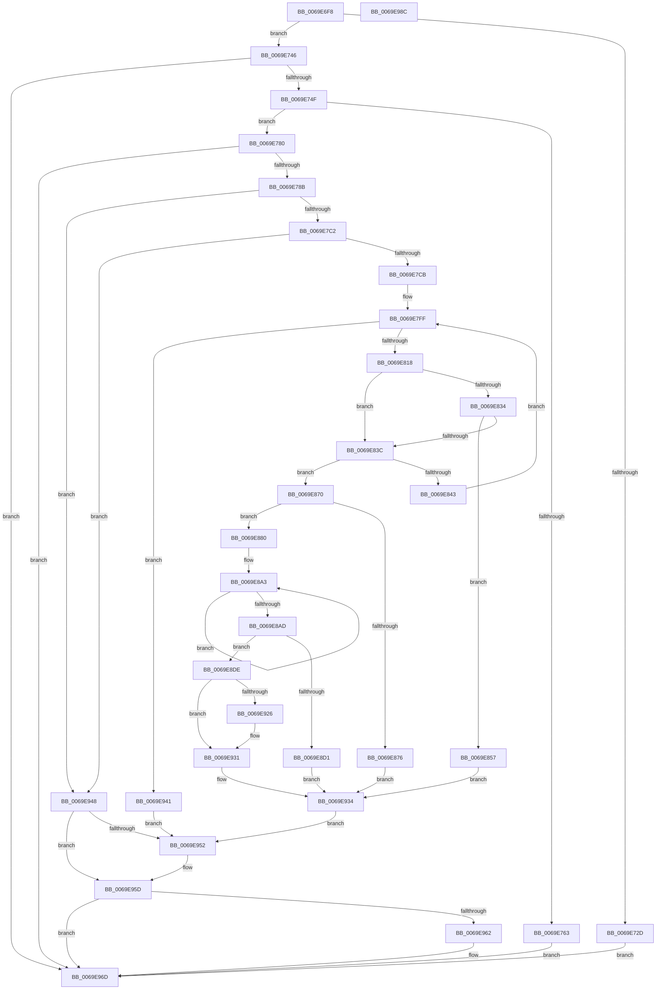

# BiSpacesUpdatePhysicalDevicePath

- RVA: `0x0069E6F8`–`0x0069E98D` (길이 `661` bytes)
- VA: `0x000000014069E6F8`
- 실행 섹션: `.text`
- PDB 이름 있음: `예`; PDB Function 태그: `아니요`
- unwind 정보 RVA: `0x0008C2BC`
- 디코드: `177`개 명령, `661/661` bytes 표시
- 미해석 바이트: `0` (있으면 어셈블리에 `.byte`로 보존)

> 이 문서는 커널 이미지의 기계어와 PDB 기호를 분석해 생성했습니다. 4번과 5번은 함수 원형과 자료형을 바이너리 사용 방식에서 추정한 C 해석이며 원본 소스 복구 결과는 아닙니다.

## 1. Dependencies

- 직접 호출 지점: **17**; 고유 호출 대상: **7**
- 직접 호출자로 확인된 함수: **1**
- RIP 상대 이미지 참조: **6**

### Outgoing calls
- `0x0069E737` → [BiLogMessage](../../page/A3/BiLogMessage_function_00A3D3A8.md) (function, `0x00A3D3A8`)
- `0x0069E758` → [SyspartIsSpace](../../page/82/SyspartIsSpace_function_008276F8.md) (function, `0x008276F8`)
- `0x0069E776` → [BiLogMessage](../../page/A3/BiLogMessage_function_00A3D3A8.md) (function, `0x00A3D3A8`)
- `0x0069E7A2` → [ExAllocatePool2](../../poolcode/B8/ExAllocatePool2_function_00B820F0.md) (function, `0x00B820F0`)
- `0x0069E7B1` → [ExAllocatePool2](../../poolcode/B8/ExAllocatePool2_function_00B820F0.md) (function, `0x00B820F0`)
- `0x0069E7FA` → [swprintf_s](../50/swprintf_s_function_00504B20.md) (function, `0x00504B20`)
- `0x0069E807` → [ExAllocatePool2](../../poolcode/B8/ExAllocatePool2_function_00B820F0.md) (function, `0x00B820F0`)
- `0x0069E821` → [SyspartGetPhysicalPartitions](../../page/82/SyspartGetPhysicalPartitions_function_008275F8.md) (function, `0x008275F8`)
- `0x0069E84B` → [ExFreePoolWithTag](../../poolcode/B8/ExFreePoolWithTag_function_00B82870.md) (function, `0x00B82870`)
- `0x0069E866` → [BiLogMessage](../../page/A3/BiLogMessage_function_00A3D3A8.md) (function, `0x00A3D3A8`)
- `0x0069E89A` → [swprintf_s](../50/swprintf_s_function_00504B20.md) (function, `0x00504B20`)
- `0x0069E8C4` → [ExAllocatePool2](../../poolcode/B8/ExAllocatePool2_function_00B820F0.md) (function, `0x00B820F0`)
- `0x0069E916` → [memcpy](../6C/memcpy_function_006C6840.md) (function, `0x006C6840`)
- `0x0069E92C` → [ExFreePoolWithTag](../../poolcode/B8/ExFreePoolWithTag_function_00B82870.md) (function, `0x00B82870`)
- `0x0069E93A` → [ExFreePoolWithTag](../../poolcode/B8/ExFreePoolWithTag_function_00B82870.md) (function, `0x00B82870`)
- `0x0069E958` → [ExFreePoolWithTag](../../poolcode/B8/ExFreePoolWithTag_function_00B82870.md) (function, `0x00B82870`)
- `0x0069E968` → [ExFreePoolWithTag](../../poolcode/B8/ExFreePoolWithTag_function_00B82870.md) (function, `0x00B82870`)

### Direct callers
- [BiUpdateEfiEntry](../../page/A3/BiUpdateEfiEntry_function_00A3CCC0.md) at `0x00A3CDC6`

### Static image references
- `0x0069E72D` → RVA `0x006D0EB0` (` ?? ::FNODOBFM::`string'`; read)
- `0x0069E766` → RVA `0x006D0F30` (` ?? ::FNODOBFM::`string'`; read)
- `0x0069E7CE` → RVA `0x006D0F70` (` ?? ::FNODOBFM::`string'`; read)
- `0x0069E7DA` → RVA `0x006D0F90` (` ?? ::FNODOBFM::`string'`; read)
- `0x0069E85A` → RVA `0x006D0FA0` (` ?? ::FNODOBFM::`string'`; read)
- `0x0069E883` → RVA `0x006D1010` (` ?? ::FNODOBFM::`string'`; read)

## 2. Other-region calls and transfers

- 다른 실행 섹션으로 향하는 call: **14**
  - `0x0069E737` → [BiLogMessage](../../page/A3/BiLogMessage_function_00A3D3A8.md) (`.text` → `PAGE`)
  - `0x0069E758` → [SyspartIsSpace](../../page/82/SyspartIsSpace_function_008276F8.md) (`.text` → `PAGE`)
  - `0x0069E776` → [BiLogMessage](../../page/A3/BiLogMessage_function_00A3D3A8.md) (`.text` → `PAGE`)
  - `0x0069E7A2` → [ExAllocatePool2](../../poolcode/B8/ExAllocatePool2_function_00B820F0.md) (`.text` → `POOLCODE`)
  - `0x0069E7B1` → [ExAllocatePool2](../../poolcode/B8/ExAllocatePool2_function_00B820F0.md) (`.text` → `POOLCODE`)
  - `0x0069E807` → [ExAllocatePool2](../../poolcode/B8/ExAllocatePool2_function_00B820F0.md) (`.text` → `POOLCODE`)
  - `0x0069E821` → [SyspartGetPhysicalPartitions](../../page/82/SyspartGetPhysicalPartitions_function_008275F8.md) (`.text` → `PAGE`)
  - `0x0069E84B` → [ExFreePoolWithTag](../../poolcode/B8/ExFreePoolWithTag_function_00B82870.md) (`.text` → `POOLCODE`)
  - `0x0069E866` → [BiLogMessage](../../page/A3/BiLogMessage_function_00A3D3A8.md) (`.text` → `PAGE`)
  - `0x0069E8C4` → [ExAllocatePool2](../../poolcode/B8/ExAllocatePool2_function_00B820F0.md) (`.text` → `POOLCODE`)
  - `0x0069E92C` → [ExFreePoolWithTag](../../poolcode/B8/ExFreePoolWithTag_function_00B82870.md) (`.text` → `POOLCODE`)
  - `0x0069E93A` → [ExFreePoolWithTag](../../poolcode/B8/ExFreePoolWithTag_function_00B82870.md) (`.text` → `POOLCODE`)
  - `0x0069E958` → [ExFreePoolWithTag](../../poolcode/B8/ExFreePoolWithTag_function_00B82870.md) (`.text` → `POOLCODE`)
  - `0x0069E968` → [ExFreePoolWithTag](../../poolcode/B8/ExFreePoolWithTag_function_00B82870.md) (`.text` → `POOLCODE`)
- 별도 외부 분기/꼬리 이동을 확인하지 못했습니다.

## 3. Assembly (complete function range)

```asm
0069E6F8  48 8B C4                        mov rax, rsp
0069E6FB  48 89 58 10                     mov qword ptr [rax + 0x10], rbx
0069E6FF  48 89 68 18                     mov qword ptr [rax + 0x18], rbp
0069E703  48 89 70 20                     mov qword ptr [rax + 0x20], rsi
0069E707  57                              push rdi
0069E708  41 54                           push r12
0069E70A  41 55                           push r13
0069E70C  41 56                           push r14
0069E70E  41 57                           push r15
0069E710  48 83 EC 30                     sub rsp, 0x30
0069E714  45 33 FF                        xor r15d, r15d
0069E717  4C 8B F1                        mov r14, rcx
0069E71A  48 8B 09                        mov rcx, qword ptr [rcx]
0069E71D  41 8B DF                        mov ebx, r15d
0069E720  44 88 78 08                     mov byte ptr [rax + 8], r15b
0069E724  41 8D 6F 6C                     lea ebp, [r15 + 0x6c]
0069E728  48 85 C9                        test rcx, rcx
0069E72B  75 19                           jne 0x14069e746
0069E72D  48 8D 15 7C 27 03 00            lea rdx, [rip + 0x3277c]
0069E734  8D 4D 97                        lea ecx, [rbp - 0x69]
0069E737  E8 6C EC 39 00                  call 0x140a3d3a8
0069E73C  BB 0D 00 00 C0                  mov ebx, 0xc000000d
0069E741  E9 27 02 00 00                  jmp 0x14069e96d
0069E746  83 39 02                        cmp dword ptr [rcx], 2
0069E749  0F 85 1E 02 00 00               jne 0x14069e96d
0069E74F  48 83 C1 14                     add rcx, 0x14
0069E753  48 8D 54 24 60                  lea rdx, [rsp + 0x60]
0069E758  E8 9B 8F 18 00                  call 0x1408276f8
0069E75D  8B D8                           mov ebx, eax
0069E75F  85 C0                           test eax, eax
0069E761  79 1D                           jns 0x14069e780
0069E763  4D 8B 06                        mov r8, qword ptr [r14]
0069E766  48 8D 15 C3 27 03 00            lea rdx, [rip + 0x327c3]
0069E76D  49 83 C0 14                     add r8, 0x14
0069E771  B9 04 00 00 00                  mov ecx, 4
0069E776  E8 2D EC 39 00                  call 0x140a3d3a8
0069E77B  E9 ED 01 00 00                  jmp 0x14069e96d
0069E780  44 38 7C 24 60                  cmp byte ptr [rsp + 0x60], r15b
0069E785  0F 84 E2 01 00 00               je 0x14069e96d
0069E78B  41 BD 42 43 44 4B               mov r13d, 0x4b444342
0069E791  BB 08 02 00 00                  mov ebx, 0x208
0069E796  BF 02 01 00 00                  mov edi, 0x102
0069E79B  45 8B C5                        mov r8d, r13d
0069E79E  8B D3                           mov edx, ebx
0069E7A0  8B CF                           mov ecx, edi
0069E7A2  E8 49 39 4E 00                  call 0x140b820f0
0069E7A7  45 8B C5                        mov r8d, r13d
0069E7AA  8B D3                           mov edx, ebx
0069E7AC  8B CF                           mov ecx, edi
0069E7AE  4C 8B E0                        mov r12, rax
0069E7B1  E8 3A 39 4E 00                  call 0x140b820f0
0069E7B6  48 8B F0                        mov rsi, rax
0069E7B9  4D 85 E4                        test r12, r12
0069E7BC  0F 84 86 01 00 00               je 0x14069e948
0069E7C2  48 85 C0                        test rax, rax
0069E7C5  0F 84 7D 01 00 00               je 0x14069e948
0069E7CB  49 8B 0E                        mov rcx, qword ptr [r14]
0069E7CE  4C 8D 0D 9B 27 03 00            lea r9, [rip + 0x3279b]
0069E7D5  BA 16 00 00 00                  mov edx, 0x16
0069E7DA  4C 8D 05 AF 27 03 00            lea r8, [rip + 0x327af]
0069E7E1  66 83 79 14 5C                  cmp word ptr [rcx + 0x14], 0x5c
0069E7E6  8D 42 FE                        lea eax, [rdx - 2]
0069E7E9  0F 45 D0                        cmovne edx, eax
0069E7EC  48 03 D1                        add rdx, rcx
0069E7EF  49 8B CC                        mov rcx, r12
0069E7F2  48 89 54 24 20                  mov qword ptr [rsp + 0x20], rdx
0069E7F7  8D 57 02                        lea edx, [rdi + 2]
0069E7FA  E8 21 63 E6 FF                  call 0x140504b20
0069E7FF  8B D5                           mov edx, ebp
0069E801  45 8B C5                        mov r8d, r13d
0069E804  48 8B CF                        mov rcx, rdi
0069E807  E8 E4 38 4E 00                  call 0x140b820f0
0069E80C  48 8B F8                        mov rdi, rax
0069E80F  48 85 C0                        test rax, rax
0069E812  0F 84 29 01 00 00               je 0x14069e941
0069E818  44 8B C5                        mov r8d, ebp
0069E81B  48 8B D0                        mov rdx, rax
0069E81E  49 8B CC                        mov rcx, r12
0069E821  E8 D2 8D 18 00                  call 0x1408275f8
0069E826  8B D8                           mov ebx, eax
0069E828  B8 00 00 00 80                  mov eax, 0x80000000
0069E82D  8D 0C 03                        lea ecx, [rbx + rax]
0069E830  85 C8                           test eax, ecx
0069E832  75 08                           jne 0x14069e83c
0069E834  81 FB 05 00 00 80               cmp ebx, 0x80000005
0069E83A  75 1B                           jne 0x14069e857
0069E83C  8B 47 04                        mov eax, dword ptr [rdi + 4]
0069E83F  3B C5                           cmp eax, ebp
0069E841  76 2D                           jbe 0x14069e870
0069E843  41 8B D5                        mov edx, r13d
0069E846  48 8B CF                        mov rcx, rdi
0069E849  8B E8                           mov ebp, eax
0069E84B  E8 20 40 4E 00                  call 0x140b82870
0069E850  BF 02 01 00 00                  mov edi, 0x102
0069E855  EB A8                           jmp 0x14069e7ff
0069E857  44 8B C3                        mov r8d, ebx
0069E85A  48 8D 15 3F 27 03 00            lea rdx, [rip + 0x3273f]
0069E861  B9 04 00 00 00                  mov ecx, 4
0069E866  E8 3D EB 39 00                  call 0x140a3d3a8
0069E86B  E9 C4 00 00 00                  jmp 0x14069e934
0069E870  44 39 7F 08                     cmp dword ptr [rdi + 8], r15d
0069E874  75 0A                           jne 0x14069e880
0069E876  BB 01 00 00 C0                  mov ebx, 0xc0000001
0069E87B  E9 B4 00 00 00                  jmp 0x14069e934
0069E880  8B 47 14                        mov eax, dword ptr [rdi + 0x14]
0069E883  4C 8D 05 86 27 03 00            lea r8, [rip + 0x32786]
0069E88A  44 8B 4F 10                     mov r9d, dword ptr [rdi + 0x10]
0069E88E  BA 04 01 00 00                  mov edx, 0x104
0069E893  48 8B CE                        mov rcx, rsi
0069E896  89 44 24 20                     mov dword ptr [rsp + 0x20], eax
0069E89A  E8 81 62 E6 FF                  call 0x140504b20
0069E89F  48 83 C8 FF                     or rax, 0xffffffffffffffff
0069E8A3  48 FF C0                        inc rax
0069E8A6  66 44 39 3C 46                  cmp word ptr [rsi + rax*2], r15w
0069E8AB  75 F6                           jne 0x14069e8a3
0069E8AD  44 8D 2C 45 02 00 00 00         lea r13d, [rax*2 + 2]
0069E8B5  B9 02 01 00 00                  mov ecx, 0x102
0069E8BA  41 8D 55 3C                     lea edx, [r13 + 0x3c]
0069E8BE  41 B8 42 43 44 4B               mov r8d, 0x4b444342
0069E8C4  E8 27 38 4E 00                  call 0x140b820f0
0069E8C9  48 8B E8                        mov rbp, rax
0069E8CC  48 85 C0                        test rax, rax
0069E8CF  75 0D                           jne 0x14069e8de
0069E8D1  BB 17 00 00 C0                  mov ebx, 0xc0000017
0069E8D6  41 BD 42 43 44 4B               mov r13d, 0x4b444342
0069E8DC  EB 56                           jmp 0x14069e934
0069E8DE  4D 8B 3E                        mov r15, qword ptr [r14]
0069E8E1  48 8D 4D 14                     lea rcx, [rbp + 0x14]
0069E8E5  45 8B C5                        mov r8d, r13d
0069E8E8  48 8B D6                        mov rdx, rsi
0069E8EB  41 0F 10 07                     movups xmm0, xmmword ptr [r15]
0069E8EF  0F 11 00                        movups xmmword ptr [rax], xmm0
0069E8F2  41 0F 10 4F 10                  movups xmm1, xmmword ptr [r15 + 0x10]
0069E8F7  0F 11 48 10                     movups xmmword ptr [rax + 0x10], xmm1
0069E8FB  41 0F 10 47 20                  movups xmm0, xmmword ptr [r15 + 0x20]
0069E900  0F 11 40 20                     movups xmmword ptr [rax + 0x20], xmm0
0069E904  F2 41 0F 10 4F 30               movsd xmm1, qword ptr [r15 + 0x30]
0069E90A  F2 0F 11 48 30                  movsd qword ptr [rax + 0x30], xmm1
0069E90F  41 8B 47 38                     mov eax, dword ptr [r15 + 0x38]
0069E913  89 45 38                        mov dword ptr [rbp + 0x38], eax
0069E916  E8 25 7F 02 00                  call 0x1406c6840
0069E91B  41 BD 42 43 44 4B               mov r13d, 0x4b444342
0069E921  4D 85 FF                        test r15, r15
0069E924  74 0B                           je 0x14069e931
0069E926  41 8B D5                        mov edx, r13d
0069E929  49 8B CF                        mov rcx, r15
0069E92C  E8 3F 3F 4E 00                  call 0x140b82870
0069E931  49 89 2E                        mov qword ptr [r14], rbp
0069E934  41 8B D5                        mov edx, r13d
0069E937  48 8B CF                        mov rcx, rdi
0069E93A  E8 31 3F 4E 00                  call 0x140b82870
0069E93F  EB 11                           jmp 0x14069e952
0069E941  BB 17 00 00 C0                  mov ebx, 0xc0000017
0069E946  EB 0A                           jmp 0x14069e952
0069E948  BB 17 00 00 C0                  mov ebx, 0xc0000017
0069E94D  4D 85 E4                        test r12, r12
0069E950  74 0B                           je 0x14069e95d
0069E952  41 8B D5                        mov edx, r13d
0069E955  49 8B CC                        mov rcx, r12
0069E958  E8 13 3F 4E 00                  call 0x140b82870
0069E95D  48 85 F6                        test rsi, rsi
0069E960  74 0B                           je 0x14069e96d
0069E962  41 8B D5                        mov edx, r13d
0069E965  48 8B CE                        mov rcx, rsi
0069E968  E8 03 3F 4E 00                  call 0x140b82870
0069E96D  48 8B 6C 24 70                  mov rbp, qword ptr [rsp + 0x70]
0069E972  8B C3                           mov eax, ebx
0069E974  48 8B 5C 24 68                  mov rbx, qword ptr [rsp + 0x68]
0069E979  48 8B 74 24 78                  mov rsi, qword ptr [rsp + 0x78]
0069E97E  48 83 C4 30                     add rsp, 0x30
0069E982  41 5F                           pop r15
0069E984  41 5E                           pop r14
0069E986  41 5D                           pop r13
0069E988  41 5C                           pop r12
0069E98A  5F                              pop rdi
0069E98B  C3                              ret
0069E98C  CC                              int3
```

## 4. C-style interpretation (structured pseudocode)

```c
__int64 __fastcall BiSpacesUpdatePhysicalDevicePath(__int64 a1)
{
    __int64 result;
    __int64 v_r15;
    __int64 v_rsp;
    unsigned __int64 v_stack_m38;
    unsigned __int64 v_stack_p10;
    unsigned __int64 v_stack_p18;
    unsigned __int64 v_stack_p20;
    unsigned __int64 v_stack_p8;

    *(unsigned __int64 *)(v_rsp + 16) = v_rbx;
    *(unsigned __int64 *)(v_rsp + 24) = v_rbp;
    *(unsigned __int64 *)(v_rsp + 32) = v_rsi;
    v_rsp = (v_rsp) - (48);
    v_r15 = 0;
    *(unsigned __int8 *)(v_rsp + 8) = 0;
    if (*(unsigned __int64 *)(a1) != 0) goto loc_0069E746;
    result = BiLogMessage(v_r15 + 108 - 105, v_rip + 206716, a3, a4);
    goto loc_0069E96D;
loc_0069E746:
    if ((*(unsigned int *)(v_r15 + 108 - 105)) != 2) goto loc_0069E96D;
    a1 = (v_r15 + 108 - 105) + (20);
    result = SyspartIsSpace(a1, v_stack_p8, a3, a4);
    if (!sign_flag) goto loc_0069E780;
    a3 = (*(unsigned __int64 *)(a1)) + (20);
    result = BiLogMessage(4, v_rip + 206787, a3, a4);
    goto loc_0069E96D;
loc_0069E780:
    if (v_stack_p8 == 0) goto loc_0069E96D;
    result = ExAllocatePool2(258, 520, (unsigned int)((unsigned int)((unsigned int)(0x4B444342ULL))), a4);
    result = ExAllocatePool2(258, 520, (unsigned int)((unsigned int)((unsigned int)(0x4B444342ULL))), a4);
    if (result == 0) goto loc_0069E948;
    if (result == 0) goto loc_0069E948;
    a2 = 22;
    if ((*(unsigned __int16 *)(*(unsigned __int64 *)(a1) + 20)) != 92) { a2 = (unsigned int)(22 - 2); }
    a2 = (a2) + (*(unsigned __int64 *)(a1));
    v_stack_m38 = a2;
    result = swprintf_s(result, 258 + 2, v_rip + 206767, v_rip + 206747);
loc_0069E7FF:
    result = ExAllocatePool2(258, (unsigned int)((unsigned int)(v_r15 + 108)), (unsigned int)((unsigned int)((unsigned int)(0x4B444342ULL))), v_rip + 206747);
    if (result == 0) goto loc_0069E941;
    result = SyspartGetPhysicalPartitions(result, result, (unsigned int)((unsigned int)(v_r15 + 108)), v_rip + 206747);
    if ((((unsigned int)((unsigned int)(0x80000000ULL))) & ((unsigned int)((unsigned int)((unsigned int)(result)) + (unsigned int)(0x80000000ULL) * 1))) != 0) goto loc_0069E83C;
    if (((unsigned int)((unsigned int)((unsigned int)(result)))) != 0x80000005ULL) goto loc_0069E857;
loc_0069E83C:
    if (((unsigned int)((unsigned int)(*(unsigned int *)(result + 4)))) <= ((unsigned int)(v_r15 + 108))) goto loc_0069E870;
    result = ExFreePoolWithTag(result, (unsigned int)((unsigned int)((unsigned int)(0x4B444342ULL))), (unsigned int)((unsigned int)(v_r15 + 108)), v_rip + 206747);
    goto loc_0069E7FF;
loc_0069E857:
    result = BiLogMessage(4, v_rip + 206655, (unsigned int)((unsigned int)((unsigned int)((unsigned int)(result)))), v_rip + 206747);
    goto loc_0069E934;
loc_0069E870:
    if ((*(unsigned int *)(258 + 8)) != 0) goto loc_0069E880;
    goto loc_0069E934;
loc_0069E880:
    v_stack_m38 = (unsigned int)((unsigned int)(*(unsigned int *)(258 + 20)));
    result = swprintf_s(result, 260, v_rip + 206726, (unsigned int)(*(unsigned int *)(258 + 16)));
    result = (result) | (-1);
loc_0069E8A3:
    result = (result) + 1;
    if ((*(unsigned __int16 *)(result + result * 2)) != 0) goto loc_0069E8A3;
    result = ExAllocatePool2(258, result * 2 + 2 + 60, (unsigned int)(0x4B444342ULL), (unsigned int)(*(unsigned int *)(258 + 16)));
    if (result != 0) goto loc_0069E8DE;
    goto loc_0069E934;
loc_0069E8DE:
    *(unsigned __int64 *)(result) = v_xmm0;
    *(unsigned __int64 *)(result + 16) = v_xmm1;
    *(unsigned __int64 *)(result + 32) = v_xmm0;
    *(unsigned __int64 *)(result + 48) = v_xmm1;
    *(unsigned int *)(result + 56) = (unsigned int)((unsigned int)(*(unsigned int *)(*(unsigned __int64 *)(a1) + 56)));
    result = memcpy(result + 20, result, (unsigned int)((unsigned int)((unsigned int)(0x4B444342ULL))), (unsigned int)(*(unsigned int *)(258 + 16)));
    if (*(unsigned __int64 *)(a1) != 0) {
        a2 = (unsigned int)((unsigned int)(0x4B444342ULL));
        a1 = *(unsigned __int64 *)(a1);
        result = ExFreePoolWithTag(a1, a2, (unsigned int)((unsigned int)((unsigned int)(0x4B444342ULL))), (unsigned int)(*(unsigned int *)(258 + 16)));
    }
    *(unsigned __int64 *)(a1) = result;
loc_0069E934:
    result = ExFreePoolWithTag(258, (unsigned int)((unsigned int)((unsigned int)(0x4B444342ULL))), (unsigned int)((unsigned int)((unsigned int)(0x4B444342ULL))), (unsigned int)(*(unsigned int *)(258 + 16)));
    goto loc_0069E952;
loc_0069E941:
    goto loc_0069E952;
loc_0069E948:
    if (result != 0) {
        a2 = (unsigned int)((unsigned int)(0x4B444342ULL));
        a1 = result;
        result = ExFreePoolWithTag(a1, a2, (unsigned int)((unsigned int)((unsigned int)(0x4B444342ULL))), (unsigned int)(*(unsigned int *)(258 + 16)));
    }
    if (result != 0) {
        a2 = (unsigned int)((unsigned int)(0x4B444342ULL));
        a1 = result;
        result = ExFreePoolWithTag(a1, a2, (unsigned int)((unsigned int)((unsigned int)(0x4B444342ULL))), (unsigned int)(*(unsigned int *)(258 + 16)));
    }
    v_rsp = (v_rsp) + (48);
    return (unsigned int)((unsigned int)((unsigned int)(0xC0000017ULL)));
}
```

## 5. (Beta) C Style

```c
int64_t BiSpacesUpdatePhysicalDevicePath(void *Arg1)
{
    uint8_t *arg1 = (uint8_t *)Arg1;

    int64_t result;
    int64_t local_r15;
    int64_t local_rsp;
    uint64_t v_stack_m38;
    uint64_t v_stack_p10;
    uint64_t v_stack_p18;
    uint64_t v_stack_p20;
    uint64_t v_stack_p8;

    *(uint64_t *)(local_rsp + 0x10) = local_rbx;
    *(uint64_t *)(local_rsp + 0x18) = local_rbp;
    *(uint64_t *)(local_rsp + 0x20) = local_rsi;
    local_rsp = (local_rsp) - (48);
    local_r15 = 0;
    *(uint8_t *)(local_rsp + 0x8) = 0;
    if (*(uint64_t *)(arg1) != 0) goto loc_0069E746;
    result = BiLogMessage(local_r15 + 108 - 105, v_rip + 206716, a3, a4);
    goto loc_0069E96D;
loc_0069E746:
    if ((*(uint32_t *)(local_r15 + 0x6C - 0x69)) != 2) goto loc_0069E96D;
    Arg1 = (local_r15 + 108 - 105) + (20);
    result = SyspartIsSpace(Arg1, v_stack_p8, a3, a4);
    if (!sign_flag) goto loc_0069E780;
    a3 = (*(uint64_t *)(arg1)) + (20);
    result = BiLogMessage(4, v_rip + 206787, a3, a4);
    goto loc_0069E96D;
loc_0069E780:
    if (v_stack_p8 == 0) goto loc_0069E96D;
    result = ExAllocatePool2(258, 520, (uint32_t)((uint32_t)((uint32_t)(0x4B444342ULL))), a4);
    result = ExAllocatePool2(258, 520, (uint32_t)((uint32_t)((uint32_t)(0x4B444342ULL))), a4);
    if (result == 0) goto loc_0069E948;
    if (result == 0) goto loc_0069E948;
    a2 = 22;
    if ((*(uint16_t *)(*(uint64_t *)(arg1) + 0x14)) != 92) { a2 = (uint32_t)(22 - 2); }
    a2 = (a2) + (*(uint64_t *)(arg1));
    v_stack_m38 = a2;
    result = swprintf_s(result, 258 + 2, v_rip + 206767, v_rip + 206747);
loc_0069E7FF:
    result = ExAllocatePool2(258, (uint32_t)((uint32_t)(local_r15 + 108)), (uint32_t)((uint32_t)((uint32_t)(0x4B444342ULL))), v_rip + 206747);
    if (result == 0) goto loc_0069E941;
    result = SyspartGetPhysicalPartitions(result, result, (uint32_t)((uint32_t)(local_r15 + 108)), v_rip + 206747);
    if ((((uint32_t)((uint32_t)(0x80000000ULL))) & ((uint32_t)((uint32_t)((uint32_t)(result)) + (uint32_t)(0x80000000ULL) * 1))) != 0) goto loc_0069E83C;
    if (((uint32_t)((uint32_t)((uint32_t)(result)))) != 0x80000005ULL) goto loc_0069E857;
loc_0069E83C:
    if (((uint32_t)((uint32_t)(*(uint32_t *)(result + 0x4)))) <= ((uint32_t)(local_r15 + 108))) goto loc_0069E870;
    result = ExFreePoolWithTag(result, (uint32_t)((uint32_t)((uint32_t)(0x4B444342ULL))), (uint32_t)((uint32_t)(local_r15 + 108)), v_rip + 206747);
    goto loc_0069E7FF;
loc_0069E857:
    result = BiLogMessage(4, v_rip + 206655, (uint32_t)((uint32_t)((uint32_t)((uint32_t)(result)))), v_rip + 206747);
    goto loc_0069E934;
loc_0069E870:
    if ((*(uint32_t *)(258 + 0x8)) != 0) goto loc_0069E880;
    goto loc_0069E934;
loc_0069E880:
    v_stack_m38 = (uint32_t)((uint32_t)(*(uint32_t *)(258 + 0x14)));
    result = swprintf_s(result, 260, v_rip + 206726, (uint32_t)(*(uint32_t *)(258 + 0x10)));
    result = (result) | (-1);
loc_0069E8A3:
    result = (result) + 1;
    if ((*(uint16_t *)(result + result * 2)) != 0) goto loc_0069E8A3;
    result = ExAllocatePool2(258, result * 2 + 2 + 60, (uint32_t)(0x4B444342ULL), (uint32_t)(*(uint32_t *)(258 + 0x10)));
    if (result != 0) goto loc_0069E8DE;
    goto loc_0069E934;
loc_0069E8DE:
    *(uint64_t *)(result) = v_xmm0;
    *(uint64_t *)(result + 0x10) = v_xmm1;
    *(uint64_t *)(result + 0x20) = v_xmm0;
    *(uint64_t *)(result + 0x30) = v_xmm1;
    *(uint32_t *)(result + 0x38) = (uint32_t)((uint32_t)(*(uint32_t *)(*(uint64_t *)(arg1) + 0x38)));
    result = memcpy(result + 20, result, (uint32_t)((uint32_t)((uint32_t)(0x4B444342ULL))), (uint32_t)(*(uint32_t *)(258 + 0x10)));
    if (*(uint64_t *)(arg1) != 0) {
        a2 = (uint32_t)((uint32_t)(0x4B444342ULL));
        Arg1 = *(uint64_t *)(arg1);
        result = ExFreePoolWithTag(Arg1, a2, (uint32_t)((uint32_t)((uint32_t)(0x4B444342ULL))), (uint32_t)(*(uint32_t *)(258 + 0x10)));
    }
    *(uint64_t *)(arg1) = result;
loc_0069E934:
    result = ExFreePoolWithTag(258, (uint32_t)((uint32_t)((uint32_t)(0x4B444342ULL))), (uint32_t)((uint32_t)((uint32_t)(0x4B444342ULL))), (uint32_t)(*(uint32_t *)(258 + 0x10)));
    goto loc_0069E952;
loc_0069E941:
    goto loc_0069E952;
loc_0069E948:
    if (result != 0) {
        a2 = (uint32_t)((uint32_t)(0x4B444342ULL));
        Arg1 = result;
        result = ExFreePoolWithTag(Arg1, a2, (uint32_t)((uint32_t)((uint32_t)(0x4B444342ULL))), (uint32_t)(*(uint32_t *)(258 + 0x10)));
    }
    if (result != 0) {
        a2 = (uint32_t)((uint32_t)(0x4B444342ULL));
        Arg1 = result;
        result = ExFreePoolWithTag(Arg1, a2, (uint32_t)((uint32_t)((uint32_t)(0x4B444342ULL))), (uint32_t)(*(uint32_t *)(258 + 0x10)));
    }
    local_rsp = (local_rsp) + (48);
    return (uint32_t)((uint32_t)((uint32_t)(0xC0000017ULL)));
}
```

### 관측된 메모리 오프셋

구조체 형식이 확인되지 않은 접근은 인자 기준의 오프셋으로만 기록했습니다.

| 기준 인자 | 오프셋 표현 | 폭 (bit) | 접근 |
|---|---:|---:|---|
| `Arg1` | `+ 0x0` | `64` | `R` |
| `Arg1` | `+ 0x0` | `64` | `W` |

## 6. Execution-region graph

[열기: 2D/3D 그래프와 함수 탐색 컨트롤 패널](../../../control-panel.html?section=text&rva=0x0069E6F8&view=graph)

- 2D 그래프는 위에서 아래로 흐르고, 3D 그래프는 빈 공간을 드래그해 회전합니다. Shift+드래그는 이동, 휠은 확대·축소, 함수 노드 선택은 대상 보고서 이동입니다.

### Static fallback


