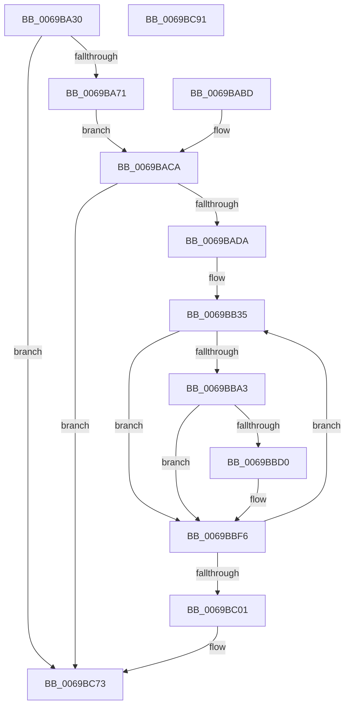

# FsRtlTruncateSmallMcb

- RVA: `0x0069BA30`–`0x0069BC92` (길이 `610` bytes)
- VA: `0x000000014069BA30`
- 실행 섹션: `.text`
- PDB 이름 있음: `예`; PDB Function 태그: `아니요`
- unwind 정보 RVA: `0x000D97C0`
- 디코드: `142`개 명령, `610/610` bytes 표시
- 미해석 바이트: `0` (있으면 어셈블리에 `.byte`로 보존)

> 이 문서는 커널 이미지의 기계어와 PDB 기호를 분석해 생성했습니다. 4번과 5번은 함수 원형과 자료형을 바이너리 사용 방식에서 추정한 C 해석이며 원본 소스 복구 결과는 아닙니다.

## 1. Dependencies

- 직접 호출 지점: **3**; 고유 호출 대상: **3**
- 직접 호출자로 확인된 함수: **0**
- RIP 상대 이미지 참조: **2**

### Outgoing calls
- `0x0069BA58` → [KeExitRetpoline](../46/KeExitRetpoline_function_00468E7C.md) (function, `0x00468E7C`)
- `0x0069BAB6` → [KiCustomAccessRoutine0](../6B/KiCustomAccessRoutine0_function_006BC580.md) (function, `0x006BC580`)
- `0x0069BC6E` → [RtlpComputeEpilogueOffset](../51/RtlpComputeEpilogueOffset_function_0051C81C.md) (function, `0x0051C81C`)

### Direct callers
- 이 함수 시작 RVA로 연결되는 직접 call은 확인되지 않았습니다. 간접 호출은 완전히 역산할 수 없습니다.

### Static image references
- `0x0069BB42` → RVA `0x00FC6F78` (`ALMOSTRO`; read)
- `0x0069BB57` → RVA `0x00FC7250` (`ALMOSTRO`; read)

## 2. Other-region calls and transfers

- 다른 실행 섹션으로 향하는 call: **0**
- 별도 외부 분기/꼬리 이동을 확인하지 못했습니다.

## 3. Assembly (complete function range)

```asm
0069BA30  48 89 5C 24 08                  mov qword ptr [rsp + 8], rbx
0069BA35  48 89 74 24 18                  mov qword ptr [rsp + 0x18], rsi
0069BA3A  48 89 7C 24 20                  mov qword ptr [rsp + 0x20], rdi
0069BA3F  41 54                           push r12
0069BA41  41 56                           push r14
0069BA43  41 57                           push r15
0069BA45  48 81 EC A0 00 00 00            sub rsp, 0xa0
0069BA4C  4D 8B E1                        mov r12, r9
0069BA4F  4D 8B F0                        mov r14, r8
0069BA52  4C 8B FA                        mov r15, rdx
0069BA55  48 8B F1                        mov rsi, rcx
0069BA58  E8 1F D4 DC FF                  call 0x140468e7c
0069BA5D  49 8B C7                        mov rax, r15
0069BA60  48 C1 F8 2F                     sar rax, 0x2f
0069BA64  48 FF C0                        inc rax
0069BA67  48 83 F8 01                     cmp rax, 1
0069BA6B  0F 86 02 02 00 00               jbe 0x14069bc73
0069BA71  33 FF                           xor edi, edi
0069BA73  8B DF                           mov ebx, edi
0069BA75  89 5C 24 20                     mov dword ptr [rsp + 0x20], ebx
0069BA79  40 88 3E                        mov byte ptr [rsi], dil
0069BA7C  49 8B C4                        mov rax, r12
0069BA7F  48 C1 E8 08                     shr rax, 8
0069BA83  48 89 46 20                     mov qword ptr [rsi + 0x20], rax
0069BA87  4C 89 B4 24 91 00 00 00         mov qword ptr [rsp + 0x91], r14
0069BA8F  41 8B CE                        mov ecx, r14d
0069BA92  49 8B C7                        mov rax, r15
0069BA95  48 D3 C0                        rol rax, cl
0069BA98  48 89 44 24 41                  mov qword ptr [rsp + 0x41], rax
0069BA9D  48 8B C6                        mov rax, rsi
0069BAA0  48 D3 C8                        ror rax, cl
0069BAA3  48 89 84 24 89 00 00 00         mov qword ptr [rsp + 0x89], rax
0069BAAB  4C 31 66 28                     xor qword ptr [rsi + 0x28], r12
0069BAAF  4C 31 76 30                     xor qword ptr [rsi + 0x30], r14
0069BAB3  49 8B CF                        mov rcx, r15
0069BAB6  E8 C5 0A 02 00                  call 0x1406bc580
0069BABB  EB 0D                           jmp 0x14069baca
0069BABD  8B 5C 24 20                     mov ebx, dword ptr [rsp + 0x20]
0069BAC1  83 C3 07                        add ebx, 7
0069BAC4  89 5C 24 20                     mov dword ptr [rsp + 0x20], ebx
0069BAC8  33 FF                           xor edi, edi
0069BACA  83 C3 07                        add ebx, 7
0069BACD  89 5C 24 20                     mov dword ptr [rsp + 0x20], ebx
0069BAD1  83 FB 15                        cmp ebx, 0x15
0069BAD4  0F 85 99 01 00 00               jne 0x14069bc73
0069BADA  48 8B 8C 24 91 00 00 00         mov rcx, qword ptr [rsp + 0x91]
0069BAE2  4C 8B 4C 24 41                  mov r9, qword ptr [rsp + 0x41]
0069BAE7  48 8B 84 24 91 00 00 00         mov rax, qword ptr [rsp + 0x91]
0069BAEF  48 8B 9C 24 89 00 00 00         mov rbx, qword ptr [rsp + 0x89]
0069BAF7  49 D3 C9                        ror r9, cl
0069BAFA  8B C8                           mov ecx, eax
0069BAFC  48 D3 C3                        rol rbx, cl
0069BAFF  4C 33 4B 40                     xor r9, qword ptr [rbx + 0x40]
0069BB03  48 B8 00 00 00 00 00 80 FF FF   movabs rax, 0xffff800000000000
0069BB0D  4C 0B C8                        or r9, rax
0069BB10  41 8A C9                        mov cl, r9b
0069BB13  80 E1 3F                        and cl, 0x3f
0069BB16  49 8B C1                        mov rax, r9
0069BB19  48 D3 C8                        ror rax, cl
0069BB1C  48 89 44 24 28                  mov qword ptr [rsp + 0x28], rax
0069BB21  41 BB 19 00 00 00               mov r11d, 0x19
0069BB27  4D 8D 51 F8                     lea r10, [r9 - 8]
0069BB2B  48 BE 2E 48 31 11 48 31 51 08   movabs rsi, 0x85131481131482e
0069BB35  49 8D 42 08                     lea rax, [r10 + 8]
0069BB39  4C 8D 10                        lea r10, [rax]
0069BB3C  4C 8B 00                        mov r8, qword ptr [rax]
0069BB3F  49 8B D0                        mov rdx, r8
0069BB42  48 8B 0D 2F B4 92 00            mov rcx, qword ptr [rip + 0x92b42f]
0069BB49  48 33 D1                        xor rdx, rcx
0069BB4C  48 D3 C2                        rol rdx, cl
0069BB4F  48 33 54 24 28                  xor rdx, qword ptr [rsp + 0x28]
0069BB54  48 0F CA                        bswap rdx
0069BB57  48 8B 05 F2 B6 92 00            mov rax, qword ptr [rip + 0x92b6f2]
0069BB5E  48 33 C2                        xor rax, rdx
0069BB61  8B CF                           mov ecx, edi
0069BB63  49 03 C1                        add rax, r9
0069BB66  48 03 C8                        add rcx, rax
0069BB69  49 89 0A                        mov qword ptr [r10], rcx
0069BB6C  41 8B C8                        mov ecx, r8d
0069BB6F  F7 D1                           not ecx
0069BB71  83 E1 3F                        and ecx, 0x3f
0069BB74  BA C8 00 00 00                  mov edx, 0xc8
0069BB79  2B D7                           sub edx, edi
0069BB7B  8B C7                           mov eax, edi
0069BB7D  48 33 D0                        xor rdx, rax
0069BB80  41 80 F0 FA                     xor r8b, 0xfa
0069BB84  41 80 E0 3F                     and r8b, 0x3f
0069BB88  48 D3 CA                        ror rdx, cl
0069BB8B  48 33 54 24 28                  xor rdx, qword ptr [rsp + 0x28]
0069BB90  41 8A C8                        mov cl, r8b
0069BB93  48 D3 C2                        rol rdx, cl
0069BB96  49 03 D1                        add rdx, r9
0069BB99  48 89 54 24 28                  mov qword ptr [rsp + 0x28], rdx
0069BB9E  83 FF 18                        cmp edi, 0x18
0069BBA1  75 53                           jne 0x14069bbf6
0069BBA3  48 89 B4 24 C8 00 00 00         mov qword ptr [rsp + 0xc8], rsi
0069BBAB  48 8B 84 24 C8 00 00 00         mov rax, qword ptr [rsp + 0xc8]
0069BBB3  48 8B 84 24 C8 00 00 00         mov rax, qword ptr [rsp + 0xc8]
0069BBBB  48 89 84 24 C8 00 00 00         mov qword ptr [rsp + 0xc8], rax
0069BBC3  48 8B 84 24 C8 00 00 00         mov rax, qword ptr [rsp + 0xc8]
0069BBCB  49 3B 01                        cmp rax, qword ptr [r9]
0069BBCE  74 26                           je 0x14069bbf6
0069BBD0  48 8B 84 24 C8 00 00 00         mov rax, qword ptr [rsp + 0xc8]
0069BBD8  49 33 02                        xor rax, qword ptr [r10]
0069BBDB  49 33 01                        xor rax, qword ptr [r9]
0069BBDE  49 89 02                        mov qword ptr [r10], rax
0069BBE1  45 03 5A 04                     add r11d, dword ptr [r10 + 4]
0069BBE5  48 8B 84 24 C8 00 00 00         mov rax, qword ptr [rsp + 0xc8]
0069BBED  49 33 02                        xor rax, qword ptr [r10]
0069BBF0  49 33 01                        xor rax, qword ptr [r9]
0069BBF3  49 89 02                        mov qword ptr [r10], rax
0069BBF6  FF C7                           inc edi
0069BBF8  41 3B FB                        cmp edi, r11d
0069BBFB  0F 82 34 FF FF FF               jb 0x14069bb35
0069BC01  48 89 B4 24 C8 00 00 00         mov qword ptr [rsp + 0xc8], rsi
0069BC09  48 8B 84 24 C8 00 00 00         mov rax, qword ptr [rsp + 0xc8]
0069BC11  48 8B 84 24 C8 00 00 00         mov rax, qword ptr [rsp + 0xc8]
0069BC19  48 89 84 24 C8 00 00 00         mov qword ptr [rsp + 0xc8], rax
0069BC21  48 8B 84 24 C8 00 00 00         mov rax, qword ptr [rsp + 0xc8]
0069BC29  49 33 01                        xor rax, qword ptr [r9]
0069BC2C  48 89 44 24 28                  mov qword ptr [rsp + 0x28], rax
0069BC31  48 C7 84 24 C8 00 00 00 2E 48 31 11  mov qword ptr [rsp + 0xc8], 0x1131482e
0069BC3D  48 8B 84 24 C8 00 00 00         mov rax, qword ptr [rsp + 0xc8]
0069BC45  4C 8B 84 24 C8 00 00 00         mov r8, qword ptr [rsp + 0xc8]
0069BC4D  45 8B C0                        mov r8d, r8d
0069BC50  4C 89 84 24 C8 00 00 00         mov qword ptr [rsp + 0xc8], r8
0069BC58  48 8B 84 24 C8 00 00 00         mov rax, qword ptr [rsp + 0xc8]
0069BC60  41 89 01                        mov dword ptr [r9], eax
0069BC63  4C 8B 44 24 28                  mov r8, qword ptr [rsp + 0x28]
0069BC68  49 8B D1                        mov rdx, r9
0069BC6B  48 8B CB                        mov rcx, rbx
0069BC6E  E8 A9 0B E8 FF                  call 0x14051c81c
0069BC73  4C 8D 9C 24 A0 00 00 00         lea r11, [rsp + 0xa0]
0069BC7B  49 8B 5B 20                     mov rbx, qword ptr [r11 + 0x20]
0069BC7F  49 8B 73 30                     mov rsi, qword ptr [r11 + 0x30]
0069BC83  49 8B 7B 38                     mov rdi, qword ptr [r11 + 0x38]
0069BC87  49 8B E3                        mov rsp, r11
0069BC8A  41 5F                           pop r15
0069BC8C  41 5E                           pop r14
0069BC8E  41 5C                           pop r12
0069BC90  C3                              ret
0069BC91  CC                              int3
```

## 4. C-style interpretation (structured pseudocode)

```c
__int64 __fastcall FsRtlTruncateSmallMcb(__int64 a1, __int64 a2, __int64 a3, __int64 a4)
{
    __int64 result;
    __int64 v_r11;
    __int64 v_rbx;
    __int64 v_rdi;
    __int64 v_rsp;
    unsigned __int64 v_stack_m18;
    unsigned __int64 v_stack_m27;
    unsigned __int64 v_stack_m2F;
    unsigned __int64 v_stack_m77;
    unsigned __int64 v_stack_m90;
    unsigned int v_stack_m98;
    unsigned __int64 v_stack_p10;
    unsigned __int64 v_stack_p18;
    unsigned __int64 v_stack_p20;
    unsigned __int64 v_stack_p8;

    v_stack_p8 = v_rbx;
    v_stack_p18 = v_rsi;
    v_stack_p20 = v_rdi;
    v_rsp = (v_rsp) - (160);
    result = KeExitRetpoline(a1, a2, a3, a4);
    result = (a2) >> (47);
    result = (result) + 1;
    if (result <= 1) goto loc_0069BC73;
    v_rdi = 0;
    v_stack_m98 = 0;
    *(unsigned __int8 *)(a1) = 0;
    result = (a4) >> (8);
    *(unsigned __int64 *)(a1 + 32) = result;
    v_stack_m27 = a3;
    v_stack_m77 = a2;
    v_stack_m2F = a1;
    result = KiCustomAccessRoutine0(a2, a2, a3, a4);
    goto loc_0069BACA;
loc_0069BACA:
    v_rbx = (unsigned int)((0) + (7));
    v_stack_m98 = (unsigned int)(v_rbx);
    if (((unsigned int)(v_rbx)) != 21) goto loc_0069BC73;
    a4 = (v_stack_m77) ^ (*(unsigned __int64 *)(v_stack_m2F + 64));
    a4 = (a4) | (v_stack_m27);
    a1 = (unsigned __int8)(((unsigned __int8)(a4)) & (63));
    v_stack_m90 = a4;
loc_0069BB35:
    a2 = (*(unsigned __int64 *)(a4 - 8 + 8)) ^ (*(unsigned __int64 *)(v_rip + 9614383));
    a2 = (a2) ^ (v_stack_m90);
    result = (*(unsigned __int64 *)(v_rip + 9615090)) ^ (a2);
    result = (result) + (a4);
    a1 = (0) + (result);
    *(unsigned __int64 *)(a4 - 8 + 8) = a1;
    a1 = (unsigned int)(~((unsigned int)((unsigned int)(*(unsigned __int64 *)(a4 - 8 + 8)))));
    a1 = (unsigned int)((a1) & (63));
    a2 = (unsigned int)((200) - (0));
    a2 = (a2) ^ (0);
    a3 = (unsigned __int8)((*(unsigned __int64 *)(a4 - 8 + 8)) ^ (250));
    a3 = (unsigned __int8)((a3) & (63));
    a2 = (a2) ^ (v_stack_m90);
    a2 = (a2) + (a4);
    v_stack_m90 = a2;
    if (0 != 24) goto loc_0069BBF6;
    v_stack_p10 = a1;
    v_stack_p10 = v_stack_p10;
    result = v_stack_p10;
    v_r11 = 25;
    if (v_stack_p10 != (*(unsigned __int64 *)(a4))) {
        result = v_stack_p10;
        result = (result) ^ (*(unsigned __int64 *)(a4 - 8 + 8));
        result = (result) ^ (*(unsigned __int64 *)(a4));
        *(unsigned __int64 *)(a4 - 8 + 8) = result;
        v_r11 = (unsigned int)((25) + (*(unsigned int *)(a4 - 8 + 8 + 4)));
        result = v_stack_p10;
        result = (result) ^ (*(unsigned __int64 *)(a4 - 8 + 8));
        result = (result) ^ (*(unsigned __int64 *)(a4));
        *(unsigned __int64 *)(a4 - 8 + 8) = result;
    }
    v_rdi = (unsigned int)((v_rdi) + 1);
    if (((unsigned int)(v_rdi)) < ((unsigned int)(v_r11))) goto loc_0069BB35;
    v_stack_p10 = a1;
    v_stack_p10 = v_stack_p10;
    result = (v_stack_p10) ^ (*(unsigned __int64 *)(a4));
    v_stack_m90 = result;
    v_stack_p10 = 0x1131482EULL;
    v_stack_p10 = (unsigned int)((unsigned int)(v_stack_p10));
    *(unsigned int *)(a4) = (unsigned int)(v_stack_p10);
    result = RtlpComputeEpilogueOffset(v_stack_m2F, a4, v_stack_m90, a4);
loc_0069BC73:
    return result;
}
```

## 5. (Beta) C Style

```c
int64_t FsRtlTruncateSmallMcb(void *Arg1, int64_t Arg2, int64_t Arg3, int64_t Arg4)
{
    uint8_t *arg1 = (uint8_t *)Arg1;

    int64_t result;
    int64_t local_r11;
    int64_t local_rbx;
    int64_t local_rdi;
    int64_t local_rsp;
    uint64_t v_stack_m18;
    uint64_t v_stack_m27;
    uint64_t v_stack_m2F;
    uint64_t v_stack_m77;
    uint64_t v_stack_m90;
    uint32_t v_stack_m98;
    uint64_t v_stack_p10;
    uint64_t v_stack_p18;
    uint64_t v_stack_p20;
    uint64_t v_stack_p8;

    v_stack_p8 = local_rbx;
    v_stack_p18 = local_rsi;
    v_stack_p20 = local_rdi;
    local_rsp = (local_rsp) - (160);
    result = KeExitRetpoline(Arg1, Arg2, Arg3, Arg4);
    result = (Arg2) >> (47);
    result = (result) + 1;
    if (result <= 1) goto loc_0069BC73;
    local_rdi = 0;
    v_stack_m98 = 0;
    *(uint8_t *)(arg1) = 0;
    result = (Arg4) >> (8);
    *(uint64_t *)(arg1 + 0x20) = result;
    v_stack_m27 = Arg3;
    v_stack_m77 = Arg2;
    v_stack_m2F = Arg1;
    result = KiCustomAccessRoutine0(Arg2, Arg2, Arg3, Arg4);
    goto loc_0069BACA;
loc_0069BACA:
    local_rbx = (uint32_t)((0) + (7));
    v_stack_m98 = (uint32_t)(local_rbx);
    if (((uint32_t)(local_rbx)) != 21) goto loc_0069BC73;
    Arg4 = (v_stack_m77) ^ (*(uint64_t *)(v_stack_m2F + 0x40));
    Arg4 = (Arg4) | (v_stack_m27);
    Arg1 = (uint8_t)(((uint8_t)(Arg4)) & (63));
    v_stack_m90 = Arg4;
loc_0069BB35:
    Arg2 = (*(uint64_t *)(Arg4 - 0x8 + 0x8)) ^ (*(uint64_t *)(v_rip + 0x92B42F));
    Arg2 = (Arg2) ^ (v_stack_m90);
    result = (*(uint64_t *)(v_rip + 0x92B6F2)) ^ (Arg2);
    result = (result) + (Arg4);
    Arg1 = (0) + (result);
    *(void **)(Arg4 - 0x8 + 0x8) = Arg1;
    Arg1 = (uint32_t)(~((uint32_t)((uint32_t)(*(uint64_t *)(Arg4 - 0x8 + 0x8)))));
    Arg1 = (uint32_t)((Arg1) & (63));
    Arg2 = (uint32_t)((200) - (0));
    Arg2 = (Arg2) ^ (0);
    Arg3 = (uint8_t)((*(uint64_t *)(Arg4 - 0x8 + 0x8)) ^ (250));
    Arg3 = (uint8_t)((Arg3) & (63));
    Arg2 = (Arg2) ^ (v_stack_m90);
    Arg2 = (Arg2) + (Arg4);
    v_stack_m90 = Arg2;
    if (0 != 24) goto loc_0069BBF6;
    v_stack_p10 = Arg1;
    v_stack_p10 = v_stack_p10;
    result = v_stack_p10;
    local_r11 = 25;
    if (v_stack_p10 != (*(uint64_t *)(Arg4))) {
        result = v_stack_p10;
        result = (result) ^ (*(uint64_t *)(Arg4 - 0x8 + 0x8));
        result = (result) ^ (*(uint64_t *)(Arg4));
        *(uint64_t *)(Arg4 - 0x8 + 0x8) = result;
        local_r11 = (uint32_t)((25) + (*(uint32_t *)(Arg4 - 0x8 + 0x8 + 0x4)));
        result = v_stack_p10;
        result = (result) ^ (*(uint64_t *)(Arg4 - 0x8 + 0x8));
        result = (result) ^ (*(uint64_t *)(Arg4));
        *(uint64_t *)(Arg4 - 0x8 + 0x8) = result;
    }
    local_rdi = (uint32_t)((local_rdi) + 1);
    if (((uint32_t)(local_rdi)) < ((uint32_t)(local_r11))) goto loc_0069BB35;
    v_stack_p10 = Arg1;
    v_stack_p10 = v_stack_p10;
    result = (v_stack_p10) ^ (*(uint64_t *)(Arg4));
    v_stack_m90 = result;
    v_stack_p10 = 0x1131482EULL;
    v_stack_p10 = (uint32_t)((uint32_t)(v_stack_p10));
    *(uint32_t *)(Arg4) = (uint32_t)(v_stack_p10);
    result = RtlpComputeEpilogueOffset(v_stack_m2F, Arg4, v_stack_m90, Arg4);
loc_0069BC73:
    return result;
}
```

### 관측된 메모리 오프셋

구조체 형식이 확인되지 않은 접근은 인자 기준의 오프셋으로만 기록했습니다.

| 기준 인자 | 오프셋 표현 | 폭 (bit) | 접근 |
|---|---:|---:|---|
| `Arg1` | `+ 0x0` | `8` | `W` |
| `Arg1` | `+ 0x20` | `64` | `W` |
| `Arg1` | `+ 0x28` | `64` | `R/W` |
| `Arg1` | `+ 0x30` | `64` | `R/W` |

## 6. Execution-region graph

[열기: 2D/3D 그래프와 함수 탐색 컨트롤 패널](../../../control-panel.html?section=text&rva=0x0069BA30&view=graph)

- 2D 그래프는 위에서 아래로 흐르고, 3D 그래프는 빈 공간을 드래그해 회전합니다. Shift+드래그는 이동, 휠은 확대·축소, 함수 노드 선택은 대상 보고서 이동입니다.

### Static fallback


