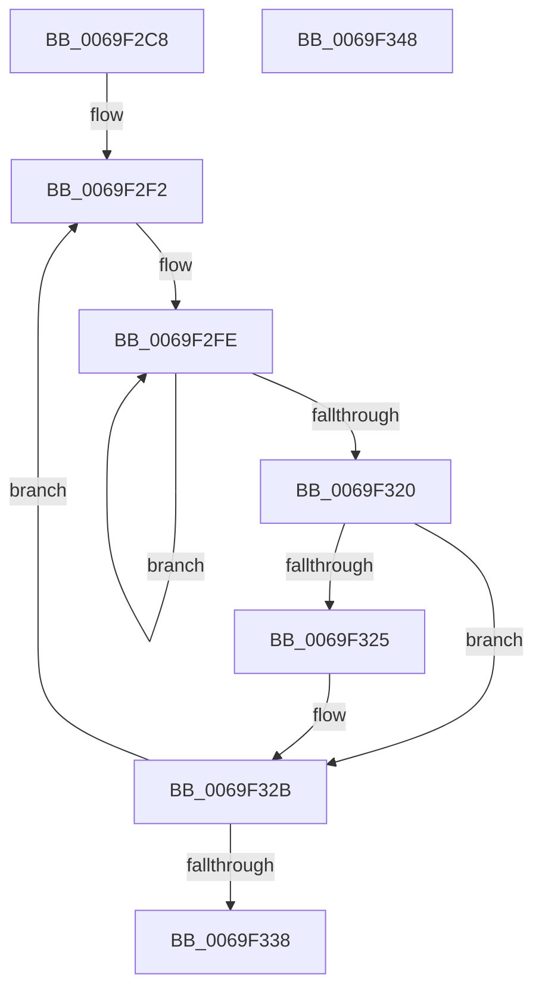

# GxpMatchPaletteColor

- RVA: `0x0069F2C8`–`0x0069F349` (길이 `129` bytes)
- VA: `0x000000014069F2C8`
- 실행 섹션: `.text`
- PDB 이름 있음: `예`; PDB Function 태그: `아니요`
- unwind 정보 RVA: `0x000DA440`
- 디코드: `38`개 명령, `129/129` bytes 표시
- 미해석 바이트: `0` (있으면 어셈블리에 `.byte`로 보존)

> 이 문서는 커널 이미지의 기계어와 PDB 기호를 분석해 생성했습니다. 4번과 5번은 함수 원형과 자료형을 바이너리 사용 방식에서 추정한 C 해석이며 원본 소스 복구 결과는 아닙니다.

## 1. Dependencies

- 직접 호출 지점: **0**; 고유 호출 대상: **0**
- 직접 호출자로 확인된 함수: **1**
- RIP 상대 이미지 참조: **1**

### Outgoing calls
- 직접 디코드된 call 명령이 없습니다.

### Direct callers
- [sub_006F2EEA](../6F/Unknown_function_006F2EEA.md) at `0x006F2F26`

### Static image references
- `0x0069F2E2` → RVA `0x00041B60` (`.rdata`; read)

## 2. Other-region calls and transfers

- 다른 실행 섹션으로 향하는 call: **0**
- 별도 외부 분기/꼬리 이동을 확인하지 못했습니다.

## 3. Assembly (complete function range)

```asm
0069F2C8  48 8B C4                        mov rax, rsp
0069F2CB  48 89 58 10                     mov qword ptr [rax + 0x10], rbx
0069F2CF  48 89 70 18                     mov qword ptr [rax + 0x18], rsi
0069F2D3  48 89 78 20                     mov qword ptr [rax + 0x20], rdi
0069F2D7  89 48 08                        mov dword ptr [rax + 8], ecx
0069F2DA  48 8D 40 08                     lea rax, [rax + 8]
0069F2DE  41 83 CB FF                     or r11d, 0xffffffff
0069F2E2  4C 8D 0D 77 28 9A FF            lea r9, [rip - 0x65d789]
0069F2E9  45 33 C0                        xor r8d, r8d
0069F2EC  48 8B FA                        mov rdi, rdx
0069F2EF  4C 2B C8                        sub r9, rax
0069F2F2  45 33 D2                        xor r10d, r10d
0069F2F5  48 8D 5C 24 08                  lea rbx, [rsp + 8]
0069F2FA  41 8D 72 03                     lea esi, [r10 + 3]
0069F2FE  41 0F B6 04 19                  movzx eax, byte ptr [r9 + rbx]
0069F303  0F B6 0B                        movzx ecx, byte ptr [rbx]
0069F306  2B C8                           sub ecx, eax
0069F308  8B D1                           mov edx, ecx
0069F30A  F7 DA                           neg edx
0069F30C  0F 48 D1                        cmovs edx, ecx
0069F30F  48 FF C3                        inc rbx
0069F312  41 8D 04 12                     lea eax, [r10 + rdx]
0069F316  44 8D 14 50                     lea r10d, [rax + rdx*2]
0069F31A  48 83 EE 01                     sub rsi, 1
0069F31E  75 DE                           jne 0x14069f2fe
0069F320  45 3B D3                        cmp r10d, r11d
0069F323  73 06                           jae 0x14069f32b
0069F325  45 8B DA                        mov r11d, r10d
0069F328  44 88 07                        mov byte ptr [rdi], r8b
0069F32B  41 FF C0                        inc r8d
0069F32E  49 83 C1 04                     add r9, 4
0069F332  41 83 F8 10                     cmp r8d, 0x10
0069F336  72 BA                           jb 0x14069f2f2
0069F338  48 8B 5C 24 10                  mov rbx, qword ptr [rsp + 0x10]
0069F33D  48 8B 74 24 18                  mov rsi, qword ptr [rsp + 0x18]
0069F342  48 8B 7C 24 20                  mov rdi, qword ptr [rsp + 0x20]
0069F347  C3                              ret
0069F348  CC                              int3
```

## 4. C-style interpretation (structured pseudocode)

```c
__int64 __fastcall GxpMatchPaletteColor(int a1, __int64 a2, int a3)
{
    __int64 v_r10;
    __int64 v_r11;
    __int64 v_rbx;
    __int64 v_rsi;
    unsigned __int64 v_stack_p10;
    unsigned __int64 v_stack_p18;
    unsigned __int64 v_stack_p20;
    unsigned __int64 v_stack_p8;

    *(unsigned __int64 *)(v_rsp + 16) = v_rbx;
    *(unsigned __int64 *)(v_rsp + 24) = v_rsi;
    *(unsigned __int64 *)(v_rsp + 32) = v_rdi;
    *(unsigned int *)(v_rsp + 8) = a1;
    v_r11 = (unsigned int)((v_r11) | (0xFFFFFFFFULL));
    a3 = 0;
    a4 = (v_rip - 6674313) - (v_rsp + 8);
loc_0069F2F2:
    v_r10 = 0;
loc_0069F2FE:
    a1 = (unsigned int)((*(unsigned __int8 *)(v_stack_p8)) - ((unsigned int)(*(unsigned __int8 *)(a4 + v_stack_p8 * 1))));
    a2 = (unsigned int)(-((unsigned int)(a1)));
    if (sign_flag) { a2 = a1; }
    v_rbx = (v_stack_p8) + 1;
    v_rsi = (v_r10 + 3) - (1);
    if (condition_is_not_equal) goto loc_0069F2FE;
    if (((unsigned int)(v_r10 + a2 * 1 + a2 * 2)) < ((unsigned int)(v_r11))) {
        v_r11 = (unsigned int)(v_r10 + a2 * 1 + a2 * 2);
        *(unsigned __int8 *)(a2) = 0;
    }
    a3 = (unsigned int)((a3) + 1);
    a4 = (a4) + (4);
    if (a3 < 16) goto loc_0069F2F2;
    return v_r10 + a2 * 1;
}
```

## 5. (Beta) C Style

```c
int64_t GxpMatchPaletteColor(int32_t Arg1, void *Arg2, int32_t Arg3)
{
    uint8_t *arg2 = (uint8_t *)Arg2;

    int64_t local_r10;
    int64_t local_r11;
    int64_t local_rbx;
    int64_t local_rsi;
    uint64_t v_stack_p10;
    uint64_t v_stack_p18;
    uint64_t v_stack_p20;
    uint64_t v_stack_p8;

    *(uint64_t *)(local_rsp + 0x10) = local_rbx;
    *(uint64_t *)(local_rsp + 0x18) = local_rsi;
    *(uint64_t *)(local_rsp + 0x20) = local_rdi;
    *(uint32_t *)(local_rsp + 0x8) = Arg1;
    local_r11 = (uint32_t)((local_r11) | (0xFFFFFFFFULL));
    Arg3 = 0;
    a4 = (v_rip - 6674313) - (local_rsp + 8);
loc_0069F2F2:
    local_r10 = 0;
loc_0069F2FE:
    Arg1 = (uint32_t)((*(uint8_t *)(v_stack_p8)) - ((uint32_t)(*(uint8_t *)(a4 + v_stack_p8 * 1))));
    Arg2 = (uint32_t)(-((uint32_t)(Arg1)));
    if (sign_flag) { Arg2 = Arg1; }
    local_rbx = (v_stack_p8) + 1;
    local_rsi = (local_r10 + 3) - (1);
    if (condition_is_not_equal) goto loc_0069F2FE;
    if (((uint32_t)(local_r10 + Arg2 * 1 + Arg2 * 2)) < ((uint32_t)(local_r11))) {
        local_r11 = (uint32_t)(local_r10 + Arg2 * 1 + Arg2 * 2);
        *(uint8_t *)(arg2) = 0;
    }
    Arg3 = (uint32_t)((Arg3) + 1);
    a4 = (a4) + (4);
    if (Arg3 < 16) goto loc_0069F2F2;
    return local_r10 + Arg2 * 1;
}
```

### 관측된 메모리 오프셋

구조체 형식이 확인되지 않은 접근은 인자 기준의 오프셋으로만 기록했습니다.

| 기준 인자 | 오프셋 표현 | 폭 (bit) | 접근 |
|---|---:|---:|---|
| `Arg2` | `+ 0x0` | `8` | `W` |

## 6. Execution-region graph

[열기: 2D/3D 그래프와 함수 탐색 컨트롤 패널](../../../control-panel.html?section=text&rva=0x0069F2C8&view=graph)

- 2D 그래프는 위에서 아래로 흐르고, 3D 그래프는 빈 공간을 드래그해 회전합니다. Shift+드래그는 이동, 휠은 확대·축소, 함수 노드 선택은 대상 보고서 이동입니다.

### Static fallback


