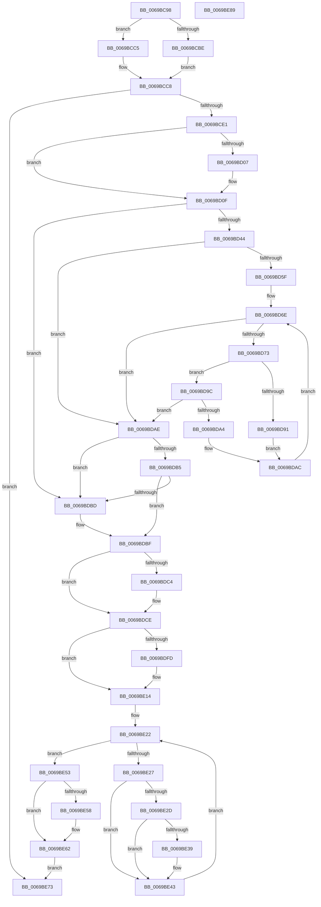

# KiLockServiceTable

- RVA: `0x0069BC98`–`0x0069BE8A` (길이 `498` bytes)
- VA: `0x000000014069BC98`
- 실행 섹션: `.text`
- PDB 이름 있음: `예`; PDB Function 태그: `아니요`
- unwind 정보 RVA: `0x000D9830`
- 디코드: `142`개 명령, `498/498` bytes 표시
- 미해석 바이트: `0` (있으면 어셈블리에 `.byte`로 보존)

> 이 문서는 커널 이미지의 기계어와 PDB 기호를 분석해 생성했습니다. 4번과 5번은 함수 원형과 자료형을 바이너리 사용 방식에서 추정한 C 해석이며 원본 소스 복구 결과는 아닙니다.

## 1. Dependencies

- 직접 호출 지점: **12**; 고유 호출 대상: **9**
- 직접 호출자로 확인된 함수: **1**
- RIP 상대 이미지 참조: **1**

### Outgoing calls
- `0x0069BCBE` → [KeExitRetpoline](../46/KeExitRetpoline_function_00468E7C.md) (function, `0x00468E7C`)
- `0x0069BCD4` → [KiLockExtendedServiceTable](../50/KiLockExtendedServiceTable_function_00509F48.md) (function, `0x00509F48`)
- `0x0069BCF8` → [RtlCaptureImageExceptionValues](../43/RtlCaptureImageExceptionValues_function_00432890.md) (function, `0x00432890`)
- `0x0069BD0A` → [KeBugCheck](../4F/KeBugCheck_function_004FD640.md) (function, `0x004FD640`)
- `0x0069BD0F` → [KiFastGetCallersAddress](../../init/C6/KiFastGetCallersAddress_function_00C6CFA8.md) (function, `0x00C6CFA8`)
- `0x0069BDC9` → [KeBugCheck](../4F/KeBugCheck_function_004FD640.md) (function, `0x004FD640`)
- `0x0069BDD1` → [RtlpConvertFunctionEntry](../41/RtlpConvertFunctionEntry_function_00416CA0.md) (function, `0x00416CA0`)
- `0x0069BDF4` → [RtlLookupExceptionHandler](../5E/RtlLookupExceptionHandler_function_005E6A48.md) (function, `0x005E6A48`)
- `0x0069BE0F` → [KeBugCheckEx](../4F/KeBugCheckEx_function_004FD660.md) (function, `0x004FD660`)
- `0x0069BE3E` → [KeBugCheck](../4F/KeBugCheck_function_004FD640.md) (function, `0x004FD640`)
- `0x0069BE5D` → [KeBugCheck](../4F/KeBugCheck_function_004FD640.md) (function, `0x004FD640`)
- `0x0069BE6C` → [guard_dispatch_icall](../6B/guard_dispatch_icall_function_006BAAD0.md) (function, `0x006BAAD0`)

### Direct callers
- [KeCompactServiceTable](../5B/KeCompactServiceTable_function_005B61AC.md) at `0x005B61EE`

### Static image references
- `0x0069BCEE` → RVA `0x00000000` (`image boundary/outside`; read)

## 2. Other-region calls and transfers

- 다른 실행 섹션으로 향하는 call: **1**
  - `0x0069BD0F` → [KiFastGetCallersAddress](../../init/C6/KiFastGetCallersAddress_function_00C6CFA8.md) (`.text` → `INIT`)
- 별도 외부 분기/꼬리 이동을 확인하지 못했습니다.

## 3. Assembly (complete function range)

```asm
0069BC98  48 89 5C 24 08                  mov qword ptr [rsp + 8], rbx
0069BC9D  48 89 74 24 10                  mov qword ptr [rsp + 0x10], rsi
0069BCA2  48 89 7C 24 18                  mov qword ptr [rsp + 0x18], rdi
0069BCA7  41 56                           push r14
0069BCA9  48 83 EC 50                     sub rsp, 0x50
0069BCAD  41 8B D9                        mov ebx, r9d
0069BCB0  41 8B F8                        mov edi, r8d
0069BCB3  48 8B F2                        mov rsi, rdx
0069BCB6  4C 8B F1                        mov r14, rcx
0069BCB9  45 85 C9                        test r9d, r9d
0069BCBC  74 07                           je 0x14069bcc5
0069BCBE  E8 B9 D1 DC FF                  call 0x140468e7c
0069BCC3  EB 03                           jmp 0x14069bcc8
0069BCC5  0F AE E8                        lfence
0069BCC8  44 8B CB                        mov r9d, ebx
0069BCCB  44 8B C7                        mov r8d, edi
0069BCCE  48 8B D6                        mov rdx, rsi
0069BCD1  49 8B CE                        mov rcx, r14
0069BCD4  E8 6F E2 E6 FF                  call 0x140509f48
0069BCD9  85 DB                           test ebx, ebx
0069BCDB  0F 85 92 01 00 00               jne 0x14069be73
0069BCE1  0F AE E8                        lfence
0069BCE4  4C 8D 44 24 78                  lea r8, [rsp + 0x78]
0069BCE9  48 8D 54 24 48                  lea rdx, [rsp + 0x48]
0069BCEE  48 8D 3D 0B 43 96 FF            lea rdi, [rip - 0x69bcf5]
0069BCF5  48 8B CF                        mov rcx, rdi
0069BCF8  E8 93 6B D9 FF                  call 0x140432890
0069BCFD  4C 8B 5C 24 48                  mov r11, qword ptr [rsp + 0x48]
0069BD02  4D 85 DB                        test r11, r11
0069BD05  75 08                           jne 0x14069bd0f
0069BD07  8D 4B 31                        lea ecx, [rbx + 0x31]
0069BD0A  E8 31 19 E6 FF                  call 0x1404fd640
0069BD0F  E8 94 12 5D 00                  call 0x140c6cfa8
0069BD14  4C 8B C0                        mov r8, rax
0069BD17  8B 4C 24 78                     mov ecx, dword ptr [rsp + 0x78]
0069BD1B  48 B8 AB AA AA AA AA AA AA AA   movabs rax, 0xaaaaaaaaaaaaaaab
0069BD25  48 F7 E1                        mul rcx
0069BD28  4C 8B CA                        mov r9, rdx
0069BD2B  49 C1 E9 03                     shr r9, 3
0069BD2F  48 83 64 24 40 00               and qword ptr [rsp + 0x40], 0
0069BD35  83 64 24 30 00                  and dword ptr [rsp + 0x30], 0
0069BD3A  83 64 24 34 00                  and dword ptr [rsp + 0x34], 0
0069BD3F  45 85 C9                        test r9d, r9d
0069BD42  74 79                           je 0x14069bdbd
0069BD44  4C 2B C7                        sub r8, rdi
0069BD47  41 8D 41 FF                     lea eax, [r9 - 1]
0069BD4B  48 8D 04 40                     lea rax, [rax + rax*2]
0069BD4F  49 8D 0C 83                     lea rcx, [r11 + rax*4]
0069BD53  48 89 4C 24 40                  mov qword ptr [rsp + 0x40], rcx
0069BD58  8B 01                           mov eax, dword ptr [rcx]
0069BD5A  4C 3B C0                        cmp r8, rax
0069BD5D  73 4F                           jae 0x14069bdae
0069BD5F  33 D2                           xor edx, edx
0069BD61  89 54 24 34                     mov dword ptr [rsp + 0x34], edx
0069BD65  41 83 C1 FE                     add r9d, -2
0069BD69  44 89 4C 24 30                  mov dword ptr [rsp + 0x30], r9d
0069BD6E  44 3B CA                        cmp r9d, edx
0069BD71  7C 3B                           jl 0x14069bdae
0069BD73  46 8D 14 0A                     lea r10d, [rdx + r9]
0069BD77  41 D1 FA                        sar r10d, 1
0069BD7A  49 63 C2                        movsxd rax, r10d
0069BD7D  48 8D 0C 40                     lea rcx, [rax + rax*2]
0069BD81  49 8D 0C 8B                     lea rcx, [r11 + rcx*4]
0069BD85  48 89 4C 24 40                  mov qword ptr [rsp + 0x40], rcx
0069BD8A  8B 01                           mov eax, dword ptr [rcx]
0069BD8C  4C 3B C0                        cmp r8, rax
0069BD8F  73 0B                           jae 0x14069bd9c
0069BD91  45 8D 4A FF                     lea r9d, [r10 - 1]
0069BD95  44 89 4C 24 30                  mov dword ptr [rsp + 0x30], r9d
0069BD9A  EB 10                           jmp 0x14069bdac
0069BD9C  8B 41 0C                        mov eax, dword ptr [rcx + 0xc]
0069BD9F  4C 3B C0                        cmp r8, rax
0069BDA2  72 0A                           jb 0x14069bdae
0069BDA4  41 8D 52 01                     lea edx, [r10 + 1]
0069BDA8  89 54 24 34                     mov dword ptr [rsp + 0x34], edx
0069BDAC  EB C0                           jmp 0x14069bd6e
0069BDAE  8B 01                           mov eax, dword ptr [rcx]
0069BDB0  4C 3B C0                        cmp r8, rax
0069BDB3  72 08                           jb 0x14069bdbd
0069BDB5  8B 41 04                        mov eax, dword ptr [rcx + 4]
0069BDB8  4C 3B C0                        cmp r8, rax
0069BDBB  72 02                           jb 0x14069bdbf
0069BDBD  33 C9                           xor ecx, ecx
0069BDBF  48 85 C9                        test rcx, rcx
0069BDC2  75 0A                           jne 0x14069bdce
0069BDC4  B9 31 00 00 00                  mov ecx, 0x31
0069BDC9  E8 72 18 E6 FF                  call 0x1404fd640
0069BDCE  48 8B D7                        mov rdx, rdi
0069BDD1  E8 CA AE D7 FF                  call 0x140416ca0
0069BDD6  48 8D 4C 24 48                  lea rcx, [rsp + 0x48]
0069BDDB  48 89 4C 24 28                  mov qword ptr [rsp + 0x28], rcx
0069BDE0  48 83 64 24 20 00               and qword ptr [rsp + 0x20], 0
0069BDE6  BB 01 00 00 00                  mov ebx, 1
0069BDEB  44 8B C3                        mov r8d, ebx
0069BDEE  48 8B D7                        mov rdx, rdi
0069BDF1  48 8B C8                        mov rcx, rax
0069BDF4  E8 4F AC F4 FF                  call 0x1405e6a48
0069BDF9  85 C0                           test eax, eax
0069BDFB  79 17                           jns 0x14069be14
0069BDFD  48 63 D0                        movsxd rdx, eax
0069BE00  48 83 64 24 20 00               and qword ptr [rsp + 0x20], 0
0069BE06  45 33 C9                        xor r9d, r9d
0069BE09  45 33 C0                        xor r8d, r8d
0069BE0C  8D 4B 30                        lea ecx, [rbx + 0x30]
0069BE0F  E8 4C 18 E6 FF                  call 0x1404fd660
0069BE14  44 8B C3                        mov r8d, ebx
0069BE17  33 C9                           xor ecx, ecx
0069BE19  89 4C 24 38                     mov dword ptr [rsp + 0x38], ecx
0069BE1D  4C 8B 4C 24 48                  mov r9, qword ptr [rsp + 0x48]
0069BE22  41 3B 09                        cmp ecx, dword ptr [r9]
0069BE25  73 2C                           jae 0x14069be53
0069BE27  8B D1                           mov edx, ecx
0069BE29  85 C9                           test ecx, ecx
0069BE2B  74 16                           je 0x14069be43
0069BE2D  8B C2                           mov eax, edx
0069BE2F  48 03 C0                        add rax, rax
0069BE32  45 39 44 C1 0C                  cmp dword ptr [r9 + rax*8 + 0xc], r8d
0069BE37  74 0A                           je 0x14069be43
0069BE39  B9 31 00 00 00                  mov ecx, 0x31
0069BE3E  E8 FD 17 E6 FF                  call 0x1404fd640
0069BE43  48 03 D2                        add rdx, rdx
0069BE46  45 8B 44 D1 0C                  mov r8d, dword ptr [r9 + rdx*8 + 0xc]
0069BE4B  03 CB                           add ecx, ebx
0069BE4D  89 4C 24 38                     mov dword ptr [rsp + 0x38], ecx
0069BE51  EB CF                           jmp 0x14069be22
0069BE53  44 3B C3                        cmp r8d, ebx
0069BE56  75 0A                           jne 0x14069be62
0069BE58  B9 31 00 00 00                  mov ecx, 0x31
0069BE5D  E8 DE 17 E6 FF                  call 0x1404fd640
0069BE62  41 8B C0                        mov eax, r8d
0069BE65  48 03 C7                        add rax, rdi
0069BE68  33 D2                           xor edx, edx
0069BE6A  33 C9                           xor ecx, ecx
0069BE6C  E8 5F EC 01 00                  call 0x1406baad0
0069BE71  EB 00                           jmp 0x14069be73
0069BE73  48 8B 5C 24 60                  mov rbx, qword ptr [rsp + 0x60]
0069BE78  48 8B 74 24 68                  mov rsi, qword ptr [rsp + 0x68]
0069BE7D  48 8B 7C 24 70                  mov rdi, qword ptr [rsp + 0x70]
0069BE82  48 83 C4 50                     add rsp, 0x50
0069BE86  41 5E                           pop r14
0069BE88  C3                              ret
0069BE89  CC                              int3
```

## 4. C-style interpretation (structured pseudocode)

```c
__int64 __fastcall KiLockServiceTable(__int64 a1, __int64 a2, int a3, int a4)
{
    __int64 result;
    __int64 v_r10;
    __int64 v_rsp;
    unsigned __int64 v_stack_m10;
    unsigned __int64 v_stack_m18;
    unsigned int v_stack_m20;
    unsigned int v_stack_m24;
    unsigned int v_stack_m28;
    unsigned __int64 v_stack_m30;
    unsigned __int64 v_stack_m38;
    unsigned __int64 v_stack_p10;
    unsigned __int64 v_stack_p18;
    unsigned __int64 v_stack_p20;
    unsigned __int64 v_stack_p8;

    v_stack_p8 = v_rbx;
    v_stack_p10 = v_rsi;
    v_stack_p18 = v_rdi;
    v_rsp = (v_rsp) - (80);
    if (a4 == 0) goto loc_0069BCC5;
    result = KeExitRetpoline(a1, a2, a3, a4);
    goto loc_0069BCC8;
loc_0069BCC5:
loc_0069BCC8:
    result = KiLockExtendedServiceTable(a1, a2, (unsigned int)((unsigned int)((unsigned int)(a3))), (unsigned int)((unsigned int)((unsigned int)(a4))));
    if ((unsigned int)((unsigned int)(a4)) != 0) goto loc_0069BE73;
    result = RtlCaptureImageExceptionValues(v_rip - 6929653, v_stack_m10, v_stack_p20, (unsigned int)((unsigned int)((unsigned int)(a4))));
    if (v_stack_m10 == 0) {
        a1 = (unsigned int)(a4) + 49;
        result = KeBugCheck(a1, v_stack_m10, v_stack_p20, (unsigned int)((unsigned int)((unsigned int)(a4))));
    }
    result = KiFastGetCallersAddress(a1, v_stack_m10, v_stack_p20, (unsigned int)((unsigned int)((unsigned int)(a4))));
    a4 = (v_stack_m10) >> (3);
    if (a4 == 0) goto loc_0069BDBD;
    a3 = (result) - (v_rip - 6929653);
    v_stack_m18 = v_stack_m10 + a4 - 1 + a4 - 1 * 2 * 4;
    if (a3 >= ((unsigned int)(*(unsigned int *)(v_stack_m10 + a4 - 1 + a4 - 1 * 2 * 4)))) goto loc_0069BDAE;
    a2 = 0;
    v_stack_m24 = 0;
    a4 = (unsigned int)((a4) + (-2));
    v_stack_m28 = a4;
loc_0069BD6E:
    if (a4 < 0) goto loc_0069BDAE;
    v_r10 = (unsigned int)((a2 + a4 * 1) >> (1));
    v_stack_m18 = v_stack_m10 + (int)((unsigned int)(v_r10)) + (int)((unsigned int)(v_r10)) * 2 * 4;
    if (a3 >= ((unsigned int)(*(unsigned int *)(v_stack_m10 + (int)((unsigned int)(v_r10)) + (int)((unsigned int)(v_r10)) * 2 * 4)))) goto loc_0069BD9C;
    v_stack_m28 = (unsigned int)(v_r10 - 1);
    goto loc_0069BDAC;
loc_0069BD9C:
    if (a3 < ((unsigned int)(*(unsigned int *)(v_stack_m10 + (int)((unsigned int)(v_r10)) + (int)((unsigned int)(v_r10)) * 2 * 4 + 12)))) goto loc_0069BDAE;
    v_stack_m24 = (unsigned int)(v_r10 + 1);
loc_0069BDAC:
    goto loc_0069BD6E;
loc_0069BDAE:
    if (a3 < ((unsigned int)(*(unsigned int *)(v_stack_m10 + (int)((unsigned int)(v_r10)) + (int)((unsigned int)(v_r10)) * 2 * 4)))) goto loc_0069BDBD;
    if (a3 >= ((unsigned int)(*(unsigned int *)(v_stack_m10 + (int)((unsigned int)(v_r10)) + (int)((unsigned int)(v_r10)) * 2 * 4 + 4)))) {
        a1 = 0;
    }
    result = (unsigned int)(*(unsigned int *)(v_stack_m10 + (int)((unsigned int)(v_r10)) + (int)((unsigned int)(v_r10)) * 2 * 4 + 4));
    if (0 == 0) {
        a1 = 49;
        result = KeBugCheck(a1, v_r10 + 1, a3, v_r10 - 1);
    }
    result = RtlpConvertFunctionEntry(a1, v_rip - 6929653, a3, v_r10 - 1);
    v_stack_m30 = v_stack_m10;
    result = RtlLookupExceptionHandler(result, v_rip - 6929653, 1, v_r10 - 1);
    if (sign_flag) {
        a2 = (int)((unsigned int)(result));
        a4 = 0;
        a3 = 0;
        a1 = 1 + 48;
        result = KeBugCheckEx(a1, a2, a3, a4);
    }
    a1 = 0;
    v_stack_m20 = 0;
loc_0069BE22:
    if (0 >= (*(unsigned int *)(v_stack_m10))) goto loc_0069BE53;
    if (0 == 0) goto loc_0069BE43;
    result = (0) + (0);
    if ((*(unsigned int *)(v_stack_m10 + result * 8 + 12)) != 1) {
        a1 = 49;
        result = KeBugCheck(a1, 0, 1, v_stack_m10);
    }
    a2 = (0) + (0);
    a1 = (unsigned int)((a1) + (1));
    v_stack_m20 = (unsigned int)(a1);
    goto loc_0069BE22;
loc_0069BE53:
    if (((unsigned int)((unsigned int)(*(unsigned int *)(v_stack_m10 + a2 * 8 + 12)))) == 1) {
        a1 = 49;
        result = KeBugCheck(a1, a2, (unsigned int)(*(unsigned int *)(v_stack_m10 + a2 * 8 + 12)), v_stack_m10);
    }
    result = ((unsigned int)((unsigned int)((unsigned int)(*(unsigned int *)(v_stack_m10 + a2 * 8 + 12))))) + (v_rip - 6929653);
    a2 = 0;
    a1 = 0;
    result = guard_dispatch_icall(a1, a2, (unsigned int)(*(unsigned int *)(v_stack_m10 + a2 * 8 + 12)), v_stack_m10);
    goto loc_0069BE73;
loc_0069BE73:
    v_rsp = (v_rsp) + (80);
    return result;
}
```

## 5. (Beta) C Style

```c
int64_t KiLockServiceTable(int64_t Arg1, int64_t Arg2, int32_t Arg3, int32_t Arg4)
{
    int64_t result;
    int64_t local_r10;
    int64_t local_rsp;
    uint64_t v_stack_m10;
    uint64_t v_stack_m18;
    uint32_t v_stack_m20;
    uint32_t v_stack_m24;
    uint32_t v_stack_m28;
    uint64_t v_stack_m30;
    uint64_t v_stack_m38;
    uint64_t v_stack_p10;
    uint64_t v_stack_p18;
    uint64_t v_stack_p20;
    uint64_t v_stack_p8;

    v_stack_p8 = local_rbx;
    v_stack_p10 = local_rsi;
    v_stack_p18 = local_rdi;
    local_rsp = (local_rsp) - (80);
    if (Arg4 == 0) goto loc_0069BCC5;
    result = KeExitRetpoline(Arg1, Arg2, Arg3, Arg4);
    goto loc_0069BCC8;
loc_0069BCC5:
loc_0069BCC8:
    result = KiLockExtendedServiceTable(Arg1, Arg2, (uint32_t)((uint32_t)((uint32_t)(Arg3))), (uint32_t)((uint32_t)((uint32_t)(Arg4))));
    if ((uint32_t)((uint32_t)(Arg4)) != 0) goto loc_0069BE73;
    result = RtlCaptureImageExceptionValues(v_rip - 6929653, v_stack_m10, v_stack_p20, (uint32_t)((uint32_t)((uint32_t)(Arg4))));
    if (v_stack_m10 == 0) {
        Arg1 = (uint32_t)(Arg4) + 49;
        result = KeBugCheck(Arg1, v_stack_m10, v_stack_p20, (uint32_t)((uint32_t)((uint32_t)(Arg4))));
    }
    result = KiFastGetCallersAddress(Arg1, v_stack_m10, v_stack_p20, (uint32_t)((uint32_t)((uint32_t)(Arg4))));
    Arg4 = (v_stack_m10) >> (3);
    if (Arg4 == 0) goto loc_0069BDBD;
    Arg3 = (result) - (v_rip - 6929653);
    v_stack_m18 = v_stack_m10 + Arg4 - 1 + Arg4 - 1 * 2 * 4;
    if (Arg3 >= ((uint32_t)(*(uint32_t *)(v_stack_m10 + Arg4 - 0x1 + Arg4 - 0x1 * 2 * 4)))) goto loc_0069BDAE;
    Arg2 = 0;
    v_stack_m24 = 0;
    Arg4 = (uint32_t)((Arg4) + (-2));
    v_stack_m28 = Arg4;
loc_0069BD6E:
    if (Arg4 < 0) goto loc_0069BDAE;
    local_r10 = (uint32_t)((Arg2 + Arg4 * 1) >> (1));
    v_stack_m18 = v_stack_m10 + (int32_t)((uint32_t)(local_r10)) + (int32_t)((uint32_t)(local_r10)) * 2 * 4;
    if (Arg3 >= ((uint32_t)(*(uint32_t *)(v_stack_m10 + (int32_t)((uint32_t)(local_r10)) + (int32_t)((uint32_t)(local_r10)) * 2 * 4)))) goto loc_0069BD9C;
    v_stack_m28 = (uint32_t)(local_r10 - 1);
    goto loc_0069BDAC;
loc_0069BD9C:
    if (Arg3 < ((uint32_t)(*(uint32_t *)(v_stack_m10 + (int32_t)((uint32_t)(local_r10)) + (int32_t)((uint32_t)(local_r10)) * 2 * 4 + 0xC)))) goto loc_0069BDAE;
    v_stack_m24 = (uint32_t)(local_r10 + 1);
loc_0069BDAC:
    goto loc_0069BD6E;
loc_0069BDAE:
    if (Arg3 < ((uint32_t)(*(uint32_t *)(v_stack_m10 + (int32_t)((uint32_t)(local_r10)) + (int32_t)((uint32_t)(local_r10)) * 2 * 4)))) goto loc_0069BDBD;
    if (Arg3 >= ((uint32_t)(*(uint32_t *)(v_stack_m10 + (int32_t)((uint32_t)(local_r10)) + (int32_t)((uint32_t)(local_r10)) * 2 * 4 + 0x4)))) {
        Arg1 = 0;
    }
    result = (uint32_t)(*(uint32_t *)(v_stack_m10 + (int32_t)((uint32_t)(local_r10)) + (int32_t)((uint32_t)(local_r10)) * 2 * 4 + 0x4));
    if (0 == 0) {
        Arg1 = 49;
        result = KeBugCheck(Arg1, local_r10 + 1, Arg3, local_r10 - 1);
    }
    result = RtlpConvertFunctionEntry(Arg1, v_rip - 6929653, Arg3, local_r10 - 1);
    v_stack_m30 = v_stack_m10;
    result = RtlLookupExceptionHandler(result, v_rip - 6929653, 1, local_r10 - 1);
    if (sign_flag) {
        Arg2 = (int32_t)((uint32_t)(result));
        Arg4 = 0;
        Arg3 = 0;
        Arg1 = 1 + 48;
        result = KeBugCheckEx(Arg1, Arg2, Arg3, Arg4);
    }
    Arg1 = 0;
    v_stack_m20 = 0;
loc_0069BE22:
    if (0 >= (*(uint32_t *)(v_stack_m10))) goto loc_0069BE53;
    if (0 == 0) goto loc_0069BE43;
    result = (0) + (0);
    if ((*(uint32_t *)(v_stack_m10 + result * 8 + 0xC)) != 1) {
        Arg1 = 49;
        result = KeBugCheck(Arg1, 0, 1, v_stack_m10);
    }
    Arg2 = (0) + (0);
    Arg1 = (uint32_t)((Arg1) + (1));
    v_stack_m20 = (uint32_t)(Arg1);
    goto loc_0069BE22;
loc_0069BE53:
    if (((uint32_t)((uint32_t)(*(uint32_t *)(v_stack_m10 + Arg2 * 8 + 0xC)))) == 1) {
        Arg1 = 49;
        result = KeBugCheck(Arg1, Arg2, (uint32_t)(*(uint32_t *)(v_stack_m10 + Arg2 * 8 + 0xC)), v_stack_m10);
    }
    result = ((uint32_t)((uint32_t)((uint32_t)(*(uint32_t *)(v_stack_m10 + Arg2 * 8 + 0xC))))) + (v_rip - 6929653);
    Arg2 = 0;
    Arg1 = 0;
    result = guard_dispatch_icall(Arg1, Arg2, (uint32_t)(*(uint32_t *)(v_stack_m10 + Arg2 * 8 + 0xC)), v_stack_m10);
    goto loc_0069BE73;
loc_0069BE73:
    local_rsp = (local_rsp) + (80);
    return result;
}
```

## 6. Execution-region graph

[열기: 2D/3D 그래프와 함수 탐색 컨트롤 패널](../../../control-panel.html?section=text&rva=0x0069BC98&view=graph)

- 2D 그래프는 위에서 아래로 흐르고, 3D 그래프는 빈 공간을 드래그해 회전합니다. Shift+드래그는 이동, 휠은 확대·축소, 함수 노드 선택은 대상 보고서 이동입니다.

### Static fallback


