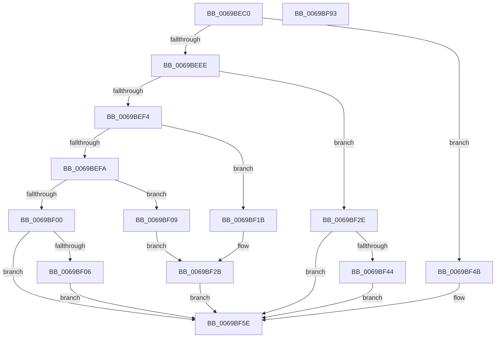

# KiSchedulerDpc

- RVA: `0x0069BEC0`–`0x0069BF94` (길이 `212` bytes)
- VA: `0x000000014069BEC0`
- 실행 섹션: `.text`
- PDB 이름 있음: `예`; PDB Function 태그: `예`
- unwind 정보 RVA: `0x00064C80`
- 디코드: `53`개 명령, `212/212` bytes 표시
- 미해석 바이트: `0` (있으면 어셈블리에 `.byte`로 보존)

> 이 문서는 커널 이미지의 기계어와 PDB 기호를 분석해 생성했습니다. 4번과 5번은 함수 원형과 자료형을 바이너리 사용 방식에서 추정한 C 해석이며 원본 소스 복구 결과는 아닙니다.

## 1. Dependencies

- 직접 호출 지점: **3**; 고유 호출 대상: **3**
- 직접 호출자로 확인된 함수: **0**
- RIP 상대 이미지 참조: **2**

### Outgoing calls
- `0x0069BF44` → [KiRaiseIrqlProcessIrqlFlags](../4F/KiRaiseIrqlProcessIrqlFlags_function_004F56FC.md) (function, `0x004F56FC`)
- `0x0069BF59` → [RtlWriteTryAcquireTickLock](../39/RtlWriteTryAcquireTickLock_function_0039D3D8.md) (function, `0x0039D3D8`)
- `0x0069BF88` → [KiMcaDeferredRecoveryService](../6B/KiMcaDeferredRecoveryService_function_006BC790.md) (function, `0x006BC790`)

### Direct callers
- 이 함수 시작 RVA로 연결되는 직접 call은 확인되지 않았습니다. 간접 호출은 완전히 역산할 수 없습니다.

### Static image references
- `0x0069BF3B` → RVA `0x00FC6D20` (`ALMOSTRO`; read)
- `0x0069BF4B` → RVA `0x00FC5008` (`ALMOSTRO`; read)

## 2. Other-region calls and transfers

- 다른 실행 섹션으로 향하는 call: **0**
- 별도 외부 분기/꼬리 이동을 확인하지 못했습니다.

## 3. Assembly (complete function range)

```asm
0069BEC0  40 53                           push rbx
0069BEC2  48 83 EC 30                     sub rsp, 0x30
0069BEC6  48 8B 4A 68                     mov rcx, qword ptr [rdx + 0x68]
0069BECA  48 8B DA                        mov rbx, rdx
0069BECD  48 B8 CD CC CC CC CC CC CC CC   movabs rax, 0xcccccccccccccccd
0069BED7  48 F7 E1                        mul rcx
0069BEDA  48 C1 EA 03                     shr rdx, 3
0069BEDE  48 8D 04 92                     lea rax, [rdx + rdx*4]
0069BEE2  48 03 C0                        add rax, rax
0069BEE5  48 2B C8                        sub rcx, rax
0069BEE8  48 83 E9 05                     sub rcx, 5
0069BEEC  74 5D                           je 0x14069bf4b
0069BEEE  48 83 E9 01                     sub rcx, 1
0069BEF2  74 3A                           je 0x14069bf2e
0069BEF4  48 83 E9 01                     sub rcx, 1
0069BEF8  74 21                           je 0x14069bf1b
0069BEFA  48 83 E9 01                     sub rcx, 1
0069BEFE  74 09                           je 0x14069bf09
0069BF00  48 83 F9 01                     cmp rcx, 1
0069BF04  75 58                           jne 0x14069bf5e
0069BF06  FA                              cli
0069BF07  EB 55                           jmp 0x14069bf5e
0069BF09  65 48 8B 04 25 88 01 00 00      mov rax, qword ptr gs:[0x188]
0069BF12  66 FF 88 E6 01 00 00            dec word ptr [rax + 0x1e6]
0069BF19  EB 10                           jmp 0x14069bf2b
0069BF1B  65 48 8B 04 25 88 01 00 00      mov rax, qword ptr gs:[0x188]
0069BF24  66 FF 88 E4 01 00 00            dec word ptr [rax + 0x1e4]
0069BF2B  90                              nop
0069BF2C  EB 30                           jmp 0x14069bf5e
0069BF2E  44 0F 20 C1                     mov rcx, cr8
0069BF32  BA 02 00 00 00                  mov edx, 2
0069BF37  44 0F 22 C2                     mov cr8, rdx
0069BF3B  83 3D DE AD 92 00 00            cmp dword ptr [rip + 0x92adde], 0
0069BF42  74 1A                           je 0x14069bf5e
0069BF44  E8 B3 97 E5 FF                  call 0x1404f56fc
0069BF49  EB 13                           jmp 0x14069bf5e
0069BF4B  48 8B 0D B6 90 92 00            mov rcx, qword ptr [rip + 0x9290b6]
0069BF52  48 81 C1 40 03 00 00            add rcx, 0x340
0069BF59  E8 7A 14 D0 FF                  call 0x14039d3d8
0069BF5E  C7 44 24 48 76 0B 01 00         mov dword ptr [rsp + 0x48], 0x10b76
0069BF66  8B 4C 24 48                     mov ecx, dword ptr [rsp + 0x48]
0069BF6A  48 8B 43 60                     mov rax, qword ptr [rbx + 0x60]
0069BF6E  81 F1 76 02 00 00               xor ecx, 0x276
0069BF74  4C 8B 4B 58                     mov r9, qword ptr [rbx + 0x58]
0069BF78  4C 8B 43 50                     mov r8, qword ptr [rbx + 0x50]
0069BF7C  48 8B 53 48                     mov rdx, qword ptr [rbx + 0x48]
0069BF80  C1 C9 68                        ror ecx, 0x68
0069BF83  48 89 44 24 20                  mov qword ptr [rsp + 0x20], rax
0069BF88  E8 03 08 02 00                  call 0x1406bc790
0069BF8D  48 83 C4 30                     add rsp, 0x30
0069BF91  5B                              pop rbx
0069BF92  C3                              ret
0069BF93  CC                              int3
```

## 4. C-style interpretation (structured pseudocode)

```c
__int64 __fastcall KiSchedulerDpc(__int64 a1, __int64 a2)
{
    __int64 result;
    __int64 v_rsp;
    unsigned __int64 v_stack_m18;
    unsigned int v_stack_p10;

    v_rsp = (v_rsp) - (48);
    a2 = (a2) >> (3);
    result = (a2 + a2 * 4) + (a2 + a2 * 4);
    a1 = (*(unsigned __int64 *)(a2 + 104)) - (result);
    a1 = (a1) - (5);
    if (condition_is_equal) goto loc_0069BF4B;
    a1 = (a1) - (1);
    if (condition_is_equal) goto loc_0069BF2E;
    a1 = (a1) - (1);
    if (condition_is_equal) goto loc_0069BF1B;
    a1 = (a1) - (1);
    if (condition_is_equal) goto loc_0069BF09;
    if (a1 != 1) goto loc_0069BF5E;
    goto loc_0069BF5E;
loc_0069BF09:
    goto loc_0069BF2B;
loc_0069BF1B:
loc_0069BF2B:
    goto loc_0069BF5E;
loc_0069BF2E:
    if ((*(unsigned int *)(v_rip + 9612766)) == 0) goto loc_0069BF5E;
    result = KiRaiseIrqlProcessIrqlFlags(v_cr8, 2, a3, a4);
    goto loc_0069BF5E;
loc_0069BF4B:
    a1 = (*(unsigned __int64 *)(v_rip + 9605302)) + (832);
    result = RtlWriteTryAcquireTickLock(a1, 2, a3, a4);
loc_0069BF5E:
    v_stack_p10 = 0x10B76ULL;
    a1 = (unsigned int)(((unsigned int)(v_stack_p10)) ^ (630));
    v_stack_m18 = *(unsigned __int64 *)(a2 + 96);
    result = KiMcaDeferredRecoveryService(a1, *(unsigned __int64 *)(a2 + 72), *(unsigned __int64 *)(a2 + 80), *(unsigned __int64 *)(a2 + 88));
    v_rsp = (v_rsp) + (48);
    return result;
}
```

## 5. (Beta) C Style

```c
int64_t KiSchedulerDpc(int64_t Arg1, void *Arg2)
{
    uint8_t *arg2 = (uint8_t *)Arg2;

    int64_t result;
    int64_t local_rsp;
    uint64_t v_stack_m18;
    uint32_t v_stack_p10;

    local_rsp = (local_rsp) - (48);
    Arg2 = (Arg2) >> (3);
    result = (Arg2 + Arg2 * 4) + (Arg2 + Arg2 * 4);
    Arg1 = (*(uint64_t *)(arg2 + 0x68)) - (result);
    Arg1 = (Arg1) - (5);
    if (condition_is_equal) goto loc_0069BF4B;
    Arg1 = (Arg1) - (1);
    if (condition_is_equal) goto loc_0069BF2E;
    Arg1 = (Arg1) - (1);
    if (condition_is_equal) goto loc_0069BF1B;
    Arg1 = (Arg1) - (1);
    if (condition_is_equal) goto loc_0069BF09;
    if (Arg1 != 1) goto loc_0069BF5E;
    goto loc_0069BF5E;
loc_0069BF09:
    goto loc_0069BF2B;
loc_0069BF1B:
loc_0069BF2B:
    goto loc_0069BF5E;
loc_0069BF2E:
    if ((*(uint32_t *)(v_rip + 0x92ADDE)) == 0) goto loc_0069BF5E;
    result = KiRaiseIrqlProcessIrqlFlags(v_cr8, 2, a3, a4);
    goto loc_0069BF5E;
loc_0069BF4B:
    Arg1 = (*(uint64_t *)(v_rip + 0x9290B6)) + (832);
    result = RtlWriteTryAcquireTickLock(Arg1, 2, a3, a4);
loc_0069BF5E:
    v_stack_p10 = 0x10B76ULL;
    Arg1 = (uint32_t)(((uint32_t)(v_stack_p10)) ^ (630));
    v_stack_m18 = *(uint64_t *)(arg2 + 0x60);
    result = KiMcaDeferredRecoveryService(Arg1, *(uint64_t *)(arg2 + 0x48), *(uint64_t *)(arg2 + 0x50), *(uint64_t *)(arg2 + 0x58));
    local_rsp = (local_rsp) + (48);
    return result;
}
```

### 관측된 메모리 오프셋

구조체 형식이 확인되지 않은 접근은 인자 기준의 오프셋으로만 기록했습니다.

| 기준 인자 | 오프셋 표현 | 폭 (bit) | 접근 |
|---|---:|---:|---|
| `Arg2` | `+ 0x48` | `64` | `R` |
| `Arg2` | `+ 0x50` | `64` | `R` |
| `Arg2` | `+ 0x58` | `64` | `R` |
| `Arg2` | `+ 0x60` | `64` | `R` |
| `Arg2` | `+ 0x68` | `64` | `R` |

## 6. Execution-region graph

[열기: 2D/3D 그래프와 함수 탐색 컨트롤 패널](../../../control-panel.html?section=text&rva=0x0069BEC0&view=graph)

- 2D 그래프는 위에서 아래로 흐르고, 3D 그래프는 빈 공간을 드래그해 회전합니다. Shift+드래그는 이동, 휠은 확대·축소, 함수 노드 선택은 대상 보고서 이동입니다.

### Static fallback


