# MiAbsorbPossibleEngineChanges

- RVA: `0x006958B4`–`0x00695DAC` (길이 `1,272` bytes)
- VA: `0x00000001406958B4`
- 실행 섹션: `.text`
- PDB 이름 있음: `예`; PDB Function 태그: `아니요`
- unwind 정보 RVA: `0x000D9488`
- 디코드: `312`개 명령, `1,272/1,272` bytes 표시
- 미해석 바이트: `0` (있으면 어셈블리에 `.byte`로 보존)

> 이 문서는 커널 이미지의 기계어와 PDB 기호를 분석해 생성했습니다. 4번과 5번은 함수 원형과 자료형을 바이너리 사용 방식에서 추정한 C 해석이며 원본 소스 복구 결과는 아닙니다.

## 1. Dependencies

- 직접 호출 지점: **20**; 고유 호출 대상: **14**
- 직접 호출자로 확인된 함수: **1**
- RIP 상대 이미지 참조: **3**

### Outgoing calls
- `0x006958D4` → [memset](../6C/memset_function_006C6C40.md) (function, `0x006C6C40`)
- `0x006958DD` → [InitializeSListHead](../46/InitializeSListHead_function_00468A90.md) (function, `0x00468A90`)
- `0x00695941` → [ExAcquireSpinLockShared](../24/ExAcquireSpinLockShared_function_0024DCE0.md) (function, `0x0024DCE0`)
- `0x006959A8` → [MiReleaseSpinLockShared](../34/MiReleaseSpinLockShared_function_00348BF0.md) (function, `0x00348BF0`)
- `0x00695A27` → [ExAllocatePoolMm](../35/ExAllocatePoolMm_function_0035B690.md) (function, `0x0035B690`)
- `0x00695A41` → [ExAcquireSpinLockShared](../24/ExAcquireSpinLockShared_function_0024DCE0.md) (function, `0x0024DCE0`)
- `0x00695A9D` → [memcpy](../6C/memcpy_function_006C6840.md) (function, `0x006C6840`)
- `0x00695AD9` → [MiReleaseSpinLockShared](../34/MiReleaseSpinLockShared_function_00348BF0.md) (function, `0x00348BF0`)
- `0x00695AEE` → [ExFreePoolWithTag](../../poolcode/B8/ExFreePoolWithTag_function_00B82870.md) (function, `0x00B82870`)
- `0x00695B97` → [MiInitializeDpcGroupAffinity](../2C/MiInitializeDpcGroupAffinity_function_002CA6D0.md) (function, `0x002CA6D0`)
- `0x00695BA2` → [MiInitializeZeroingDomains](../../page/81/MiInitializeZeroingDomains_function_00810884.md) (function, `0x00810884`)
- `0x00695BBE` → [MiDrainEngineDescriptors](MiDrainEngineDescriptors_function_00695F20.md) (function, `0x00695F20`)
- `0x00695BD3` → [MiAllocateAcceleratorDescriptor](MiAllocateAcceleratorDescriptor_function_00697124.md) (function, `0x00697124`)
- `0x00695BF8` → [ExFreePoolWithTag](../../poolcode/B8/ExFreePoolWithTag_function_00B82870.md) (function, `0x00B82870`)
- `0x00695C16` → [ExAcquireSpinLockExclusive](../24/ExAcquireSpinLockExclusive_function_00248690.md) (function, `0x00248690`)
- `0x00695C51` → [MiReleaseSpinLockExclusive](../24/MiReleaseSpinLockExclusive_function_002482C0.md) (function, `0x002482C0`)
- `0x00695C83` → [ExAcquireSpinLockExclusive](../24/ExAcquireSpinLockExclusive_function_00248690.md) (function, `0x00248690`)
- `0x00695D5F` → [MiReleaseSpinLockExclusive](../24/MiReleaseSpinLockExclusive_function_002482C0.md) (function, `0x002482C0`)
- `0x00695D74` → [MiAllocateZeroPageDecisionTraceBuffer](MiAllocateZeroPageDecisionTraceBuffer_function_00695DB4.md) (function, `0x00695DB4`)
- `0x00695D8E` → [ExFreePoolWithTag](../../poolcode/B8/ExFreePoolWithTag_function_00B82870.md) (function, `0x00B82870`)

### Direct callers
- [MiInitializeZeroEngines](../../page/81/MiInitializeZeroEngines_function_008106F4.md) at `0x008107A4`

### Static image references
- `0x006958FB` → RVA `0x00E2DBF8` (`.data`; read)
- `0x00695922` → RVA `0x00E2DBD8` (`.data`; read)
- `0x00695957` → RVA `0x00FC6A80` (`ALMOSTRO`; read)

## 2. Other-region calls and transfers

- 다른 실행 섹션으로 향하는 call: **4**
  - `0x00695AEE` → [ExFreePoolWithTag](../../poolcode/B8/ExFreePoolWithTag_function_00B82870.md) (`.text` → `POOLCODE`)
  - `0x00695BA2` → [MiInitializeZeroingDomains](../../page/81/MiInitializeZeroingDomains_function_00810884.md) (`.text` → `PAGE`)
  - `0x00695BF8` → [ExFreePoolWithTag](../../poolcode/B8/ExFreePoolWithTag_function_00B82870.md) (`.text` → `POOLCODE`)
  - `0x00695D8E` → [ExFreePoolWithTag](../../poolcode/B8/ExFreePoolWithTag_function_00B82870.md) (`.text` → `POOLCODE`)
- 별도 외부 분기/꼬리 이동을 확인하지 못했습니다.

## 3. Assembly (complete function range)

```asm
006958B4  40 53                           push rbx
006958B6  55                              push rbp
006958B7  56                              push rsi
006958B8  57                              push rdi
006958B9  41 54                           push r12
006958BB  41 55                           push r13
006958BD  41 56                           push r14
006958BF  41 57                           push r15
006958C1  48 83 EC 38                     sub rsp, 0x38
006958C5  48 8B FA                        mov rdi, rdx
006958C8  48 8B F1                        mov rsi, rcx
006958CB  33 D2                           xor edx, edx
006958CD  48 8B CF                        mov rcx, rdi
006958D0  44 8D 42 50                     lea r8d, [rdx + 0x50]
006958D4  E8 67 13 03 00                  call 0x1406c6c40
006958D9  48 8D 4F 30                     lea rcx, [rdi + 0x30]
006958DD  E8 AE 31 DD FF                  call 0x140468a90
006958E2  48 8B 86 B0 00 00 00            mov rax, qword ptr [rsi + 0xb0]
006958E9  4C 63 26                        movsxd r12, dword ptr [rsi]
006958EC  8B 58 38                        mov ebx, dword ptr [rax + 0x38]
006958EF  89 5F 10                        mov dword ptr [rdi + 0x10], ebx
006958F2  48 8B 40 30                     mov rax, qword ptr [rax + 0x30]
006958F6  48 89 44 24 28                  mov qword ptr [rsp + 0x28], rax
006958FB  48 8B 05 F6 82 79 00            mov rax, qword ptr [rip + 0x7982f6]
00695902  48 8D 0C 5B                     lea rcx, [rbx + rbx*2]
00695906  48 C1 E1 07                     shl rcx, 7
0069590A  48 8B 94 01 78 01 00 00         mov rdx, qword ptr [rcx + rax + 0x178]
00695912  8B 42 24                        mov eax, dword ptr [rdx + 0x24]
00695915  A8 01                           test al, 1
00695917  74 16                           je 0x14069592f
00695919  45 85 E4                        test r12d, r12d
0069591C  74 11                           je 0x14069592f
0069591E  C6 46 24 01                     mov byte ptr [rsi + 0x24], 1
00695922  4C 8D 35 AF 82 79 00            lea r14, [rip + 0x7982af]
00695929  C6 47 02 01                     mov byte ptr [rdi + 2], 1
0069592D  EB 03                           jmp 0x140695932
0069592F  4C 8B F2                        mov r14, rdx
00695932  48 8D 42 40                     lea rax, [rdx + 0x40]
00695936  48 8B C8                        mov rcx, rax
00695939  48 89 84 24 98 00 00 00         mov qword ptr [rsp + 0x98], rax
00695941  E8 9A 83 BB FF                  call 0x14024dce0
00695946  41 0F B7 4E 10                  movzx ecx, word ptr [r14 + 0x10]
0069594B  44 8A C0                        mov r8b, al
0069594E  89 4F 04                        mov dword ptr [rdi + 4], ecx
00695951  43 0F B7 54 66 12               movzx edx, word ptr [r14 + r12*2 + 0x12]
00695957  8B 0D 23 11 93 00               mov ecx, dword ptr [rip + 0x931123]
0069595D  3B D1                           cmp edx, ecx
0069595F  73 08                           jae 0x140695969
00695961  47 0F B7 7C 66 12               movzx r15d, word ptr [r14 + r12*2 + 0x12]
00695967  EB 07                           jmp 0x140695970
00695969  44 8B 3D 10 11 93 00            mov r15d, dword ptr [rip + 0x931110]
00695970  43 0F B7 4C 66 18               movzx ecx, word ptr [r14 + r12*2 + 0x18]
00695976  8B 05 04 11 93 00               mov eax, dword ptr [rip + 0x931104]
0069597C  3B C8                           cmp ecx, eax
0069597E  73 10                           jae 0x140695990
00695980  47 0F B7 6C 66 18               movzx r13d, word ptr [r14 + r12*2 + 0x18]
00695986  44 89 AC 24 88 00 00 00         mov dword ptr [rsp + 0x88], r13d
0069598E  EB 0D                           jmp 0x14069599d
00695990  8B 05 EA 10 93 00               mov eax, dword ptr [rip + 0x9310ea]
00695996  89 84 24 88 00 00 00            mov dword ptr [rsp + 0x88], eax
0069599D  48 8B 8C 24 98 00 00 00         mov rcx, qword ptr [rsp + 0x98]
006959A5  41 8A D0                        mov dl, r8b
006959A8  E8 43 32 CB FF                  call 0x140348bf0
006959AD  8B 05 CD 10 93 00               mov eax, dword ptr [rip + 0x9310cd]
006959B3  44 3B F8                        cmp r15d, eax
006959B6  76 07                           jbe 0x1406959bf
006959B8  44 8B 3D C1 10 93 00            mov r15d, dword ptr [rip + 0x9310c1]
006959BF  44 3B BE A8 00 00 00            cmp r15d, dword ptr [rsi + 0xa8]
006959C6  75 09                           jne 0x1406959d1
006959C8  45 85 E4                        test r12d, r12d
006959CB  0F 85 2C 02 00 00               jne 0x140695bfd
006959D1  44 8B 6F 04                     mov r13d, dword ptr [rdi + 4]
006959D5  44 8B CB                        mov r9d, ebx
006959D8  C6 07 01                        mov byte ptr [rdi], 1
006959DB  41 0F BA E9 1F                  bts r9d, 0x1f
006959E0  41 8B 4E 08                     mov ecx, dword ptr [r14 + 8]
006959E4  89 4F 0C                        mov dword ptr [rdi + 0xc], ecx
006959E7  46 8D 04 6D 00 00 00 00         lea r8d, [r13*2]
006959EF  45 03 C5                        add r8d, r13d
006959F2  44 0F AF E9                     imul r13d, ecx
006959F6  49 C1 E0 04                     shl r8, 4
006959FA  4C 89 44 24 20                  mov qword ptr [rsp + 0x20], r8
006959FF  42 8D 0C 6D 00 00 00 00         lea ecx, [r13*2]
00695A07  4A 8D 14 6D 00 00 00 00         lea rdx, [r13*2]
00695A0F  49 03 D5                        add rdx, r13
00695A12  48 03 D1                        add rdx, rcx
00695A15  B9 40 00 00 00                  mov ecx, 0x40
00695A1A  48 C1 E2 04                     shl rdx, 4
00695A1E  49 03 D0                        add rdx, r8
00695A21  41 B8 4D 69 5A 63               mov r8d, 0x635a694d
00695A27  E8 64 5C CC FF                  call 0x14035b690
00695A2C  48 89 47 18                     mov qword ptr [rdi + 0x18], rax
00695A30  48 85 C0                        test rax, rax
00695A33  0F 84 5A 03 00 00               je 0x140695d93
00695A39  48 8B 8C 24 98 00 00 00         mov rcx, qword ptr [rsp + 0x98]
00695A41  E8 9A 82 BB FF                  call 0x14024dce0
00695A46  41 0F B7 4E 10                  movzx ecx, word ptr [r14 + 0x10]
00695A4B  88 84 24 80 00 00 00            mov byte ptr [rsp + 0x80], al
00695A52  39 4F 04                        cmp dword ptr [rdi + 4], ecx
00695A55  75 4D                           jne 0x140695aa4
00695A57  43 0F B7 54 66 12               movzx edx, word ptr [r14 + r12*2 + 0x12]
00695A5D  8B 0D 1D 10 93 00               mov ecx, dword ptr [rip + 0x93101d]
00695A63  3B D1                           cmp edx, ecx
00695A65  73 08                           jae 0x140695a6f
00695A67  43 0F B7 4C 66 12               movzx ecx, word ptr [r14 + r12*2 + 0x12]
00695A6D  EB 06                           jmp 0x140695a75
00695A6F  8B 0D 0B 10 93 00               mov ecx, dword ptr [rip + 0x93100b]
00695A75  44 3B F9                        cmp r15d, ecx
00695A78  75 2A                           jne 0x140695aa4
00695A7A  44 8B 47 04                     mov r8d, dword ptr [rdi + 4]
00695A7E  83 A4 24 90 00 00 00 00         and dword ptr [rsp + 0x90], 0
00695A86  43 8D 0C 00                     lea ecx, [r8 + r8]
00695A8A  49 C1 E0 04                     shl r8, 4
00695A8E  48 C1 E1 04                     shl rcx, 4
00695A92  48 03 4F 18                     add rcx, qword ptr [rdi + 0x18]
00695A96  48 89 4F 20                     mov qword ptr [rdi + 0x20], rcx
00695A9A  49 8B 16                        mov rdx, qword ptr [r14]
00695A9D  E8 9E 0D 03 00                  call 0x1406c6840
00695AA2  EB 26                           jmp 0x140695aca
00695AA4  41 0F B7 46 10                  movzx eax, word ptr [r14 + 0x10]
00695AA9  89 47 04                        mov dword ptr [rdi + 4], eax
00695AAC  43 0F B7 44 66 18               movzx eax, word ptr [r14 + r12*2 + 0x18]
00695AB2  47 0F B7 7C 66 12               movzx r15d, word ptr [r14 + r12*2 + 0x12]
00695AB8  89 84 24 88 00 00 00            mov dword ptr [rsp + 0x88], eax
00695ABF  C7 84 24 90 00 00 00 01 00 00 00  mov dword ptr [rsp + 0x90], 1
00695ACA  8A 94 24 80 00 00 00            mov dl, byte ptr [rsp + 0x80]
00695AD1  48 8B 8C 24 98 00 00 00         mov rcx, qword ptr [rsp + 0x98]
00695AD9  E8 12 31 CB FF                  call 0x140348bf0
00695ADE  83 BC 24 90 00 00 00 00         cmp dword ptr [rsp + 0x90], 0
00695AE6  74 10                           je 0x140695af8
00695AE8  48 8B 4F 18                     mov rcx, qword ptr [rdi + 0x18]
00695AEC  33 D2                           xor edx, edx
00695AEE  E8 7D CD 4E 00                  call 0x140b82870
00695AF3  E9 B5 FE FF FF                  jmp 0x1406959ad
00695AF8  8B 05 82 0F 93 00               mov eax, dword ptr [rip + 0x930f82]
00695AFE  39 84 24 88 00 00 00            cmp dword ptr [rsp + 0x88], eax
00695B05  76 0D                           jbe 0x140695b14
00695B07  8B 05 73 0F 93 00               mov eax, dword ptr [rip + 0x930f73]
00695B0D  89 84 24 88 00 00 00            mov dword ptr [rsp + 0x88], eax
00695B14  48 8B 47 18                     mov rax, qword ptr [rdi + 0x18]
00695B18  4A 8D 0C 6D 00 00 00 00         lea rcx, [r13*2]
00695B20  8B 57 04                        mov edx, dword ptr [rdi + 4]
00695B23  49 03 CD                        add rcx, r13
00695B26  4C 8B 44 24 20                  mov r8, qword ptr [rsp + 0x20]
00695B2B  8B EA                           mov ebp, edx
00695B2D  4C 03 C0                        add r8, rax
00695B30  48 C1 E5 04                     shl rbp, 4
00695B34  48 C1 E1 04                     shl rcx, 4
00695B38  48 03 E8                        add rbp, rax
00695B3B  49 03 C8                        add rcx, r8
00695B3E  44 89 7F 08                     mov dword ptr [rdi + 8], r15d
00695B42  4C 89 47 28                     mov qword ptr [rdi + 0x28], r8
00695B46  45 85 ED                        test r13d, r13d
00695B49  74 3E                           je 0x140695b89
00695B4B  49 8D 50 10                     lea rdx, [r8 + 0x10]
00695B4F  45 8B D5                        mov r10d, r13d
00695B52  48 89 52 08                     mov qword ptr [rdx + 8], rdx
00695B56  48 89 12                        mov qword ptr [rdx], rdx
00695B59  49 89 08                        mov qword ptr [r8], rcx
00695B5C  4D 8D 40 30                     lea r8, [r8 + 0x30]
00695B60  8B 47 04                        mov eax, dword ptr [rdi + 4]
00695B63  48 C1 E0 04                     shl rax, 4
00695B67  48 03 C8                        add rcx, rax
00695B6A  48 89 4A F8                     mov qword ptr [rdx - 8], rcx
00695B6E  48 83 C2 30                     add rdx, 0x30
00695B72  44 8B 4F 04                     mov r9d, dword ptr [rdi + 4]
00695B76  41 8B C1                        mov eax, r9d
00695B79  48 C1 E0 04                     shl rax, 4
00695B7D  48 03 C8                        add rcx, rax
00695B80  49 83 EA 01                     sub r10, 1
00695B84  75 CC                           jne 0x140695b52
00695B86  41 8B D1                        mov edx, r9d
00695B89  48 8B 4F 18                     mov rcx, qword ptr [rdi + 0x18]
00695B8D  44 8B C2                        mov r8d, edx
00695B90  48 8B 57 20                     mov rdx, qword ptr [rdi + 0x20]
00695B94  45 8B CC                        mov r9d, r12d
00695B97  E8 34 4B C3 FF                  call 0x1402ca6d0
00695B9C  41 8B D4                        mov edx, r12d
00695B9F  48 8B CF                        mov rcx, rdi
00695BA2  E8 DD AC 17 00                  call 0x140810884
00695BA7  45 33 ED                        xor r13d, r13d
00695BAA  45 85 E4                        test r12d, r12d
00695BAD  0F 85 A5 00 00 00               jne 0x140695c58
00695BB3  48 8B CE                        mov rcx, rsi
00695BB6  4C 89 AC 24 80 00 00 00         mov qword ptr [rsp + 0x80], r13
00695BBE  E8 5D 03 00 00                  call 0x140695f20
00695BC3  4C 8D 8C 24 80 00 00 00         lea r9, [rsp + 0x80]
00695BCB  45 33 C0                        xor r8d, r8d
00695BCE  8B D3                           mov edx, ebx
00695BD0  48 8B CE                        mov rcx, rsi
00695BD3  E8 4C 15 00 00                  call 0x140697124
00695BD8  85 C0                           test eax, eax
00695BDA  75 09                           jne 0x140695be5
00695BDC  48 8B 4F 18                     mov rcx, qword ptr [rdi + 0x18]
00695BE0  E9 A7 01 00 00                  jmp 0x140695d8c
00695BE5  4C 8B B4 24 80 00 00 00         mov r14, qword ptr [rsp + 0x80]
00695BED  4D 85 F6                        test r14, r14
00695BF0  75 14                           jne 0x140695c06
00695BF2  48 8B 4F 18                     mov rcx, qword ptr [rdi + 0x18]
00695BF6  33 D2                           xor edx, edx
00695BF8  E8 73 CC 4E 00                  call 0x140b82870
00695BFD  C6 47 01 01                     mov byte ptr [rdi + 1], 1
00695C01  E9 8D 01 00 00                  jmp 0x140695d93
00695C06  48 8B 8E D0 00 00 00            mov rcx, qword ptr [rsi + 0xd0]
00695C0D  41 BC B0 3B 00 00               mov r12d, 0x3bb0
00695C13  49 03 CC                        add rcx, r12
00695C16  E8 75 2A BB FF                  call 0x140248690
00695C1B  48 8D 56 78                     lea rdx, [rsi + 0x78]
00695C1F  4C 8B 42 08                     mov r8, qword ptr [rdx + 8]
00695C23  49 8B CE                        mov rcx, r14
00695C26  4D 8B 36                        mov r14, qword ptr [r14]
00695C29  49 39 10                        cmp qword ptr [r8], rdx
00695C2C  0F 85 73 01 00 00               jne 0x140695da5
00695C32  48 89 11                        mov qword ptr [rcx], rdx
00695C35  4C 89 41 08                     mov qword ptr [rcx + 8], r8
00695C39  49 89 08                        mov qword ptr [r8], rcx
00695C3C  48 89 4A 08                     mov qword ptr [rdx + 8], rcx
00695C40  4D 85 F6                        test r14, r14
00695C43  75 DA                           jne 0x140695c1f
00695C45  48 8B 8E D0 00 00 00            mov rcx, qword ptr [rsi + 0xd0]
00695C4C  8A D0                           mov dl, al
00695C4E  49 03 CC                        add rcx, r12
00695C51  E8 6A 26 BB FF                  call 0x1402482c0
00695C56  EB 06                           jmp 0x140695c5e
00695C58  41 BC B0 3B 00 00               mov r12d, 0x3bb0
00695C5E  48 8B 8E D0 00 00 00            mov rcx, qword ptr [rsi + 0xd0]
00695C65  4C 8B B6 90 00 00 00            mov r14, qword ptr [rsi + 0x90]
00695C6C  49 03 CC                        add rcx, r12
00695C6F  44 89 BE A8 00 00 00            mov dword ptr [rsi + 0xa8], r15d
00695C76  48 89 AE 98 00 00 00            mov qword ptr [rsi + 0x98], rbp
00695C7D  8B 47 40                        mov eax, dword ptr [rdi + 0x40]
00695C80  89 46 70                        mov dword ptr [rsi + 0x70], eax
00695C83  E8 08 2A BB FF                  call 0x140248690
00695C88  4C 8B 86 88 00 00 00            mov r8, qword ptr [rsi + 0x88]
00695C8F  40 8A E8                        mov bpl, al
00695C92  48 8B 4F 18                     mov rcx, qword ptr [rdi + 0x18]
00695C96  48 89 8E 90 00 00 00            mov qword ptr [rsi + 0x90], rcx
00695C9D  4D 85 C0                        test r8, r8
00695CA0  0F 84 83 00 00 00               je 0x140695d29
00695CA6  45 8B CD                        mov r9d, r13d
00695CA9  44 39 6F 0C                     cmp dword ptr [rdi + 0xc], r13d
00695CAD  76 7A                           jbe 0x140695d29
00695CAF  4C 8B 5F 28                     mov r11, qword ptr [rdi + 0x28]
00695CB3  41 8B C1                        mov eax, r9d
00695CB6  48 8D 14 40                     lea rdx, [rax + rax*2]
00695CBA  48 C1 E2 04                     shl rdx, 4
00695CBE  48 8D 4A 10                     lea rcx, [rdx + 0x10]
00695CC2  49 03 C8                        add rcx, r8
00695CC5  4C 39 29                        cmp qword ptr [rcx], r13
00695CC8  74 56                           je 0x140695d20
00695CCA  48 8B 01                        mov rax, qword ptr [rcx]
00695CCD  48 3B C1                        cmp rax, rcx
00695CD0  74 47                           je 0x140695d19
00695CD2  48 39 48 08                     cmp qword ptr [rax + 8], rcx
00695CD6  0F 85 C9 00 00 00               jne 0x140695da5
00695CDC  4C 8B 00                        mov r8, qword ptr [rax]
00695CDF  49 39 40 08                     cmp qword ptr [r8 + 8], rax
00695CE3  0F 85 BC 00 00 00               jne 0x140695da5
00695CE9  4C 89 01                        mov qword ptr [rcx], r8
00695CEC  49 89 48 08                     mov qword ptr [r8 + 8], rcx
00695CF0  4D 8D 43 10                     lea r8, [r11 + 0x10]
00695CF4  4C 03 C2                        add r8, rdx
00695CF7  4D 8B 50 08                     mov r10, qword ptr [r8 + 8]
00695CFB  4D 39 02                        cmp qword ptr [r10], r8
00695CFE  0F 85 A1 00 00 00               jne 0x140695da5
00695D04  4C 89 00                        mov qword ptr [rax], r8
00695D07  4C 89 50 08                     mov qword ptr [rax + 8], r10
00695D0B  49 89 02                        mov qword ptr [r10], rax
00695D0E  49 89 40 08                     mov qword ptr [r8 + 8], rax
00695D12  42 FF 44 1A 20                  inc dword ptr [rdx + r11 + 0x20]
00695D17  EB B1                           jmp 0x140695cca
00695D19  4C 8B 86 88 00 00 00            mov r8, qword ptr [rsi + 0x88]
00695D20  41 FF C1                        inc r9d
00695D23  44 3B 4F 0C                     cmp r9d, dword ptr [rdi + 0xc]
00695D27  72 86                           jb 0x140695caf
00695D29  48 8B 47 28                     mov rax, qword ptr [rdi + 0x28]
00695D2D  40 8A D5                        mov dl, bpl
00695D30  48 8B 8E D0 00 00 00            mov rcx, qword ptr [rsi + 0xd0]
00695D37  48 89 86 88 00 00 00            mov qword ptr [rsi + 0x88], rax
00695D3E  49 03 CC                        add rcx, r12
00695D41  48 8B 47 20                     mov rax, qword ptr [rdi + 0x20]
00695D45  48 89 86 A0 00 00 00            mov qword ptr [rsi + 0xa0], rax
00695D4C  8B 47 04                        mov eax, dword ptr [rdi + 4]
00695D4F  89 46 14                        mov dword ptr [rsi + 0x14], eax
00695D52  8B 84 24 88 00 00 00            mov eax, dword ptr [rsp + 0x88]
00695D59  89 86 AC 00 00 00               mov dword ptr [rsi + 0xac], eax
00695D5F  E8 5C 25 BB FF                  call 0x1402482c0
00695D64  4C 39 AE 28 01 00 00            cmp qword ptr [rsi + 0x128], r13
00695D6B  75 13                           jne 0x140695d80
00695D6D  48 8B 4C 24 28                  mov rcx, qword ptr [rsp + 0x28]
00695D72  8B D3                           mov edx, ebx
00695D74  E8 3B 00 00 00                  call 0x140695db4
00695D79  48 89 86 28 01 00 00            mov qword ptr [rsi + 0x128], rax
00695D80  C6 47 01 01                     mov byte ptr [rdi + 1], 1
00695D84  4D 85 F6                        test r14, r14
00695D87  74 0A                           je 0x140695d93
00695D89  49 8B CE                        mov rcx, r14
00695D8C  33 D2                           xor edx, edx
00695D8E  E8 DD CA 4E 00                  call 0x140b82870
00695D93  48 83 C4 38                     add rsp, 0x38
00695D97  41 5F                           pop r15
00695D99  41 5E                           pop r14
00695D9B  41 5D                           pop r13
00695D9D  41 5C                           pop r12
00695D9F  5F                              pop rdi
00695DA0  5E                              pop rsi
00695DA1  5D                              pop rbp
00695DA2  5B                              pop rbx
00695DA3  C3                              ret
00695DA4  CC                              int3
00695DA5  B9 03 00 00 00                  mov ecx, 3
00695DAA  CD 29                           int 0x29
```

## 4. C-style interpretation (structured pseudocode)

```c
__int64 __fastcall MiAbsorbPossibleEngineChanges(__int64 a1, __int64 a2)
{
    __int64 result;
    __int64 v_r10;
    __int64 v_r13;
    __int64 v_r15;
    __int64 v_rbp;
    __int64 v_rsp;
    unsigned __int64 v_stack_m50;
    unsigned __int64 v_stack_m58;
    unsigned int v_stack_p10;
    unsigned int v_stack_p18;
    unsigned __int64 v_stack_p20;
    unsigned __int8 v_stack_p8;

    v_rsp = (v_rsp) - (56);
    a2 = 0;
    result = memset(0, a2, a2 + 80, a4);
    result = InitializeSListHead(a2 + 48, a2, a2 + 80, a4);
    *(unsigned int *)(a2 + 16) = (unsigned int)((unsigned int)(*(unsigned int *)(*(unsigned __int64 *)(a1 + 176) + 56)));
    v_stack_m50 = *(unsigned __int64 *)(*(unsigned __int64 *)(a1 + 176) + 48);
    a1 = ((unsigned int)(*(unsigned int *)(*(unsigned __int64 *)(a1 + 176) + 56)) + (unsigned int)(*(unsigned int *)(*(unsigned __int64 *)(a1 + 176) + 56)) * 2) << (7);
    if ((((unsigned __int8)((unsigned int)(*(unsigned int *)(*(unsigned __int64 *)(a1 + *(unsigned __int64 *)(v_rip + 7963382) * 1 + 376) + 36)))) & (1)) == 0) goto loc_0069592F;
    if ((unsigned int)((int)(*(unsigned int *)(a1))) == 0) goto loc_0069592F;
    *(unsigned __int8 *)(a1 + 36) = 1;
    *(unsigned __int8 *)(a2 + 2) = 1;
    goto loc_00695932;
loc_0069592F:
loc_00695932:
    v_stack_p20 = *(unsigned __int64 *)(a1 + *(unsigned __int64 *)(v_rip + 7963382) * 1 + 376) + 64;
    result = ExAcquireSpinLockShared(*(unsigned __int64 *)(a1 + *(unsigned __int64 *)(v_rip + 7963382) * 1 + 376) + 64, *(unsigned __int64 *)(a1 + *(unsigned __int64 *)(v_rip + 7963382) * 1 + 376), a2 + 80, a4);
    *(unsigned int *)(a2 + 4) = (unsigned int)(*(unsigned __int16 *)(*(unsigned __int64 *)(a1 + *(unsigned __int64 *)(v_rip + 7963382) * 1 + 376) + 16));
    if (((unsigned int)(*(unsigned __int16 *)(*(unsigned __int64 *)(a1 + *(unsigned __int64 *)(v_rip + 7963382) * 1 + 376) + (int)(*(unsigned int *)(a1)) * 2 + 18))) >= ((unsigned int)((unsigned int)(*(unsigned int *)(v_rip + 9638179))))) goto loc_00695969;
    goto loc_00695970;
loc_00695969:
loc_00695970:
    if (((unsigned int)(*(unsigned __int16 *)(*(unsigned __int64 *)(a1 + *(unsigned __int64 *)(v_rip + 7963382) * 1 + 376) + (int)(*(unsigned int *)(a1)) * 2 + 24))) >= ((unsigned int)((unsigned int)(*(unsigned int *)(v_rip + 9638148))))) goto loc_00695990;
    v_stack_p10 = (unsigned int)(*(unsigned __int16 *)(*(unsigned __int64 *)(a1 + *(unsigned __int64 *)(v_rip + 7963382) * 1 + 376) + (int)(*(unsigned int *)(a1)) * 2 + 24));
    goto loc_0069599D;
loc_00695990:
    v_stack_p10 = (unsigned int)((unsigned int)(*(unsigned int *)(v_rip + 9638122)));
loc_0069599D:
    result = MiReleaseSpinLockShared(v_stack_p20, (unsigned __int8)((unsigned __int8)(result)), (unsigned __int8)(result), a4);
loc_006959AD:
    v_r15 = (unsigned int)(*(unsigned int *)(v_rip + 9638160));
    if (((unsigned int)((unsigned int)(*(unsigned int *)(v_rip + 9638160)))) >= = ((unsigned int)((unsigned int)(*(unsigned int *)(v_rip + 9638093))))) {
        v_r15 = *(unsigned int *)(v_rip + 9638081);
    }
    if (((unsigned int)(v_r15)) != (*(unsigned int *)(a1 + 168))) goto loc_006959D1;
    if ((unsigned int)((int)(*(unsigned int *)(a1))) != 0) goto loc_00695BFD;
loc_006959D1:
    *(unsigned __int8 *)(a2) = 1;
    *(unsigned int *)(a2 + 12) = (unsigned int)((unsigned int)(*(unsigned int *)(*(unsigned __int64 *)(a1 + *(unsigned __int64 *)(v_rip + 7963382) * 1 + 376) + 8)));
    a3 = (unsigned int)(((unsigned int)(*(unsigned int *)(a2 + 4)) * 2) + ((unsigned int)((unsigned int)(*(unsigned int *)(a2 + 4)))));
    v_r13 = (unsigned int)(((unsigned int)(*(unsigned int *)(a2 + 4))) * ((unsigned int)((unsigned int)(*(unsigned int *)(*(unsigned __int64 *)(a1 + *(unsigned __int64 *)(v_rip + 7963382) * 1 + 376) + 8)))));
    a3 = (a3) << (4);
    v_stack_m58 = a3;
    a2 = (v_r13 * 2) + (v_r13);
    a2 = (a2) + (v_r13 * 2);
    a2 = (a2) << (4);
    a2 = (a2) + (a3);
    result = ExAllocatePoolMm(64, a2, (unsigned int)(0x635A694DULL), (unsigned int)((unsigned int)((unsigned int)(*(unsigned int *)(*(unsigned __int64 *)(a1 + 176) + 56)))));
    *(unsigned __int64 *)(a2 + 24) = result;
    if (result == 0) goto loc_00695D93;
    result = ExAcquireSpinLockShared(v_stack_p20, a2, (unsigned int)(0x635A694DULL), (unsigned int)((unsigned int)((unsigned int)(*(unsigned int *)(*(unsigned __int64 *)(a1 + 176) + 56)))));
    v_stack_p8 = (unsigned __int8)(result);
    if ((*(unsigned int *)(a2 + 4)) != ((unsigned int)(*(unsigned __int16 *)(*(unsigned __int64 *)(a1 + *(unsigned __int64 *)(v_rip + 7963382) * 1 + 376) + 16)))) goto loc_00695AA4;
    if (((unsigned int)(*(unsigned __int16 *)(*(unsigned __int64 *)(a1 + *(unsigned __int64 *)(v_rip + 7963382) * 1 + 376) + (int)(*(unsigned int *)(a1)) * 2 + 18))) >= ((unsigned int)((unsigned int)(*(unsigned int *)(v_rip + 9637917))))) goto loc_00695A6F;
    goto loc_00695A75;
loc_00695A6F:
loc_00695A75:
    if (((unsigned int)(v_r15)) != ((unsigned int)((unsigned int)(*(unsigned int *)(v_rip + 9637899))))) goto loc_00695AA4;
    a3 = ((unsigned int)(*(unsigned int *)(a2 + 4))) << (4);
    a1 = ((unsigned int)(*(unsigned int *)(a2 + 4)) + (unsigned int)(*(unsigned int *)(a2 + 4)) * 1) << (4);
    a1 = (a1) + (*(unsigned __int64 *)(a2 + 24));
    *(unsigned __int64 *)(a2 + 32) = a1;
    result = memcpy(a1, *(unsigned __int64 *)(*(unsigned __int64 *)(a1 + *(unsigned __int64 *)(v_rip + 7963382) * 1 + 376)), a3, (unsigned int)((unsigned int)((unsigned int)(*(unsigned int *)(*(unsigned __int64 *)(a1 + 176) + 56)))));
    goto loc_00695ACA;
loc_00695AA4:
    *(unsigned int *)(a2 + 4) = (unsigned int)(*(unsigned __int16 *)(*(unsigned __int64 *)(a1 + *(unsigned __int64 *)(v_rip + 7963382) * 1 + 376) + 16));
    v_stack_p10 = (unsigned int)(*(unsigned __int16 *)(*(unsigned __int64 *)(a1 + *(unsigned __int64 *)(v_rip + 7963382) * 1 + 376) + (int)(*(unsigned int *)(a1)) * 2 + 24));
    v_stack_p18 = 1;
loc_00695ACA:
    result = MiReleaseSpinLockShared(v_stack_p20, v_stack_p8, a3, (unsigned int)((unsigned int)((unsigned int)(*(unsigned int *)(*(unsigned __int64 *)(a1 + 176) + 56)))));
    if (v_stack_p18 == 0) goto loc_00695AF8;
    a2 = 0;
    result = ExFreePoolWithTag(*(unsigned __int64 *)(a2 + 24), a2, a3, (unsigned int)((unsigned int)((unsigned int)(*(unsigned int *)(*(unsigned __int64 *)(a1 + 176) + 56)))));
    goto loc_006959AD;
loc_00695AF8:
    result = (unsigned int)(*(unsigned int *)(v_rip + 9637762));
    if (v_stack_p10 >= = ((unsigned int)((unsigned int)(*(unsigned int *)(v_rip + 9637762))))) {
        result = *(unsigned int *)(v_rip + 9637747);
        v_stack_p10 = (unsigned int)(result);
    }
    a1 = (v_r13 * 2) + (v_r13);
    a3 = (v_stack_m58) + (*(unsigned __int64 *)(a2 + 24));
    v_rbp = ((unsigned int)((unsigned int)((unsigned int)(*(unsigned int *)(a2 + 4))))) << (4);
    a1 = (a1) << (4);
    v_rbp = (v_rbp) + (*(unsigned __int64 *)(a2 + 24));
    a1 = (a1) + (a3);
    *(unsigned int *)(a2 + 8) = (unsigned int)(*(unsigned __int16 *)(*(unsigned __int64 *)(a1 + *(unsigned __int64 *)(v_rip + 7963382) * 1 + 376) + (int)(*(unsigned int *)(a1)) * 2 + 18));
    *(unsigned __int64 *)(a2 + 40) = a3;
    if ((unsigned int)(v_r13) == 0) goto loc_00695B89;
loc_00695B52:
    *(unsigned __int64 *)(a3 + 16 + 8) = a3 + 16;
    *(unsigned __int64 *)(a3 + 16) = a3 + 16;
    *(unsigned __int64 *)(a3) = a1;
    result = ((unsigned int)(*(unsigned int *)(a2 + 4))) << (4);
    a1 = (a1) + (result);
    *(unsigned __int64 *)(a3 + 16 - 8) = a1;
    a2 = (a3 + 16) + (48);
    result = ((unsigned int)((unsigned int)((unsigned int)(*(unsigned int *)(a2 + 4))))) << (4);
    a1 = (a1) + (result);
    v_r10 = ((unsigned int)((unsigned int)(v_r13))) - (1);
    if (condition_is_not_equal) goto loc_00695B52;
loc_00695B89:
    result = MiInitializeDpcGroupAffinity(*(unsigned __int64 *)(a2 + 24), *(unsigned __int64 *)(a2 + 32), (unsigned int)((unsigned int)((unsigned int)((unsigned int)((unsigned int)(*(unsigned int *)(a2 + 4)))))), (unsigned int)((unsigned int)((int)(*(unsigned int *)(a1)))));
    result = MiInitializeZeroingDomains(a2, (unsigned int)((unsigned int)((int)(*(unsigned int *)(a1)))), (unsigned int)((unsigned int)((unsigned int)((unsigned int)((unsigned int)(*(unsigned int *)(a2 + 4)))))), (unsigned int)((unsigned int)((int)(*(unsigned int *)(a1)))));
    v_r13 = 0;
    if ((unsigned int)((int)(*(unsigned int *)(a1))) != 0) goto loc_00695C58;
    v_stack_p8 = 0;
    result = MiDrainEngineDescriptors(a1, (unsigned int)((unsigned int)((int)(*(unsigned int *)(a1)))), (unsigned int)((unsigned int)((unsigned int)((unsigned int)((unsigned int)(*(unsigned int *)(a2 + 4)))))), (unsigned int)((unsigned int)((int)(*(unsigned int *)(a1)))));
    a3 = 0;
    result = MiAllocateAcceleratorDescriptor(a1, (unsigned int)((unsigned int)((unsigned int)(*(unsigned int *)(*(unsigned __int64 *)(a1 + 176) + 56)))), a3, v_stack_p8);
    if ((unsigned int)(result) != 0) goto loc_00695BE5;
    goto loc_00695D8C;
loc_00695BE5:
    if (v_stack_p8 != 0) goto loc_00695C06;
    a2 = 0;
    result = ExFreePoolWithTag(*(unsigned __int64 *)(a2 + 24), a2, a3, v_stack_p8);
loc_00695BFD:
    *(unsigned __int8 *)(a2 + 1) = 1;
    goto loc_00695D93;
loc_00695C06:
    a1 = (*(unsigned __int64 *)(a1 + 208)) + ((unsigned int)(0x3BB0ULL));
    result = ExAcquireSpinLockExclusive(a1, a2, a3, v_stack_p8);
loc_00695C1F:
    if ((*(unsigned __int64 *)(*(unsigned __int64 *)(a1 + 120 + 8))) != (a1 + 120)) goto loc_00695DA5;
    *(unsigned __int64 *)(v_stack_p8) = a1 + 120;
    *(unsigned __int64 *)(v_stack_p8 + 8) = *(unsigned __int64 *)(a1 + 120 + 8);
    *(unsigned __int64 *)(*(unsigned __int64 *)(a1 + 120 + 8)) = v_stack_p8;
    *(unsigned __int64 *)(a1 + 120 + 8) = v_stack_p8;
    if (*(unsigned __int64 *)(v_stack_p8) != 0) goto loc_00695C1F;
    a1 = (*(unsigned __int64 *)(a1 + 208)) + ((unsigned int)(0x3BB0ULL));
    result = MiReleaseSpinLockExclusive(a1, (unsigned __int8)(result), *(unsigned __int64 *)(a1 + 120 + 8), v_stack_p8);
    goto loc_00695C5E;
loc_00695C58:
loc_00695C5E:
    a1 = (*(unsigned __int64 *)(a1 + 208)) + ((unsigned int)(0x3BB0ULL));
    *(unsigned int *)(a1 + 168) = (unsigned int)(*(unsigned __int16 *)(*(unsigned __int64 *)(a1 + *(unsigned __int64 *)(v_rip + 7963382) * 1 + 376) + (int)(*(unsigned int *)(a1)) * 2 + 18));
    *(unsigned __int64 *)(a1 + 152) = v_rbp;
    *(unsigned int *)(a1 + 112) = (unsigned int)((unsigned int)(*(unsigned int *)(a2 + 64)));
    result = ExAcquireSpinLockExclusive(a1, (unsigned __int8)(result), *(unsigned __int64 *)(a1 + 120 + 8), v_stack_p8);
    *(unsigned __int64 *)(a1 + 144) = *(unsigned __int64 *)(a2 + 24);
    if (*(unsigned __int64 *)(a1 + 136) == 0) goto loc_00695D29;
    if ((*(unsigned int *)(a2 + 12)) <= 0) goto loc_00695D29;
loc_00695CAF:
    a2 = (0 + 0 * 2) << (4);
    a1 = (a2 + 16) + (*(unsigned __int64 *)(a1 + 136));
    if ((*(unsigned __int64 *)(a1)) == 0) goto loc_00695D20;
loc_00695CCA:
    if ((*(unsigned __int64 *)(a1)) == a1) goto loc_00695D19;
    if ((*(unsigned __int64 *)(*(unsigned __int64 *)(a1) + 8)) != a1) goto loc_00695DA5;
    if ((*(unsigned __int64 *)(*(unsigned __int64 *)(*(unsigned __int64 *)(a1)) + 8)) != (*(unsigned __int64 *)(a1))) goto loc_00695DA5;
    *(unsigned __int64 *)(a1) = *(unsigned __int64 *)(*(unsigned __int64 *)(a1));
    *(unsigned __int64 *)(*(unsigned __int64 *)(*(unsigned __int64 *)(a1)) + 8) = a1;
    a3 = (*(unsigned __int64 *)(a2 + 40) + 16) + (a2);
    if ((*(unsigned __int64 *)(*(unsigned __int64 *)(a3 + 8))) != a3) goto loc_00695DA5;
    *(unsigned __int64 *)(*(unsigned __int64 *)(a1)) = a3;
    *(unsigned __int64 *)(*(unsigned __int64 *)(a1) + 8) = *(unsigned __int64 *)(a3 + 8);
    *(unsigned __int64 *)(*(unsigned __int64 *)(a3 + 8)) = *(unsigned __int64 *)(a1);
    *(unsigned __int64 *)(a3 + 8) = *(unsigned __int64 *)(a1);
    goto loc_00695CCA;
loc_00695D19:
loc_00695D20:
    a4 = (unsigned int)((0) + 1);
    if (((unsigned int)(a4)) < (*(unsigned int *)(a2 + 12))) goto loc_00695CAF;
loc_00695D29:
    *(unsigned __int64 *)(a1 + 136) = *(unsigned __int64 *)(a2 + 40);
    a1 = (*(unsigned __int64 *)(a1 + 208)) + ((unsigned int)(0x3BB0ULL));
    *(unsigned __int64 *)(a1 + 160) = *(unsigned __int64 *)(a2 + 32);
    *(unsigned int *)(a1 + 20) = (unsigned int)((unsigned int)(*(unsigned int *)(a2 + 4)));
    *(unsigned int *)(a1 + 172) = (unsigned int)((unsigned int)(v_stack_p10));
    result = MiReleaseSpinLockExclusive(a1, (unsigned __int8)((unsigned __int8)(result)), *(unsigned __int64 *)(a1 + 136), a4);
    if ((*(unsigned __int64 *)(a1 + 296)) == 0) {
        a1 = v_stack_m50;
        a2 = (unsigned int)((unsigned int)(*(unsigned int *)(*(unsigned __int64 *)(a1 + 176) + 56)));
        result = MiAllocateZeroPageDecisionTraceBuffer(a1, a2, *(unsigned __int64 *)(a1 + 136), a4);
        *(unsigned __int64 *)(a1 + 296) = result;
    }
    *(unsigned __int8 *)(a2 + 1) = 1;
    if (*(unsigned __int64 *)(a1 + 144) == 0) goto loc_00695D93;
loc_00695D8C:
    a2 = 0;
    result = ExFreePoolWithTag(*(unsigned __int64 *)(a1 + 144), a2, *(unsigned __int64 *)(a1 + 136), a4);
loc_00695D93:
    v_rsp = (v_rsp) + (56);
    return result;
loc_00695DA5:
    return result;
}
```

## 5. (Beta) C Style

```c
int64_t MiAbsorbPossibleEngineChanges(void *Arg1, void *Arg2)
{
    uint8_t *arg1 = (uint8_t *)Arg1;
    uint8_t *arg2 = (uint8_t *)Arg2;

    int64_t result;
    int64_t local_r10;
    int64_t local_r13;
    int64_t local_r15;
    int64_t local_rbp;
    int64_t local_rsp;
    uint64_t v_stack_m50;
    uint64_t v_stack_m58;
    uint32_t v_stack_p10;
    uint32_t v_stack_p18;
    uint64_t v_stack_p20;
    uint8_t v_stack_p8;

    local_rsp = (local_rsp) - (56);
    Arg2 = 0;
    result = memset(0, Arg2, Arg2 + 80, a4);
    result = InitializeSListHead(Arg2 + 48, Arg2, Arg2 + 80, a4);
    *(uint32_t *)(arg2 + 0x10) = (uint32_t)((uint32_t)(*(uint32_t *)(*(uint64_t *)(arg1 + 0xB0) + 0x38)));
    v_stack_m50 = *(uint64_t *)(*(uint64_t *)(arg1 + 0xB0) + 0x30);
    Arg1 = ((uint32_t)(*(uint32_t *)(*(uint64_t *)(arg1 + 0xB0) + 0x38)) + (uint32_t)(*(uint32_t *)(*(uint64_t *)(arg1 + 0xB0) + 0x38)) * 2) << (7);
    if ((((uint8_t)((uint32_t)(*(uint32_t *)(*(uint64_t *)(arg1 + *(uint64_t *)(v_rip + 0x7982F6) * 1 + 0x178) + 0x24)))) & (1)) == 0) goto loc_0069592F;
    if ((uint32_t)((int32_t)(*(uint32_t *)(arg1))) == 0) goto loc_0069592F;
    *(uint8_t *)(arg1 + 0x24) = 1;
    *(uint8_t *)(arg2 + 0x2) = 1;
    goto loc_00695932;
loc_0069592F:
loc_00695932:
    v_stack_p20 = *(uint64_t *)(arg1 + *(uint64_t *)(v_rip + 0x7982F6) * 1 + 0x178) + 64;
    result = ExAcquireSpinLockShared(*(uint64_t *)(arg1 + *(uint64_t *)(v_rip + 0x7982F6) * 1 + 0x178) + 64, *(uint64_t *)(arg1 + *(uint64_t *)(v_rip + 0x7982F6) * 1 + 0x178), Arg2 + 80, a4);
    *(uint32_t *)(arg2 + 0x4) = (uint32_t)(*(uint16_t *)(*(uint64_t *)(arg1 + *(uint64_t *)(v_rip + 0x7982F6) * 1 + 0x178) + 0x10));
    if (((uint32_t)(*(uint16_t *)(*(uint64_t *)(arg1 + *(uint64_t *)(v_rip + 0x7982F6) * 1 + 0x178) + (int32_t)(*(uint32_t *)(arg1)) * 2 + 0x12))) >= ((uint32_t)((uint32_t)(*(uint32_t *)(v_rip + 0x931123))))) goto loc_00695969;
    goto loc_00695970;
loc_00695969:
loc_00695970:
    if (((uint32_t)(*(uint16_t *)(*(uint64_t *)(arg1 + *(uint64_t *)(v_rip + 0x7982F6) * 1 + 0x178) + (int32_t)(*(uint32_t *)(arg1)) * 2 + 0x18))) >= ((uint32_t)((uint32_t)(*(uint32_t *)(v_rip + 0x931104))))) goto loc_00695990;
    v_stack_p10 = (uint32_t)(*(uint16_t *)(*(uint64_t *)(arg1 + *(uint64_t *)(v_rip + 0x7982F6) * 1 + 0x178) + (int32_t)(*(uint32_t *)(arg1)) * 2 + 0x18));
    goto loc_0069599D;
loc_00695990:
    v_stack_p10 = (uint32_t)((uint32_t)(*(uint32_t *)(v_rip + 0x9310EA)));
loc_0069599D:
    result = MiReleaseSpinLockShared(v_stack_p20, (uint8_t)((uint8_t)(result)), (uint8_t)(result), a4);
loc_006959AD:
    local_r15 = (uint32_t)(*(uint32_t *)(v_rip + 0x931110));
    if (((uint32_t)((uint32_t)(*(uint32_t *)(v_rip + 0x931110)))) >= = ((uint32_t)((uint32_t)(*(uint32_t *)(v_rip + 0x9310CD))))) {
        local_r15 = *(uint32_t *)(v_rip + 0x9310C1);
    }
    if (((uint32_t)(local_r15)) != (*(uint32_t *)(arg1 + 0xA8))) goto loc_006959D1;
    if ((uint32_t)((int32_t)(*(uint32_t *)(arg1))) != 0) goto loc_00695BFD;
loc_006959D1:
    *(uint8_t *)(arg2) = 1;
    *(uint32_t *)(arg2 + 0xC) = (uint32_t)((uint32_t)(*(uint32_t *)(*(uint64_t *)(arg1 + *(uint64_t *)(v_rip + 0x7982F6) * 1 + 0x178) + 0x8)));
    a3 = (uint32_t)(((uint32_t)(*(uint32_t *)(arg2 + 0x4)) * 2) + ((uint32_t)((uint32_t)(*(uint32_t *)(arg2 + 0x4)))));
    local_r13 = (uint32_t)(((uint32_t)(*(uint32_t *)(arg2 + 0x4))) * ((uint32_t)((uint32_t)(*(uint32_t *)(*(uint64_t *)(arg1 + *(uint64_t *)(v_rip + 0x7982F6) * 1 + 0x178) + 0x8)))));
    a3 = (a3) << (4);
    v_stack_m58 = a3;
    Arg2 = (local_r13 * 2) + (local_r13);
    Arg2 = (Arg2) + (local_r13 * 2);
    Arg2 = (Arg2) << (4);
    Arg2 = (Arg2) + (a3);
    result = ExAllocatePoolMm(64, Arg2, (uint32_t)(0x635A694DULL), (uint32_t)((uint32_t)((uint32_t)(*(uint32_t *)(*(uint64_t *)(arg1 + 0xB0) + 0x38)))));
    *(uint64_t *)(arg2 + 0x18) = result;
    if (result == 0) goto loc_00695D93;
    result = ExAcquireSpinLockShared(v_stack_p20, Arg2, (uint32_t)(0x635A694DULL), (uint32_t)((uint32_t)((uint32_t)(*(uint32_t *)(*(uint64_t *)(arg1 + 0xB0) + 0x38)))));
    v_stack_p8 = (uint8_t)(result);
    if ((*(uint32_t *)(arg2 + 0x4)) != ((uint32_t)(*(uint16_t *)(*(uint64_t *)(arg1 + *(uint64_t *)(v_rip + 0x7982F6) * 1 + 0x178) + 0x10)))) goto loc_00695AA4;
    if (((uint32_t)(*(uint16_t *)(*(uint64_t *)(arg1 + *(uint64_t *)(v_rip + 0x7982F6) * 1 + 0x178) + (int32_t)(*(uint32_t *)(arg1)) * 2 + 0x12))) >= ((uint32_t)((uint32_t)(*(uint32_t *)(v_rip + 0x93101D))))) goto loc_00695A6F;
    goto loc_00695A75;
loc_00695A6F:
loc_00695A75:
    if (((uint32_t)(local_r15)) != ((uint32_t)((uint32_t)(*(uint32_t *)(v_rip + 0x93100B))))) goto loc_00695AA4;
    a3 = ((uint32_t)(*(uint32_t *)(arg2 + 0x4))) << (4);
    Arg1 = ((uint32_t)(*(uint32_t *)(arg2 + 0x4)) + (uint32_t)(*(uint32_t *)(arg2 + 0x4)) * 1) << (4);
    Arg1 = (Arg1) + (*(uint64_t *)(arg2 + 0x18));
    *(void **)(arg2 + 0x20) = Arg1;
    result = memcpy(Arg1, *(uint64_t *)(*(uint64_t *)(arg1 + *(uint64_t *)(v_rip + 0x7982F6) * 1 + 0x178)), a3, (uint32_t)((uint32_t)((uint32_t)(*(uint32_t *)(*(uint64_t *)(arg1 + 0xB0) + 0x38)))));
    goto loc_00695ACA;
loc_00695AA4:
    *(uint32_t *)(arg2 + 0x4) = (uint32_t)(*(uint16_t *)(*(uint64_t *)(arg1 + *(uint64_t *)(v_rip + 0x7982F6) * 1 + 0x178) + 0x10));
    v_stack_p10 = (uint32_t)(*(uint16_t *)(*(uint64_t *)(arg1 + *(uint64_t *)(v_rip + 0x7982F6) * 1 + 0x178) + (int32_t)(*(uint32_t *)(arg1)) * 2 + 0x18));
    v_stack_p18 = 1;
loc_00695ACA:
    result = MiReleaseSpinLockShared(v_stack_p20, v_stack_p8, a3, (uint32_t)((uint32_t)((uint32_t)(*(uint32_t *)(*(uint64_t *)(arg1 + 0xB0) + 0x38)))));
    if (v_stack_p18 == 0) goto loc_00695AF8;
    Arg2 = 0;
    result = ExFreePoolWithTag(*(uint64_t *)(arg2 + 0x18), Arg2, a3, (uint32_t)((uint32_t)((uint32_t)(*(uint32_t *)(*(uint64_t *)(arg1 + 0xB0) + 0x38)))));
    goto loc_006959AD;
loc_00695AF8:
    result = (uint32_t)(*(uint32_t *)(v_rip + 0x930F82));
    if (v_stack_p10 >= = ((uint32_t)((uint32_t)(*(uint32_t *)(v_rip + 0x930F82))))) {
        result = *(uint32_t *)(v_rip + 0x930F73);
        v_stack_p10 = (uint32_t)(result);
    }
    Arg1 = (local_r13 * 2) + (local_r13);
    a3 = (v_stack_m58) + (*(uint64_t *)(arg2 + 0x18));
    local_rbp = ((uint32_t)((uint32_t)((uint32_t)(*(uint32_t *)(arg2 + 0x4))))) << (4);
    Arg1 = (Arg1) << (4);
    local_rbp = (local_rbp) + (*(uint64_t *)(arg2 + 0x18));
    Arg1 = (Arg1) + (a3);
    *(uint32_t *)(arg2 + 0x8) = (uint32_t)(*(uint16_t *)(*(uint64_t *)(arg1 + *(uint64_t *)(v_rip + 0x7982F6) * 1 + 0x178) + (int32_t)(*(uint32_t *)(arg1)) * 2 + 0x12));
    *(uint64_t *)(arg2 + 0x28) = a3;
    if ((uint32_t)(local_r13) == 0) goto loc_00695B89;
loc_00695B52:
    *(uint64_t *)(a3 + 0x10 + 0x8) = a3 + 16;
    *(uint64_t *)(a3 + 0x10) = a3 + 16;
    *(void **)(a3) = Arg1;
    result = ((uint32_t)(*(uint32_t *)(arg2 + 0x4))) << (4);
    Arg1 = (Arg1) + (result);
    *(void **)(a3 + 0x10 - 0x8) = Arg1;
    Arg2 = (a3 + 16) + (48);
    result = ((uint32_t)((uint32_t)((uint32_t)(*(uint32_t *)(arg2 + 0x4))))) << (4);
    Arg1 = (Arg1) + (result);
    local_r10 = ((uint32_t)((uint32_t)(local_r13))) - (1);
    if (condition_is_not_equal) goto loc_00695B52;
loc_00695B89:
    result = MiInitializeDpcGroupAffinity(*(uint64_t *)(arg2 + 0x18), *(uint64_t *)(arg2 + 0x20), (uint32_t)((uint32_t)((uint32_t)((uint32_t)((uint32_t)(*(uint32_t *)(arg2 + 0x4)))))), (uint32_t)((uint32_t)((int32_t)(*(uint32_t *)(arg1)))));
    result = MiInitializeZeroingDomains(Arg2, (uint32_t)((uint32_t)((int32_t)(*(uint32_t *)(arg1)))), (uint32_t)((uint32_t)((uint32_t)((uint32_t)((uint32_t)(*(uint32_t *)(arg2 + 0x4)))))), (uint32_t)((uint32_t)((int32_t)(*(uint32_t *)(arg1)))));
    local_r13 = 0;
    if ((uint32_t)((int32_t)(*(uint32_t *)(arg1))) != 0) goto loc_00695C58;
    v_stack_p8 = 0;
    result = MiDrainEngineDescriptors(Arg1, (uint32_t)((uint32_t)((int32_t)(*(uint32_t *)(arg1)))), (uint32_t)((uint32_t)((uint32_t)((uint32_t)((uint32_t)(*(uint32_t *)(arg2 + 0x4)))))), (uint32_t)((uint32_t)((int32_t)(*(uint32_t *)(arg1)))));
    a3 = 0;
    result = MiAllocateAcceleratorDescriptor(Arg1, (uint32_t)((uint32_t)((uint32_t)(*(uint32_t *)(*(uint64_t *)(arg1 + 0xB0) + 0x38)))), a3, v_stack_p8);
    if ((uint32_t)(result) != 0) goto loc_00695BE5;
    goto loc_00695D8C;
loc_00695BE5:
    if (v_stack_p8 != 0) goto loc_00695C06;
    Arg2 = 0;
    result = ExFreePoolWithTag(*(uint64_t *)(arg2 + 0x18), Arg2, a3, v_stack_p8);
loc_00695BFD:
    *(uint8_t *)(arg2 + 0x1) = 1;
    goto loc_00695D93;
loc_00695C06:
    Arg1 = (*(uint64_t *)(arg1 + 0xD0)) + ((uint32_t)(0x3BB0ULL));
    result = ExAcquireSpinLockExclusive(Arg1, Arg2, a3, v_stack_p8);
loc_00695C1F:
    if ((*(uint64_t *)(*(uint64_t *)(arg1 + 0x78 + 0x8))) != (Arg1 + 120)) goto loc_00695DA5;
    *(void **)(v_stack_p8) = Arg1 + 120;
    *(uint64_t *)(v_stack_p8 + 0x8) = *(uint64_t *)(arg1 + 0x78 + 0x8);
    *(uint64_t *)(*(uint64_t *)(arg1 + 0x78 + 0x8)) = v_stack_p8;
    *(uint64_t *)(arg1 + 0x78 + 0x8) = v_stack_p8;
    if (*(uint64_t *)(v_stack_p8) != 0) goto loc_00695C1F;
    Arg1 = (*(uint64_t *)(arg1 + 0xD0)) + ((uint32_t)(0x3BB0ULL));
    result = MiReleaseSpinLockExclusive(Arg1, (uint8_t)(result), *(uint64_t *)(arg1 + 0x78 + 0x8), v_stack_p8);
    goto loc_00695C5E;
loc_00695C58:
loc_00695C5E:
    Arg1 = (*(uint64_t *)(arg1 + 0xD0)) + ((uint32_t)(0x3BB0ULL));
    *(uint32_t *)(arg1 + 0xA8) = (uint32_t)(*(uint16_t *)(*(uint64_t *)(arg1 + *(uint64_t *)(v_rip + 0x7982F6) * 1 + 0x178) + (int32_t)(*(uint32_t *)(arg1)) * 2 + 0x12));
    *(uint64_t *)(arg1 + 0x98) = local_rbp;
    *(uint32_t *)(arg1 + 0x70) = (uint32_t)((uint32_t)(*(uint32_t *)(arg2 + 0x40)));
    result = ExAcquireSpinLockExclusive(Arg1, (uint8_t)(result), *(uint64_t *)(arg1 + 0x78 + 0x8), v_stack_p8);
    *(uint64_t *)(arg1 + 0x90) = *(uint64_t *)(arg2 + 0x18);
    if (*(uint64_t *)(arg1 + 0x88) == 0) goto loc_00695D29;
    if ((*(uint32_t *)(arg2 + 0xC)) <= 0) goto loc_00695D29;
loc_00695CAF:
    Arg2 = (0 + 0 * 2) << (4);
    Arg1 = (Arg2 + 16) + (*(uint64_t *)(arg1 + 0x88));
    if ((*(uint64_t *)(arg1)) == 0) goto loc_00695D20;
loc_00695CCA:
    if ((*(uint64_t *)(arg1)) == Arg1) goto loc_00695D19;
    if ((*(uint64_t *)(*(uint64_t *)(arg1) + 0x8)) != Arg1) goto loc_00695DA5;
    if ((*(uint64_t *)(*(uint64_t *)(*(uint64_t *)(arg1)) + 0x8)) != (*(uint64_t *)(arg1))) goto loc_00695DA5;
    *(uint64_t *)(arg1) = *(uint64_t *)(*(uint64_t *)(arg1));
    *(void **)(*(uint64_t *)(*(uint64_t *)(arg1)) + 0x8) = Arg1;
    a3 = (*(uint64_t *)(arg2 + 0x28) + 16) + (Arg2);
    if ((*(uint64_t *)(*(uint64_t *)(a3 + 0x8))) != a3) goto loc_00695DA5;
    *(uint64_t *)(*(uint64_t *)(arg1)) = a3;
    *(uint64_t *)(*(uint64_t *)(arg1) + 0x8) = *(uint64_t *)(a3 + 0x8);
    *(uint64_t *)(*(uint64_t *)(a3 + 0x8)) = *(uint64_t *)(arg1);
    *(uint64_t *)(a3 + 0x8) = *(uint64_t *)(arg1);
    goto loc_00695CCA;
loc_00695D19:
loc_00695D20:
    a4 = (uint32_t)((0) + 1);
    if (((uint32_t)(a4)) < (*(uint32_t *)(arg2 + 0xC))) goto loc_00695CAF;
loc_00695D29:
    *(uint64_t *)(arg1 + 0x88) = *(uint64_t *)(arg2 + 0x28);
    Arg1 = (*(uint64_t *)(arg1 + 0xD0)) + ((uint32_t)(0x3BB0ULL));
    *(uint64_t *)(arg1 + 0xA0) = *(uint64_t *)(arg2 + 0x20);
    *(uint32_t *)(arg1 + 0x14) = (uint32_t)((uint32_t)(*(uint32_t *)(arg2 + 0x4)));
    *(uint32_t *)(arg1 + 0xAC) = (uint32_t)((uint32_t)(v_stack_p10));
    result = MiReleaseSpinLockExclusive(Arg1, (uint8_t)((uint8_t)(result)), *(uint64_t *)(arg1 + 0x88), a4);
    if ((*(uint64_t *)(arg1 + 0x128)) == 0) {
        Arg1 = v_stack_m50;
        Arg2 = (uint32_t)((uint32_t)(*(uint32_t *)(*(uint64_t *)(arg1 + 0xB0) + 0x38)));
        result = MiAllocateZeroPageDecisionTraceBuffer(Arg1, Arg2, *(uint64_t *)(arg1 + 0x88), a4);
        *(uint64_t *)(arg1 + 0x128) = result;
    }
    *(uint8_t *)(arg2 + 0x1) = 1;
    if (*(uint64_t *)(arg1 + 0x90) == 0) goto loc_00695D93;
loc_00695D8C:
    Arg2 = 0;
    result = ExFreePoolWithTag(*(uint64_t *)(arg1 + 0x90), Arg2, *(uint64_t *)(arg1 + 0x88), a4);
loc_00695D93:
    local_rsp = (local_rsp) + (56);
    return result;
loc_00695DA5:
    return result;
}
```

### 관측된 메모리 오프셋

구조체 형식이 확인되지 않은 접근은 인자 기준의 오프셋으로만 기록했습니다.

| 기준 인자 | 오프셋 표현 | 폭 (bit) | 접근 |
|---|---:|---:|---|
| `Arg1` | `+ 0x0` | `32` | `R` |
| `Arg1` | `+ 0x8` | `64` | `R` |
| `Arg1` | `+ 0x8` | `64` | `W` |
| `Arg1` | `+ 0x14` | `32` | `W` |
| `Arg1` | `+ 0x24` | `8` | `W` |
| `Arg1` | `+ 0x70` | `32` | `W` |
| `Arg1` | `+ 0x78` | `64` | `R` |
| `Arg1` | `+ 0x88` | `64` | `R` |
| `Arg1` | `+ 0x88` | `64` | `W` |
| `Arg1` | `+ 0x90` | `64` | `R` |
| `Arg1` | `+ 0x90` | `64` | `W` |
| `Arg1` | `+ 0x98` | `64` | `W` |
| `Arg1` | `+ 0xA0` | `64` | `W` |
| `Arg1` | `+ 0xA8` | `32` | `R` |
| `Arg1` | `+ 0xA8` | `32` | `W` |
| `Arg1` | `+ 0xAC` | `32` | `W` |
| `Arg1` | `+ 0xB0` | `64` | `R` |
| `Arg1` | `+ 0xD0` | `64` | `R` |
| `Arg1` | `+ 0x128` | `64` | `R` |
| `Arg1` | `+ 0x128` | `64` | `W` |
| `Arg2` | `+ 0x0` | `8` | `W` |
| `Arg2` | `+ 0x1` | `8` | `W` |
| `Arg2` | `+ 0x2` | `8` | `W` |
| `Arg2` | `+ 0x4` | `32` | `R` |
| `Arg2` | `+ 0x4` | `32` | `W` |
| `Arg2` | `+ 0x8` | `32` | `W` |
| `Arg2` | `+ 0xC` | `32` | `R` |
| `Arg2` | `+ 0xC` | `32` | `W` |
| `Arg2` | `+ 0x10` | `32` | `W` |
| `Arg2` | `+ 0x18` | `64` | `R` |
| `Arg2` | `+ 0x18` | `64` | `W` |
| `Arg2` | `+ 0x20` | `64` | `R` |

추가 오프셋 5개는 표에서 생략했습니다.

## 6. Execution-region graph

[열기: 2D/3D 그래프와 함수 탐색 컨트롤 패널](../../../control-panel.html?section=text&rva=0x006958B4&view=graph)

- 2D 그래프는 위에서 아래로 흐르고, 3D 그래프는 빈 공간을 드래그해 회전합니다. Shift+드래그는 이동, 휠은 확대·축소, 함수 노드 선택은 대상 보고서 이동입니다.

### Static fallback

```mermaid
flowchart TD
  bb_006958B4[BB_006958B4]
  bb_00695919[BB_00695919]
  bb_0069591E[BB_0069591E]
  bb_0069592F[BB_0069592F]
  bb_00695932[BB_00695932]
  bb_00695961[BB_00695961]
  bb_00695969[BB_00695969]
  bb_00695970[BB_00695970]
  bb_00695980[BB_00695980]
  bb_00695990[BB_00695990]
  bb_0069599D[BB_0069599D]
  bb_006959AD[BB_006959AD]
  bb_006959B8[BB_006959B8]
  bb_006959BF[BB_006959BF]
  bb_006959C8[BB_006959C8]
  bb_006959D1[BB_006959D1]
  bb_00695A39[BB_00695A39]
  bb_00695A57[BB_00695A57]
  bb_00695A67[BB_00695A67]
  bb_00695A6F[BB_00695A6F]
  bb_00695A75[BB_00695A75]
  bb_00695A7A[BB_00695A7A]
  bb_00695AA4[BB_00695AA4]
  bb_00695ACA[BB_00695ACA]
  bb_00695AE8[BB_00695AE8]
  bb_00695AF8[BB_00695AF8]
  bb_00695B07[BB_00695B07]
  bb_00695B14[BB_00695B14]
  bb_00695B4B[BB_00695B4B]
  bb_00695B52[BB_00695B52]
  bb_00695B86[BB_00695B86]
  bb_00695B89[BB_00695B89]
  bb_00695BB3[BB_00695BB3]
  bb_00695BDC[BB_00695BDC]
  bb_00695BE5[BB_00695BE5]
  bb_00695BF2[BB_00695BF2]
  bb_00695BFD[BB_00695BFD]
  bb_00695C06[BB_00695C06]
  bb_00695C1F[BB_00695C1F]
  bb_00695C32[BB_00695C32]
  bb_00695C45[BB_00695C45]
  bb_00695C58[BB_00695C58]
  bb_00695C5E[BB_00695C5E]
  bb_00695CA6[BB_00695CA6]
  bb_00695CAF[BB_00695CAF]
  bb_00695CCA[BB_00695CCA]
  bb_00695CD2[BB_00695CD2]
  bb_00695CDC[BB_00695CDC]
  bb_00695CE9[BB_00695CE9]
  bb_00695D04[BB_00695D04]
  bb_00695D19[BB_00695D19]
  bb_00695D20[BB_00695D20]
  bb_00695D29[BB_00695D29]
  bb_00695D6D[BB_00695D6D]
  bb_00695D80[BB_00695D80]
  bb_00695D89[BB_00695D89]
  bb_00695D8C[BB_00695D8C]
  bb_00695D93[BB_00695D93]
  bb_00695DA4[BB_00695DA4]
  bb_00695DA5[BB_00695DA5]
  bb_006958B4 -->|branch| bb_0069592F
  bb_006958B4 -->|fallthrough| bb_00695919
  bb_00695919 -->|branch| bb_0069592F
  bb_00695919 -->|fallthrough| bb_0069591E
  bb_0069591E -->|branch| bb_00695932
  bb_0069592F -->|flow| bb_00695932
  bb_00695932 -->|branch| bb_00695969
  bb_00695932 -->|fallthrough| bb_00695961
  bb_00695961 -->|branch| bb_00695970
  bb_00695969 -->|flow| bb_00695970
  bb_00695970 -->|branch| bb_00695990
  bb_00695970 -->|fallthrough| bb_00695980
  bb_00695980 -->|branch| bb_0069599D
  bb_00695990 -->|flow| bb_0069599D
  bb_0069599D -->|flow| bb_006959AD
  bb_006959AD -->|branch| bb_006959BF
  bb_006959AD -->|fallthrough| bb_006959B8
  bb_006959B8 -->|flow| bb_006959BF
  bb_006959BF -->|branch| bb_006959D1
  bb_006959BF -->|fallthrough| bb_006959C8
  bb_006959C8 -->|branch| bb_00695BFD
  bb_006959C8 -->|fallthrough| bb_006959D1
  bb_006959D1 -->|branch| bb_00695D93
  bb_006959D1 -->|fallthrough| bb_00695A39
  bb_00695A39 -->|branch| bb_00695AA4
  bb_00695A39 -->|fallthrough| bb_00695A57
  bb_00695A57 -->|branch| bb_00695A6F
  bb_00695A57 -->|fallthrough| bb_00695A67
  bb_00695A67 -->|branch| bb_00695A75
  bb_00695A6F -->|flow| bb_00695A75
  bb_00695A75 -->|branch| bb_00695AA4
  bb_00695A75 -->|fallthrough| bb_00695A7A
  bb_00695A7A -->|branch| bb_00695ACA
  bb_00695AA4 -->|flow| bb_00695ACA
  bb_00695ACA -->|branch| bb_00695AF8
  bb_00695ACA -->|fallthrough| bb_00695AE8
  bb_00695AE8 -->|branch| bb_006959AD
  bb_00695AF8 -->|branch| bb_00695B14
  bb_00695AF8 -->|fallthrough| bb_00695B07
  bb_00695B07 -->|flow| bb_00695B14
  bb_00695B14 -->|branch| bb_00695B89
  bb_00695B14 -->|fallthrough| bb_00695B4B
  bb_00695B4B -->|flow| bb_00695B52
  bb_00695B52 -->|branch| bb_00695B52
  bb_00695B52 -->|fallthrough| bb_00695B86
  bb_00695B86 -->|flow| bb_00695B89
  bb_00695B89 -->|branch| bb_00695C58
  bb_00695B89 -->|fallthrough| bb_00695BB3
  bb_00695BB3 -->|branch| bb_00695BE5
  bb_00695BB3 -->|fallthrough| bb_00695BDC
  bb_00695BDC -->|branch| bb_00695D8C
  bb_00695BE5 -->|branch| bb_00695C06
  bb_00695BE5 -->|fallthrough| bb_00695BF2
  bb_00695BF2 -->|flow| bb_00695BFD
  bb_00695BFD -->|branch| bb_00695D93
  bb_00695C06 -->|flow| bb_00695C1F
  bb_00695C1F -->|branch| bb_00695DA5
  bb_00695C1F -->|fallthrough| bb_00695C32
  bb_00695C32 -->|branch| bb_00695C1F
  bb_00695C32 -->|fallthrough| bb_00695C45
  bb_00695C45 -->|branch| bb_00695C5E
  bb_00695C58 -->|flow| bb_00695C5E
  bb_00695C5E -->|branch| bb_00695D29
  bb_00695C5E -->|fallthrough| bb_00695CA6
  bb_00695CA6 -->|branch| bb_00695D29
  bb_00695CA6 -->|fallthrough| bb_00695CAF
  bb_00695CAF -->|branch| bb_00695D20
  bb_00695CAF -->|fallthrough| bb_00695CCA
  bb_00695CCA -->|branch| bb_00695D19
  bb_00695CCA -->|fallthrough| bb_00695CD2
  bb_00695CD2 -->|branch| bb_00695DA5
  bb_00695CD2 -->|fallthrough| bb_00695CDC
  bb_00695CDC -->|branch| bb_00695DA5
  bb_00695CDC -->|fallthrough| bb_00695CE9
  bb_00695CE9 -->|branch| bb_00695DA5
  bb_00695CE9 -->|fallthrough| bb_00695D04
  bb_00695D04 -->|branch| bb_00695CCA
  bb_00695D19 -->|flow| bb_00695D20
  bb_00695D20 -->|branch| bb_00695CAF
  bb_00695D20 -->|fallthrough| bb_00695D29
  bb_00695D29 -->|branch| bb_00695D80
  bb_00695D29 -->|fallthrough| bb_00695D6D
  bb_00695D6D -->|flow| bb_00695D80
  bb_00695D80 -->|branch| bb_00695D93
  bb_00695D80 -->|fallthrough| bb_00695D89
  bb_00695D89 -->|flow| bb_00695D8C
  bb_00695D8C -->|flow| bb_00695D93
  bb_00695DA4 -->|flow| bb_00695DA5
```


