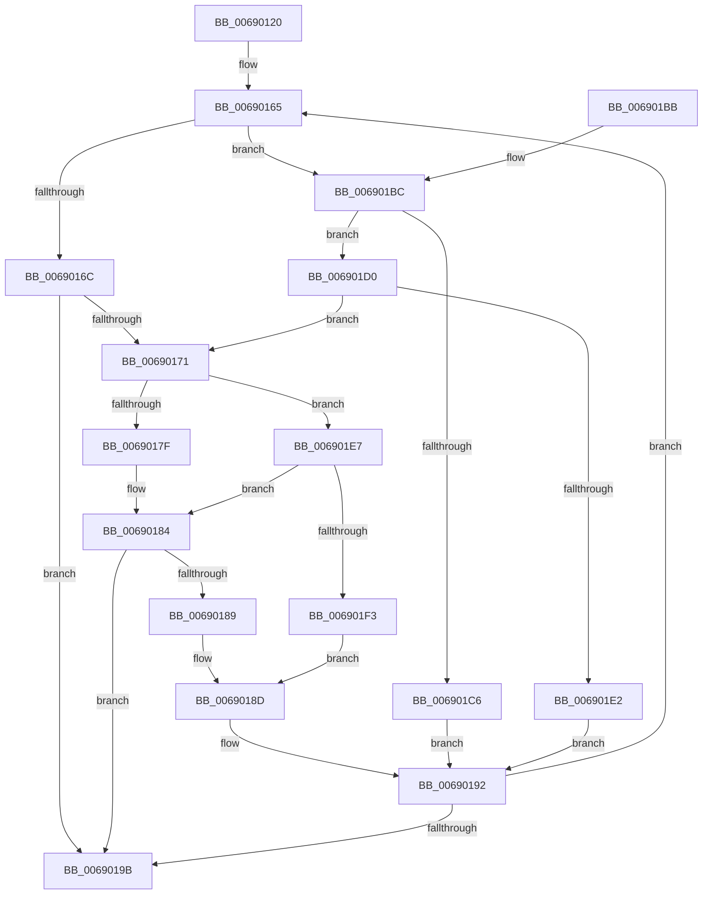

# MiAddMdlToPartitionTree

- RVA: `0x00690120`–`0x00690203` (길이 `227` bytes)
- VA: `0x0000000140690120`
- 실행 섹션: `.text`
- PDB 이름 있음: `예`; PDB Function 태그: `아니요`
- unwind 정보 RVA: `0x000D90C4`
- 디코드: `77`개 명령, `227/227` bytes 표시
- 미해석 바이트: `0` (있으면 어셈블리에 `.byte`로 보존)

> 이 문서는 커널 이미지의 기계어와 PDB 기호를 분석해 생성했습니다. 4번과 5번은 함수 원형과 자료형을 바이너리 사용 방식에서 추정한 C 해석이며 원본 소스 복구 결과는 아닙니다.

## 1. Dependencies

- 직접 호출 지점: **2**; 고유 호출 대상: **2**
- 직접 호출자로 확인된 함수: **1**
- RIP 상대 이미지 참조: **0**

### Outgoing calls
- `0x0069017F` → [MiClearRangeInPartitionTree](MiClearRangeInPartitionTree_function_00690734.md) (function, `0x00690734`)
- `0x006901EA` → [MiAddRangeToPartitionTree](MiAddRangeToPartitionTree_function_0069020C.md) (function, `0x0069020C`)

### Direct callers
- [MiAllocatePartitionPhysicalPages](../../page/80/MiAllocatePartitionPhysicalPages_function_0080C9D4.md) at `0x0080CF6C`

### Static image references
- 디코드된 RIP-relative 메모리 참조가 없습니다.

## 2. Other-region calls and transfers

- 다른 실행 섹션으로 향하는 call: **0**
- 별도 외부 분기/꼬리 이동을 확인하지 못했습니다.

## 3. Assembly (complete function range)

```asm
00690120  48 8B C4                        mov rax, rsp
00690123  48 89 58 10                     mov qword ptr [rax + 0x10], rbx
00690127  48 89 68 18                     mov qword ptr [rax + 0x18], rbp
0069012B  48 89 70 20                     mov qword ptr [rax + 0x20], rsi
0069012F  48 89 48 08                     mov qword ptr [rax + 8], rcx
00690133  57                              push rdi
00690134  41 54                           push r12
00690136  41 55                           push r13
00690138  41 56                           push r14
0069013A  41 57                           push r15
0069013C  48 83 EC 20                     sub rsp, 0x20
00690140  8B 72 28                        mov esi, dword ptr [rdx + 0x28]
00690143  45 8B E8                        mov r13d, r8d
00690146  41 F7 D5                        not r13d
00690149  48 C1 EE 0C                     shr rsi, 0xc
0069014D  41 83 E5 01                     and r13d, 1
00690151  33 DB                           xor ebx, ebx
00690153  49 83 CF FF                     or r15, 0xffffffffffffffff
00690157  4C 8B E2                        mov r12, rdx
0069015A  33 FF                           xor edi, edi
0069015C  48 8B C1                        mov rax, rcx
0069015F  41 BE 01 00 00 00               mov r14d, 1
00690165  8B EF                           mov ebp, edi
00690167  48 3B EE                        cmp rbp, rsi
0069016A  75 50                           jne 0x1406901bc
0069016C  48 85 DB                        test rbx, rbx
0069016F  74 2A                           je 0x14069019b
00690171  4C 8B C3                        mov r8, rbx
00690174  49 8B D7                        mov rdx, r15
00690177  48 8B C8                        mov rcx, rax
0069017A  45 85 F6                        test r14d, r14d
0069017D  75 68                           jne 0x1406901e7
0069017F  E8 B0 05 00 00                  call 0x140690734
00690184  48 3B EE                        cmp rbp, rsi
00690187  74 12                           je 0x14069019b
00690189  33 DB                           xor ebx, ebx
0069018B  FF CF                           dec edi
0069018D  48 8B 44 24 50                  mov rax, qword ptr [rsp + 0x50]
00690192  FF C7                           inc edi
00690194  8B CF                           mov ecx, edi
00690196  48 3B CE                        cmp rcx, rsi
00690199  76 CA                           jbe 0x140690165
0069019B  48 8B 5C 24 58                  mov rbx, qword ptr [rsp + 0x58]
006901A0  41 8B C6                        mov eax, r14d
006901A3  48 8B 6C 24 60                  mov rbp, qword ptr [rsp + 0x60]
006901A8  48 8B 74 24 68                  mov rsi, qword ptr [rsp + 0x68]
006901AD  48 83 C4 20                     add rsp, 0x20
006901B1  41 5F                           pop r15
006901B3  41 5E                           pop r14
006901B5  41 5D                           pop r13
006901B7  41 5C                           pop r12
006901B9  5F                              pop rdi
006901BA  C3                              ret
006901BB  CC                              int3
006901BC  49 8B 4C FC 30                  mov rcx, qword ptr [r12 + rdi*8 + 0x30]
006901C1  48 85 DB                        test rbx, rbx
006901C4  75 0A                           jne 0x1406901d0
006901C6  4C 8B F9                        mov r15, rcx
006901C9  BB 01 00 00 00                  mov ebx, 1
006901CE  EB C2                           jmp 0x140690192
006901D0  49 8B 44 FC 28                  mov rax, qword ptr [r12 + rdi*8 + 0x28]
006901D5  48 FF C0                        inc rax
006901D8  48 3B C1                        cmp rax, rcx
006901DB  48 8B 44 24 50                  mov rax, qword ptr [rsp + 0x50]
006901E0  75 8F                           jne 0x140690171
006901E2  48 FF C3                        inc rbx
006901E5  EB AB                           jmp 0x140690192
006901E7  45 8B CD                        mov r9d, r13d
006901EA  E8 1D 00 00 00                  call 0x14069020c
006901EF  85 C0                           test eax, eax
006901F1  75 91                           jne 0x140690184
006901F3  48 8B F5                        mov rsi, rbp
006901F6  83 CF FF                        or edi, 0xffffffff
006901F9  48 2B F3                        sub rsi, rbx
006901FC  33 DB                           xor ebx, ebx
006901FE  45 33 F6                        xor r14d, r14d
00690201  EB 8A                           jmp 0x14069018d
```

## 4. C-style interpretation (structured pseudocode)

```c
__int64 __fastcall MiAddMdlToPartitionTree(__int64 a1, __int64 a2, int a3)
{
    __int64 result;
    __int64 v_r13;
    __int64 v_r14;
    __int64 v_r15;
    __int64 v_rbx;
    __int64 v_rdi;
    __int64 v_rsi;
    __int64 v_rsp;
    unsigned __int64 v_stack_p10;
    unsigned __int64 v_stack_p18;
    unsigned __int64 v_stack_p20;
    unsigned __int64 v_stack_p50;
    unsigned __int64 v_stack_p8;

    *(unsigned __int64 *)(v_rsp + 16) = v_rbx;
    *(unsigned __int64 *)(v_rsp + 24) = v_rbp;
    *(unsigned __int64 *)(v_rsp + 32) = v_rsi;
    *(unsigned __int64 *)(v_rsp + 8) = a1;
    v_rsp = (v_rsp) - (32);
    v_r13 = (unsigned int)(~((unsigned int)(a3)));
    v_rsi = ((unsigned int)(*(unsigned int *)(a2 + 40))) >> (12);
    v_r13 = (unsigned int)((v_r13) & (1));
    v_rbx = 0;
    v_r15 = (v_r15) | (-1);
    v_rdi = 0;
loc_00690165:
    if (0 != v_rsi) goto loc_006901BC;
    if (0 == 0) goto loc_0069019B;
loc_00690171:
    if (1 != 0) goto loc_006901E7;
    result = MiClearRangeInPartitionTree(a1, v_r15, 0, a4);
loc_00690184:
    if (0 == v_rsi) goto loc_0069019B;
    v_rbx = 0;
    v_rdi = (unsigned int)((v_rdi) - 1);
loc_0069018D:
loc_00690192:
    v_rdi = (unsigned int)((v_rdi) + 1);
    if (((unsigned int)((unsigned int)(v_rdi))) <= v_rsi) goto loc_00690165;
loc_0069019B:
    v_rsp = (v_rsp) + (32);
    return 1;
loc_006901BC:
    if (v_stack_p10 != 0) goto loc_006901D0;
    goto loc_00690192;
loc_006901D0:
    result = (*(unsigned __int64 *)(a2 + v_rdi * 8 + 40)) + 1;
    if (result != (*(unsigned __int64 *)(a2 + v_rdi * 8 + 48))) goto loc_00690171;
    v_rbx = (1) + 1;
    goto loc_00690192;
loc_006901E7:
    result = MiAddRangeToPartitionTree(*(unsigned __int64 *)(a2 + v_rdi * 8 + 48), v_r15, 0, (unsigned int)((unsigned int)(v_r13)));
    if ((unsigned int)(result) != 0) goto loc_00690184;
    v_rdi = (unsigned int)((v_rdi) | (0xFFFFFFFFULL));
    v_rsi = (v_stack_p18) - (v_rbx);
    v_rbx = 0;
    v_r14 = 0;
    goto loc_0069018D;
}
```

## 5. (Beta) C Style

```c
int64_t MiAddMdlToPartitionTree(int64_t Arg1, void *Arg2, int32_t Arg3)
{
    uint8_t *arg2 = (uint8_t *)Arg2;

    int64_t result;
    int64_t local_r13;
    int64_t local_r14;
    int64_t local_r15;
    int64_t local_rbx;
    int64_t local_rdi;
    int64_t local_rsi;
    int64_t local_rsp;
    uint64_t v_stack_p10;
    uint64_t v_stack_p18;
    uint64_t v_stack_p20;
    uint64_t v_stack_p50;
    uint64_t v_stack_p8;

    *(uint64_t *)(local_rsp + 0x10) = local_rbx;
    *(uint64_t *)(local_rsp + 0x18) = local_rbp;
    *(uint64_t *)(local_rsp + 0x20) = local_rsi;
    *(uint64_t *)(local_rsp + 0x8) = Arg1;
    local_rsp = (local_rsp) - (32);
    local_r13 = (uint32_t)(~((uint32_t)(Arg3)));
    local_rsi = ((uint32_t)(*(uint32_t *)(arg2 + 0x28))) >> (12);
    local_r13 = (uint32_t)((local_r13) & (1));
    local_rbx = 0;
    local_r15 = (local_r15) | (-1);
    local_rdi = 0;
loc_00690165:
    if (0 != local_rsi) goto loc_006901BC;
    if (0 == 0) goto loc_0069019B;
loc_00690171:
    if (1 != 0) goto loc_006901E7;
    result = MiClearRangeInPartitionTree(Arg1, local_r15, 0, a4);
loc_00690184:
    if (0 == local_rsi) goto loc_0069019B;
    local_rbx = 0;
    local_rdi = (uint32_t)((local_rdi) - 1);
loc_0069018D:
loc_00690192:
    local_rdi = (uint32_t)((local_rdi) + 1);
    if (((uint32_t)((uint32_t)(local_rdi))) <= local_rsi) goto loc_00690165;
loc_0069019B:
    local_rsp = (local_rsp) + (32);
    return 1;
loc_006901BC:
    if (v_stack_p10 != 0) goto loc_006901D0;
    goto loc_00690192;
loc_006901D0:
    result = (*(uint64_t *)(arg2 + local_rdi * 8 + 0x28)) + 1;
    if (result != (*(uint64_t *)(arg2 + local_rdi * 8 + 0x30))) goto loc_00690171;
    local_rbx = (1) + 1;
    goto loc_00690192;
loc_006901E7:
    result = MiAddRangeToPartitionTree(*(uint64_t *)(arg2 + local_rdi * 8 + 0x30), local_r15, 0, (uint32_t)((uint32_t)(local_r13)));
    if ((uint32_t)(result) != 0) goto loc_00690184;
    local_rdi = (uint32_t)((local_rdi) | (0xFFFFFFFFULL));
    local_rsi = (v_stack_p18) - (local_rbx);
    local_rbx = 0;
    local_r14 = 0;
    goto loc_0069018D;
}
```

### 관측된 메모리 오프셋

구조체 형식이 확인되지 않은 접근은 인자 기준의 오프셋으로만 기록했습니다.

| 기준 인자 | 오프셋 표현 | 폭 (bit) | 접근 |
|---|---:|---:|---|
| `Arg2` | `+ 0x28` | `32` | `R` |
| `Arg2` | `+ 0x28 + rdi*8` | `64` | `R` |
| `Arg2` | `+ 0x30 + rdi*8` | `64` | `R` |

## 6. Execution-region graph

[열기: 2D/3D 그래프와 함수 탐색 컨트롤 패널](../../../control-panel.html?section=text&rva=0x00690120&view=graph)

- 2D 그래프는 위에서 아래로 흐르고, 3D 그래프는 빈 공간을 드래그해 회전합니다. Shift+드래그는 이동, 휠은 확대·축소, 함수 노드 선택은 대상 보고서 이동입니다.

### Static fallback


