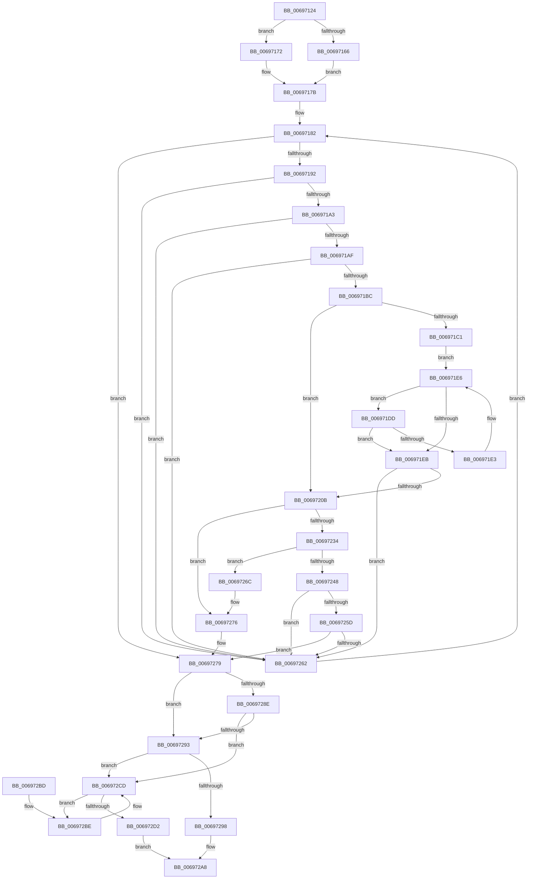

# MiAllocateAcceleratorDescriptor

- RVA: `0x00697124`–`0x006972D6` (길이 `434` bytes)
- VA: `0x0000000140697124`
- 실행 섹션: `.text`
- PDB 이름 있음: `예`; PDB Function 태그: `아니요`
- unwind 정보 RVA: `0x000D95D0`
- 디코드: `121`개 명령, `434/434` bytes 표시
- 미해석 바이트: `0` (있으면 어셈블리에 `.byte`로 보존)

> 이 문서는 커널 이미지의 기계어와 PDB 기호를 분석해 생성했습니다. 4번과 5번은 함수 원형과 자료형을 바이너리 사용 방식에서 추정한 C 해석이며 원본 소스 복구 결과는 아닙니다.

## 1. Dependencies

- 직접 호출 지점: **9**; 고유 호출 대상: **8**
- 직접 호출자로 확인된 함수: **5**
- RIP 상대 이미지 참조: **3**

### Outgoing calls
- `0x0069716B` → [ExAcquireSpinLockExclusiveAtDpcLevel](../24/ExAcquireSpinLockExclusiveAtDpcLevel_function_00248E80.md) (function, `0x00248E80`)
- `0x00697172` → [ExAcquireSpinLockExclusive](../24/ExAcquireSpinLockExclusive_function_00248690.md) (function, `0x00248690`)
- `0x006971CF` → [ExAcquireSpinLockExclusiveAtDpcLevel](../24/ExAcquireSpinLockExclusiveAtDpcLevel_function_00248E80.md) (function, `0x00248E80`)
- `0x006971F9` → [ExReleaseSpinLockExclusiveFromDpcLevel](../24/ExReleaseSpinLockExclusiveFromDpcLevel_function_002497E0.md) (function, `0x002497E0`)
- `0x00697227` → [ExAllocatePoolMm](../35/ExAllocatePoolMm_function_0035B690.md) (function, `0x0035B690`)
- `0x0069723F` → [AccelInitializeDescriptor](../66/AccelInitializeDescriptor_function_0066860C.md) (function, `0x0066860C`)
- `0x00697271` → [ExFreePoolWithTag](../../poolcode/B8/ExFreePoolWithTag_function_00B82870.md) (function, `0x00B82870`)
- `0x00697284` → [MiReleaseSpinLockExclusive](../24/MiReleaseSpinLockExclusive_function_002482C0.md) (function, `0x002482C0`)
- `0x006972C8` → [MiDeleteAcceleratorDescriptor](../2C/MiDeleteAcceleratorDescriptor_function_002CA560.md) (function, `0x002CA560`)

### Direct callers
- [MiZeroLargePage](../2C/MiZeroLargePage_function_002C6914.md) at `0x002C6C64`
- [MiGetZeroingDescriptors](../68/MiGetZeroingDescriptors_function_0068C2F4.md) at `0x0068C311`
- [MiSoloZeroHugeRange](../68/MiSoloZeroHugeRange_function_0068C6E4.md) at `0x0068C74A`
- [MiAbsorbPossibleEngineChanges](MiAbsorbPossibleEngineChanges_function_006958B4.md) at `0x00695BD3`
- [MiZeroPageCalibrate](MiZeroPageCalibrate_function_0069A69C.md) at `0x0069A7C2`

### Static image references
- `0x0069715B` → RVA `0x00E37568` (`.data`; read)
- `0x0069717B` → RVA `0x00E37540` (`.data`; read)
- `0x006971AF` → RVA `0x00E37554` (`.data`; read)

## 2. Other-region calls and transfers

- 다른 실행 섹션으로 향하는 call: **1**
  - `0x00697271` → [ExFreePoolWithTag](../../poolcode/B8/ExFreePoolWithTag_function_00B82870.md) (`.text` → `POOLCODE`)
- 별도 외부 분기/꼬리 이동을 확인하지 못했습니다.

## 3. Assembly (complete function range)

```asm
00697124  48 89 5C 24 08                  mov qword ptr [rsp + 8], rbx
00697129  4C 89 4C 24 20                  mov qword ptr [rsp + 0x20], r9
0069712E  44 89 44 24 18                  mov dword ptr [rsp + 0x18], r8d
00697133  55                              push rbp
00697134  56                              push rsi
00697135  57                              push rdi
00697136  41 54                           push r12
00697138  41 55                           push r13
0069713A  41 56                           push r14
0069713C  41 57                           push r15
0069713E  48 83 EC 30                     sub rsp, 0x30
00697142  49 83 21 00                     and qword ptr [r9], 0
00697146  33 FF                           xor edi, edi
00697148  45 8B F8                        mov r15d, r8d
0069714B  8B DA                           mov ebx, edx
0069714D  48 8B E9                        mov rbp, rcx
00697150  45 33 E4                        xor r12d, r12d
00697153  44 8D 6F 01                     lea r13d, [rdi + 1]
00697157  44 0F 20 C0                     mov rax, cr8
0069715B  48 8D 0D 06 04 7A 00            lea rcx, [rip + 0x7a0406]
00697162  3C 02                           cmp al, 2
00697164  75 0C                           jne 0x140697172
00697166  C6 44 24 20 11                  mov byte ptr [rsp + 0x20], 0x11
0069716B  E8 10 1D BB FF                  call 0x140248e80
00697170  EB 09                           jmp 0x14069717b
00697172  E8 19 15 BB FF                  call 0x140248690
00697177  88 44 24 20                     mov byte ptr [rsp + 0x20], al
0069717B  48 8B 35 BE 03 7A 00            mov rsi, qword ptr [rip + 0x7a03be]
00697182  48 8D 05 B7 03 7A 00            lea rax, [rip + 0x7a03b7]
00697189  48 3B F0                        cmp rsi, rax
0069718C  0F 84 E7 00 00 00               je 0x140697279
00697192  48 8B 06                        mov rax, qword ptr [rsi]
00697195  48 89 44 24 28                  mov qword ptr [rsp + 0x28], rax
0069719A  39 5E 18                        cmp dword ptr [rsi + 0x18], ebx
0069719D  0F 85 BF 00 00 00               jne 0x140697262
006971A3  8B 46 34                        mov eax, dword ptr [rsi + 0x34]
006971A6  41 84 C5                        test r13b, al
006971A9  0F 85 B3 00 00 00               jne 0x140697262
006971AF  80 3D 9E 03 7A 00 00            cmp byte ptr [rip + 0x7a039e], 0
006971B6  0F 85 A6 00 00 00               jne 0x140697262
006971BC  48 85 ED                        test rbp, rbp
006971BF  74 4A                           je 0x14069720b
006971C1  48 8B 8D D0 00 00 00            mov rcx, qword ptr [rbp + 0xd0]
006971C8  48 81 C1 B0 3B 00 00            add rcx, 0x3bb0
006971CF  E8 AC 1C BB FF                  call 0x140248e80
006971D4  4C 8D 7D 78                     lea r15, [rbp + 0x78]
006971D8  4D 8B 37                        mov r14, qword ptr [r15]
006971DB  EB 09                           jmp 0x1406971e6
006971DD  49 39 76 18                     cmp qword ptr [r14 + 0x18], rsi
006971E1  74 08                           je 0x1406971eb
006971E3  4D 8B 36                        mov r14, qword ptr [r14]
006971E6  4D 3B F7                        cmp r14, r15
006971E9  75 F2                           jne 0x1406971dd
006971EB  48 8B 8D D0 00 00 00            mov rcx, qword ptr [rbp + 0xd0]
006971F2  48 81 C1 B0 3B 00 00            add rcx, 0x3bb0
006971F9  E8 E2 25 BB FF                  call 0x1402497e0
006971FE  4D 3B F7                        cmp r14, r15
00697201  44 8B BC 24 80 00 00 00         mov r15d, dword ptr [rsp + 0x80]
00697209  75 57                           jne 0x140697262
0069720B  48 8B 56 20                     mov rdx, qword ptr [rsi + 0x20]
0069720F  B9 40 00 00 00                  mov ecx, 0x40
00697214  44 8B 4E 18                     mov r9d, dword ptr [rsi + 0x18]
00697218  48 83 C2 20                     add rdx, 0x20
0069721C  41 0F BA E9 1F                  bts r9d, 0x1f
00697221  41 B8 4D 69 4F 6C               mov r8d, 0x6c4f694d
00697227  E8 64 44 CC FF                  call 0x14035b690
0069722C  4C 8B F0                        mov r14, rax
0069722F  48 85 C0                        test rax, rax
00697232  74 42                           je 0x140697276
00697234  8B 56 20                        mov edx, dword ptr [rsi + 0x20]
00697237  4C 8D 40 20                     lea r8, [rax + 0x20]
0069723B  48 8B 4E 10                     mov rcx, qword ptr [rsi + 0x10]
0069723F  E8 C8 13 FD FF                  call 0x14066860c
00697244  85 C0                           test eax, eax
00697246  78 24                           js 0x14069726c
00697248  FF 46 30                        inc dword ptr [rsi + 0x30]
0069724B  41 FF C4                        inc r12d
0069724E  49 89 3E                        mov qword ptr [r14], rdi
00697251  49 8B FE                        mov rdi, r14
00697254  49 89 76 18                     mov qword ptr [r14 + 0x18], rsi
00697258  45 85 FF                        test r15d, r15d
0069725B  74 05                           je 0x140697262
0069725D  45 3B E7                        cmp r12d, r15d
00697260  74 17                           je 0x140697279
00697262  48 8B 74 24 28                  mov rsi, qword ptr [rsp + 0x28]
00697267  E9 16 FF FF FF                  jmp 0x140697182
0069726C  33 D2                           xor edx, edx
0069726E  49 8B CE                        mov rcx, r14
00697271  E8 FA B5 4E 00                  call 0x140b82870
00697276  45 33 ED                        xor r13d, r13d
00697279  8A 54 24 20                     mov dl, byte ptr [rsp + 0x20]
0069727D  48 8D 0D E4 02 7A 00            lea rcx, [rip + 0x7a02e4]
00697284  E8 37 10 BB FF                  call 0x1402482c0
00697289  45 85 E4                        test r12d, r12d
0069728C  75 05                           jne 0x140697293
0069728E  48 85 ED                        test rbp, rbp
00697291  74 3A                           je 0x1406972cd
00697293  45 85 ED                        test r13d, r13d
00697296  74 35                           je 0x1406972cd
00697298  48 8B 8C 24 88 00 00 00         mov rcx, qword ptr [rsp + 0x88]
006972A0  B8 01 00 00 00                  mov eax, 1
006972A5  48 89 39                        mov qword ptr [rcx], rdi
006972A8  48 8B 5C 24 70                  mov rbx, qword ptr [rsp + 0x70]
006972AD  48 83 C4 30                     add rsp, 0x30
006972B1  41 5F                           pop r15
006972B3  41 5E                           pop r14
006972B5  41 5D                           pop r13
006972B7  41 5C                           pop r12
006972B9  5F                              pop rdi
006972BA  5E                              pop rsi
006972BB  5D                              pop rbp
006972BC  C3                              ret
006972BD  CC                              int3
006972BE  48 8B CF                        mov rcx, rdi
006972C1  48 8B 3F                        mov rdi, qword ptr [rdi]
006972C4  48 83 C1 20                     add rcx, 0x20
006972C8  E8 93 32 C3 FF                  call 0x1402ca560
006972CD  48 85 FF                        test rdi, rdi
006972D0  75 EC                           jne 0x1406972be
006972D2  33 C0                           xor eax, eax
006972D4  EB D2                           jmp 0x1406972a8
```

## 4. C-style interpretation (structured pseudocode)

```c
__int64 __fastcall MiAllocateAcceleratorDescriptor(__int64 a1, int a2, int a3, __int64 a4)
{
    __int64 result;
    __int64 v_r12;
    __int64 v_r13;
    __int64 v_rdi;
    __int64 v_rsp;
    unsigned __int64 v_stack_m40;
    unsigned __int8 v_stack_m48;
    unsigned int v_stack_p18;
    unsigned __int64 v_stack_p20;
    unsigned __int64 v_stack_p8;

    v_stack_p8 = v_rbx;
    v_stack_p20 = a4;
    v_stack_p18 = a3;
    v_rsp = (v_rsp) - (48);
    v_rdi = 0;
    v_r12 = 0;
    if (((unsigned __int8)(v_cr8)) != 2) goto loc_00697172;
    v_stack_m48 = 17;
    result = ExAcquireSpinLockExclusiveAtDpcLevel(v_rip + 7996422, a2, a3, a4);
    goto loc_0069717B;
loc_00697172:
    result = ExAcquireSpinLockExclusive(v_rip + 7996422, a2, a3, a4);
    v_stack_m48 = (unsigned __int8)(result);
loc_0069717B:
loc_00697182:
    if ((*(unsigned __int64 *)(v_rip + 7996350)) == (v_rip + 7996343)) goto loc_00697279;
    v_stack_m40 = *(unsigned __int64 *)(*(unsigned __int64 *)(v_rip + 7996350));
    if ((*(unsigned int *)(*(unsigned __int64 *)(v_rip + 7996350) + 24)) != ((unsigned int)((unsigned int)(a2)))) goto loc_00697262;
    if ((((unsigned __int8)(v_rdi + 1)) & ((unsigned __int8)((unsigned int)(*(unsigned int *)(*(unsigned __int64 *)(v_rip + 7996350) + 52))))) != 0) goto loc_00697262;
    if ((*(unsigned __int8 *)(v_rip + 7996318)) != 0) goto loc_00697262;
    if (a1 == 0) goto loc_0069720B;
    a1 = (*(unsigned __int64 *)(a1 + 208)) + (0x3BB0ULL);
    result = ExAcquireSpinLockExclusiveAtDpcLevel(a1, a2, a3, a4);
    goto loc_006971E6;
loc_006971DD:
    if ((*(unsigned __int64 *)(*(unsigned __int64 *)(a1 + 120) + 24)) == (*(unsigned __int64 *)(v_rip + 7996350))) goto loc_006971EB;
loc_006971E6:
    if ((*(unsigned __int64 *)(*(unsigned __int64 *)(a1 + 120))) != (a1 + 120)) goto loc_006971DD;
loc_006971EB:
    a1 = (*(unsigned __int64 *)(a1 + 208)) + (0x3BB0ULL);
    result = ExReleaseSpinLockExclusiveFromDpcLevel(a1, a2, a3, a4);
    if ((*(unsigned __int64 *)(*(unsigned __int64 *)(a1 + 120))) != (a1 + 120)) goto loc_00697262;
loc_0069720B:
    a2 = (*(unsigned __int64 *)(*(unsigned __int64 *)(v_rip + 7996350) + 32)) + (32);
    result = ExAllocatePoolMm(64, a2, (unsigned int)(0x6C4F694DULL), (unsigned int)(*(unsigned int *)(*(unsigned __int64 *)(v_rip + 7996350) + 24)));
    if (result == 0) goto loc_00697276;
    result = AccelInitializeDescriptor(*(unsigned __int64 *)(*(unsigned __int64 *)(v_rip + 7996350) + 16), (unsigned int)(*(unsigned int *)(*(unsigned __int64 *)(v_rip + 7996350) + 32)), result + 32, (unsigned int)(*(unsigned int *)(*(unsigned __int64 *)(v_rip + 7996350) + 24)));
    if (sign_flag) goto loc_0069726C;
    v_r12 = (unsigned int)((v_r12) + 1);
    *(unsigned __int64 *)(result) = 0;
    *(unsigned __int64 *)(result + 24) = *(unsigned __int64 *)(v_rip + 7996350);
    if ((unsigned int)((unsigned int)(v_stack_p18)) == 0) goto loc_00697262;
    if (((unsigned int)(v_r12)) == ((unsigned int)((unsigned int)(v_stack_p18)))) goto loc_00697279;
loc_00697262:
    goto loc_00697182;
loc_0069726C:
    a2 = 0;
    result = ExFreePoolWithTag(result, a2, result + 32, (unsigned int)(*(unsigned int *)(*(unsigned __int64 *)(v_rip + 7996350) + 24)));
loc_00697276:
    v_r13 = 0;
loc_00697279:
    result = MiReleaseSpinLockExclusive(v_rip + 7996132, v_stack_m48, result + 32, (unsigned int)(*(unsigned int *)(*(unsigned __int64 *)(v_rip + 7996350) + 24)));
    if ((unsigned int)(v_r12) != 0) goto loc_00697293;
    if (a1 == 0) goto loc_006972CD;
loc_00697293:
    if (0 == 0) goto loc_006972CD;
    *(unsigned __int64 *)(v_stack_p20) = result;
loc_006972A8:
    v_rsp = (v_rsp) + (48);
    return 1;
loc_006972BE:
    a1 = (result) + (32);
    result = MiDeleteAcceleratorDescriptor(a1, v_stack_m48, result + 32, (unsigned int)(*(unsigned int *)(*(unsigned __int64 *)(v_rip + 7996350) + 24)));
loc_006972CD:
    if (*(unsigned __int64 *)(result) != 0) goto loc_006972BE;
    result = 0;
    goto loc_006972A8;
}
```

## 5. (Beta) C Style

```c
int64_t MiAllocateAcceleratorDescriptor(int64_t Arg1, int32_t Arg2, int32_t Arg3, void *Arg4)
{
    uint8_t *arg4 = (uint8_t *)Arg4;

    int64_t result;
    int64_t local_r12;
    int64_t local_r13;
    int64_t local_rdi;
    int64_t local_rsp;
    uint64_t v_stack_m40;
    uint8_t v_stack_m48;
    uint32_t v_stack_p18;
    uint64_t v_stack_p20;
    uint64_t v_stack_p8;

    v_stack_p8 = local_rbx;
    v_stack_p20 = Arg4;
    v_stack_p18 = Arg3;
    local_rsp = (local_rsp) - (48);
    local_rdi = 0;
    local_r12 = 0;
    if (((uint8_t)(v_cr8)) != 2) goto loc_00697172;
    v_stack_m48 = 17;
    result = ExAcquireSpinLockExclusiveAtDpcLevel(v_rip + 7996422, Arg2, Arg3, Arg4);
    goto loc_0069717B;
loc_00697172:
    result = ExAcquireSpinLockExclusive(v_rip + 7996422, Arg2, Arg3, Arg4);
    v_stack_m48 = (uint8_t)(result);
loc_0069717B:
loc_00697182:
    if ((*(uint64_t *)(v_rip + 0x7A03BE)) == (v_rip + 7996343)) goto loc_00697279;
    v_stack_m40 = *(uint64_t *)(*(uint64_t *)(v_rip + 0x7A03BE));
    if ((*(uint32_t *)(*(uint64_t *)(v_rip + 0x7A03BE) + 0x18)) != ((uint32_t)((uint32_t)(Arg2)))) goto loc_00697262;
    if ((((uint8_t)(local_rdi + 1)) & ((uint8_t)((uint32_t)(*(uint32_t *)(*(uint64_t *)(v_rip + 0x7A03BE) + 0x34))))) != 0) goto loc_00697262;
    if ((*(uint8_t *)(v_rip + 0x7A039E)) != 0) goto loc_00697262;
    if (Arg1 == 0) goto loc_0069720B;
    Arg1 = (*(uint64_t *)(Arg1 + 0xD0)) + (0x3BB0ULL);
    result = ExAcquireSpinLockExclusiveAtDpcLevel(Arg1, Arg2, Arg3, Arg4);
    goto loc_006971E6;
loc_006971DD:
    if ((*(uint64_t *)(*(uint64_t *)(Arg1 + 0x78) + 0x18)) == (*(uint64_t *)(v_rip + 0x7A03BE))) goto loc_006971EB;
loc_006971E6:
    if ((*(uint64_t *)(*(uint64_t *)(Arg1 + 0x78))) != (Arg1 + 120)) goto loc_006971DD;
loc_006971EB:
    Arg1 = (*(uint64_t *)(Arg1 + 0xD0)) + (0x3BB0ULL);
    result = ExReleaseSpinLockExclusiveFromDpcLevel(Arg1, Arg2, Arg3, Arg4);
    if ((*(uint64_t *)(*(uint64_t *)(Arg1 + 0x78))) != (Arg1 + 120)) goto loc_00697262;
loc_0069720B:
    Arg2 = (*(uint64_t *)(*(uint64_t *)(v_rip + 0x7A03BE) + 0x20)) + (32);
    result = ExAllocatePoolMm(64, Arg2, (uint32_t)(0x6C4F694DULL), (uint32_t)(*(uint32_t *)(*(uint64_t *)(v_rip + 0x7A03BE) + 0x18)));
    if (result == 0) goto loc_00697276;
    result = AccelInitializeDescriptor(*(uint64_t *)(*(uint64_t *)(v_rip + 0x7A03BE) + 0x10), (uint32_t)(*(uint32_t *)(*(uint64_t *)(v_rip + 0x7A03BE) + 0x20)), result + 32, (uint32_t)(*(uint32_t *)(*(uint64_t *)(v_rip + 0x7A03BE) + 0x18)));
    if (sign_flag) goto loc_0069726C;
    local_r12 = (uint32_t)((local_r12) + 1);
    *(uint64_t *)(result) = 0;
    *(uint64_t *)(result + 0x18) = *(uint64_t *)(v_rip + 0x7A03BE);
    if ((uint32_t)((uint32_t)(v_stack_p18)) == 0) goto loc_00697262;
    if (((uint32_t)(local_r12)) == ((uint32_t)((uint32_t)(v_stack_p18)))) goto loc_00697279;
loc_00697262:
    goto loc_00697182;
loc_0069726C:
    Arg2 = 0;
    result = ExFreePoolWithTag(result, Arg2, result + 32, (uint32_t)(*(uint32_t *)(*(uint64_t *)(v_rip + 0x7A03BE) + 0x18)));
loc_00697276:
    local_r13 = 0;
loc_00697279:
    result = MiReleaseSpinLockExclusive(v_rip + 7996132, v_stack_m48, result + 32, (uint32_t)(*(uint32_t *)(*(uint64_t *)(v_rip + 0x7A03BE) + 0x18)));
    if ((uint32_t)(local_r12) != 0) goto loc_00697293;
    if (Arg1 == 0) goto loc_006972CD;
loc_00697293:
    if (0 == 0) goto loc_006972CD;
    *(uint64_t *)(v_stack_p20) = result;
loc_006972A8:
    local_rsp = (local_rsp) + (48);
    return 1;
loc_006972BE:
    Arg1 = (result) + (32);
    result = MiDeleteAcceleratorDescriptor(Arg1, v_stack_m48, result + 32, (uint32_t)(*(uint32_t *)(*(uint64_t *)(v_rip + 0x7A03BE) + 0x18)));
loc_006972CD:
    if (*(uint64_t *)(result) != 0) goto loc_006972BE;
    result = 0;
    goto loc_006972A8;
}
```

### 관측된 메모리 오프셋

구조체 형식이 확인되지 않은 접근은 인자 기준의 오프셋으로만 기록했습니다.

| 기준 인자 | 오프셋 표현 | 폭 (bit) | 접근 |
|---|---:|---:|---|
| `Arg4` | `+ 0x0` | `64` | `R/W` |

## 6. Execution-region graph

[열기: 2D/3D 그래프와 함수 탐색 컨트롤 패널](../../../control-panel.html?section=text&rva=0x00697124&view=graph)

- 2D 그래프는 위에서 아래로 흐르고, 3D 그래프는 빈 공간을 드래그해 회전합니다. Shift+드래그는 이동, 휠은 확대·축소, 함수 노드 선택은 대상 보고서 이동입니다.

### Static fallback


