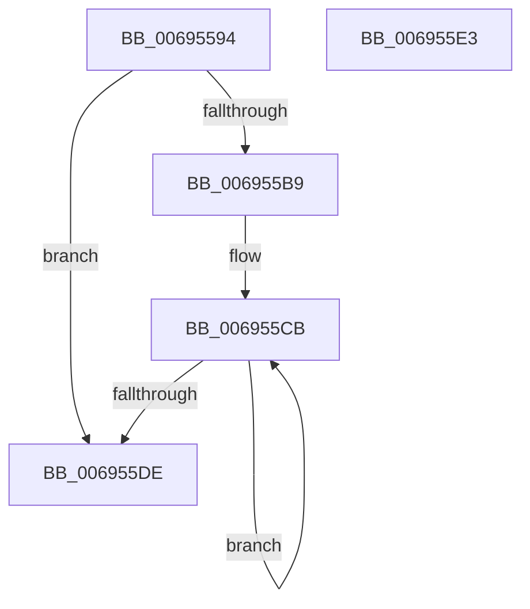

# MiAllocatePrcb

- RVA: `0x00695594`–`0x006955E4` (길이 `80` bytes)
- VA: `0x0000000140695594`
- 실행 섹션: `.text`
- PDB 이름 있음: `예`; PDB Function 태그: `아니요`
- unwind 정보 RVA: `0x0005C788`
- 디코드: `19`개 명령, `80/80` bytes 표시
- 미해석 바이트: `0` (있으면 어셈블리에 `.byte`로 보존)

> 이 문서는 커널 이미지의 기계어와 PDB 기호를 분석해 생성했습니다. 4번과 5번은 함수 원형과 자료형을 바이너리 사용 방식에서 추정한 C 해석이며 원본 소스 복구 결과는 아닙니다.

## 1. Dependencies

- 직접 호출 지점: **1**; 고유 호출 대상: **1**
- 직접 호출자로 확인된 함수: **1**
- RIP 상대 이미지 참조: **0**

### Outgoing calls
- `0x006955AF` → [ExAllocatePoolMm](../35/ExAllocatePoolMm_function_0035B690.md) (function, `0x0035B690`)

### Direct callers
- [MmInitializeProcessor](../../pagelk/B7/MmInitializeProcessor_function_00B737F8.md) at `0x00B73831`

### Static image references
- 디코드된 RIP-relative 메모리 참조가 없습니다.

## 2. Other-region calls and transfers

- 다른 실행 섹션으로 향하는 call: **0**
- 별도 외부 분기/꼬리 이동을 확인하지 못했습니다.

## 3. Assembly (complete function range)

```asm
00695594  48 83 EC 28                     sub rsp, 0x28
00695598  0F BA E9 1F                     bts ecx, 0x1f
0069559C  BA 70 A2 00 00                  mov edx, 0xa270
006955A1  44 8B C9                        mov r9d, ecx
006955A4  41 B8 4D 69 50 6D               mov r8d, 0x6d50694d
006955AA  B9 40 00 00 00                  mov ecx, 0x40
006955AF  E8 DC 60 CC FF                  call 0x14035b690
006955B4  48 85 C0                        test rax, rax
006955B7  74 25                           je 0x1406955de
006955B9  BA 02 00 00 00                  mov edx, 2
006955BE  48 8D 88 D4 21 00 00            lea rcx, [rax + 0x21d4]
006955C5  89 90 60 01 00 00               mov dword ptr [rax + 0x160], edx
006955CB  C7 01 00 02 00 00               mov dword ptr [rcx], 0x200
006955D1  48 8D 89 78 50 00 00            lea rcx, [rcx + 0x5078]
006955D8  48 83 EA 01                     sub rdx, 1
006955DC  75 ED                           jne 0x1406955cb
006955DE  48 83 C4 28                     add rsp, 0x28
006955E2  C3                              ret
006955E3  CC                              int3
```

## 4. C-style interpretation (structured pseudocode)

```c
__int64 __fastcall MiAllocatePrcb(int a1)
{
    __int64 result;
    __int64 v_rsp;

    v_rsp = (v_rsp) - (40);
    result = ExAllocatePoolMm(64, (unsigned int)(0xA270ULL), (unsigned int)(0x6D50694DULL), (unsigned int)(a1));
    if (result == 0) goto loc_006955DE;
    *(unsigned int *)(result + 352) = 2;
loc_006955CB:
    *(unsigned int *)(result + 8660) = 512;
    a2 = (2) - (1);
    if (condition_is_not_equal) goto loc_006955CB;
loc_006955DE:
    v_rsp = (v_rsp) + (40);
    return result;
}
```

## 5. (Beta) C Style

```c
int64_t MiAllocatePrcb(int32_t Arg1)
{
    int64_t result;
    int64_t local_rsp;

    local_rsp = (local_rsp) - (40);
    result = ExAllocatePoolMm(64, (uint32_t)(0xA270ULL), (uint32_t)(0x6D50694DULL), (uint32_t)(Arg1));
    if (result == 0) goto loc_006955DE;
    *(uint32_t *)(result + 0x160) = 2;
loc_006955CB:
    *(uint32_t *)(result + 0x21D4) = 512;
    a2 = (2) - (1);
    if (condition_is_not_equal) goto loc_006955CB;
loc_006955DE:
    local_rsp = (local_rsp) + (40);
    return result;
}
```

## 6. Execution-region graph

[열기: 2D/3D 그래프와 함수 탐색 컨트롤 패널](../../../control-panel.html?section=text&rva=0x00695594&view=graph)

- 2D 그래프는 위에서 아래로 흐르고, 3D 그래프는 빈 공간을 드래그해 회전합니다. Shift+드래그는 이동, 휠은 확대·축소, 함수 노드 선택은 대상 보고서 이동입니다.

### Static fallback


