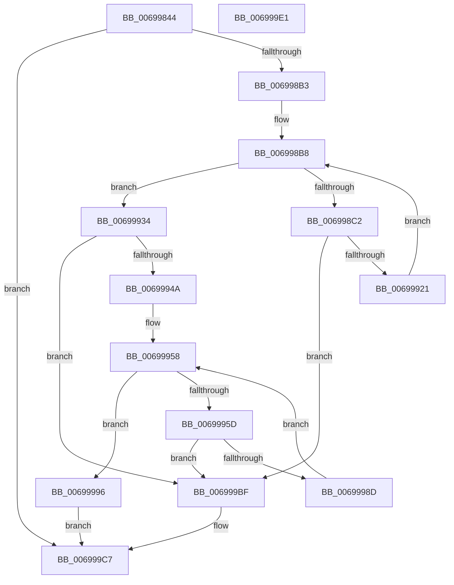

# MiAllocateZeroCalibrationBuffer

- RVA: `0x00699844`–`0x006999E2` (길이 `414` bytes)
- VA: `0x0000000140699844`
- 실행 섹션: `.text`
- PDB 이름 있음: `예`; PDB Function 태그: `아니요`
- unwind 정보 RVA: `0x000D96A0`
- 디코드: `106`개 명령, `414/414` bytes 표시
- 미해석 바이트: `0` (있으면 어셈블리에 `.byte`로 보존)

> 이 문서는 커널 이미지의 기계어와 PDB 기호를 분석해 생성했습니다. 4번과 5번은 함수 원형과 자료형을 바이너리 사용 방식에서 추정한 C 해석이며 원본 소스 복구 결과는 아닙니다.

## 1. Dependencies

- 직접 호출 지점: **5**; 고유 호출 대상: **5**
- 직접 호출자로 확인된 함수: **1**
- RIP 상대 이미지 참조: **1**

### Outgoing calls
- `0x0069987D` → [MiUpdateProtectionMask](../28/MiUpdateProtectionMask_function_002845DC.md) (function, `0x002845DC`)
- `0x00699913` → [MiAllocatePagesForMdl](../3E/MiAllocatePagesForMdl_function_003EABEC.md) (function, `0x003EABEC`)
- `0x0069993D` → [MiReservePtes](../31/MiReservePtes_function_00318D20.md) (function, `0x00318D20`)
- `0x00699984` → [MiFillSystemPtes](../31/MiFillSystemPtes_function_00319850.md) (function, `0x00319850`)
- `0x006999C2` → [MiFreeZeroCalibrationBuffer](MiFreeZeroCalibrationBuffer_function_00699E44.md) (function, `0x00699E44`)

### Direct callers
- [MiZeroPageCalibrate](MiZeroPageCalibrate_function_0069A69C.md) at `0x0069A8BA`

### Static image references
- `0x00699936` → RVA `0x00E37668` (`.data`; read)

## 2. Other-region calls and transfers

- 다른 실행 섹션으로 향하는 call: **0**
- 별도 외부 분기/꼬리 이동을 확인하지 못했습니다.

## 3. Assembly (complete function range)

```asm
00699844  48 8B C4                        mov rax, rsp
00699847  48 89 68 08                     mov qword ptr [rax + 8], rbp
0069984B  48 89 70 18                     mov qword ptr [rax + 0x18], rsi
0069984F  48 89 50 10                     mov qword ptr [rax + 0x10], rdx
00699853  57                              push rdi
00699854  41 54                           push r12
00699856  41 55                           push r13
00699858  41 56                           push r14
0069985A  41 57                           push r15
0069985C  48 83 EC 60                     sub rsp, 0x60
00699860  44 8B AC 24 B0 00 00 00         mov r13d, dword ptr [rsp + 0xb0]
00699868  4C 8B F9                        mov r15, rcx
0069986B  83 60 C8 00                     and dword ptr [rax - 0x38], 0
0069986F  4C 8B D2                        mov r10, rdx
00699872  41 8B D5                        mov edx, r13d
00699875  B9 04 00 00 00                  mov ecx, 4
0069987A  41 8B F8                        mov edi, r8d
0069987D  E8 5A AD BE FF                  call 0x1402845dc
00699882  49 F7 C1 FF 0F 00 00            test r9, 0xfff
00699889  89 84 24 A8 00 00 00            mov dword ptr [rsp + 0xa8], eax
00699890  BD 00 00 00 00                  mov ebp, 0
00699895  48 B8 00 00 00 00 01 00 00 00   movabs rax, 0x100000000
0069989F  40 0F 95 C5                     setne bpl
006998A3  49 C1 E9 0C                     shr r9, 0xc
006998A7  49 03 E9                        add rbp, r9
006998AA  48 3B E8                        cmp rbp, rax
006998AD  0F 83 14 01 00 00               jae 0x1406999c7
006998B3  45 33 F6                        xor r14d, r14d
006998B6  33 F6                           xor esi, esi
006998B8  B8 FF FF 0F 00                  mov eax, 0xfffff
006998BD  4C 3B F5                        cmp r14, rbp
006998C0  74 72                           je 0x140699934
006998C2  4C 8B E5                        mov r12, rbp
006998C5  4D 2B E6                        sub r12, r14
006998C8  4C 3B E0                        cmp r12, rax
006998CB  4C 0F 47 E0                     cmova r12, rax
006998CF  48 83 64 24 48 00               and qword ptr [rsp + 0x48], 0
006998D5  65 48 8B 04 25 88 01 00 00      mov rax, qword ptr gs:[0x188]
006998DE  45 33 C9                        xor r9d, r9d
006998E1  49 83 C8 FF                     or r8, 0xffffffffffffffff
006998E5  33 D2                           xor edx, edx
006998E7  48 8B 88 B8 00 00 00            mov rcx, qword ptr [rax + 0xb8]
006998EE  49 8B C4                        mov rax, r12
006998F1  48 89 4C 24 40                  mov qword ptr [rsp + 0x40], rcx
006998F6  49 8B CA                        mov rcx, r10
006998F9  C7 44 24 38 07 00 00 00         mov dword ptr [rsp + 0x38], 7
00699901  89 7C 24 30                     mov dword ptr [rsp + 0x30], edi
00699905  48 C1 E0 0C                     shl rax, 0xc
00699909  44 89 6C 24 28                  mov dword ptr [rsp + 0x28], r13d
0069990E  48 89 44 24 20                  mov qword ptr [rsp + 0x20], rax
00699913  E8 D4 12 D5 FF                  call 0x1403eabec
00699918  48 85 C0                        test rax, rax
0069991B  0F 84 9E 00 00 00               je 0x1406999bf
00699921  4C 8B 94 24 98 00 00 00         mov r10, qword ptr [rsp + 0x98]
00699929  4D 03 F4                        add r14, r12
0069992C  48 89 30                        mov qword ptr [rax], rsi
0069992F  48 8B F0                        mov rsi, rax
00699932  EB 84                           jmp 0x1406998b8
00699934  8B D5                           mov edx, ebp
00699936  48 8D 0D 2B DD 79 00            lea rcx, [rip + 0x79dd2b]
0069993D  E8 DE F3 C7 FF                  call 0x140318d20
00699942  48 8B F8                        mov rdi, rax
00699945  48 85 C0                        test rax, rax
00699948  74 75                           je 0x1406999bf
0069994A  44 8B AC 24 A8 00 00 00         mov r13d, dword ptr [rsp + 0xa8]
00699952  4C 8B F0                        mov r14, rax
00699955  4C 8B C6                        mov r8, rsi
00699958  4D 85 C0                        test r8, r8
0069995B  74 39                           je 0x140699996
0069995D  41 8B 68 28                     mov ebp, dword ptr [r8 + 0x28]
00699961  48 8D 44 24 50                  lea rax, [rsp + 0x50]
00699966  4D 8B 20                        mov r12, qword ptr [r8]
00699969  45 8B CD                        mov r9d, r13d
0069996C  48 89 44 24 28                  mov qword ptr [rsp + 0x28], rax
00699971  49 83 C0 30                     add r8, 0x30
00699975  83 64 24 20 00                  and dword ptr [rsp + 0x20], 0
0069997A  49 8B CE                        mov rcx, r14
0069997D  48 C1 ED 0C                     shr rbp, 0xc
00699981  48 8B D5                        mov rdx, rbp
00699984  E8 C7 FE C7 FF                  call 0x140319850
00699989  85 C0                           test eax, eax
0069998B  78 32                           js 0x1406999bf
0069998D  4D 8D 34 EE                     lea r14, [r14 + rbp*8]
00699991  4D 8B C4                        mov r8, r12
00699994  EB C2                           jmp 0x140699958
00699996  49 89 B7 20 01 00 00            mov qword ptr [r15 + 0x120], rsi
0069999D  48 C1 E7 19                     shl rdi, 0x19
006999A1  48 B8 00 00 00 00 80 F6 FF FF   movabs rax, 0xfffff68000000000
006999AB  48 C1 E0 19                     shl rax, 0x19
006999AF  48 2B F8                        sub rdi, rax
006999B2  48 C1 FF 10                     sar rdi, 0x10
006999B6  49 89 BF 10 01 00 00            mov qword ptr [r15 + 0x110], rdi
006999BD  EB 08                           jmp 0x1406999c7
006999BF  49 8B CF                        mov rcx, r15
006999C2  E8 7D 04 00 00                  call 0x140699e44
006999C7  4C 8D 5C 24 60                  lea r11, [rsp + 0x60]
006999CC  49 8B 6B 30                     mov rbp, qword ptr [r11 + 0x30]
006999D0  49 8B 73 40                     mov rsi, qword ptr [r11 + 0x40]
006999D4  49 8B E3                        mov rsp, r11
006999D7  41 5F                           pop r15
006999D9  41 5E                           pop r14
006999DB  41 5D                           pop r13
006999DD  41 5C                           pop r12
006999DF  5F                              pop rdi
006999E0  C3                              ret
006999E1  CC                              int3
```

## 4. C-style interpretation (structured pseudocode)

```c
__int64 __fastcall MiAllocateZeroCalibrationBuffer(__int64 a1, __int64 a2, __int64 a3, __int64 a4, unsigned int a5)
{
    __int64 result;
    __int64 v_r12;
    __int64 v_r14;
    __int64 v_rbp;
    __int64 v_rdi;
    __int64 v_rsi;
    __int64 v_rsp;
    unsigned __int64 v_stack_m28;
    unsigned __int64 v_stack_m38;
    unsigned __int64 v_stack_m40;
    unsigned __int64 v_stack_m48;
    unsigned int v_stack_m50;
    unsigned int v_stack_m58;
    unsigned int v_stack_m60;
    unsigned __int64 v_stack_m68;
    unsigned __int64 v_stack_p10;
    unsigned int v_stack_p20;

    *(unsigned __int64 *)(v_rsp + 8) = v_rbp;
    *(unsigned __int64 *)(v_rsp + 24) = v_rsi;
    *(unsigned __int64 *)(v_rsp + 16) = a2;
    v_rsp = (v_rsp) - (96);
    result = MiUpdateProtectionMask(4, (unsigned int)((unsigned int)((unsigned int)(a5))), a3, a4);
    v_stack_p20 = (unsigned int)(result);
    v_rbp = (((a4) & (0xFFFULL)) != 0) ? 1 : 0;
    a4 = (a4) >> (12);
    v_rbp = (v_rbp) + (a4);
    if (v_rbp >= result) goto loc_006999C7;
    v_r14 = 0;
    v_rsi = 0;
loc_006998B8:
    if (0 == v_rbp) goto loc_00699934;
    v_r12 = (v_rbp) - (0);
    if (v_r12 > ((unsigned int)(0xFFFFFULL))) { v_r12 = (unsigned int)(0xFFFFFULL); }
    a4 = 0;
    a3 = (a3) | (-1);
    a2 = 0;
    v_stack_m48 = *(unsigned __int64 *)(*(unsigned __int64 *)(gs_base + (0 + 392)) + 184);
    v_stack_m50 = 7;
    v_stack_m58 = (unsigned int)((unsigned int)((unsigned int)(a3)));
    result = (v_r12) << (12);
    v_stack_m60 = (unsigned int)((unsigned int)(a5));
    v_stack_m68 = result;
    result = MiAllocatePagesForMdl(0, a2, a3, a4);
    if (result == 0) goto loc_006999BF;
    v_r14 = (v_r14) + (v_r12);
    *(unsigned __int64 *)(result) = 0;
    goto loc_006998B8;
loc_00699934:
    result = MiReservePtes(v_rip + 7986475, (unsigned int)((unsigned int)(v_rbp)), a3, a4);
    if (result == 0) goto loc_006999BF;
loc_00699958:
    if (result == 0) goto loc_00699996;
    v_stack_m60 = v_stack_m38;
    a3 = (result) + (48);
    v_rbp = ((unsigned int)(*(unsigned int *)(result + 40))) >> (12);
    result = MiFillSystemPtes(result, v_rbp, a3, (unsigned int)((unsigned int)((unsigned int)(v_stack_p20))));
    if (sign_flag) goto loc_006999BF;
    goto loc_00699958;
loc_00699996:
    *(unsigned __int64 *)(a1 + 288) = result;
    v_rdi = (result) << (25);
    result = (result) << (25);
    v_rdi = (v_rdi) - (result);
    v_rdi = (v_rdi) >> (16);
    *(unsigned __int64 *)(a1 + 272) = v_rdi;
    goto loc_006999C7;
loc_006999BF:
    result = MiFreeZeroCalibrationBuffer(a1, v_rbp, *(unsigned __int64 *)(result), (unsigned int)((unsigned int)((unsigned int)(v_stack_p20))));
loc_006999C7:
    return result;
}
```

## 5. (Beta) C Style

```c
int64_t MiAllocateZeroCalibrationBuffer(void *Arg1, int64_t Arg2, int64_t Arg3, int64_t Arg4, uint32_t Arg5)
{
    uint8_t *arg1 = (uint8_t *)Arg1;

    int64_t result;
    int64_t local_r12;
    int64_t local_r14;
    int64_t local_rbp;
    int64_t local_rdi;
    int64_t local_rsi;
    int64_t local_rsp;
    uint64_t v_stack_m28;
    uint64_t v_stack_m38;
    uint64_t v_stack_m40;
    uint64_t v_stack_m48;
    uint32_t v_stack_m50;
    uint32_t v_stack_m58;
    uint32_t v_stack_m60;
    uint64_t v_stack_m68;
    uint64_t v_stack_p10;
    uint32_t v_stack_p20;

    *(uint64_t *)(local_rsp + 0x8) = local_rbp;
    *(uint64_t *)(local_rsp + 0x18) = local_rsi;
    *(uint64_t *)(local_rsp + 0x10) = Arg2;
    local_rsp = (local_rsp) - (96);
    result = MiUpdateProtectionMask(4, (uint32_t)((uint32_t)((uint32_t)(Arg5))), Arg3, Arg4);
    v_stack_p20 = (uint32_t)(result);
    local_rbp = (((Arg4) & (0xFFFULL)) != 0) ? 1 : 0;
    Arg4 = (Arg4) >> (12);
    local_rbp = (local_rbp) + (Arg4);
    if (local_rbp >= result) goto loc_006999C7;
    local_r14 = 0;
    local_rsi = 0;
loc_006998B8:
    if (0 == local_rbp) goto loc_00699934;
    local_r12 = (local_rbp) - (0);
    if (local_r12 > ((uint32_t)(0xFFFFFULL))) { local_r12 = (uint32_t)(0xFFFFFULL); }
    Arg4 = 0;
    Arg3 = (Arg3) | (-1);
    Arg2 = 0;
    v_stack_m48 = *(uint64_t *)(*(uint64_t *)(gs_base + (0 + 0x188)) + 0xB8);
    v_stack_m50 = 7;
    v_stack_m58 = (uint32_t)((uint32_t)((uint32_t)(Arg3)));
    result = (local_r12) << (12);
    v_stack_m60 = (uint32_t)((uint32_t)(Arg5));
    v_stack_m68 = result;
    result = MiAllocatePagesForMdl(0, Arg2, Arg3, Arg4);
    if (result == 0) goto loc_006999BF;
    local_r14 = (local_r14) + (local_r12);
    *(uint64_t *)(result) = 0;
    goto loc_006998B8;
loc_00699934:
    result = MiReservePtes(v_rip + 7986475, (uint32_t)((uint32_t)(local_rbp)), Arg3, Arg4);
    if (result == 0) goto loc_006999BF;
loc_00699958:
    if (result == 0) goto loc_00699996;
    v_stack_m60 = v_stack_m38;
    Arg3 = (result) + (48);
    local_rbp = ((uint32_t)(*(uint32_t *)(result + 0x28))) >> (12);
    result = MiFillSystemPtes(result, local_rbp, Arg3, (uint32_t)((uint32_t)((uint32_t)(v_stack_p20))));
    if (sign_flag) goto loc_006999BF;
    goto loc_00699958;
loc_00699996:
    *(uint64_t *)(arg1 + 0x120) = result;
    local_rdi = (result) << (25);
    result = (result) << (25);
    local_rdi = (local_rdi) - (result);
    local_rdi = (local_rdi) >> (16);
    *(uint64_t *)(arg1 + 0x110) = local_rdi;
    goto loc_006999C7;
loc_006999BF:
    result = MiFreeZeroCalibrationBuffer(Arg1, local_rbp, *(uint64_t *)(result), (uint32_t)((uint32_t)((uint32_t)(v_stack_p20))));
loc_006999C7:
    return result;
}
```

### 관측된 메모리 오프셋

구조체 형식이 확인되지 않은 접근은 인자 기준의 오프셋으로만 기록했습니다.

| 기준 인자 | 오프셋 표현 | 폭 (bit) | 접근 |
|---|---:|---:|---|
| `Arg1` | `+ 0x110` | `64` | `W` |
| `Arg1` | `+ 0x120` | `64` | `W` |

## 6. Execution-region graph

[열기: 2D/3D 그래프와 함수 탐색 컨트롤 패널](../../../control-panel.html?section=text&rva=0x00699844&view=graph)

- 2D 그래프는 위에서 아래로 흐르고, 3D 그래프는 빈 공간을 드래그해 회전합니다. Shift+드래그는 이동, 휠은 확대·축소, 함수 노드 선택은 대상 보고서 이동입니다.

### Static fallback


