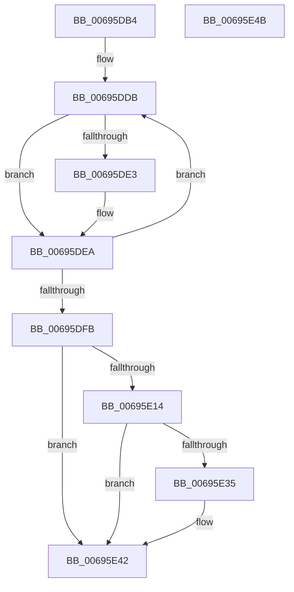

# MiAllocateZeroPageDecisionTraceBuffer

- RVA: `0x00695DB4`–`0x00695E4C` (길이 `152` bytes)
- VA: `0x0000000140695DB4`
- 실행 섹션: `.text`
- PDB 이름 있음: `예`; PDB Function 태그: `아니요`
- unwind 정보 RVA: `0x0005CF00`
- 디코드: `44`개 명령, `152/152` bytes 표시
- 미해석 바이트: `0` (있으면 어셈블리에 `.byte`로 보존)

> 이 문서는 커널 이미지의 기계어와 PDB 기호를 분석해 생성했습니다. 4번과 5번은 함수 원형과 자료형을 바이너리 사용 방식에서 추정한 C 해석이며 원본 소스 복구 결과는 아닙니다.

## 1. Dependencies

- 직접 호출 지점: **1**; 고유 호출 대상: **1**
- 직접 호출자로 확인된 함수: **1**
- RIP 상대 이미지 참조: **1**

### Outgoing calls
- `0x00695E28` → [ExAllocatePoolMm](../35/ExAllocatePoolMm_function_0035B690.md) (function, `0x0035B690`)

### Direct callers
- [MiAbsorbPossibleEngineChanges](MiAbsorbPossibleEngineChanges_function_006958B4.md) at `0x00695D74`

### Static image references
- `0x00695DD0` → RVA `0x00011C60` (`.rdata`; read)

## 2. Other-region calls and transfers

- 다른 실행 섹션으로 향하는 call: **0**
- 별도 외부 분기/꼬리 이동을 확인하지 못했습니다.

## 3. Assembly (complete function range)

```asm
00695DB4  40 53                           push rbx
00695DB6  48 83 EC 20                     sub rsp, 0x20
00695DBA  45 33 C9                        xor r9d, r9d
00695DBD  8B C2                           mov eax, edx
00695DBF  4C 69 C0 80 DF 00 00            imul r8, rax, 0xdf80
00695DC6  33 DB                           xor ebx, ebx
00695DC8  45 8D 51 02                     lea r10d, [r9 + 2]
00695DCC  4C 03 41 10                     add r8, qword ptr [rcx + 0x10]
00695DD0  48 8D 0D 89 BE 97 FF            lea rcx, [rip - 0x684177]
00695DD7  49 83 C0 10                     add r8, 0x10
00695DDB  49 8B 00                        mov rax, qword ptr [r8]
00695DDE  48 85 C0                        test rax, rax
00695DE1  74 07                           je 0x140695dea
00695DE3  48 0F AF 01                     imul rax, qword ptr [rcx]
00695DE7  48 03 D8                        add rbx, rax
00695DEA  49 81 C0 00 05 00 00            add r8, 0x500
00695DF1  48 83 C1 08                     add rcx, 8
00695DF5  49 83 EA 01                     sub r10, 1
00695DF9  75 E0                           jne 0x140695ddb
00695DFB  48 C1 EB 0C                     shr rbx, 0xc
00695DFF  B8 00 01 00 00                  mov eax, 0x100
00695E04  3B D8                           cmp ebx, eax
00695E06  0F 42 D8                        cmovb ebx, eax
00695E09  8B C3                           mov eax, ebx
00695E0B  48 C1 E0 04                     shl rax, 4
00695E0F  48 85 C0                        test rax, rax
00695E12  74 2E                           je 0x140695e42
00695E14  0F BA EA 1F                     bts edx, 0x1f
00695E18  41 8D 4A 40                     lea ecx, [r10 + 0x40]
00695E1C  44 8B CA                        mov r9d, edx
00695E1F  41 B8 4D 69 5A 69               mov r8d, 0x695a694d
00695E25  48 8B D0                        mov rdx, rax
00695E28  E8 63 58 CC FF                  call 0x14035b690
00695E2D  4C 8B C8                        mov r9, rax
00695E30  48 85 C0                        test rax, rax
00695E33  74 0D                           je 0x140695e42
00695E35  83 60 04 00                     and dword ptr [rax + 4], 0
00695E39  89 18                           mov dword ptr [rax], ebx
00695E3B  C7 40 08 01 00 00 00            mov dword ptr [rax + 8], 1
00695E42  49 8B C1                        mov rax, r9
00695E45  48 83 C4 20                     add rsp, 0x20
00695E49  5B                              pop rbx
00695E4A  C3                              ret
00695E4B  CC                              int3
```

## 4. C-style interpretation (structured pseudocode)

```c
__int64 __fastcall MiAllocateZeroPageDecisionTraceBuffer(__int64 a1, int a2, __int64 a3, int a4)
{
    __int64 result;
    __int64 v_r10;
    __int64 v_rbx;
    __int64 v_rsp;

    v_rsp = (v_rsp) - (32);
    a4 = 0;
    a3 = (a3) * ((unsigned int)(a2));
    v_rbx = 0;
    a3 = (a3) + (*(unsigned __int64 *)(a1 + 16));
    a3 = (a3) + (16);
loc_00695DDB:
    result = *(unsigned __int64 *)(a3);
    if (*(unsigned __int64 *)(a3) != 0) {
        result = (*(unsigned __int64 *)(a3)) * (*(unsigned __int64 *)(v_rip - 6832503));
        v_rbx = (v_rbx) + (result);
    }
    a3 = (a3) + (0x500ULL);
    a1 = (v_rip - 6832503) + (8);
    v_r10 = (a4 + 2) - (1);
    if (condition_is_not_equal) goto loc_00695DDB;
    v_rbx = (v_rbx) >> (12);
    if (((unsigned int)(v_rbx)) < 256) { v_rbx = 256; }
    result = ((unsigned int)((unsigned int)(v_rbx))) << (4);
    if (result == 0) goto loc_00695E42;
    result = ExAllocatePoolMm(v_r10 + 64, result, (unsigned int)(0x695A694DULL), (unsigned int)(a2));
    if (result != 0) {
        *(unsigned int *)(result) = (unsigned int)(v_rbx);
        *(unsigned int *)(result + 8) = 1;
    }
    v_rsp = (v_rsp) + (32);
    return result;
}
```

## 5. (Beta) C Style

```c
int64_t MiAllocateZeroPageDecisionTraceBuffer(void *Arg1, int32_t Arg2, void *Arg3, int32_t Arg4)
{
    uint8_t *arg1 = (uint8_t *)Arg1;
    uint8_t *arg3 = (uint8_t *)Arg3;

    int64_t result;
    int64_t local_r10;
    int64_t local_rbx;
    int64_t local_rsp;

    local_rsp = (local_rsp) - (32);
    Arg4 = 0;
    Arg3 = (Arg3) * ((uint32_t)(Arg2));
    local_rbx = 0;
    Arg3 = (Arg3) + (*(uint64_t *)(arg1 + 0x10));
    Arg3 = (Arg3) + (16);
loc_00695DDB:
    result = *(uint64_t *)(arg3);
    if (*(uint64_t *)(arg3) != 0) {
        result = (*(uint64_t *)(arg3)) * (*(uint64_t *)(v_rip - 0x684177));
        local_rbx = (local_rbx) + (result);
    }
    Arg3 = (Arg3) + (0x500ULL);
    Arg1 = (v_rip - 6832503) + (8);
    local_r10 = (Arg4 + 2) - (1);
    if (condition_is_not_equal) goto loc_00695DDB;
    local_rbx = (local_rbx) >> (12);
    if (((uint32_t)(local_rbx)) < 256) { local_rbx = 256; }
    result = ((uint32_t)((uint32_t)(local_rbx))) << (4);
    if (result == 0) goto loc_00695E42;
    result = ExAllocatePoolMm(local_r10 + 64, result, (uint32_t)(0x695A694DULL), (uint32_t)(Arg2));
    if (result != 0) {
        *(uint32_t *)(result) = (uint32_t)(local_rbx);
        *(uint32_t *)(result + 0x8) = 1;
    }
    local_rsp = (local_rsp) + (32);
    return result;
}
```

### 관측된 메모리 오프셋

구조체 형식이 확인되지 않은 접근은 인자 기준의 오프셋으로만 기록했습니다.

| 기준 인자 | 오프셋 표현 | 폭 (bit) | 접근 |
|---|---:|---:|---|
| `Arg1` | `+ 0x10` | `64` | `R` |
| `Arg3` | `+ 0x0` | `64` | `R` |

## 6. Execution-region graph

[열기: 2D/3D 그래프와 함수 탐색 컨트롤 패널](../../../control-panel.html?section=text&rva=0x00695DB4&view=graph)

- 2D 그래프는 위에서 아래로 흐르고, 3D 그래프는 빈 공간을 드래그해 회전합니다. Shift+드래그는 이동, 휠은 확대·축소, 함수 노드 선택은 대상 보고서 이동입니다.

### Static fallback


