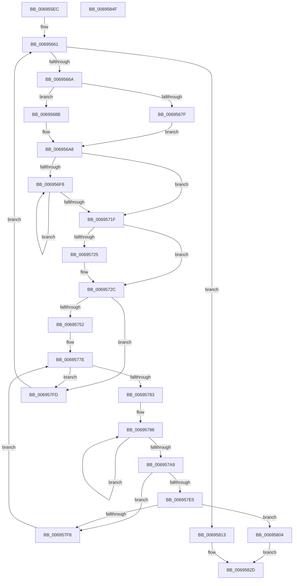

# MiCalibrateTbFlush

- RVA: `0x006955EC`–`0x00695850` (길이 `612` bytes)
- VA: `0x00000001406955EC`
- 실행 섹션: `.text`
- PDB 이름 있음: `예`; PDB Function 태그: `아니요`
- unwind 정보 RVA: `0x000D941C`
- 디코드: `167`개 명령, `612/612` bytes 표시
- 미해석 바이트: `0` (있으면 어셈블리에 `.byte`로 보존)

> 이 문서는 커널 이미지의 기계어와 PDB 기호를 분석해 생성했습니다. 4번과 5번은 함수 원형과 자료형을 바이너리 사용 방식에서 추정한 C 해석이며 원본 소스 복구 결과는 아닙니다.

## 1. Dependencies

- 직접 호출 지점: **8**; 고유 호출 대상: **8**
- 직접 호출자로 확인된 함수: **1**
- RIP 상대 이미지 참조: **2**

### Outgoing calls
- `0x00695628` → [memset](../6C/memset_function_006C6C40.md) (function, `0x006C6C40`)
- `0x0069563B` → [MiGetAnyMultiplexedVm](../44/MiGetAnyMultiplexedVm_function_00448BD0.md) (function, `0x00448BD0`)
- `0x0069565A` → [MiInitializeTbFlushList](../29/MiInitializeTbFlushList_function_00294F00.md) (function, `0x00294F00`)
- `0x00695684` → [KeFlushTb](../31/KeFlushTb_function_00314140.md) (function, `0x00314140`)
- `0x00695699` → [MiInsertTbFlushEntry](../29/MiInsertTbFlushEntry_function_00293670.md) (function, `0x00293670`)
- `0x006956A3` → [MiFlushTbList](../31/MiFlushTbList_function_00311FC0.md) (function, `0x00311FC0`)
- `0x00695769` → [qsort](../50/qsort_function_005009F0.md) (function, `0x005009F0`)
- `0x00695838` → [_security_check_cookie](../6A/_security_check_cookie_function_006AC640.md) (function, `0x006AC640`)

### Direct callers
- [MiInitializeTbFlush](../../init/C6/MiInitializeTbFlush_function_00C6B01C.md) at `0x00C6B10C`
- [MiInitializeTbFlush](../../init/C6/MiInitializeTbFlush_function_00C6B01C.md) at `0x00C6B138`

### Static image references
- `0x006955FE` → RVA `0x00E0A740` (`.data`; read)
- `0x00695754` → RVA `0x00695860` (`MiTbFlushCostSort`; read)

## 2. Other-region calls and transfers

- 다른 실행 섹션으로 향하는 call: **0**
- 별도 외부 분기/꼬리 이동을 확인하지 못했습니다.

## 3. Assembly (complete function range)

```asm
006955EC  40 53                           push rbx
006955EE  55                              push rbp
006955EF  56                              push rsi
006955F0  57                              push rdi
006955F1  41 54                           push r12
006955F3  41 56                           push r14
006955F5  41 57                           push r15
006955F7  48 81 EC 90 01 00 00            sub rsp, 0x190
006955FE  48 8B 05 3B 51 77 00            mov rax, qword ptr [rip + 0x77513b]
00695605  48 33 C4                        xor rax, rsp
00695608  48 89 84 24 80 01 00 00         mov qword ptr [rsp + 0x180], rax
00695610  45 8B E0                        mov r12d, r8d
00695613  8B EA                           mov ebp, edx
00695615  4C 8B F9                        mov r15, rcx
00695618  33 D2                           xor edx, edx
0069561A  41 B8 C8 00 00 00               mov r8d, 0xc8
00695620  48 8D 4C 24 30                  lea rcx, [rsp + 0x30]
00695625  49 8B D9                        mov rbx, r9
00695628  E8 13 16 03 00                  call 0x1406c6c40
0069562D  48 83 23 00                     and qword ptr [rbx], 0
00695631  B9 04 00 00 00                  mov ecx, 4
00695636  48 83 63 08 00                  and qword ptr [rbx + 8], 0
0069563B  E8 90 35 DB FF                  call 0x140448bd0
00695640  41 B9 08 00 00 00               mov r9d, 8
00695646  C7 44 24 20 80 00 00 00         mov dword ptr [rsp + 0x20], 0x80
0069564E  48 8B D0                        mov rdx, rax
00695651  48 8D 4C 24 30                  lea rcx, [rsp + 0x30]
00695656  45 8D 41 0C                     lea r8d, [r9 + 0xc]
0069565A  E8 A1 F8 BF FF                  call 0x140294f00
0069565F  33 FF                           xor edi, edi
00695661  83 FF 08                        cmp edi, 8
00695664  0F 83 A9 01 00 00               jae 0x140695813
0069566A  0F 31                           rdtsc
0069566C  48 C1 E2 20                     shl rdx, 0x20
00695670  48 0B C2                        or rax, rdx
00695673  48 8B F0                        mov rsi, rax
00695676  F0 83 0C 24 00                  lock or dword ptr [rsp], 0
0069567B  85 ED                           test ebp, ebp
0069567D  75 0C                           jne 0x14069568b
0069567F  8D 55 02                        lea edx, [rbp + 2]
00695682  33 C9                           xor ecx, ecx
00695684  E8 B7 EA C7 FF                  call 0x140314140
00695689  EB 1D                           jmp 0x1406956a8
0069568B  4C 8B C5                        mov r8, rbp
0069568E  48 8D 4C 24 30                  lea rcx, [rsp + 0x30]
00695693  45 33 C9                        xor r9d, r9d
00695696  49 8B D7                        mov rdx, r15
00695699  E8 D2 DF BF FF                  call 0x140293670
0069569E  48 8D 4C 24 30                  lea rcx, [rsp + 0x30]
006956A3  E8 18 C9 C7 FF                  call 0x140311fc0
006956A8  F0 83 0C 24 00                  lock or dword ptr [rsp], 0
006956AD  0F 31                           rdtsc
006956AF  48 C1 E2 20                     shl rdx, 0x20
006956B3  44 8B D5                        mov r10d, ebp
006956B6  48 0B C2                        or rax, rdx
006956B9  41 C1 E2 0C                     shl r10d, 0xc
006956BD  48 2B C6                        sub rax, rsi
006956C0  44 8B DF                        mov r11d, edi
006956C3  48 01 03                        add qword ptr [rbx], rax
006956C6  4D 03 DB                        add r11, r11
006956C9  4D 03 D7                        add r10, r15
006956CC  45 8B CC                        mov r9d, r12d
006956CF  44 2B CD                        sub r9d, ebp
006956D2  49 8B CA                        mov rcx, r10
006956D5  4A 89 84 DC 00 01 00 00         mov qword ptr [rsp + r11*8 + 0x100], rax
006956DD  0F 31                           rdtsc
006956DF  48 C1 E2 20                     shl rdx, 0x20
006956E3  48 0B C2                        or rax, rdx
006956E6  4C 8B F0                        mov r14, rax
006956E9  F0 83 0C 24 00                  lock or dword ptr [rsp], 0
006956EE  45 33 C0                        xor r8d, r8d
006956F1  41 8B F1                        mov esi, r9d
006956F4  D1 EE                           shr esi, 1
006956F6  74 27                           je 0x14069571f
006956F8  41 8B C8                        mov ecx, r8d
006956FB  C1 E1 0C                        shl ecx, 0xc
006956FE  4A 8B 14 11                     mov rdx, qword ptr [rcx + r10]
00695702  41 8B C9                        mov ecx, r9d
00695705  41 2B C8                        sub ecx, r8d
00695708  41 FF C0                        inc r8d
0069570B  C1 E1 0C                        shl ecx, 0xc
0069570E  81 E9 00 10 00 00               sub ecx, 0x1000
00695714  49 03 CA                        add rcx, r10
00695717  48 8B 01                        mov rax, qword ptr [rcx]
0069571A  44 3B C6                        cmp r8d, esi
0069571D  72 D9                           jb 0x1406956f8
0069571F  41 F6 C1 01                     test r9b, 1
00695723  74 07                           je 0x14069572c
00695725  48 8B 81 00 F0 FF FF            mov rax, qword ptr [rcx - 0x1000]
0069572C  F0 83 0C 24 00                  lock or dword ptr [rsp], 0
00695731  0F 31                           rdtsc
00695733  48 C1 E2 20                     shl rdx, 0x20
00695737  48 0B C2                        or rax, rdx
0069573A  49 2B C6                        sub rax, r14
0069573D  48 01 43 08                     add qword ptr [rbx + 8], rax
00695741  4A 89 84 DC 08 01 00 00         mov qword ptr [rsp + r11*8 + 0x108], rax
00695749  83 FF 02                        cmp edi, 2
0069574C  0F 82 AB 00 00 00               jb 0x1406957fd
00695752  8B D7                           mov edx, edi
00695754  4C 8D 0D 05 01 00 00            lea r9, [rip + 0x105]
0069575B  41 B8 10 00 00 00               mov r8d, 0x10
00695761  48 8D 8C 24 00 01 00 00         lea rcx, [rsp + 0x100]
00695769  E8 82 B2 E6 FF                  call 0x1405009f0
0069576E  45 33 C0                        xor r8d, r8d
00695771  8D 77 FE                        lea esi, [rdi - 2]
00695774  49 BE CD CC CC CC CC CC CC CC   movabs r14, 0xcccccccccccccccd
0069577E  44 3B C6                        cmp r8d, esi
00695781  77 7A                           ja 0x1406957fd
00695783  45 33 C9                        xor r9d, r9d
00695786  33 D2                           xor edx, edx
00695788  41 8D 0C 10                     lea ecx, [r8 + rdx]
0069578C  FF C2                           inc edx
0069578E  48 03 C9                        add rcx, rcx
00695791  48 8B 84 CC 08 01 00 00         mov rax, qword ptr [rsp + rcx*8 + 0x108]
00695799  48 03 84 CC 00 01 00 00         add rax, qword ptr [rsp + rcx*8 + 0x100]
006957A1  4C 03 C8                        add r9, rax
006957A4  83 FA 03                        cmp edx, 3
006957A7  72 DF                           jb 0x140695788
006957A9  48 B8 AB AA AA AA AA AA AA AA   movabs rax, 0xaaaaaaaaaaaaaaab
006957B3  49 F7 E1                        mul r9
006957B6  49 8B C6                        mov rax, r14
006957B9  45 8B C8                        mov r9d, r8d
006957BC  4C 8B D2                        mov r10, rdx
006957BF  4D 03 C9                        add r9, r9
006957C2  49 D1 EA                        shr r10, 1
006957C5  4E 8B 9C CC 08 01 00 00         mov r11, qword ptr [rsp + r9*8 + 0x108]
006957CD  4E 03 9C CC 00 01 00 00         add r11, qword ptr [rsp + r9*8 + 0x100]
006957D5  4B 8D 0C D2                     lea rcx, [r10 + r10*8]
006957D9  48 F7 E1                        mul rcx
006957DC  48 C1 EA 03                     shr rdx, 3
006957E0  4C 3B DA                        cmp r11, rdx
006957E3  72 13                           jb 0x1406957f8
006957E5  49 6B CA 0B                     imul rcx, r10, 0xb
006957E9  49 8B C6                        mov rax, r14
006957EC  48 F7 E1                        mul rcx
006957EF  48 C1 EA 03                     shr rdx, 3
006957F3  4C 3B DA                        cmp r11, rdx
006957F6  76 0C                           jbe 0x140695804
006957F8  41 FF C0                        inc r8d
006957FB  EB 81                           jmp 0x14069577e
006957FD  FF C7                           inc edi
006957FF  E9 5D FE FF FF                  jmp 0x140695661
00695804  42 0F 10 84 CC 00 01 00 00      movups xmm0, xmmword ptr [rsp + r9*8 + 0x100]
0069580D  F3 0F 7F 03                     movdqu xmmword ptr [rbx], xmm0
00695811  EB 1A                           jmp 0x14069582d
00695813  48 8B 03                        mov rax, qword ptr [rbx]
00695816  33 D2                           xor edx, edx
00695818  8B CF                           mov ecx, edi
0069581A  48 F7 F1                        div rcx
0069581D  33 D2                           xor edx, edx
0069581F  48 89 03                        mov qword ptr [rbx], rax
00695822  48 8B 43 08                     mov rax, qword ptr [rbx + 8]
00695826  48 F7 F1                        div rcx
00695829  48 89 43 08                     mov qword ptr [rbx + 8], rax
0069582D  48 8B 8C 24 80 01 00 00         mov rcx, qword ptr [rsp + 0x180]
00695835  48 33 CC                        xor rcx, rsp
00695838  E8 03 6E 01 00                  call 0x1406ac640
0069583D  48 81 C4 90 01 00 00            add rsp, 0x190
00695844  41 5F                           pop r15
00695846  41 5E                           pop r14
00695848  41 5C                           pop r12
0069584A  5F                              pop rdi
0069584B  5E                              pop rsi
0069584C  5D                              pop rbp
0069584D  5B                              pop rbx
0069584E  C3                              ret
0069584F  CC                              int3
```

## 4. C-style interpretation (structured pseudocode)

```c
__int64 __fastcall MiCalibrateTbFlush(__int64 a1, int a2, int a3, __int64 a4)
{
    __int64 result;
    __int64 v_r10;
    __int64 v_r11;
    __int64 v_rdi;
    __int64 v_rsi;
    __int64 v_rsp;
    unsigned __int64 v_stack_m198;
    unsigned int v_stack_m1A8;
    unsigned int v_stack_m1C8;
    unsigned __int64 v_stack_m48;
    unsigned __int64 v_stack_mC8;

    v_rsp = (v_rsp) - (400);
    result = (*(unsigned __int64 *)(v_rip + 7819579)) ^ (v_rsp);
    v_stack_m48 = result;
    a2 = 0;
    result = memset(v_stack_m198, a2, 200, a4);
    result = MiGetAnyMultiplexedVm(4, a2, 200, a4);
    v_stack_m1A8 = 128;
    result = MiInitializeTbFlushList(v_stack_m198, result, 8 + 12, 8);
    v_rdi = 0;
loc_00695661:
    if (0 >= 8) goto loc_00695813;
    a2 = (result) << (32);
    result = (result) | (a2);
    if ((unsigned int)((unsigned int)(a2)) != 0) goto loc_0069568B;
    a1 = 0;
    result = KeFlushTb(a1, (unsigned int)(a2) + 2, 8 + 12, 8);
    goto loc_006956A8;
loc_0069568B:
    a4 = 0;
    result = MiInsertTbFlushEntry(v_stack_m198, 0, (unsigned int)(a2), a4);
    result = MiFlushTbList(v_stack_m198, 0, (unsigned int)(a2), a4);
loc_006956A8:
    a2 = (0) << (32);
    result = (result) | (a2);
    v_r10 = (unsigned int)(((unsigned int)((unsigned int)((unsigned int)(a2)))) << (12));
    result = (result) - (result);
    v_r11 = (0) + (0);
    v_r10 = (v_r10) + (0);
    a4 = (unsigned int)(((unsigned int)((unsigned int)((unsigned int)(a3)))) - ((unsigned int)((unsigned int)(a2))));
    *(unsigned __int64 *)(v_rsp + v_r11 * 8 + 256) = result;
    a2 = (a2) << (32);
    result = (result) | (a2);
    a3 = 0;
    v_rsi = (unsigned int)(((unsigned int)((unsigned int)(a4))) >> (1));
    if (condition_is_equal) goto loc_0069571F;
loc_006956F8:
    a1 = (unsigned int)((0) << (12));
    a1 = (unsigned int)(((unsigned int)((unsigned int)(a4))) - (0));
    a3 = (unsigned int)((a3) + 1);
    a1 = (unsigned int)((a1) << (12));
    a1 = (unsigned int)((a1) - (0x1000ULL));
    a1 = (a1) + (v_r10);
    if (a3 < ((unsigned int)(v_rsi))) goto loc_006956F8;
loc_0069571F:
    result = *(unsigned __int64 *)(a1);
    if ((((unsigned __int8)(a4)) & (1)) != 0) {
        result = *(unsigned __int64 *)(a1 - 4096);
    }
    a2 = (*(unsigned __int64 *)(a1 + v_r10 * 1)) << (32);
    result = (result) | (a2);
    result = (result) - (result);
    *(unsigned __int64 *)(v_rsp + v_r11 * 8 + 264) = result;
    if (0 < 2) goto loc_006957FD;
    result = qsort(v_stack_mC8, 0, 16, v_rip + 261);
    a3 = 0;
loc_0069577E:
    if (0 > ((unsigned int)(v_rdi - 2))) goto loc_006957FD;
    a4 = 0;
    a2 = 0;
loc_00695788:
    a2 = (unsigned int)((a2) + 1);
    a1 = (a3 + a2 * 1) + (a3 + a2 * 1);
    result = (*(unsigned __int64 *)(v_rsp + a1 * 8 + 264)) + (*(unsigned __int64 *)(v_rsp + a1 * 8 + 256));
    a4 = (a4) + (result);
    if (a2 < 3) goto loc_00695788;
    a4 = (0) + (0);
    v_r10 = (a2) >> (1);
    v_r11 = (*(unsigned __int64 *)(v_rsp + a4 * 8 + 264)) + (*(unsigned __int64 *)(v_rsp + a4 * 8 + 256));
    a2 = (a2) >> (3);
    if (v_r11 < a2) goto loc_006957F8;
    a1 = (v_r10 + v_r10 * 8) * (v_r10);
    a2 = (a2) >> (3);
    if (v_r11 <= a2) goto loc_00695804;
loc_006957F8:
    a3 = (unsigned int)((a3) + 1);
    goto loc_0069577E;
loc_006957FD:
    v_rdi = (unsigned int)((v_rdi) + 1);
    goto loc_00695661;
loc_00695804:
    *(unsigned __int64 *)(a4) = v_xmm0;
    goto loc_0069582D;
loc_00695813:
    a2 = 0;
    a2 = 0;
    *(unsigned __int64 *)(a4) = *(unsigned __int64 *)(a4);
    *(unsigned __int64 *)(a4 + 8) = *(unsigned __int64 *)(a4 + 8);
loc_0069582D:
    a1 = (v_stack_m48) ^ (v_rsp);
    result = _security_check_cookie(a1, a2, a3, a4);
    v_rsp = (v_rsp) + (400);
    return result;
}
```

## 5. (Beta) C Style

```c
int64_t MiCalibrateTbFlush(int64_t Arg1, int32_t Arg2, int32_t Arg3, void *Arg4)
{
    uint8_t *arg4 = (uint8_t *)Arg4;

    int64_t result;
    int64_t local_r10;
    int64_t local_r11;
    int64_t local_rdi;
    int64_t local_rsi;
    int64_t local_rsp;
    uint64_t v_stack_m198;
    uint32_t v_stack_m1A8;
    uint32_t v_stack_m1C8;
    uint64_t v_stack_m48;
    uint64_t v_stack_mC8;

    local_rsp = (local_rsp) - (400);
    result = (*(uint64_t *)(v_rip + 0x77513B)) ^ (local_rsp);
    v_stack_m48 = result;
    Arg2 = 0;
    result = memset(v_stack_m198, Arg2, 200, Arg4);
    result = MiGetAnyMultiplexedVm(4, Arg2, 200, Arg4);
    v_stack_m1A8 = 128;
    result = MiInitializeTbFlushList(v_stack_m198, result, 8 + 12, 8);
    local_rdi = 0;
loc_00695661:
    if (0 >= 8) goto loc_00695813;
    Arg2 = (result) << (32);
    result = (result) | (Arg2);
    if ((uint32_t)((uint32_t)(Arg2)) != 0) goto loc_0069568B;
    Arg1 = 0;
    result = KeFlushTb(Arg1, (uint32_t)(Arg2) + 2, 8 + 12, 8);
    goto loc_006956A8;
loc_0069568B:
    Arg4 = 0;
    result = MiInsertTbFlushEntry(v_stack_m198, 0, (uint32_t)(Arg2), Arg4);
    result = MiFlushTbList(v_stack_m198, 0, (uint32_t)(Arg2), Arg4);
loc_006956A8:
    Arg2 = (0) << (32);
    result = (result) | (Arg2);
    local_r10 = (uint32_t)(((uint32_t)((uint32_t)((uint32_t)(Arg2)))) << (12));
    result = (result) - (result);
    local_r11 = (0) + (0);
    local_r10 = (local_r10) + (0);
    Arg4 = (uint32_t)(((uint32_t)((uint32_t)((uint32_t)(Arg3)))) - ((uint32_t)((uint32_t)(Arg2))));
    *(uint64_t *)(local_rsp + local_r11 * 8 + 0x100) = result;
    Arg2 = (Arg2) << (32);
    result = (result) | (Arg2);
    Arg3 = 0;
    local_rsi = (uint32_t)(((uint32_t)((uint32_t)(Arg4))) >> (1));
    if (condition_is_equal) goto loc_0069571F;
loc_006956F8:
    Arg1 = (uint32_t)((0) << (12));
    Arg1 = (uint32_t)(((uint32_t)((uint32_t)(Arg4))) - (0));
    Arg3 = (uint32_t)((Arg3) + 1);
    Arg1 = (uint32_t)((Arg1) << (12));
    Arg1 = (uint32_t)((Arg1) - (0x1000ULL));
    Arg1 = (Arg1) + (local_r10);
    if (Arg3 < ((uint32_t)(local_rsi))) goto loc_006956F8;
loc_0069571F:
    result = *(uint64_t *)(Arg1);
    if ((((uint8_t)(Arg4)) & (1)) != 0) {
        result = *(uint64_t *)(Arg1 - 0x1000);
    }
    Arg2 = (*(uint64_t *)(Arg1 + local_r10 * 1)) << (32);
    result = (result) | (Arg2);
    result = (result) - (result);
    *(uint64_t *)(local_rsp + local_r11 * 8 + 0x108) = result;
    if (0 < 2) goto loc_006957FD;
    result = qsort(v_stack_mC8, 0, 16, v_rip + 261);
    Arg3 = 0;
loc_0069577E:
    if (0 > ((uint32_t)(local_rdi - 2))) goto loc_006957FD;
    Arg4 = 0;
    Arg2 = 0;
loc_00695788:
    Arg2 = (uint32_t)((Arg2) + 1);
    Arg1 = (Arg3 + Arg2 * 1) + (Arg3 + Arg2 * 1);
    result = (*(uint64_t *)(local_rsp + Arg1 * 8 + 0x108)) + (*(uint64_t *)(local_rsp + Arg1 * 8 + 0x100));
    Arg4 = (Arg4) + (result);
    if (Arg2 < 3) goto loc_00695788;
    Arg4 = (0) + (0);
    local_r10 = (Arg2) >> (1);
    local_r11 = (*(uint64_t *)(local_rsp + arg4 * 8 + 0x108)) + (*(uint64_t *)(local_rsp + arg4 * 8 + 0x100));
    Arg2 = (Arg2) >> (3);
    if (local_r11 < Arg2) goto loc_006957F8;
    Arg1 = (local_r10 + local_r10 * 8) * (local_r10);
    Arg2 = (Arg2) >> (3);
    if (local_r11 <= Arg2) goto loc_00695804;
loc_006957F8:
    Arg3 = (uint32_t)((Arg3) + 1);
    goto loc_0069577E;
loc_006957FD:
    local_rdi = (uint32_t)((local_rdi) + 1);
    goto loc_00695661;
loc_00695804:
    *(uint64_t *)(arg4) = v_xmm0;
    goto loc_0069582D;
loc_00695813:
    Arg2 = 0;
    Arg2 = 0;
    *(uint64_t *)(arg4) = *(uint64_t *)(arg4);
    *(uint64_t *)(arg4 + 0x8) = *(uint64_t *)(arg4 + 0x8);
loc_0069582D:
    Arg1 = (v_stack_m48) ^ (local_rsp);
    result = _security_check_cookie(Arg1, Arg2, Arg3, Arg4);
    local_rsp = (local_rsp) + (400);
    return result;
}
```

### 관측된 메모리 오프셋

구조체 형식이 확인되지 않은 접근은 인자 기준의 오프셋으로만 기록했습니다.

| 기준 인자 | 오프셋 표현 | 폭 (bit) | 접근 |
|---|---:|---:|---|
| `Arg4` | `+ 0x0` | `64` | `R` |
| `Arg4` | `+ 0x0` | `64` | `R/W` |
| `Arg4` | `+ 0x0` | `64` | `W` |
| `Arg4` | `+ 0x0` | `128` | `W` |
| `Arg4` | `+ 0x8` | `64` | `R` |
| `Arg4` | `+ 0x8` | `64` | `R/W` |
| `Arg4` | `+ 0x8` | `64` | `W` |

## 6. Execution-region graph

[열기: 2D/3D 그래프와 함수 탐색 컨트롤 패널](../../../control-panel.html?section=text&rva=0x006955EC&view=graph)

- 2D 그래프는 위에서 아래로 흐르고, 3D 그래프는 빈 공간을 드래그해 회전합니다. Shift+드래그는 이동, 휠은 확대·축소, 함수 노드 선택은 대상 보고서 이동입니다.

### Static fallback


