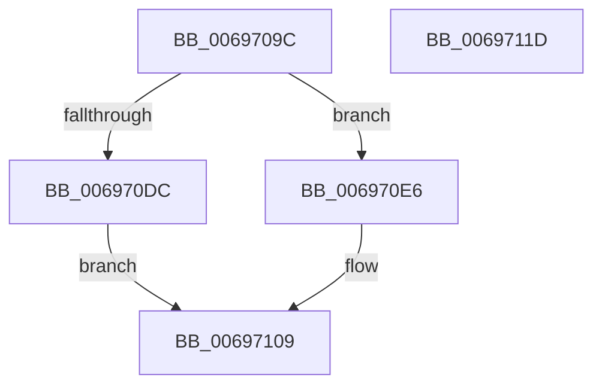

# MiCaptureStackTraceEx

- RVA: `0x0069709C`–`0x0069711E` (길이 `130` bytes)
- VA: `0x000000014069709C`
- 실행 섹션: `.text`
- PDB 이름 있음: `예`; PDB Function 태그: `아니요`
- unwind 정보 RVA: `0x00065960`
- 디코드: `32`개 명령, `130/130` bytes 표시
- 미해석 바이트: `0` (있으면 어셈블리에 `.byte`로 보존)

> 이 문서는 커널 이미지의 기계어와 PDB 기호를 분석해 생성했습니다. 4번과 5번은 함수 원형과 자료형을 바이너리 사용 방식에서 추정한 C 해석이며 원본 소스 복구 결과는 아닙니다.

## 1. Dependencies

- 직접 호출 지점: **2**; 고유 호출 대상: **2**
- 직접 호출자로 확인된 함수: **2**
- RIP 상대 이미지 참조: **1**

### Outgoing calls
- `0x006970C2` → [memset](../6C/memset_function_006C6C40.md) (function, `0x006C6C40`)
- `0x00697104` → [MiCaptureStackTraceCallout](../4C/MiCaptureStackTraceCallout_function_004C8684.md) (function, `0x004C8684`)

### Direct callers
- [MiAddMdlTracker](../49/MiAddMdlTracker_function_0049A240.md) at `0x0049A311`
- [MiInsertPteTracker](MiInsertPteTracker_function_00697BE4.md) at `0x00697D13`

### Static image references
- `0x006970C7` → RVA `0x00E37510` (`.data`; read)

## 2. Other-region calls and transfers

- 다른 실행 섹션으로 향하는 call: **0**
- 별도 외부 분기/꼬리 이동을 확인하지 못했습니다.

## 3. Assembly (complete function range)

```asm
0069709C  48 89 5C 24 08                  mov qword ptr [rsp + 8], rbx
006970A1  57                              push rdi
006970A2  48 83 EC 40                     sub rsp, 0x40
006970A6  8B FA                           mov edi, edx
006970A8  0F 57 C0                        xorps xmm0, xmm0
006970AB  33 C0                           xor eax, eax
006970AD  33 D2                           xor edx, edx
006970AF  41 B8 A0 00 00 00               mov r8d, 0xa0
006970B5  48 89 44 24 30                  mov qword ptr [rsp + 0x30], rax
006970BA  0F 11 44 24 20                  movups xmmword ptr [rsp + 0x20], xmm0
006970BF  48 8B D9                        mov rbx, rcx
006970C2  E8 79 FB 02 00                  call 0x1406c6c40
006970C7  4C 8B 05 42 04 7A 00            mov r8, qword ptr [rip + 0x7a0442]
006970CE  65 48 8B 04 25 88 01 00 00      mov rax, qword ptr gs:[0x188]
006970D7  4C 3B C0                        cmp r8, rax
006970DA  75 0A                           jne 0x1406970e6
006970DC  48 C7 43 10 78 56 34 12         mov qword ptr [rbx + 0x10], 0x12345678
006970E4  EB 23                           jmp 0x140697109
006970E6  48 8D 4C 24 20                  lea rcx, [rsp + 0x20]
006970EB  48 C7 43 10 77 56 34 12         mov qword ptr [rbx + 0x10], 0x12345677
006970F3  89 7C 24 28                     mov dword ptr [rsp + 0x28], edi
006970F7  48 89 5C 24 20                  mov qword ptr [rsp + 0x20], rbx
006970FC  C7 44 24 2C 02 00 00 00         mov dword ptr [rsp + 0x2c], 2
00697104  E8 7B 15 E3 FF                  call 0x1404c8684
00697109  48 8B 5C 24 50                  mov rbx, qword ptr [rsp + 0x50]
0069710E  33 C0                           xor eax, eax
00697110  39 44 24 30                     cmp dword ptr [rsp + 0x30], eax
00697114  0F 95 C0                        setne al
00697117  48 83 C4 40                     add rsp, 0x40
0069711B  5F                              pop rdi
0069711C  C3                              ret
0069711D  CC                              int3
```

## 4. C-style interpretation (structured pseudocode)

```c
__int64 __fastcall MiCaptureStackTraceEx(__int64 a1, int a2)
{
    __int64 result;
    __int64 v_rsp;
    unsigned __int64 v_stack_m18;
    unsigned int v_stack_m1C;
    unsigned int v_stack_m20;
    unsigned __int64 v_stack_m28;
    unsigned __int64 v_stack_p8;

    v_stack_p8 = v_rbx;
    v_rsp = (v_rsp) - (64);
    result = 0;
    a2 = 0;
    v_stack_m18 = 0;
    v_stack_m28 = v_xmm0;
    result = memset(a1, a2, 160, a4);
    if ((*(unsigned __int64 *)(v_rip + 7996482)) != (*(unsigned __int64 *)(gs_base + (0 + 392)))) goto loc_006970E6;
    *(unsigned __int64 *)(a1 + 16) = 0x12345678ULL;
    goto loc_00697109;
loc_006970E6:
    *(unsigned __int64 *)(a1 + 16) = 0x12345677ULL;
    v_stack_m20 = (unsigned int)((unsigned int)(a2));
    v_stack_m28 = a1;
    v_stack_m1C = 2;
    result = MiCaptureStackTraceCallout(v_stack_m28, a2, *(unsigned __int64 *)(v_rip + 7996482), a4);
loc_00697109:
    result = 0;
    result = (v_stack_m18 != 0) ? 1 : 0;
    v_rsp = (v_rsp) + (64);
    return result;
}
```

## 5. (Beta) C Style

```c
int64_t MiCaptureStackTraceEx(void *Arg1, int32_t Arg2)
{
    uint8_t *arg1 = (uint8_t *)Arg1;

    int64_t result;
    int64_t local_rsp;
    uint64_t v_stack_m18;
    uint32_t v_stack_m1C;
    uint32_t v_stack_m20;
    uint64_t v_stack_m28;
    uint64_t v_stack_p8;

    v_stack_p8 = local_rbx;
    local_rsp = (local_rsp) - (64);
    result = 0;
    Arg2 = 0;
    v_stack_m18 = 0;
    v_stack_m28 = v_xmm0;
    result = memset(Arg1, Arg2, 160, a4);
    if ((*(uint64_t *)(v_rip + 0x7A0442)) != (*(uint64_t *)(gs_base + (0 + 0x188)))) goto loc_006970E6;
    *(uint64_t *)(arg1 + 0x10) = 0x12345678ULL;
    goto loc_00697109;
loc_006970E6:
    *(uint64_t *)(arg1 + 0x10) = 0x12345677ULL;
    v_stack_m20 = (uint32_t)((uint32_t)(Arg2));
    v_stack_m28 = Arg1;
    v_stack_m1C = 2;
    result = MiCaptureStackTraceCallout(v_stack_m28, Arg2, *(uint64_t *)(v_rip + 0x7A0442), a4);
loc_00697109:
    result = 0;
    result = (v_stack_m18 != 0) ? 1 : 0;
    local_rsp = (local_rsp) + (64);
    return result;
}
```

### 관측된 메모리 오프셋

구조체 형식이 확인되지 않은 접근은 인자 기준의 오프셋으로만 기록했습니다.

| 기준 인자 | 오프셋 표현 | 폭 (bit) | 접근 |
|---|---:|---:|---|
| `Arg1` | `+ 0x10` | `64` | `W` |

## 6. Execution-region graph

[열기: 2D/3D 그래프와 함수 탐색 컨트롤 패널](../../../control-panel.html?section=text&rva=0x0069709C&view=graph)

- 2D 그래프는 위에서 아래로 흐르고, 3D 그래프는 빈 공간을 드래그해 회전합니다. Shift+드래그는 이동, 휠은 확대·축소, 함수 노드 선택은 대상 보고서 이동입니다.

### Static fallback


