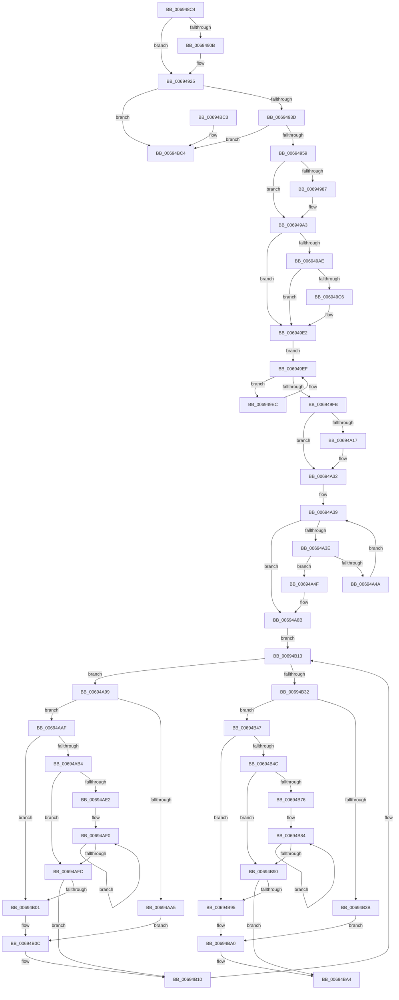

# MiCheckPteRelease

- RVA: `0x006948C4`–`0x00694BE0` (길이 `796` bytes)
- VA: `0x00000001406948C4`
- 실행 섹션: `.text`
- PDB 이름 있음: `예`; PDB Function 태그: `아니요`
- unwind 정보 RVA: `0x000D9334`
- 디코드: `240`개 명령, `796/796` bytes 표시
- 미해석 바이트: `0` (있으면 어셈블리에 `.byte`로 보존)

> 이 문서는 커널 이미지의 기계어와 PDB 기호를 분석해 생성했습니다. 4번과 5번은 함수 원형과 자료형을 바이너리 사용 방식에서 추정한 C 해석이며 원본 소스 복구 결과는 아닙니다.

## 1. Dependencies

- 직접 호출 지점: **8**; 고유 호출 대상: **2**
- 직접 호출자로 확인된 함수: **1**
- RIP 상대 이미지 참조: **0**

### Outgoing calls
- `0x0069491F` → [KeBugCheckEx](../4F/KeBugCheckEx_function_004FD660.md) (function, `0x004FD660`)
- `0x00694928` → [MiGetSystemRegionType](../28/MiGetSystemRegionType_function_0028EC80.md) (function, `0x0028EC80`)
- `0x0069494B` → [MiGetSystemRegionType](../28/MiGetSystemRegionType_function_0028EC80.md) (function, `0x0028EC80`)
- `0x0069499D` → [KeBugCheckEx](../4F/KeBugCheckEx_function_004FD660.md) (function, `0x004FD660`)
- `0x006949DC` → [KeBugCheckEx](../4F/KeBugCheckEx_function_004FD660.md) (function, `0x004FD660`)
- `0x00694A2C` → [KeBugCheckEx](../4F/KeBugCheckEx_function_004FD660.md) (function, `0x004FD660`)
- `0x00694A85` → [KeBugCheckEx](../4F/KeBugCheckEx_function_004FD660.md) (function, `0x004FD660`)
- `0x00694BDA` → [KeBugCheckEx](../4F/KeBugCheckEx_function_004FD660.md) (function, `0x004FD660`)

### Direct callers
- [MiReleasePtes](../24/MiReleasePtes_function_00247240.md) at `0x00247937`

### Static image references
- 디코드된 RIP-relative 메모리 참조가 없습니다.

## 2. Other-region calls and transfers

- 다른 실행 섹션으로 향하는 call: **0**
- 별도 외부 분기/꼬리 이동을 확인하지 못했습니다.

## 3. Assembly (complete function range)

```asm
006948C4  48 8B C4                        mov rax, rsp
006948C7  48 89 58 08                     mov qword ptr [rax + 8], rbx
006948CB  48 89 68 10                     mov qword ptr [rax + 0x10], rbp
006948CF  48 89 70 18                     mov qword ptr [rax + 0x18], rsi
006948D3  48 89 78 20                     mov qword ptr [rax + 0x20], rdi
006948D7  41 54                           push r12
006948D9  41 56                           push r14
006948DB  41 57                           push r15
006948DD  48 83 EC 30                     sub rsp, 0x30
006948E1  49 8B F8                        mov rdi, r8
006948E4  48 8B EA                        mov rbp, rdx
006948E7  4C 8B F9                        mov r15, rcx
006948EA  48 BE 00 00 00 00 80 F6 FF FF   movabs rsi, 0xfffff68000000000
006948F4  48 C1 E6 19                     shl rsi, 0x19
006948F8  48 8B DA                        mov rbx, rdx
006948FB  48 C1 E3 19                     shl rbx, 0x19
006948FF  48 2B DE                        sub rbx, rsi
00694902  48 C1 FB 10                     sar rbx, 0x10
00694906  4D 85 C0                        test r8, r8
00694909  75 1A                           jne 0x140694925
0069490B  4C 21 40 D8                     and qword ptr [rax - 0x28], r8
0069490F  45 33 C9                        xor r9d, r9d
00694912  4C 8B C3                        mov r8, rbx
00694915  BA 00 03 00 00                  mov edx, 0x300
0069491A  B9 DA 00 00 00                  mov ecx, 0xda
0069491F  E8 3C 8D E6 FF                  call 0x1404fd660
00694924  CC                              int3
00694925  48 8B CB                        mov rcx, rbx
00694928  E8 53 A3 BF FF                  call 0x14028ec80
0069492D  4D 8B 77 20                     mov r14, qword ptr [r15 + 0x20]
00694931  44 8B E0                        mov r12d, eax
00694934  49 3B EE                        cmp rbp, r14
00694937  0F 82 87 02 00 00               jb 0x140694bc4
0069493D  49 8B CE                        mov rcx, r14
00694940  48 C1 E1 19                     shl rcx, 0x19
00694944  48 2B CE                        sub rcx, rsi
00694947  48 C1 F9 10                     sar rcx, 0x10
0069494B  E8 30 A3 BF FF                  call 0x14028ec80
00694950  44 3B E0                        cmp r12d, eax
00694953  0F 85 6B 02 00 00               jne 0x140694bc4
00694959  41 8B 47 28                     mov eax, dword ptr [r15 + 0x28]
0069495D  49 2B EE                        sub rbp, r14
00694960  49 8B 57 18                     mov rdx, qword ptr [r15 + 0x18]
00694964  41 BC 01 00 00 00               mov r12d, 1
0069496A  41 23 C4                        and eax, r12d
0069496D  48 C1 FD 03                     sar rbp, 3
00694971  8A C8                           mov cl, al
00694973  44 8B C5                        mov r8d, ebp
00694976  C0 E1 02                        shl cl, 2
00694979  8B F0                           mov esi, eax
0069497B  49 D3 E8                        shr r8, cl
0069497E  4D 03 C0                        add r8, r8
00694981  4C 0F A3 02                     bt qword ptr [rdx], r8
00694985  73 1C                           jae 0x1406949a3
00694987  48 83 64 24 20 00               and qword ptr [rsp + 0x20], 0
0069498D  4C 8B CF                        mov r9, rdi
00694990  4C 8B C3                        mov r8, rbx
00694993  BA 03 03 00 00                  mov edx, 0x303
00694998  B9 DA 00 00 00                  mov ecx, 0xda
0069499D  E8 BE 8C E6 FF                  call 0x1404fd660
006949A2  CC                              int3
006949A3  41 BA 02 00 00 00               mov r10d, 2
006949A9  4D 85 C0                        test r8, r8
006949AC  74 34                           je 0x1406949e2
006949AE  49 8D 48 FE                     lea rcx, [r8 - 2]
006949B2  48 8B C1                        mov rax, rcx
006949B5  80 E1 1F                        and cl, 0x1f
006949B8  48 C1 E8 05                     shr rax, 5
006949BC  8B 14 82                        mov edx, dword ptr [rdx + rax*4]
006949BF  D3 EA                           shr edx, cl
006949C1  41 3B D2                        cmp edx, r10d
006949C4  75 1C                           jne 0x1406949e2
006949C6  48 83 64 24 20 00               and qword ptr [rsp + 0x20], 0
006949CC  4C 8B CF                        mov r9, rdi
006949CF  4C 8B C3                        mov r8, rbx
006949D2  BA 04 03 00 00                  mov edx, 0x304
006949D7  B9 DA 00 00 00                  mov ecx, 0xda
006949DC  E8 7F 8C E6 FF                  call 0x1404fd660
006949E1  CC                              int3
006949E2  49 8B 57 18                     mov rdx, qword ptr [r15 + 0x18]
006949E6  49 8D 48 01                     lea rcx, [r8 + 1]
006949EA  EB 03                           jmp 0x1406949ef
006949EC  49 03 CA                        add rcx, r10
006949EF  48 0F A3 0A                     bt qword ptr [rdx], rcx
006949F3  0F 92 C0                        setb al
006949F6  41 3A C4                        cmp al, r12b
006949F9  74 F1                           je 0x1406949ec
006949FB  49 2B C8                        sub rcx, r8
006949FE  48 D1 E9                        shr rcx, 1
00694A01  4C 8D 59 01                     lea r11, [rcx + 1]
00694A05  48 FF C1                        inc rcx
00694A08  48 C1 E1 04                     shl rcx, 4
00694A0C  85 F6                           test esi, esi
00694A0E  49 0F 44 CB                     cmove rcx, r11
00694A12  48 3B CF                        cmp rcx, rdi
00694A15  74 1B                           je 0x140694a32
00694A17  48 89 4C 24 20                  mov qword ptr [rsp + 0x20], rcx
00694A1C  4C 8B CF                        mov r9, rdi
00694A1F  B9 DA 00 00 00                  mov ecx, 0xda
00694A24  4C 8B C3                        mov r8, rbx
00694A27  BA 05 03 00 00                  mov edx, 0x305
00694A2C  E8 2F 8C E6 FF                  call 0x1404fd660
00694A31  CC                              int3
00694A32  4D 8B C8                        mov r9, r8
00694A35  4B 8D 0C 58                     lea rcx, [r8 + r11*2]
00694A39  4C 3B C9                        cmp r9, rcx
00694A3C  73 4D                           jae 0x140694a8b
00694A3E  4C 0F A3 0A                     bt qword ptr [rdx], r9
00694A42  0F 92 C0                        setb al
00694A45  41 3A C4                        cmp al, r12b
00694A48  74 05                           je 0x140694a4f
00694A4A  4D 03 CA                        add r9, r10
00694A4D  EB EA                           jmp 0x140694a39
00694A4F  F7 DE                           neg esi
00694A51  BA 06 03 00 00                  mov edx, 0x306
00694A56  B9 DA 00 00 00                  mov ecx, 0xda
00694A5B  48 1B C0                        sbb rax, rax
00694A5E  49 C1 E1 0B                     shl r9, 0xb
00694A62  83 E0 0F                        and eax, 0xf
00694A65  49 C1 E0 0B                     shl r8, 0xb
00694A69  4D 2B C8                        sub r9, r8
00694A6C  49 03 C4                        add rax, r12
00694A6F  49 0F AF C3                     imul rax, r11
00694A73  49 81 E1 00 F0 FF FF            and r9, 0xfffffffffffff000
00694A7A  4C 8B C3                        mov r8, rbx
00694A7D  4C 03 CB                        add r9, rbx
00694A80  48 89 44 24 20                  mov qword ptr [rsp + 0x20], rax
00694A85  E8 D6 8B E6 FF                  call 0x1404fd660
00694A8A  CC                              int3
00694A8B  48 8D 59 FE                     lea rbx, [rcx - 2]
00694A8F  BF 20 00 00 00                  mov edi, 0x20
00694A94  83 CE FF                        or esi, 0xffffffff
00694A97  EB 7A                           jmp 0x140694b13
00694A99  49 8D 43 01                     lea rax, [r11 + 1]
00694A9D  49 8B D4                        mov rdx, r12
00694AA0  48 3B C7                        cmp rax, rdi
00694AA3  77 0A                           ja 0x140694aaf
00694AA5  49 8B CB                        mov rcx, r11
00694AA8  41 8B C4                        mov eax, r12d
00694AAB  D3 E0                           shl eax, cl
00694AAD  EB 5D                           jmp 0x140694b0c
00694AAF  4D 85 DB                        test r11, r11
00694AB2  74 4D                           je 0x140694b01
00694AB4  41 8B C0                        mov eax, r8d
00694AB7  8B D7                           mov edx, edi
00694AB9  83 E0 1F                        and eax, 0x1f
00694ABC  2B D0                           sub edx, eax
00694ABE  41 8B C4                        mov eax, r12d
00694AC1  8B CA                           mov ecx, edx
00694AC3  D3 E0                           shl eax, cl
00694AC5  49 8B CB                        mov rcx, r11
00694AC8  41 2B C4                        sub eax, r12d
00694ACB  D3 E0                           shl eax, cl
00694ACD  F0 41 09 01                     lock or dword ptr [r9], eax
00694AD1  8B C2                           mov eax, edx
00694AD3  49 83 C1 04                     add r9, 4
00694AD7  49 8B D4                        mov rdx, r12
00694ADA  48 2B D0                        sub rdx, rax
00694ADD  48 3B D7                        cmp rdx, rdi
00694AE0  72 1A                           jb 0x140694afc
00694AE2  48 8B CA                        mov rcx, rdx
00694AE5  48 C1 E9 05                     shr rcx, 5
00694AE9  48 6B C1 E0                     imul rax, rcx, -0x20
00694AED  48 03 D0                        add rdx, rax
00694AF0  41 89 31                        mov dword ptr [r9], esi
00694AF3  49 83 C1 04                     add r9, 4
00694AF7  49 2B CC                        sub rcx, r12
00694AFA  75 F4                           jne 0x140694af0
00694AFC  48 85 D2                        test rdx, rdx
00694AFF  74 0F                           je 0x140694b10
00694B01  48 8B CA                        mov rcx, rdx
00694B04  41 8B C4                        mov eax, r12d
00694B07  D3 E0                           shl eax, cl
00694B09  41 2B C4                        sub eax, r12d
00694B0C  F0 41 09 01                     lock or dword ptr [r9], eax
00694B10  4D 03 C2                        add r8, r10
00694B13  49 8B 47 18                     mov rax, qword ptr [r15 + 0x18]
00694B17  49 8B C8                        mov rcx, r8
00694B1A  48 C1 E9 05                     shr rcx, 5
00694B1E  4D 8B D8                        mov r11, r8
00694B21  41 83 E3 1F                     and r11d, 0x1f
00694B25  4C 8D 0C 88                     lea r9, [rax + rcx*4]
00694B29  4C 3B C3                        cmp r8, rbx
00694B2C  0F 82 67 FF FF FF               jb 0x140694a99
00694B32  49 8D 43 02                     lea rax, [r11 + 2]
00694B36  48 3B C7                        cmp rax, rdi
00694B39  77 0C                           ja 0x140694b47
00694B3B  41 8B CB                        mov ecx, r11d
00694B3E  B8 03 00 00 00                  mov eax, 3
00694B43  D3 E0                           shl eax, cl
00694B45  EB 59                           jmp 0x140694ba0
00694B47  4D 85 DB                        test r11, r11
00694B4A  74 49                           je 0x140694b95
00694B4C  41 83 E0 1F                     and r8d, 0x1f
00694B50  8B D7                           mov edx, edi
00694B52  41 2B D0                        sub edx, r8d
00694B55  41 8B C4                        mov eax, r12d
00694B58  8B CA                           mov ecx, edx
00694B5A  D3 E0                           shl eax, cl
00694B5C  49 8B CB                        mov rcx, r11
00694B5F  41 2B C4                        sub eax, r12d
00694B62  D3 E0                           shl eax, cl
00694B64  F0 41 09 01                     lock or dword ptr [r9], eax
00694B68  8B C2                           mov eax, edx
00694B6A  49 83 C1 04                     add r9, 4
00694B6E  4C 2B D0                        sub r10, rax
00694B71  4C 3B D7                        cmp r10, rdi
00694B74  72 1A                           jb 0x140694b90
00694B76  49 8B CA                        mov rcx, r10
00694B79  48 C1 E9 05                     shr rcx, 5
00694B7D  48 6B C1 E0                     imul rax, rcx, -0x20
00694B81  4C 03 D0                        add r10, rax
00694B84  41 89 31                        mov dword ptr [r9], esi
00694B87  49 83 C1 04                     add r9, 4
00694B8B  49 2B CC                        sub rcx, r12
00694B8E  75 F4                           jne 0x140694b84
00694B90  4D 85 D2                        test r10, r10
00694B93  74 0F                           je 0x140694ba4
00694B95  49 8B CA                        mov rcx, r10
00694B98  41 8B C4                        mov eax, r12d
00694B9B  D3 E0                           shl eax, cl
00694B9D  41 2B C4                        sub eax, r12d
00694BA0  F0 41 09 01                     lock or dword ptr [r9], eax
00694BA4  48 8B 5C 24 50                  mov rbx, qword ptr [rsp + 0x50]
00694BA9  48 8B 6C 24 58                  mov rbp, qword ptr [rsp + 0x58]
00694BAE  48 8B 74 24 60                  mov rsi, qword ptr [rsp + 0x60]
00694BB3  48 8B 7C 24 68                  mov rdi, qword ptr [rsp + 0x68]
00694BB8  48 83 C4 30                     add rsp, 0x30
00694BBC  41 5F                           pop r15
00694BBE  41 5E                           pop r14
00694BC0  41 5C                           pop r12
00694BC2  C3                              ret
00694BC3  CC                              int3
00694BC4  48 83 64 24 20 00               and qword ptr [rsp + 0x20], 0
00694BCA  45 33 C9                        xor r9d, r9d
00694BCD  4C 8B C3                        mov r8, rbx
00694BD0  BA 01 03 00 00                  mov edx, 0x301
00694BD5  B9 DA 00 00 00                  mov ecx, 0xda
00694BDA  E8 81 8A E6 FF                  call 0x1404fd660
00694BDF  CC                              int3
```

## 4. C-style interpretation (structured pseudocode)

```c
__int64 __fastcall MiCheckPteRelease(__int64 a1, __int64 a2, __int64 a3, int a4)
{
    __int64 result;
    __int64 v_r10;
    __int64 v_r11;
    __int64 v_rbp;
    __int64 v_rbx;
    __int64 v_rsi;
    __int64 v_rsp;
    unsigned __int64 v_stack_m28;
    unsigned __int64 v_stack_p10;
    unsigned __int64 v_stack_p18;
    unsigned __int64 v_stack_p20;
    unsigned __int64 v_stack_p8;

    *(unsigned __int64 *)(v_rsp + 8) = v_rbx;
    *(unsigned __int64 *)(v_rsp + 16) = v_rbp;
    *(unsigned __int64 *)(v_rsp + 24) = v_rsi;
    *(unsigned __int64 *)(v_rsp + 32) = v_rdi;
    v_rsp = (v_rsp) - (48);
    v_rsi = (v_rsi) << (25);
    v_rbx = (a2) << (25);
    v_rbx = (v_rbx) - (v_rsi);
    v_rbx = (v_rbx) >> (16);
    result = v_rsp;
    if (a3 == 0) {
        a4 = 0;
        a3 = v_rbx;
        a2 = 768;
        a1 = 218;
        result = KeBugCheckEx(a1, a2, a3, a4);
    }
    result = MiGetSystemRegionType(v_rbx, a2, a3, a4);
    if (a2 < (*(unsigned __int64 *)(a1 + 32))) goto loc_00694BC4;
    a1 = (*(unsigned __int64 *)(a1 + 32)) << (25);
    a1 = (a1) - (v_rsi);
    a1 = (a1) >> (16);
    result = MiGetSystemRegionType(a1, a2, a3, a4);
    if (((unsigned int)((unsigned int)((unsigned int)(result)))) != ((unsigned int)(result))) goto loc_00694BC4;
    v_rbp = (a2) - (*(unsigned __int64 *)(a1 + 32));
    result = (unsigned int)(((unsigned int)(*(unsigned int *)(a1 + 40))) & (1));
    v_rbp = (v_rbp) >> (3);
    a1 = (unsigned __int8)(((unsigned __int8)(result)) << (2));
    a3 = ((unsigned int)((unsigned int)(v_rbp))) >> ((unsigned __int8)(a1));
    a3 = (a3) + (a3);
    if (!(condition_is_above_or_equal)) {
        a4 = a3;
        a3 = v_rbx;
        a2 = 771;
        a1 = 218;
        result = KeBugCheckEx(a1, a2, a3, a4);
    }
    if (a3 == 0) goto loc_006949E2;
    a1 = (unsigned __int8)((a3 - 2) & (31));
    result = (a3 - 2) >> (5);
    a2 = (unsigned int)(((unsigned int)(*(unsigned int *)(a2 + result * 4))) >> ((unsigned __int8)(a1)));
    if (((unsigned int)(a2)) == 2) {
        a4 = a3;
        a3 = v_rbx;
        a2 = 772;
        a1 = 218;
        result = KeBugCheckEx(a1, a2, a3, a4);
    }
    goto loc_006949EF;
loc_006949EC:
    a1 = (a3 + 1) + (2);
loc_006949EF:
    result = (condition_is_below) ? 1 : 0;
    if (((unsigned __int8)(result)) == 1) goto loc_006949EC;
    a1 = (a1) - (a3);
    a1 = (a1) >> (1);
    a1 = (a1) + 1;
    a1 = (a1) << (4);
    if ((unsigned int)((unsigned int)((unsigned int)(result))) == 0) { a1 = a1 + 1; }
    if (a1 != a3) {
        v_stack_m28 = a1;
        a4 = a3;
        a1 = 218;
        a3 = v_rbx;
        a2 = 773;
        result = KeBugCheckEx(a1, a2, a3, a4);
    }
loc_00694A39:
    if (a3 >= (a3 + a1 + 1 * 2)) goto loc_00694A8B;
    result = (a3 < (a3 + a1 + 1 * 2)) ? 1 : 0;
    if (((unsigned __int8)(result)) == 1) goto loc_00694A4F;
    a4 = (a3) + (2);
    goto loc_00694A39;
loc_00694A4F:
    v_rsi = (unsigned int)(-((unsigned int)((unsigned int)(result))));
    a4 = (a4) << (11);
    result = (unsigned int)((result) & (15));
    a3 = (a3) << (11);
    a4 = (a4) - (a3);
    result = (result) + (1);
    result = (result) * (a1 + 1);
    a4 = (a4) & (0xFFFFFFFFFFFFF000ULL);
    a4 = (a4) + (v_rbx);
    v_stack_m28 = result;
    result = KeBugCheckEx(218, 774, v_rbx, a4);
loc_00694A8B:
    v_rsi = (unsigned int)((v_rsi) | (0xFFFFFFFFULL));
    goto loc_00694B13;
loc_00694A99:
    if ((a1 + 1 + 1) > 32) goto loc_00694AAF;
    result = (unsigned int)((1) << ((unsigned __int8)(a1 + 1)));
    goto loc_00694B0C;
loc_00694AAF:
    if (a1 + 1 == 0) goto loc_00694B01;
    result = (unsigned int)(((unsigned int)((unsigned int)(v_rbx))) & (31));
    a2 = (unsigned int)((32) - ((unsigned int)(result)));
    result = (unsigned int)((1) << ((unsigned __int8)((unsigned int)((unsigned int)(a2)))));
    result = (unsigned int)((result) - (1));
    result = (unsigned int)((result) << ((unsigned __int8)(a1 + 1)));
    a4 = (a4) + (4);
    a2 = (1) - ((unsigned int)((unsigned int)(a2)));
    if (a2 < 32) goto loc_00694AFC;
    a1 = (a2) >> (5);
    result = ((unsigned int)((unsigned int)(a2))) * (a1);
    a2 = (a2) + (result);
loc_00694AF0:
    *(unsigned int *)(a4) = (unsigned int)(v_rsi);
    a4 = (a4) + (4);
    a1 = (a1) - (1);
    if (condition_is_not_equal) goto loc_00694AF0;
loc_00694AFC:
    if (a2 == 0) goto loc_00694B10;
loc_00694B01:
    result = (unsigned int)((1) << ((unsigned __int8)(a2)));
    result = (unsigned int)((result) - (1));
loc_00694B0C:
loc_00694B10:
    a3 = (v_rbx) + (2);
loc_00694B13:
    a1 = (a3) >> (5);
    v_r11 = (unsigned int)((a3) & (31));
    if (a3 < (218 - 2)) goto loc_00694A99;
    if ((v_r11 + 2) > 32) goto loc_00694B47;
    result = (unsigned int)((3) << ((unsigned __int8)((unsigned int)((unsigned int)(v_r11)))));
    goto loc_00694BA0;
loc_00694B47:
    if (v_r11 == 0) goto loc_00694B95;
    a3 = (unsigned int)((a3) & (31));
    a2 = (unsigned int)((32) - ((unsigned int)(a3)));
    result = (unsigned int)((1) << ((unsigned __int8)((unsigned int)((unsigned int)(a2)))));
    result = (unsigned int)((result) - (1));
    result = (unsigned int)((result) << ((unsigned __int8)(v_r11)));
    a4 = (*(unsigned __int64 *)(a1 + 24) + a1 * 4) + (4);
    v_r10 = (2) - ((unsigned int)((unsigned int)(a2)));
    if (v_r10 < 32) goto loc_00694B90;
    a1 = (v_r10) >> (5);
    result = ((unsigned int)((unsigned int)(a2))) * (a1);
    v_r10 = (v_r10) + (result);
loc_00694B84:
    *(unsigned int *)(a4) = (unsigned int)(v_rsi);
    a4 = (a4) + (4);
    a1 = (a1) - (1);
    if (condition_is_not_equal) goto loc_00694B84;
loc_00694B90:
    if (v_r10 == 0) goto loc_00694BA4;
loc_00694B95:
    result = (unsigned int)((1) << ((unsigned __int8)(v_r10)));
    result = (unsigned int)((result) - (1));
loc_00694BA0:
loc_00694BA4:
    v_rsp = (v_rsp) + (48);
    return result;
loc_00694BC4:
    a4 = 0;
    result = KeBugCheckEx(218, 769, v_stack_p8, a4);
    return result;
}
```

## 5. (Beta) C Style

```c
int64_t MiCheckPteRelease(void *Arg1, int64_t Arg2, int64_t Arg3, int32_t Arg4)
{
    uint8_t *arg1 = (uint8_t *)Arg1;

    int64_t result;
    int64_t local_r10;
    int64_t local_r11;
    int64_t local_rbp;
    int64_t local_rbx;
    int64_t local_rsi;
    int64_t local_rsp;
    uint64_t v_stack_m28;
    uint64_t v_stack_p10;
    uint64_t v_stack_p18;
    uint64_t v_stack_p20;
    uint64_t v_stack_p8;

    *(uint64_t *)(local_rsp + 0x8) = local_rbx;
    *(uint64_t *)(local_rsp + 0x10) = local_rbp;
    *(uint64_t *)(local_rsp + 0x18) = local_rsi;
    *(uint64_t *)(local_rsp + 0x20) = local_rdi;
    local_rsp = (local_rsp) - (48);
    local_rsi = (local_rsi) << (25);
    local_rbx = (Arg2) << (25);
    local_rbx = (local_rbx) - (local_rsi);
    local_rbx = (local_rbx) >> (16);
    result = local_rsp;
    if (Arg3 == 0) {
        Arg4 = 0;
        Arg3 = local_rbx;
        Arg2 = 768;
        Arg1 = 218;
        result = KeBugCheckEx(Arg1, Arg2, Arg3, Arg4);
    }
    result = MiGetSystemRegionType(local_rbx, Arg2, Arg3, Arg4);
    if (Arg2 < (*(uint64_t *)(arg1 + 0x20))) goto loc_00694BC4;
    Arg1 = (*(uint64_t *)(arg1 + 0x20)) << (25);
    Arg1 = (Arg1) - (local_rsi);
    Arg1 = (Arg1) >> (16);
    result = MiGetSystemRegionType(Arg1, Arg2, Arg3, Arg4);
    if (((uint32_t)((uint32_t)((uint32_t)(result)))) != ((uint32_t)(result))) goto loc_00694BC4;
    local_rbp = (Arg2) - (*(uint64_t *)(arg1 + 0x20));
    result = (uint32_t)(((uint32_t)(*(uint32_t *)(arg1 + 0x28))) & (1));
    local_rbp = (local_rbp) >> (3);
    Arg1 = (uint8_t)(((uint8_t)(result)) << (2));
    Arg3 = ((uint32_t)((uint32_t)(local_rbp))) >> ((uint8_t)(Arg1));
    Arg3 = (Arg3) + (Arg3);
    if (!(condition_is_above_or_equal)) {
        Arg4 = Arg3;
        Arg3 = local_rbx;
        Arg2 = 771;
        Arg1 = 218;
        result = KeBugCheckEx(Arg1, Arg2, Arg3, Arg4);
    }
    if (Arg3 == 0) goto loc_006949E2;
    Arg1 = (uint8_t)((Arg3 - 2) & (31));
    result = (Arg3 - 2) >> (5);
    Arg2 = (uint32_t)(((uint32_t)(*(uint32_t *)(Arg2 + result * 4))) >> ((uint8_t)(Arg1)));
    if (((uint32_t)(Arg2)) == 2) {
        Arg4 = Arg3;
        Arg3 = local_rbx;
        Arg2 = 772;
        Arg1 = 218;
        result = KeBugCheckEx(Arg1, Arg2, Arg3, Arg4);
    }
    goto loc_006949EF;
loc_006949EC:
    Arg1 = (Arg3 + 1) + (2);
loc_006949EF:
    result = (condition_is_below) ? 1 : 0;
    if (((uint8_t)(result)) == 1) goto loc_006949EC;
    Arg1 = (Arg1) - (Arg3);
    Arg1 = (Arg1) >> (1);
    Arg1 = (Arg1) + 1;
    Arg1 = (Arg1) << (4);
    if ((uint32_t)((uint32_t)((uint32_t)(result))) == 0) { Arg1 = Arg1 + 1; }
    if (Arg1 != Arg3) {
        v_stack_m28 = Arg1;
        Arg4 = Arg3;
        Arg1 = 218;
        Arg3 = local_rbx;
        Arg2 = 773;
        result = KeBugCheckEx(Arg1, Arg2, Arg3, Arg4);
    }
loc_00694A39:
    if (Arg3 >= (Arg3 + Arg1 + 1 * 2)) goto loc_00694A8B;
    result = (Arg3 < (Arg3 + Arg1 + 1 * 2)) ? 1 : 0;
    if (((uint8_t)(result)) == 1) goto loc_00694A4F;
    Arg4 = (Arg3) + (2);
    goto loc_00694A39;
loc_00694A4F:
    local_rsi = (uint32_t)(-((uint32_t)((uint32_t)(result))));
    Arg4 = (Arg4) << (11);
    result = (uint32_t)((result) & (15));
    Arg3 = (Arg3) << (11);
    Arg4 = (Arg4) - (Arg3);
    result = (result) + (1);
    result = (result) * (Arg1 + 1);
    Arg4 = (Arg4) & (0xFFFFFFFFFFFFF000ULL);
    Arg4 = (Arg4) + (local_rbx);
    v_stack_m28 = result;
    result = KeBugCheckEx(218, 774, local_rbx, Arg4);
loc_00694A8B:
    local_rsi = (uint32_t)((local_rsi) | (0xFFFFFFFFULL));
    goto loc_00694B13;
loc_00694A99:
    if ((Arg1 + 1 + 1) > 32) goto loc_00694AAF;
    result = (uint32_t)((1) << ((uint8_t)(Arg1 + 1)));
    goto loc_00694B0C;
loc_00694AAF:
    if (Arg1 + 1 == 0) goto loc_00694B01;
    result = (uint32_t)(((uint32_t)((uint32_t)(local_rbx))) & (31));
    Arg2 = (uint32_t)((32) - ((uint32_t)(result)));
    result = (uint32_t)((1) << ((uint8_t)((uint32_t)((uint32_t)(Arg2)))));
    result = (uint32_t)((result) - (1));
    result = (uint32_t)((result) << ((uint8_t)(Arg1 + 1)));
    Arg4 = (Arg4) + (4);
    Arg2 = (1) - ((uint32_t)((uint32_t)(Arg2)));
    if (Arg2 < 32) goto loc_00694AFC;
    Arg1 = (Arg2) >> (5);
    result = ((uint32_t)((uint32_t)(Arg2))) * (Arg1);
    Arg2 = (Arg2) + (result);
loc_00694AF0:
    *(uint32_t *)(Arg4) = (uint32_t)(local_rsi);
    Arg4 = (Arg4) + (4);
    Arg1 = (Arg1) - (1);
    if (condition_is_not_equal) goto loc_00694AF0;
loc_00694AFC:
    if (Arg2 == 0) goto loc_00694B10;
loc_00694B01:
    result = (uint32_t)((1) << ((uint8_t)(Arg2)));
    result = (uint32_t)((result) - (1));
loc_00694B0C:
loc_00694B10:
    Arg3 = (local_rbx) + (2);
loc_00694B13:
    Arg1 = (Arg3) >> (5);
    local_r11 = (uint32_t)((Arg3) & (31));
    if (Arg3 < (218 - 2)) goto loc_00694A99;
    if ((local_r11 + 2) > 32) goto loc_00694B47;
    result = (uint32_t)((3) << ((uint8_t)((uint32_t)((uint32_t)(local_r11)))));
    goto loc_00694BA0;
loc_00694B47:
    if (local_r11 == 0) goto loc_00694B95;
    Arg3 = (uint32_t)((Arg3) & (31));
    Arg2 = (uint32_t)((32) - ((uint32_t)(Arg3)));
    result = (uint32_t)((1) << ((uint8_t)((uint32_t)((uint32_t)(Arg2)))));
    result = (uint32_t)((result) - (1));
    result = (uint32_t)((result) << ((uint8_t)(local_r11)));
    Arg4 = (*(uint64_t *)(arg1 + 0x18) + Arg1 * 4) + (4);
    local_r10 = (2) - ((uint32_t)((uint32_t)(Arg2)));
    if (local_r10 < 32) goto loc_00694B90;
    Arg1 = (local_r10) >> (5);
    result = ((uint32_t)((uint32_t)(Arg2))) * (Arg1);
    local_r10 = (local_r10) + (result);
loc_00694B84:
    *(uint32_t *)(Arg4) = (uint32_t)(local_rsi);
    Arg4 = (Arg4) + (4);
    Arg1 = (Arg1) - (1);
    if (condition_is_not_equal) goto loc_00694B84;
loc_00694B90:
    if (local_r10 == 0) goto loc_00694BA4;
loc_00694B95:
    result = (uint32_t)((1) << ((uint8_t)(local_r10)));
    result = (uint32_t)((result) - (1));
loc_00694BA0:
loc_00694BA4:
    local_rsp = (local_rsp) + (48);
    return result;
loc_00694BC4:
    Arg4 = 0;
    result = KeBugCheckEx(218, 769, v_stack_p8, Arg4);
    return result;
}
```

### 관측된 메모리 오프셋

구조체 형식이 확인되지 않은 접근은 인자 기준의 오프셋으로만 기록했습니다.

| 기준 인자 | 오프셋 표현 | 폭 (bit) | 접근 |
|---|---:|---:|---|
| `Arg1` | `+ 0x18` | `64` | `R` |
| `Arg1` | `+ 0x20` | `64` | `R` |
| `Arg1` | `+ 0x28` | `32` | `R` |

## 6. Execution-region graph

[열기: 2D/3D 그래프와 함수 탐색 컨트롤 패널](../../../control-panel.html?section=text&rva=0x006948C4&view=graph)

- 2D 그래프는 위에서 아래로 흐르고, 3D 그래프는 빈 공간을 드래그해 회전합니다. Shift+드래그는 이동, 휠은 확대·축소, 함수 노드 선택은 대상 보고서 이동입니다.

### Static fallback


