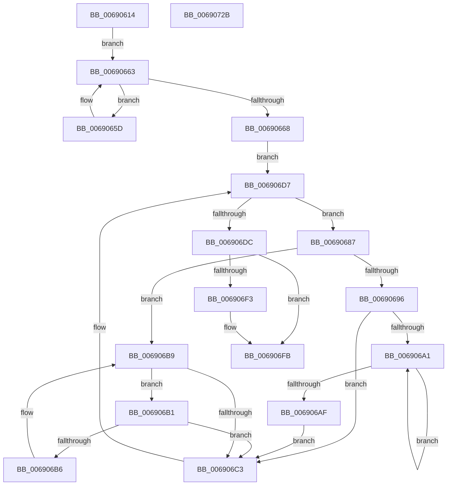

# MiClearPartitionPageBitMap

- RVA: `0x00690614`–`0x0069072C` (길이 `280` bytes)
- VA: `0x0000000140690614`
- 실행 섹션: `.text`
- PDB 이름 있음: `예`; PDB Function 태그: `아니요`
- unwind 정보 RVA: `0x000D175C`
- 디코드: `81`개 명령, `280/280` bytes 표시
- 미해석 바이트: `0` (있으면 어셈블리에 `.byte`로 보존)

> 이 문서는 커널 이미지의 기계어와 PDB 기호를 분석해 생성했습니다. 4번과 5번은 함수 원형과 자료형을 바이너리 사용 방식에서 추정한 C 해석이며 원본 소스 복구 결과는 아닙니다.

## 1. Dependencies

- 직접 호출 지점: **8**; 고유 호출 대상: **8**
- 직접 호출자로 확인된 함수: **1**
- RIP 상대 이미지 참조: **1**

### Outgoing calls
- `0x0069063D` → [memset](../6C/memset_function_006C6C40.md) (function, `0x006C6C40`)
- `0x0069066E` → [MiLockDynamicMemoryExclusive](../67/MiLockDynamicMemoryExclusive_function_006730F8.md) (function, `0x006730F8`)
- `0x0069067D` → [ExAcquireSpinLockExclusive](../24/ExAcquireSpinLockExclusive_function_00248690.md) (function, `0x00248690`)
- `0x006906D2` → [MiActOnPartitionNodePages](../68/MiActOnPartitionNodePages_function_0068F7F4.md) (function, `0x0068F7F4`)
- `0x006906E2` → [MiReleaseSpinLockExclusive](../24/MiReleaseSpinLockExclusive_function_002482C0.md) (function, `0x002482C0`)
- `0x006906F6` → [MiMakePartitionMemoryBlock](../../page/80/MiMakePartitionMemoryBlock_function_0080D94C.md) (function, `0x0080D94C`)
- `0x00690701` → [MiUnlockDynamicMemoryExclusive](../67/MiUnlockDynamicMemoryExclusive_function_00673C5C.md) (function, `0x00673C5C`)
- `0x0069070B` → [MiDeletePartitionPageNodes](MiDeletePartitionPageNodes_function_006908F0.md) (function, `0x006908F0`)

### Direct callers
- [MiInsertPartitionPages](MiInsertPartitionPages_function_006911A0.md) at `0x00691372`

### Static image references
- `0x006906E7` → RVA `0x00E38D00` (`.data`; read)

## 2. Other-region calls and transfers

- 다른 실행 섹션으로 향하는 call: **1**
  - `0x006906F6` → [MiMakePartitionMemoryBlock](../../page/80/MiMakePartitionMemoryBlock_function_0080D94C.md) (`.text` → `PAGE`)
- 별도 외부 분기/꼬리 이동을 확인하지 못했습니다.

## 3. Assembly (complete function range)

```asm
00690614  48 8B C4                        mov rax, rsp
00690617  48 89 58 08                     mov qword ptr [rax + 8], rbx
0069061B  48 89 68 10                     mov qword ptr [rax + 0x10], rbp
0069061F  48 89 70 18                     mov qword ptr [rax + 0x18], rsi
00690623  48 89 78 20                     mov qword ptr [rax + 0x20], rdi
00690627  41 56                           push r14
00690629  48 83 EC 70                     sub rsp, 0x70
0069062D  48 8B DA                        mov rbx, rdx
00690630  48 8B F1                        mov rsi, rcx
00690633  33 D2                           xor edx, edx
00690635  48 8D 48 A8                     lea rcx, [rax - 0x58]
00690639  44 8D 42 48                     lea r8d, [rdx + 0x48]
0069063D  E8 FE 65 03 00                  call 0x1406c6c40
00690642  48 83 64 24 40 00               and qword ptr [rsp + 0x40], 0
00690648  48 89 74 24 20                  mov qword ptr [rsp + 0x20], rsi
0069064D  33 FF                           xor edi, edi
0069064F  65 48 8B 2C 25 88 01 00 00      mov rbp, qword ptr gs:[0x188]
00690658  48 8B 03                        mov rax, qword ptr [rbx]
0069065B  EB 06                           jmp 0x140690663
0069065D  48 8B F8                        mov rdi, rax
00690660  48 8B 00                        mov rax, qword ptr [rax]
00690663  48 85 C0                        test rax, rax
00690666  75 F5                           jne 0x14069065d
00690668  48 8B D5                        mov rdx, rbp
0069066B  48 8B CE                        mov rcx, rsi
0069066E  E8 85 2A FE FF                  call 0x1406730f8
00690673  48 8D 9E C8 00 00 00            lea rbx, [rsi + 0xc8]
0069067A  48 8B CB                        mov rcx, rbx
0069067D  E8 0E 80 BB FF                  call 0x140248690
00690682  44 8A F0                        mov r14b, al
00690685  EB 50                           jmp 0x1406906d7
00690687  48 8B 4F 08                     mov rcx, qword ptr [rdi + 8]
0069068B  4C 8B D7                        mov r10, rdi
0069068E  48 8B D7                        mov rdx, rdi
00690691  48 85 C9                        test rcx, rcx
00690694  74 23                           je 0x1406906b9
00690696  48 8B F9                        mov rdi, rcx
00690699  48 8B 09                        mov rcx, qword ptr [rcx]
0069069C  48 85 C9                        test rcx, rcx
0069069F  74 22                           je 0x1406906c3
006906A1  48 8B 01                        mov rax, qword ptr [rcx]
006906A4  48 8B F9                        mov rdi, rcx
006906A7  48 8B C8                        mov rcx, rax
006906AA  48 85 C0                        test rax, rax
006906AD  75 F2                           jne 0x1406906a1
006906AF  EB 12                           jmp 0x1406906c3
006906B1  48 39 17                        cmp qword ptr [rdi], rdx
006906B4  74 0D                           je 0x1406906c3
006906B6  48 8B D7                        mov rdx, rdi
006906B9  48 8B 7F 10                     mov rdi, qword ptr [rdi + 0x10]
006906BD  48 83 E7 FC                     and rdi, 0xfffffffffffffffc
006906C1  75 EE                           jne 0x1406906b1
006906C3  45 33 C0                        xor r8d, r8d
006906C6  4C 8D 4C 24 20                  lea r9, [rsp + 0x20]
006906CB  49 8B CA                        mov rcx, r10
006906CE  41 8D 50 09                     lea edx, [r8 + 9]
006906D2  E8 1D F1 FF FF                  call 0x14068f7f4
006906D7  48 85 FF                        test rdi, rdi
006906DA  75 AB                           jne 0x140690687
006906DC  41 8A D6                        mov dl, r14b
006906DF  48 8B CB                        mov rcx, rbx
006906E2  E8 D9 7B BB FF                  call 0x1402482c0
006906E7  48 8D 05 12 86 7A 00            lea rax, [rip + 0x7a8612]
006906EE  48 3B F0                        cmp rsi, rax
006906F1  74 08                           je 0x1406906fb
006906F3  48 8B CE                        mov rcx, rsi
006906F6  E8 51 D2 17 00                  call 0x14080d94c
006906FB  48 8B D5                        mov rdx, rbp
006906FE  48 8B CE                        mov rcx, rsi
00690701  E8 56 35 FE FF                  call 0x140673c5c
00690706  48 8D 4C 24 40                  lea rcx, [rsp + 0x40]
0069070B  E8 E0 01 00 00                  call 0x1406908f0
00690710  4C 8D 5C 24 70                  lea r11, [rsp + 0x70]
00690715  49 8B 5B 10                     mov rbx, qword ptr [r11 + 0x10]
00690719  49 8B 6B 18                     mov rbp, qword ptr [r11 + 0x18]
0069071D  49 8B 73 20                     mov rsi, qword ptr [r11 + 0x20]
00690721  49 8B 7B 28                     mov rdi, qword ptr [r11 + 0x28]
00690725  49 8B E3                        mov rsp, r11
00690728  41 5E                           pop r14
0069072A  C3                              ret
0069072B  CC                              int3
```

## 4. C-style interpretation (structured pseudocode)

```c
__int64 __fastcall MiClearPartitionPageBitMap(__int64 a1, __int64 a2)
{
    __int64 result;
    __int64 v_rdi;
    __int64 v_rsp;
    unsigned __int64 v_stack_m38;
    unsigned __int64 v_stack_m58;
    unsigned __int64 v_stack_m8;

    *(unsigned __int64 *)(v_rsp + 8) = v_rbx;
    *(unsigned __int64 *)(v_rsp + 16) = v_rbp;
    *(unsigned __int64 *)(v_rsp + 24) = v_rsi;
    *(unsigned __int64 *)(v_rsp + 32) = v_rdi;
    v_rsp = (v_rsp) - (112);
    a2 = 0;
    result = memset(v_rsp - 88, a2, a2 + 72, a4);
    v_stack_m58 = a1;
    v_rdi = 0;
    goto loc_00690663;
loc_0069065D:
loc_00690663:
    if (*(unsigned __int64 *)(*(unsigned __int64 *)(a2)) != 0) goto loc_0069065D;
    result = MiLockDynamicMemoryExclusive(a1, *(unsigned __int64 *)(gs_base + (0 + 392)), a2 + 72, a4);
    result = ExAcquireSpinLockExclusive(a1 + 200, *(unsigned __int64 *)(gs_base + (0 + 392)), a2 + 72, a4);
    goto loc_006906D7;
loc_00690687:
    if (*(unsigned __int64 *)(*(unsigned __int64 *)(a2) + 8) == 0) goto loc_006906B9;
    if (*(unsigned __int64 *)(*(unsigned __int64 *)(*(unsigned __int64 *)(a2) + 8)) == 0) goto loc_006906C3;
loc_006906A1:
    if (*(unsigned __int64 *)(*(unsigned __int64 *)(*(unsigned __int64 *)(*(unsigned __int64 *)(a2) + 8))) != 0) goto loc_006906A1;
    goto loc_006906C3;
loc_006906B1:
    if ((*(unsigned __int64 *)(*(unsigned __int64 *)(*(unsigned __int64 *)(*(unsigned __int64 *)(a2) + 8)))) == (*(unsigned __int64 *)(a2))) goto loc_006906C3;
loc_006906B9:
    v_rdi = (*(unsigned __int64 *)(*(unsigned __int64 *)(*(unsigned __int64 *)(*(unsigned __int64 *)(a2) + 8)) + 16)) & (-4);
    if (condition_is_not_equal) goto loc_006906B1;
loc_006906C3:
    a3 = 0;
    result = MiActOnPartitionNodePages(*(unsigned __int64 *)(a2), a3 + 9, a3, v_stack_m58);
loc_006906D7:
    if (v_rdi != 0) goto loc_00690687;
    result = MiReleaseSpinLockExclusive(a1 + 200, (unsigned __int8)((unsigned __int8)(result)), a3, v_stack_m58);
    result = v_rip + 8029714;
    if (a1 != (v_rip + 8029714)) {
        a1 = a1;
        result = MiMakePartitionMemoryBlock(a1, (unsigned __int8)((unsigned __int8)(result)), a3, v_stack_m58);
    }
    result = MiUnlockDynamicMemoryExclusive(a1, *(unsigned __int64 *)(gs_base + (0 + 392)), a3, v_stack_m58);
    result = MiDeletePartitionPageNodes(v_stack_m38, *(unsigned __int64 *)(gs_base + (0 + 392)), a3, v_stack_m58);
    return result;
}
```

## 5. (Beta) C Style

```c
int64_t MiClearPartitionPageBitMap(void *Arg1, void *Arg2)
{
    uint8_t *arg1 = (uint8_t *)Arg1;
    uint8_t *arg2 = (uint8_t *)Arg2;

    int64_t result;
    int64_t local_rdi;
    int64_t local_rsp;
    uint64_t v_stack_m38;
    uint64_t v_stack_m58;
    uint64_t v_stack_m8;

    *(uint64_t *)(local_rsp + 0x8) = local_rbx;
    *(uint64_t *)(local_rsp + 0x10) = local_rbp;
    *(uint64_t *)(local_rsp + 0x18) = local_rsi;
    *(uint64_t *)(local_rsp + 0x20) = local_rdi;
    local_rsp = (local_rsp) - (112);
    Arg2 = 0;
    result = memset(local_rsp - 88, Arg2, Arg2 + 72, a4);
    v_stack_m58 = Arg1;
    local_rdi = 0;
    goto loc_00690663;
loc_0069065D:
loc_00690663:
    if (*(uint64_t *)(*(uint64_t *)(arg2)) != 0) goto loc_0069065D;
    result = MiLockDynamicMemoryExclusive(Arg1, *(uint64_t *)(gs_base + (0 + 0x188)), Arg2 + 72, a4);
    result = ExAcquireSpinLockExclusive(Arg1 + 200, *(uint64_t *)(gs_base + (0 + 0x188)), Arg2 + 72, a4);
    goto loc_006906D7;
loc_00690687:
    if (*(uint64_t *)(*(uint64_t *)(arg2) + 0x8) == 0) goto loc_006906B9;
    if (*(uint64_t *)(*(uint64_t *)(*(uint64_t *)(arg2) + 0x8)) == 0) goto loc_006906C3;
loc_006906A1:
    if (*(uint64_t *)(*(uint64_t *)(*(uint64_t *)(*(uint64_t *)(arg2) + 0x8))) != 0) goto loc_006906A1;
    goto loc_006906C3;
loc_006906B1:
    if ((*(uint64_t *)(*(uint64_t *)(*(uint64_t *)(*(uint64_t *)(arg2) + 0x8)))) == (*(uint64_t *)(arg2))) goto loc_006906C3;
loc_006906B9:
    local_rdi = (*(uint64_t *)(*(uint64_t *)(*(uint64_t *)(*(uint64_t *)(arg2) + 0x8)) + 0x10)) & (-4);
    if (condition_is_not_equal) goto loc_006906B1;
loc_006906C3:
    a3 = 0;
    result = MiActOnPartitionNodePages(*(uint64_t *)(arg2), a3 + 9, a3, v_stack_m58);
loc_006906D7:
    if (local_rdi != 0) goto loc_00690687;
    result = MiReleaseSpinLockExclusive(Arg1 + 200, (uint8_t)((uint8_t)(result)), a3, v_stack_m58);
    result = v_rip + 8029714;
    if (Arg1 != (v_rip + 8029714)) {
        Arg1 = Arg1;
        result = MiMakePartitionMemoryBlock(Arg1, (uint8_t)((uint8_t)(result)), a3, v_stack_m58);
    }
    result = MiUnlockDynamicMemoryExclusive(Arg1, *(uint64_t *)(gs_base + (0 + 0x188)), a3, v_stack_m58);
    result = MiDeletePartitionPageNodes(v_stack_m38, *(uint64_t *)(gs_base + (0 + 0x188)), a3, v_stack_m58);
    return result;
}
```

### 관측된 메모리 오프셋

구조체 형식이 확인되지 않은 접근은 인자 기준의 오프셋으로만 기록했습니다.

| 기준 인자 | 오프셋 표현 | 폭 (bit) | 접근 |
|---|---:|---:|---|
| `Arg1` | `+ 0xC8` | `64` | `R` |
| `Arg2` | `+ 0x0` | `64` | `R` |

## 6. Execution-region graph

[열기: 2D/3D 그래프와 함수 탐색 컨트롤 패널](../../../control-panel.html?section=text&rva=0x00690614&view=graph)

- 2D 그래프는 위에서 아래로 흐르고, 3D 그래프는 빈 공간을 드래그해 회전합니다. Shift+드래그는 이동, 휠은 확대·축소, 함수 노드 선택은 대상 보고서 이동입니다.

### Static fallback


