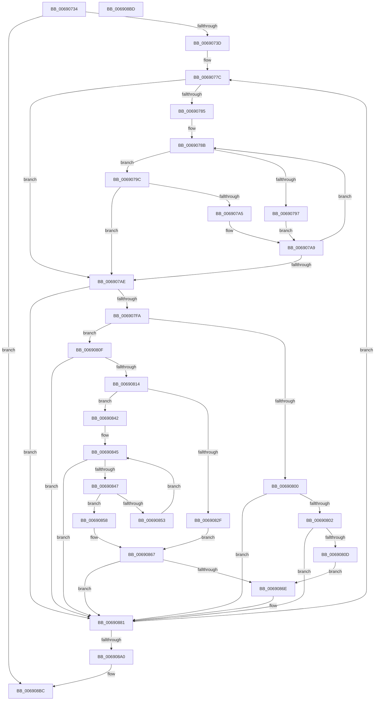

# MiClearRangeInPartitionTree

- RVA: `0x00690734`–`0x006908BE` (길이 `394` bytes)
- VA: `0x0000000140690734`
- 실행 섹션: `.text`
- PDB 이름 있음: `예`; PDB Function 태그: `아니요`
- unwind 정보 RVA: `0x000D77B4`
- 디코드: `117`개 명령, `394/394` bytes 표시
- 미해석 바이트: `0` (있으면 어셈블리에 `.byte`로 보존)

> 이 문서는 커널 이미지의 기계어와 PDB 기호를 분석해 생성했습니다. 4번과 5번은 함수 원형과 자료형을 바이너리 사용 방식에서 추정한 C 해석이며 원본 소스 복구 결과는 아닙니다.

## 1. Dependencies

- 직접 호출 지점: **3**; 고유 호출 대상: **3**
- 직접 호출자로 확인된 함수: **1**
- RIP 상대 이미지 참조: **0**

### Outgoing calls
- `0x006907D8` → [RtlClearBitsEx](../29/RtlClearBitsEx_function_00297740.md) (function, `0x00297740`)
- `0x00690874` → [RtlAvlRemoveNode](../29/RtlAvlRemoveNode_function_00296650.md) (function, `0x00296650`)
- `0x0069087C` → [MiDeletePartitionPageNode](MiDeletePartitionPageNode_function_006908C4.md) (function, `0x006908C4`)

### Direct callers
- [MiAddMdlToPartitionTree](MiAddMdlToPartitionTree_function_00690120.md) at `0x0069017F`

### Static image references
- 디코드된 RIP-relative 메모리 참조가 없습니다.

## 2. Other-region calls and transfers

- 다른 실행 섹션으로 향하는 call: **0**
- 별도 외부 분기/꼬리 이동을 확인하지 못했습니다.

## 3. Assembly (complete function range)

```asm
00690734  4D 85 C0                        test r8, r8
00690737  0F 84 7F 01 00 00               je 0x1406908bc
0069073D  48 89 5C 24 08                  mov qword ptr [rsp + 8], rbx
00690742  48 89 6C 24 10                  mov qword ptr [rsp + 0x10], rbp
00690747  48 89 74 24 18                  mov qword ptr [rsp + 0x18], rsi
0069074C  57                              push rdi
0069074D  41 54                           push r12
0069074F  41 55                           push r13
00690751  41 56                           push r14
00690753  41 57                           push r15
00690755  48 83 EC 20                     sub rsp, 0x20
00690759  48 8B FA                        mov rdi, rdx
0069075C  48 B8 00 00 FC FF FF FF FF 3F   movabs rax, 0x3ffffffffffc0000
00690766  48 23 F8                        and rdi, rax
00690769  49 8B E8                        mov rbp, r8
0069076C  48 8B F2                        mov rsi, rdx
0069076F  4C 8B E1                        mov r12, rcx
00690772  49 BD FF FF FF FF FF FF FF 3F   movabs r13, 0x3fffffffffffffff
0069077C  49 8B 1C 24                     mov rbx, qword ptr [r12]
00690780  48 85 DB                        test rbx, rbx
00690783  74 29                           je 0x1406907ae
00690785  48 8B D7                        mov rdx, rdi
00690788  49 23 D5                        and rdx, r13
0069078B  48 8B 4B 18                     mov rcx, qword ptr [rbx + 0x18]
0069078F  49 23 CD                        and rcx, r13
00690792  48 3B D1                        cmp rdx, rcx
00690795  73 05                           jae 0x14069079c
00690797  48 8B 1B                        mov rbx, qword ptr [rbx]
0069079A  EB 0D                           jmp 0x1406907a9
0069079C  48 03 4B 20                     add rcx, qword ptr [rbx + 0x20]
006907A0  48 3B D1                        cmp rdx, rcx
006907A3  72 09                           jb 0x1406907ae
006907A5  48 8B 5B 08                     mov rbx, qword ptr [rbx + 8]
006907A9  48 85 DB                        test rbx, rbx
006907AC  75 DD                           jne 0x14069078b
006907AE  4C 8B 43 18                     mov r8, qword ptr [rbx + 0x18]
006907B2  4C 8D 73 20                     lea r14, [rbx + 0x20]
006907B6  4D 23 C5                        and r8, r13
006907B9  4C 8B FD                        mov r15, rbp
006907BC  49 8B D0                        mov rdx, r8
006907BF  49 8B CE                        mov rcx, r14
006907C2  48 2B D6                        sub rdx, rsi
006907C5  49 03 16                        add rdx, qword ptr [r14]
006907C8  48 3B D5                        cmp rdx, rbp
006907CB  4C 0F 46 FA                     cmovbe r15, rdx
006907CF  48 8B D6                        mov rdx, rsi
006907D2  49 2B D0                        sub rdx, r8
006907D5  4D 8B C7                        mov r8, r15
006907D8  E8 63 6F C0 FF                  call 0x140297740
006907DD  48 B8 FF FF FF FF FF FF FF 7F   movabs rax, 0x7fffffffffffffff
006907E7  48 21 43 18                     and qword ptr [rbx + 0x18], rax
006907EB  49 8B 06                        mov rax, qword ptr [r14]
006907EE  49 8B 16                        mov rdx, qword ptr [r14]
006907F1  48 85 C0                        test rax, rax
006907F4  0F 84 87 00 00 00               je 0x140690881
006907FA  48 83 FA 01                     cmp rdx, 1
006907FE  77 0F                           ja 0x14069080f
00690800  75 7F                           jne 0x140690881
00690802  49 8B 46 08                     mov rax, qword ptr [r14 + 8]
00690806  48 0F BA 20 00                  bt qword ptr [rax], 0
0069080B  72 74                           jb 0x140690881
0069080D  EB 5F                           jmp 0x14069086e
0069080F  48 3B C2                        cmp rax, rdx
00690812  72 6D                           jb 0x140690881
00690814  49 8B 4E 08                     mov rcx, qword ptr [r14 + 8]
00690818  4C 8D 52 FF                     lea r10, [rdx - 1]
0069081C  49 8B C2                        mov rax, r10
0069081F  48 C1 E8 06                     shr rax, 6
00690823  4C 8B 01                        mov r8, qword ptr [rcx]
00690826  4C 8D 0C C1                     lea r9, [rcx + rax*8]
0069082A  49 3B C9                        cmp rcx, r9
0069082D  75 13                           jne 0x140690842
0069082F  48 83 C8 FF                     or rax, 0xffffffffffffffff
00690833  B9 40 00 00 00                  mov ecx, 0x40
00690838  2A CA                           sub cl, dl
0069083A  48 D3 E8                        shr rax, cl
0069083D  4C 85 C0                        test rax, r8
00690840  EB 25                           jmp 0x140690867
00690842  4D 85 C0                        test r8, r8
00690845  75 3A                           jne 0x140690881
00690847  48 83 C1 08                     add rcx, 8
0069084B  48 8B 11                        mov rdx, qword ptr [rcx]
0069084E  49 3B C9                        cmp rcx, r9
00690851  74 05                           je 0x140690858
00690853  48 85 D2                        test rdx, rdx
00690856  EB ED                           jmp 0x140690845
00690858  48 83 C8 FF                     or rax, 0xffffffffffffffff
0069085C  41 8A CA                        mov cl, r10b
0069085F  F6 D1                           not cl
00690861  48 D3 E8                        shr rax, cl
00690864  48 85 D0                        test rax, rdx
00690867  0F 94 C0                        sete al
0069086A  84 C0                           test al, al
0069086C  74 13                           je 0x140690881
0069086E  48 8B D3                        mov rdx, rbx
00690871  49 8B CC                        mov rcx, r12
00690874  E8 D7 5D C0 FF                  call 0x140296650
00690879  48 8B CB                        mov rcx, rbx
0069087C  E8 43 00 00 00                  call 0x1406908c4
00690881  49 03 F7                        add rsi, r15
00690884  48 B8 00 00 00 00 00 00 00 C0   movabs rax, 0xc000000000000000
0069088E  48 33 FE                        xor rdi, rsi
00690891  48 23 F8                        and rdi, rax
00690894  48 33 FE                        xor rdi, rsi
00690897  49 2B EF                        sub rbp, r15
0069089A  0F 85 DC FE FF FF               jne 0x14069077c
006908A0  48 8B 5C 24 50                  mov rbx, qword ptr [rsp + 0x50]
006908A5  48 8B 6C 24 58                  mov rbp, qword ptr [rsp + 0x58]
006908AA  48 8B 74 24 60                  mov rsi, qword ptr [rsp + 0x60]
006908AF  48 83 C4 20                     add rsp, 0x20
006908B3  41 5F                           pop r15
006908B5  41 5E                           pop r14
006908B7  41 5D                           pop r13
006908B9  41 5C                           pop r12
006908BB  5F                              pop rdi
006908BC  C3                              ret
006908BD  CC                              int3
```

## 4. C-style interpretation (structured pseudocode)

```c
__int64 __fastcall MiClearRangeInPartitionTree(__int64 a1, __int64 a2, __int64 a3)
{
    __int64 result;
    __int64 v_rbp;
    __int64 v_rdi;
    __int64 v_rsi;
    __int64 v_rsp;
    unsigned __int64 v_stack_p10;
    unsigned __int64 v_stack_p18;
    unsigned __int64 v_stack_p8;

    if (a3 == 0) goto loc_006908BC;
    v_stack_p8 = v_rbx;
    v_stack_p10 = v_rbp;
    v_stack_p18 = v_rsi;
    v_rsp = (v_rsp) - (32);
    v_rdi = (a2) & (result);
loc_0069077C:
    if (*(unsigned __int64 *)(a1) == 0) goto loc_006907AE;
    a2 = (v_rdi) & (v_r13);
loc_0069078B:
    a1 = (*(unsigned __int64 *)(*(unsigned __int64 *)(a1) + 24)) & (v_r13);
    if (a2 >= a1) goto loc_0069079C;
    goto loc_006907A9;
loc_0069079C:
    a1 = (a1) + (*(unsigned __int64 *)(*(unsigned __int64 *)(*(unsigned __int64 *)(a1)) + 32));
    if (a2 < a1) goto loc_006907AE;
loc_006907A9:
    if (*(unsigned __int64 *)(*(unsigned __int64 *)(*(unsigned __int64 *)(a1)) + 8) != 0) goto loc_0069078B;
loc_006907AE:
    a3 = (*(unsigned __int64 *)(*(unsigned __int64 *)(*(unsigned __int64 *)(*(unsigned __int64 *)(a1)) + 8) + 24)) & (v_r13);
    a2 = (a3) - (a2);
    a2 = (a2) + (*(unsigned __int64 *)(*(unsigned __int64 *)(*(unsigned __int64 *)(*(unsigned __int64 *)(a1)) + 8) + 32));
    if (a2 <= a3) { a3 = a2; }
    a2 = (a2) - (a3);
    result = RtlClearBitsEx(*(unsigned __int64 *)(*(unsigned __int64 *)(*(unsigned __int64 *)(a1)) + 8) + 32, a2, a3, a4);
    if (*(unsigned __int64 *)(*(unsigned __int64 *)(*(unsigned __int64 *)(*(unsigned __int64 *)(a1)) + 8) + 32) == 0) goto loc_00690881;
    if ((*(unsigned __int64 *)(*(unsigned __int64 *)(*(unsigned __int64 *)(*(unsigned __int64 *)(a1)) + 8) + 32)) > 1) goto loc_0069080F;
    if ((*(unsigned __int64 *)(*(unsigned __int64 *)(*(unsigned __int64 *)(*(unsigned __int64 *)(a1)) + 8) + 32)) != 1) goto loc_00690881;
    if ((*(unsigned __int64 *)(*(unsigned __int64 *)(*(unsigned __int64 *)(*(unsigned __int64 *)(a1)) + 8) + 32)) < 1) goto loc_00690881;
    goto loc_0069086E;
loc_0069080F:
    if ((*(unsigned __int64 *)(*(unsigned __int64 *)(*(unsigned __int64 *)(*(unsigned __int64 *)(a1)) + 8) + 32 + 8)) < (*(unsigned __int64 *)(*(unsigned __int64 *)(*(unsigned __int64 *)(*(unsigned __int64 *)(a1)) + 8) + 32))) goto loc_00690881;
    result = (*(unsigned __int64 *)(*(unsigned __int64 *)(*(unsigned __int64 *)(*(unsigned __int64 *)(a1)) + 8) + 32) - 1) >> (6);
    if ((*(unsigned __int64 *)(*(unsigned __int64 *)(*(unsigned __int64 *)(*(unsigned __int64 *)(a1)) + 8) + 32 + 8)) != (*(unsigned __int64 *)(*(unsigned __int64 *)(*(unsigned __int64 *)(*(unsigned __int64 *)(a1)) + 8) + 32 + 8) + result * 8)) goto loc_00690842;
    result = (result) | (-1);
    a1 = (unsigned __int8)((64) - ((unsigned __int8)(*(unsigned __int64 *)(*(unsigned __int64 *)(*(unsigned __int64 *)(*(unsigned __int64 *)(a1)) + 8) + 32))));
    result = (result) >> ((unsigned __int8)(a1));
    goto loc_00690867;
loc_00690842:
loc_00690845:
    if (*(unsigned __int64 *)(*(unsigned __int64 *)(*(unsigned __int64 *)(*(unsigned __int64 *)(*(unsigned __int64 *)(a1)) + 8) + 32 + 8)) != 0) goto loc_00690881;
    a1 = (a1) + (8);
    if (a1 == (*(unsigned __int64 *)(*(unsigned __int64 *)(*(unsigned __int64 *)(*(unsigned __int64 *)(a1)) + 8) + 32 + 8) + result * 8)) goto loc_00690858;
    goto loc_00690845;
loc_00690858:
    result = (result) | (-1);
    a1 = (unsigned __int8)(~((unsigned __int8)(*(unsigned __int64 *)(*(unsigned __int64 *)(*(unsigned __int64 *)(*(unsigned __int64 *)(a1)) + 8) + 32) - 1)));
    result = (result) >> ((unsigned __int8)(a1));
loc_00690867:
    result = (((result) & (*(unsigned __int64 *)(a1))) == 0) ? 1 : 0;
    if ((unsigned __int8)(result) != 0) {
        a2 = *(unsigned __int64 *)(*(unsigned __int64 *)(*(unsigned __int64 *)(a1)) + 8);
        a1 = a1;
        result = RtlAvlRemoveNode(a1, a2, *(unsigned __int64 *)(*(unsigned __int64 *)(*(unsigned __int64 *)(*(unsigned __int64 *)(*(unsigned __int64 *)(a1)) + 8) + 32 + 8)), *(unsigned __int64 *)(*(unsigned __int64 *)(*(unsigned __int64 *)(*(unsigned __int64 *)(a1)) + 8) + 32 + 8) + result * 8);
        a1 = *(unsigned __int64 *)(*(unsigned __int64 *)(*(unsigned __int64 *)(a1)) + 8);
        result = MiDeletePartitionPageNode(a1, a2, *(unsigned __int64 *)(*(unsigned __int64 *)(*(unsigned __int64 *)(*(unsigned __int64 *)(*(unsigned __int64 *)(a1)) + 8) + 32 + 8)), *(unsigned __int64 *)(*(unsigned __int64 *)(*(unsigned __int64 *)(*(unsigned __int64 *)(a1)) + 8) + 32 + 8) + result * 8);
    }
    v_rsi = (a2) + (a3);
    v_rdi = (v_rdi) ^ (v_rsi);
    v_rdi = (v_rdi) & (result);
    v_rdi = (v_rdi) ^ (v_rsi);
    v_rbp = (a3) - (a3);
    if (condition_is_not_equal) goto loc_0069077C;
    v_rsp = (v_rsp) + (32);
loc_006908BC:
    return result;
}
```

## 5. (Beta) C Style

```c
int64_t MiClearRangeInPartitionTree(void *Arg1, int64_t Arg2, int64_t Arg3)
{
    uint8_t *arg1 = (uint8_t *)Arg1;

    int64_t result;
    int64_t local_rbp;
    int64_t local_rdi;
    int64_t local_rsi;
    int64_t local_rsp;
    uint64_t v_stack_p10;
    uint64_t v_stack_p18;
    uint64_t v_stack_p8;

    if (Arg3 == 0) goto loc_006908BC;
    v_stack_p8 = local_rbx;
    v_stack_p10 = local_rbp;
    v_stack_p18 = local_rsi;
    local_rsp = (local_rsp) - (32);
    local_rdi = (Arg2) & (result);
loc_0069077C:
    if (*(uint64_t *)(arg1) == 0) goto loc_006907AE;
    Arg2 = (local_rdi) & (local_r13);
loc_0069078B:
    Arg1 = (*(uint64_t *)(*(uint64_t *)(arg1) + 0x18)) & (local_r13);
    if (Arg2 >= Arg1) goto loc_0069079C;
    goto loc_006907A9;
loc_0069079C:
    Arg1 = (Arg1) + (*(uint64_t *)(*(uint64_t *)(*(uint64_t *)(arg1)) + 0x20));
    if (Arg2 < Arg1) goto loc_006907AE;
loc_006907A9:
    if (*(uint64_t *)(*(uint64_t *)(*(uint64_t *)(arg1)) + 0x8) != 0) goto loc_0069078B;
loc_006907AE:
    Arg3 = (*(uint64_t *)(*(uint64_t *)(*(uint64_t *)(*(uint64_t *)(arg1)) + 0x8) + 0x18)) & (local_r13);
    Arg2 = (Arg3) - (Arg2);
    Arg2 = (Arg2) + (*(uint64_t *)(*(uint64_t *)(*(uint64_t *)(*(uint64_t *)(arg1)) + 0x8) + 0x20));
    if (Arg2 <= Arg3) { Arg3 = Arg2; }
    Arg2 = (Arg2) - (Arg3);
    result = RtlClearBitsEx(*(uint64_t *)(*(uint64_t *)(*(uint64_t *)(arg1)) + 0x8) + 32, Arg2, Arg3, a4);
    if (*(uint64_t *)(*(uint64_t *)(*(uint64_t *)(*(uint64_t *)(arg1)) + 0x8) + 0x20) == 0) goto loc_00690881;
    if ((*(uint64_t *)(*(uint64_t *)(*(uint64_t *)(*(uint64_t *)(arg1)) + 0x8) + 0x20)) > 1) goto loc_0069080F;
    if ((*(uint64_t *)(*(uint64_t *)(*(uint64_t *)(*(uint64_t *)(arg1)) + 0x8) + 0x20)) != 1) goto loc_00690881;
    if ((*(uint64_t *)(*(uint64_t *)(*(uint64_t *)(*(uint64_t *)(arg1)) + 0x8) + 0x20)) < 1) goto loc_00690881;
    goto loc_0069086E;
loc_0069080F:
    if ((*(uint64_t *)(*(uint64_t *)(*(uint64_t *)(*(uint64_t *)(arg1)) + 0x8) + 0x20 + 0x8)) < (*(uint64_t *)(*(uint64_t *)(*(uint64_t *)(*(uint64_t *)(arg1)) + 0x8) + 0x20))) goto loc_00690881;
    result = (*(uint64_t *)(*(uint64_t *)(*(uint64_t *)(*(uint64_t *)(arg1)) + 0x8) + 0x20) - 1) >> (6);
    if ((*(uint64_t *)(*(uint64_t *)(*(uint64_t *)(*(uint64_t *)(arg1)) + 0x8) + 0x20 + 0x8)) != (*(uint64_t *)(*(uint64_t *)(*(uint64_t *)(*(uint64_t *)(arg1)) + 0x8) + 0x20 + 0x8) + result * 8)) goto loc_00690842;
    result = (result) | (-1);
    Arg1 = (uint8_t)((64) - ((uint8_t)(*(uint64_t *)(*(uint64_t *)(*(uint64_t *)(*(uint64_t *)(arg1)) + 0x8) + 0x20))));
    result = (result) >> ((uint8_t)(Arg1));
    goto loc_00690867;
loc_00690842:
loc_00690845:
    if (*(uint64_t *)(*(uint64_t *)(*(uint64_t *)(*(uint64_t *)(*(uint64_t *)(arg1)) + 0x8) + 0x20 + 0x8)) != 0) goto loc_00690881;
    Arg1 = (Arg1) + (8);
    if (Arg1 == (*(uint64_t *)(*(uint64_t *)(*(uint64_t *)(*(uint64_t *)(arg1)) + 0x8) + 0x20 + 0x8) + result * 8)) goto loc_00690858;
    goto loc_00690845;
loc_00690858:
    result = (result) | (-1);
    Arg1 = (uint8_t)(~((uint8_t)(*(uint64_t *)(*(uint64_t *)(*(uint64_t *)(*(uint64_t *)(arg1)) + 0x8) + 0x20) - 1)));
    result = (result) >> ((uint8_t)(Arg1));
loc_00690867:
    result = (((result) & (*(uint64_t *)(arg1))) == 0) ? 1 : 0;
    if ((uint8_t)(result) != 0) {
        Arg2 = *(uint64_t *)(*(uint64_t *)(*(uint64_t *)(arg1)) + 0x8);
        Arg1 = Arg1;
        result = RtlAvlRemoveNode(Arg1, Arg2, *(uint64_t *)(*(uint64_t *)(*(uint64_t *)(*(uint64_t *)(*(uint64_t *)(arg1)) + 0x8) + 0x20 + 0x8)), *(uint64_t *)(*(uint64_t *)(*(uint64_t *)(*(uint64_t *)(arg1)) + 0x8) + 0x20 + 0x8) + result * 8);
        Arg1 = *(uint64_t *)(*(uint64_t *)(*(uint64_t *)(arg1)) + 0x8);
        result = MiDeletePartitionPageNode(Arg1, Arg2, *(uint64_t *)(*(uint64_t *)(*(uint64_t *)(*(uint64_t *)(*(uint64_t *)(arg1)) + 0x8) + 0x20 + 0x8)), *(uint64_t *)(*(uint64_t *)(*(uint64_t *)(*(uint64_t *)(arg1)) + 0x8) + 0x20 + 0x8) + result * 8);
    }
    local_rsi = (Arg2) + (Arg3);
    local_rdi = (local_rdi) ^ (local_rsi);
    local_rdi = (local_rdi) & (result);
    local_rdi = (local_rdi) ^ (local_rsi);
    local_rbp = (Arg3) - (Arg3);
    if (condition_is_not_equal) goto loc_0069077C;
    local_rsp = (local_rsp) + (32);
loc_006908BC:
    return result;
}
```

### 관측된 메모리 오프셋

구조체 형식이 확인되지 않은 접근은 인자 기준의 오프셋으로만 기록했습니다.

| 기준 인자 | 오프셋 표현 | 폭 (bit) | 접근 |
|---|---:|---:|---|
| `Arg1` | `+ 0x0` | `64` | `R` |

## 6. Execution-region graph

[열기: 2D/3D 그래프와 함수 탐색 컨트롤 패널](../../../control-panel.html?section=text&rva=0x00690734&view=graph)

- 2D 그래프는 위에서 아래로 흐르고, 3D 그래프는 빈 공간을 드래그해 회전합니다. Shift+드래그는 이동, 휠은 확대·축소, 함수 노드 선택은 대상 보고서 이동입니다.

### Static fallback


