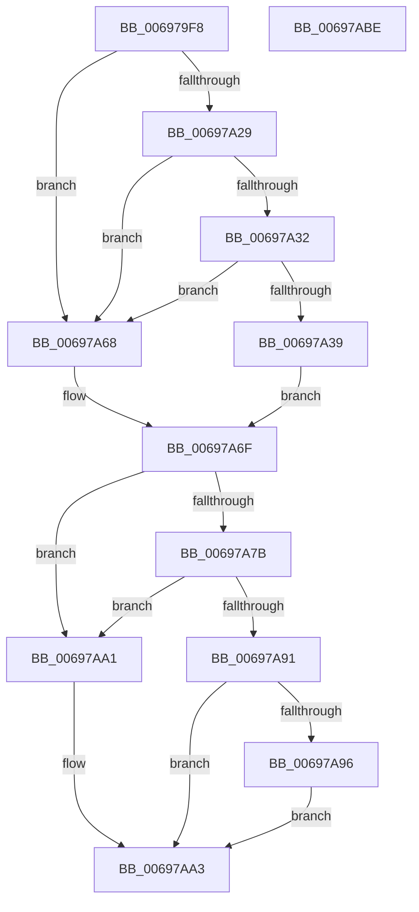

# MiCloneImageVad

- RVA: `0x006979F8`–`0x00697ABF` (길이 `199` bytes)
- VA: `0x00000001406979F8`
- 실행 섹션: `.text`
- PDB 이름 있음: `예`; PDB Function 태그: `아니요`
- unwind 정보 RVA: `0x0005E6B4`
- 디코드: `57`개 명령, `199/199` bytes 표시
- 미해석 바이트: `0` (있으면 어셈블리에 `.byte`로 보존)

> 이 문서는 커널 이미지의 기계어와 PDB 기호를 분석해 생성했습니다. 4번과 5번은 함수 원형과 자료형을 바이너리 사용 방식에서 추정한 C 해석이며 원본 소스 복구 결과는 아닙니다.

## 1. Dependencies

- 직접 호출 지점: **3**; 고유 호출 대상: **3**
- 직접 호출자로 확인된 함수: **1**
- RIP 상대 이미지 참조: **0**

### Outgoing calls
- `0x00697A3F` → [MiCopyForkedFixupVad](../../page/80/MiCopyForkedFixupVad_function_0080C82C.md) (function, `0x0080C82C`)
- `0x00697A7E` → [PsGetProcessSessionIdEx](../22/PsGetProcessSessionIdEx_function_0022F8F0.md) (function, `0x0022F8F0`)
- `0x00697A88` → [MiCreatePerSessionProtos](../../page/A6/MiCreatePerSessionProtos_function_00A666D8.md) (function, `0x00A666D8`)

### Direct callers
- [MiAllocateChildVads](../../page/97/MiAllocateChildVads_function_0097E380.md) at `0x0097E75C`

### Static image references
- 디코드된 RIP-relative 메모리 참조가 없습니다.

## 2. Other-region calls and transfers

- 다른 실행 섹션으로 향하는 call: **2**
  - `0x00697A3F` → [MiCopyForkedFixupVad](../../page/80/MiCopyForkedFixupVad_function_0080C82C.md) (`.text` → `PAGE`)
  - `0x00697A88` → [MiCreatePerSessionProtos](../../page/A6/MiCreatePerSessionProtos_function_00A666D8.md) (`.text` → `PAGE`)
- 별도 외부 분기/꼬리 이동을 확인하지 못했습니다.

## 3. Assembly (complete function range)

```asm
006979F8  48 8B C4                        mov rax, rsp
006979FB  48 89 58 08                     mov qword ptr [rax + 8], rbx
006979FF  48 89 68 10                     mov qword ptr [rax + 0x10], rbp
00697A03  48 89 70 18                     mov qword ptr [rax + 0x18], rsi
00697A07  48 89 78 20                     mov qword ptr [rax + 0x20], rdi
00697A0B  41 56                           push r14
00697A0D  48 83 EC 20                     sub rsp, 0x20
00697A11  49 8B 40 48                     mov rax, qword ptr [r8 + 0x48]
00697A15  4C 8B D2                        mov r10, rdx
00697A18  45 8B 48 30                     mov r9d, dword ptr [r8 + 0x30]
00697A1C  4C 8B F1                        mov r14, rcx
00697A1F  48 8B 28                        mov rbp, qword ptr [rax]
00697A22  41 0F BA E1 15                  bt r9d, 0x15
00697A27  72 3F                           jb 0x140697a68
00697A29  41 8B C1                        mov eax, r9d
00697A2C  24 70                           and al, 0x70
00697A2E  3C 20                           cmp al, 0x20
00697A30  75 36                           jne 0x140697a68
00697A32  41 0F BA E1 16                  bt r9d, 0x16
00697A37  73 2F                           jae 0x140697a68
00697A39  49 8B D0                        mov rdx, r8
00697A3C  49 8B CA                        mov rcx, r10
00697A3F  E8 E8 4D 17 00                  call 0x14080c82c
00697A44  49 8B 8E 10 04 00 00            mov rcx, qword ptr [r14 + 0x410]
00697A4B  48 8D 99 40 04 00 00            lea rbx, [rcx + 0x440]
00697A52  48 8B 03                        mov rax, qword ptr [rbx]
00697A55  48 8D B9 00 03 00 00            lea rdi, [rcx + 0x300]
00697A5C  48 FF C0                        inc rax
00697A5F  48 89 81 40 04 00 00            mov qword ptr [rcx + 0x440], rax
00697A66  EB 07                           jmp 0x140697a6f
00697A68  33 FF                           xor edi, edi
00697A6A  BB 40 01 00 00                  mov ebx, 0x140
00697A6F  F7 45 38 00 00 00 08            test dword ptr [rbp + 0x38], 0x8000000
00697A76  48 8B F3                        mov rsi, rbx
00697A79  74 26                           je 0x140697aa1
00697A7B  49 8B CE                        mov rcx, r14
00697A7E  E8 6D 7E B9 FF                  call 0x14022f8f0
00697A83  8B D0                           mov edx, eax
00697A85  48 8B CD                        mov rcx, rbp
00697A88  E8 4B EC 3C 00                  call 0x140a666d8
00697A8D  85 C0                           test eax, eax
00697A8F  79 10                           jns 0x140697aa1
00697A91  48 85 FF                        test rdi, rdi
00697A94  74 0D                           je 0x140697aa3
00697A96  48 8B 0B                        mov rcx, qword ptr [rbx]
00697A99  48 FF C9                        dec rcx
00697A9C  48 89 0B                        mov qword ptr [rbx], rcx
00697A9F  EB 02                           jmp 0x140697aa3
00697AA1  33 C0                           xor eax, eax
00697AA3  48 8B 5C 24 30                  mov rbx, qword ptr [rsp + 0x30]
00697AA8  48 8B 6C 24 38                  mov rbp, qword ptr [rsp + 0x38]
00697AAD  48 8B 74 24 40                  mov rsi, qword ptr [rsp + 0x40]
00697AB2  48 8B 7C 24 48                  mov rdi, qword ptr [rsp + 0x48]
00697AB7  48 83 C4 20                     add rsp, 0x20
00697ABB  41 5E                           pop r14
00697ABD  C3                              ret
00697ABE  CC                              int3
```

## 4. C-style interpretation (structured pseudocode)

```c
__int64 __fastcall MiCloneImageVad(__int64 a1, __int64 a2, __int64 a3)
{
    __int64 result;
    __int64 v_rdi;
    __int64 v_rsp;
    unsigned __int64 v_stack_p10;
    unsigned __int64 v_stack_p18;
    unsigned __int64 v_stack_p20;
    unsigned __int64 v_stack_p8;

    *(unsigned __int64 *)(v_rsp + 8) = v_rbx;
    *(unsigned __int64 *)(v_rsp + 16) = v_rbp;
    *(unsigned __int64 *)(v_rsp + 24) = v_rsi;
    *(unsigned __int64 *)(v_rsp + 32) = v_rdi;
    v_rsp = (v_rsp) - (32);
    if (condition_is_below) goto loc_00697A68;
    result = (unsigned __int8)(((unsigned int)((unsigned int)((unsigned int)(*(unsigned int *)(a3 + 48))))) & (112));
    if (((unsigned __int8)(result)) != 32) goto loc_00697A68;
    if (((unsigned __int8)(result)) >= 32) goto loc_00697A68;
    result = MiCopyForkedFixupVad(a2, a3, a3, (unsigned int)(*(unsigned int *)(a3 + 48)));
    result = (*(unsigned __int64 *)(*(unsigned __int64 *)(a1 + 1040) + 1088)) + 1;
    *(unsigned __int64 *)(*(unsigned __int64 *)(a1 + 1040) + 1088) = result;
    goto loc_00697A6F;
loc_00697A68:
    v_rdi = 0;
loc_00697A6F:
    if (((*(unsigned int *)(*(unsigned __int64 *)(*(unsigned __int64 *)(a3 + 72)) + 56)) & (0x8000000ULL)) == 0) goto loc_00697AA1;
    result = PsGetProcessSessionIdEx(a1, a3, a3, (unsigned int)(*(unsigned int *)(a3 + 48)));
    result = MiCreatePerSessionProtos(*(unsigned __int64 *)(*(unsigned __int64 *)(a3 + 72)), (unsigned int)((unsigned int)(result)), a3, (unsigned int)(*(unsigned int *)(a3 + 48)));
    if (!sign_flag) goto loc_00697AA1;
    if (0 == 0) goto loc_00697AA3;
    a1 = (*(unsigned __int64 *)(320)) - 1;
    *(unsigned __int64 *)(320) = a1;
    goto loc_00697AA3;
loc_00697AA1:
    result = 0;
loc_00697AA3:
    v_rsp = (v_rsp) + (32);
    return result;
}
```

## 5. (Beta) C Style

```c
int64_t MiCloneImageVad(void *Arg1, int64_t Arg2, void *Arg3)
{
    uint8_t *arg1 = (uint8_t *)Arg1;
    uint8_t *arg3 = (uint8_t *)Arg3;

    int64_t result;
    int64_t local_rdi;
    int64_t local_rsp;
    uint64_t v_stack_p10;
    uint64_t v_stack_p18;
    uint64_t v_stack_p20;
    uint64_t v_stack_p8;

    *(uint64_t *)(local_rsp + 0x8) = local_rbx;
    *(uint64_t *)(local_rsp + 0x10) = local_rbp;
    *(uint64_t *)(local_rsp + 0x18) = local_rsi;
    *(uint64_t *)(local_rsp + 0x20) = local_rdi;
    local_rsp = (local_rsp) - (32);
    if (condition_is_below) goto loc_00697A68;
    result = (uint8_t)(((uint32_t)((uint32_t)((uint32_t)(*(uint32_t *)(arg3 + 0x30))))) & (112));
    if (((uint8_t)(result)) != 32) goto loc_00697A68;
    if (((uint8_t)(result)) >= 32) goto loc_00697A68;
    result = MiCopyForkedFixupVad(Arg2, Arg3, Arg3, (uint32_t)(*(uint32_t *)(arg3 + 0x30)));
    result = (*(uint64_t *)(*(uint64_t *)(arg1 + 0x410) + 0x440)) + 1;
    *(uint64_t *)(*(uint64_t *)(arg1 + 0x410) + 0x440) = result;
    goto loc_00697A6F;
loc_00697A68:
    local_rdi = 0;
loc_00697A6F:
    if (((*(uint32_t *)(*(uint64_t *)(*(uint64_t *)(arg3 + 0x48)) + 0x38)) & (0x8000000ULL)) == 0) goto loc_00697AA1;
    result = PsGetProcessSessionIdEx(Arg1, Arg3, Arg3, (uint32_t)(*(uint32_t *)(arg3 + 0x30)));
    result = MiCreatePerSessionProtos(*(uint64_t *)(*(uint64_t *)(arg3 + 0x48)), (uint32_t)((uint32_t)(result)), Arg3, (uint32_t)(*(uint32_t *)(arg3 + 0x30)));
    if (!sign_flag) goto loc_00697AA1;
    if (0 == 0) goto loc_00697AA3;
    Arg1 = (*(uint64_t *)(320)) - 1;
    *(void **)(320) = Arg1;
    goto loc_00697AA3;
loc_00697AA1:
    result = 0;
loc_00697AA3:
    local_rsp = (local_rsp) + (32);
    return result;
}
```

### 관측된 메모리 오프셋

구조체 형식이 확인되지 않은 접근은 인자 기준의 오프셋으로만 기록했습니다.

| 기준 인자 | 오프셋 표현 | 폭 (bit) | 접근 |
|---|---:|---:|---|
| `Arg1` | `+ 0x410` | `64` | `R` |
| `Arg3` | `+ 0x30` | `32` | `R` |
| `Arg3` | `+ 0x48` | `64` | `R` |

## 6. Execution-region graph

[열기: 2D/3D 그래프와 함수 탐색 컨트롤 패널](../../../control-panel.html?section=text&rva=0x006979F8&view=graph)

- 2D 그래프는 위에서 아래로 흐르고, 3D 그래프는 빈 공간을 드래그해 회전합니다. Shift+드래그는 이동, 휠은 확대·축소, 함수 노드 선택은 대상 보고서 이동입니다.

### Static fallback


