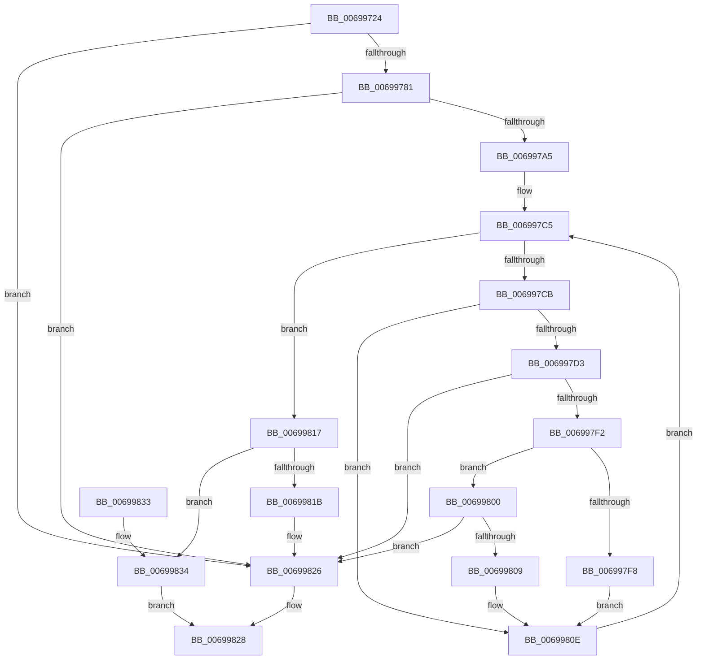

# MiClusterVadActive

- RVA: `0x00699724`–`0x0069983B` (길이 `279` bytes)
- VA: `0x0000000140699724`
- 실행 섹션: `.text`
- PDB 이름 있음: `예`; PDB Function 태그: `아니요`
- unwind 정보 RVA: `0x000D9690`
- 디코드: `75`개 명령, `279/279` bytes 표시
- 미해석 바이트: `0` (있으면 어셈블리에 `.byte`로 보존)

> 이 문서는 커널 이미지의 기계어와 PDB 기호를 분석해 생성했습니다. 4번과 5번은 함수 원형과 자료형을 바이너리 사용 방식에서 추정한 C 해석이며 원본 소스 복구 결과는 아닙니다.

## 1. Dependencies

- 직접 호출 지점: **0**; 고유 호출 대상: **0**
- 직접 호출자로 확인된 함수: **1**
- RIP 상대 이미지 참조: **0**

### Outgoing calls
- 직접 디코드된 call 명령이 없습니다.

### Direct callers
- [MiLockStealUserVm](../2B/MiLockStealUserVm_function_002B3EDC.md) at `0x002B4456`

### Static image references
- 디코드된 RIP-relative 메모리 참조가 없습니다.

## 2. Other-region calls and transfers

- 다른 실행 섹션으로 향하는 call: **0**
- 별도 외부 분기/꼬리 이동을 확인하지 못했습니다.

## 3. Assembly (complete function range)

```asm
00699724  48 89 5C 24 08                  mov qword ptr [rsp + 8], rbx
00699729  48 89 7C 24 10                  mov qword ptr [rsp + 0x10], rdi
0069972E  49 83 08 FF                     or qword ptr [r8], 0xffffffffffffffff
00699732  49 8B F8                        mov rdi, r8
00699735  4C 8B 4A 08                     mov r9, qword ptr [rdx + 8]
00699739  4C 8B D1                        mov r10, rcx
0069973C  49 C1 E1 19                     shl r9, 0x19
00699740  49 BB 00 00 00 00 80 F6 FF FF   movabs r11, 0xfffff68000000000
0069974A  49 8B C3                        mov rax, r11
0069974D  0F B6 49 20                     movzx ecx, byte ptr [rcx + 0x20]
00699751  48 C1 E0 19                     shl rax, 0x19
00699755  4C 2B C8                        sub r9, rax
00699758  48 C1 E1 20                     shl rcx, 0x20
0069975C  41 8B 42 18                     mov eax, dword ptr [r10 + 0x18]
00699760  48 0B C8                        or rcx, rax
00699763  49 C1 F9 10                     sar r9, 0x10
00699767  49 8B D1                        mov rdx, r9
0069976A  48 81 E2 00 00 FF FF            and rdx, 0xffffffffffff0000
00699771  48 8B C2                        mov rax, rdx
00699774  48 C1 E8 0C                     shr rax, 0xc
00699778  48 3B C1                        cmp rax, rcx
0069977B  0F 82 A5 00 00 00               jb 0x140699826
00699781  41 8B 42 1C                     mov eax, dword ptr [r10 + 0x1c]
00699785  41 0F B6 4A 21                  movzx ecx, byte ptr [r10 + 0x21]
0069978A  48 C1 E1 20                     shl rcx, 0x20
0069978E  48 0B C8                        or rcx, rax
00699791  48 8D 82 FF FF 00 00            lea rax, [rdx + 0xffff]
00699798  48 C1 E8 0C                     shr rax, 0xc
0069979C  48 3B C1                        cmp rax, rcx
0069979F  0F 87 81 00 00 00               ja 0x140699826
006997A5  48 C1 EA 09                     shr rdx, 9
006997A9  48 B8 F8 FF FF FF 7F 00 00 00   movabs rax, 0x7ffffffff8
006997B3  48 23 D0                        and rdx, rax
006997B6  33 DB                           xor ebx, ebx
006997B8  49 83 C8 FF                     or r8, 0xffffffffffffffff
006997BC  49 8B C3                        mov rax, r11
006997BF  48 03 D0                        add rdx, rax
006997C2  45 33 D2                        xor r10d, r10d
006997C5  41 83 FA 10                     cmp r10d, 0x10
006997C9  73 4C                           jae 0x140699817
006997CB  48 8B 0A                        mov rcx, qword ptr [rdx]
006997CE  F6 C1 01                        test cl, 1
006997D1  74 3B                           je 0x14069980e
006997D3  48 C1 E9 0C                     shr rcx, 0xc
006997D7  48 B8 FF FF FF FF FF 00 00 00   movabs rax, 0xffffffffff
006997E1  48 23 C8                        and rcx, rax
006997E4  45 8B DA                        mov r11d, r10d
006997E7  48 8B C1                        mov rax, rcx
006997EA  83 E0 0F                        and eax, 0xf
006997ED  49 3B C3                        cmp rax, r11
006997F0  75 34                           jne 0x140699826
006997F2  49 83 F8 FF                     cmp r8, -1
006997F6  75 08                           jne 0x140699800
006997F8  4C 8B C1                        mov r8, rcx
006997FB  4D 2B C3                        sub r8, r11
006997FE  EB 0E                           jmp 0x14069980e
00699800  4B 8D 04 02                     lea rax, [r10 + r8]
00699804  48 3B C8                        cmp rcx, rax
00699807  75 1D                           jne 0x140699826
00699809  BB 01 00 00 00                  mov ebx, 1
0069980E  41 FF C2                        inc r10d
00699811  48 83 C2 08                     add rdx, 8
00699815  EB AE                           jmp 0x1406997c5
00699817  85 DB                           test ebx, ebx
00699819  75 19                           jne 0x140699834
0069981B  49 C1 E9 0C                     shr r9, 0xc
0069981F  41 83 E1 0F                     and r9d, 0xf
00699823  4C 89 0F                        mov qword ptr [rdi], r9
00699826  33 C0                           xor eax, eax
00699828  48 8B 5C 24 08                  mov rbx, qword ptr [rsp + 8]
0069982D  48 8B 7C 24 10                  mov rdi, qword ptr [rsp + 0x10]
00699832  C3                              ret
00699833  CC                              int3
00699834  B8 01 00 00 00                  mov eax, 1
00699839  EB ED                           jmp 0x140699828
```

## 4. C-style interpretation (structured pseudocode)

```c
__int64 __fastcall MiClusterVadActive(__int64 a1, __int64 a2, __int64 a3)
{
    __int64 result;
    __int64 v_r10;
    __int64 v_rbx;
    unsigned __int64 v_stack_p10;
    unsigned __int64 v_stack_p8;

    v_stack_p8 = v_rbx;
    v_stack_p10 = v_rdi;
    a4 = (*(unsigned __int64 *)(a2 + 8)) << (25);
    result = (v_r11) << (25);
    a4 = (a4) - (result);
    a1 = (*(unsigned __int8 *)(a1 + 32)) << (32);
    a1 = (a1) | ((unsigned int)(*(unsigned int *)(a1 + 24)));
    a4 = (a4) >> (16);
    a2 = (a4) & (0xFFFFFFFFFFFF0000ULL);
    result = (a2) >> (12);
    if (result < a1) goto loc_00699826;
    a1 = (*(unsigned __int8 *)(a1 + 33)) << (32);
    a1 = (a1) | ((unsigned int)(*(unsigned int *)(a1 + 28)));
    result = (a2 + 65535) >> (12);
    if (result > a1) goto loc_00699826;
    a2 = (a2) >> (9);
    a2 = (a2) & (result);
    v_rbx = 0;
    a3 = (a3) | (-1);
    a2 = (a2) + (v_r11);
    v_r10 = 0;
loc_006997C5:
    if (0 >= 16) goto loc_00699817;
    if ((((unsigned __int8)(*(unsigned __int64 *)(a2))) & (1)) == 0) goto loc_0069980E;
    a1 = (*(unsigned __int64 *)(a2)) >> (12);
    a1 = (a1) & (v_r11);
    result = (unsigned int)((a1) & (15));
    if (result != 0) goto loc_00699826;
    if (a3 != -1) goto loc_00699800;
    a3 = (a1) - (0);
    goto loc_0069980E;
loc_00699800:
    if (a1 != (v_r10 + a3 * 1)) goto loc_00699826;
loc_0069980E:
    v_r10 = (unsigned int)((v_r10) + 1);
    a2 = (a2) + (8);
    goto loc_006997C5;
loc_00699817:
    if (1 != 0) goto loc_00699834;
    a4 = (a4) >> (12);
    a4 = (unsigned int)((a4) & (15));
    *(unsigned __int64 *)(a3) = a4;
loc_00699826:
    result = 0;
loc_00699828:
    return result;
loc_00699834:
    goto loc_00699828;
}
```

## 5. (Beta) C Style

```c
int64_t MiClusterVadActive(void *Arg1, void *Arg2, void *Arg3)
{
    uint8_t *arg1 = (uint8_t *)Arg1;
    uint8_t *arg2 = (uint8_t *)Arg2;
    uint8_t *arg3 = (uint8_t *)Arg3;

    int64_t result;
    int64_t local_r10;
    int64_t local_rbx;
    uint64_t v_stack_p10;
    uint64_t v_stack_p8;

    v_stack_p8 = local_rbx;
    v_stack_p10 = local_rdi;
    a4 = (*(uint64_t *)(arg2 + 0x8)) << (25);
    result = (local_r11) << (25);
    a4 = (a4) - (result);
    Arg1 = (*(uint8_t *)(arg1 + 0x20)) << (32);
    Arg1 = (Arg1) | ((uint32_t)(*(uint32_t *)(arg1 + 0x18)));
    a4 = (a4) >> (16);
    Arg2 = (a4) & (0xFFFFFFFFFFFF0000ULL);
    result = (Arg2) >> (12);
    if (result < Arg1) goto loc_00699826;
    Arg1 = (*(uint8_t *)(arg1 + 0x21)) << (32);
    Arg1 = (Arg1) | ((uint32_t)(*(uint32_t *)(arg1 + 0x1C)));
    result = (Arg2 + 65535) >> (12);
    if (result > Arg1) goto loc_00699826;
    Arg2 = (Arg2) >> (9);
    Arg2 = (Arg2) & (result);
    local_rbx = 0;
    Arg3 = (Arg3) | (-1);
    Arg2 = (Arg2) + (local_r11);
    local_r10 = 0;
loc_006997C5:
    if (0 >= 16) goto loc_00699817;
    if ((((uint8_t)(*(uint64_t *)(arg2))) & (1)) == 0) goto loc_0069980E;
    Arg1 = (*(uint64_t *)(arg2)) >> (12);
    Arg1 = (Arg1) & (local_r11);
    result = (uint32_t)((Arg1) & (15));
    if (result != 0) goto loc_00699826;
    if (Arg3 != -1) goto loc_00699800;
    Arg3 = (Arg1) - (0);
    goto loc_0069980E;
loc_00699800:
    if (Arg1 != (local_r10 + Arg3 * 1)) goto loc_00699826;
loc_0069980E:
    local_r10 = (uint32_t)((local_r10) + 1);
    Arg2 = (Arg2) + (8);
    goto loc_006997C5;
loc_00699817:
    if (1 != 0) goto loc_00699834;
    a4 = (a4) >> (12);
    a4 = (uint32_t)((a4) & (15));
    *(uint64_t *)(arg3) = a4;
loc_00699826:
    result = 0;
loc_00699828:
    return result;
loc_00699834:
    goto loc_00699828;
}
```

### 관측된 메모리 오프셋

구조체 형식이 확인되지 않은 접근은 인자 기준의 오프셋으로만 기록했습니다.

| 기준 인자 | 오프셋 표현 | 폭 (bit) | 접근 |
|---|---:|---:|---|
| `Arg1` | `+ 0x18` | `32` | `R` |
| `Arg1` | `+ 0x1C` | `32` | `R` |
| `Arg1` | `+ 0x20` | `8` | `R` |
| `Arg1` | `+ 0x21` | `8` | `R` |
| `Arg2` | `+ 0x8` | `64` | `R` |
| `Arg3` | `+ 0x0` | `64` | `R/W` |
| `Arg3` | `+ 0x0` | `64` | `W` |

## 6. Execution-region graph

[열기: 2D/3D 그래프와 함수 탐색 컨트롤 패널](../../../control-panel.html?section=text&rva=0x00699724&view=graph)

- 2D 그래프는 위에서 아래로 흐르고, 3D 그래프는 빈 공간을 드래그해 회전합니다. Shift+드래그는 이동, 휠은 확대·축소, 함수 노드 선택은 대상 보고서 이동입니다.

### Static fallback


