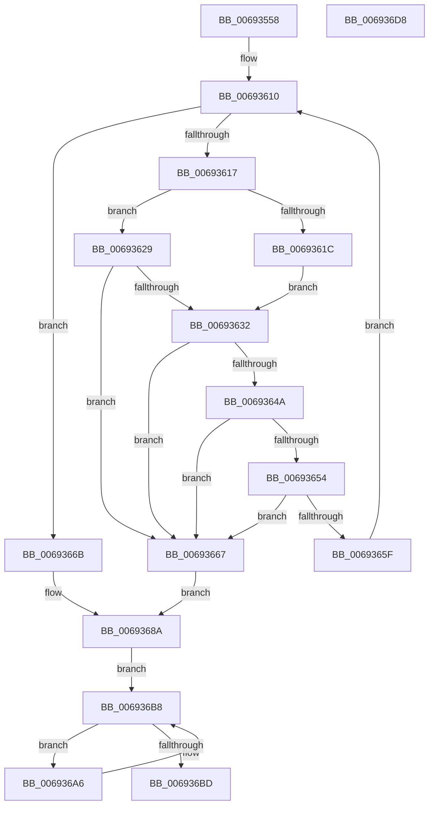

# MiCoalesceActivePagesIntoFree

- RVA: `0x00693558`–`0x006936D9` (길이 `385` bytes)
- VA: `0x0000000140693558`
- 실행 섹션: `.text`
- PDB 이름 있음: `예`; PDB Function 태그: `아니요`
- unwind 정보 RVA: `0x000D9258`
- 디코드: `107`개 명령, `385/385` bytes 표시
- 미해석 바이트: `0` (있으면 어셈블리에 `.byte`로 보존)

> 이 문서는 커널 이미지의 기계어와 PDB 기호를 분석해 생성했습니다. 4번과 5번은 함수 원형과 자료형을 바이너리 사용 방식에서 추정한 C 해석이며 원본 소스 복구 결과는 아닙니다.

## 1. Dependencies

- 직접 호출 지점: **5**; 고유 호출 대상: **5**
- 직접 호출자로 확인된 함수: **2**
- RIP 상대 이미지 참조: **1**

### Outgoing calls
- `0x006935B1` → [MiGetPfnPageSizeIndex](../31/MiGetPfnPageSizeIndex_function_0031C710.md) (function, `0x0031C710`)
- `0x006935D6` → [MiPageToNode](../33/MiPageToNode_function_00338CD0.md) (function, `0x00338CD0`)
- `0x0069361F` → [MiLockPageInline](../31/MiLockPageInline_function_0031A340.md) (function, `0x0031A340`)
- `0x00693685` → [MiLargePagePromote](../37/MiLargePagePromote_function_0037915C.md) (function, `0x0037915C`)
- `0x006936C0` → [MiUnlockPage](../31/MiUnlockPage_function_0031A3E0.md) (function, `0x0031A3E0`)

### Direct callers
- [MiFreeContiguousLargePageRun](../68/MiFreeContiguousLargePageRun_function_00688A34.md) at `0x00688BBA`
- [MiFreeCacheSlice](MiFreeCacheSlice_function_00698EB8.md) at `0x00698EF8`

### Static image references
- `0x00693583` → RVA `0x00000000` (`image boundary/outside`; read)

## 2. Other-region calls and transfers

- 다른 실행 섹션으로 향하는 call: **0**
- 별도 외부 분기/꼬리 이동을 확인하지 못했습니다.

## 3. Assembly (complete function range)

```asm
00693558  4C 8B DC                        mov r11, rsp
0069355B  45 89 43 18                     mov dword ptr [r11 + 0x18], r8d
0069355F  49 89 4B 08                     mov qword ptr [r11 + 8], rcx
00693563  53                              push rbx
00693564  55                              push rbp
00693565  56                              push rsi
00693566  57                              push rdi
00693567  41 54                           push r12
00693569  41 55                           push r13
0069356B  41 56                           push r14
0069356D  41 57                           push r15
0069356F  48 83 EC 48                     sub rsp, 0x48
00693573  41 83 63 20 00                  and dword ptr [r11 + 0x20], 0
00693578  48 8D 2C 55 00 00 00 00         lea rbp, [rdx*2]
00693580  41 8B C0                        mov eax, r8d
00693583  48 8D 1D 76 CA 96 FF            lea rbx, [rip - 0x69358a]
0069358A  48 03 EA                        add rbp, rdx
0069358D  4C 8B EA                        mov r13, rdx
00693590  BF 01 00 00 00                  mov edi, 1
00693595  48 C1 E5 04                     shl rbp, 4
00693599  4C 8B B4 C3 60 1C 01 00         mov r14, qword ptr [rbx + rax*8 + 0x11c60]
006935A1  48 B9 00 00 00 00 00 DE FF FF   movabs rcx, 0xffffde0000000000
006935AB  48 03 E9                        add rbp, rcx
006935AE  48 8B CD                        mov rcx, rbp
006935B1  E8 5A 91 C8 FF                  call 0x14031c710
006935B6  8B C0                           mov eax, eax
006935B8  49 8B CD                        mov rcx, r13
006935BB  4C 8B BC C3 60 1C 01 00         mov r15, qword ptr [rbx + rax*8 + 0x11c60]
006935C3  8B 84 83 E8 35 01 00            mov eax, dword ptr [rbx + rax*4 + 0x135e8]
006935CA  4C 89 7C 24 38                  mov qword ptr [rsp + 0x38], r15
006935CF  89 84 24 90 00 00 00            mov dword ptr [rsp + 0x90], eax
006935D6  E8 F5 56 CA FF                  call 0x140338cd0
006935DB  8B 45 20                        mov eax, dword ptr [rbp + 0x20]
006935DE  4F 8D 3C 7F                     lea r15, [r15 + r15*2]
006935E2  8B 8C 24 90 00 00 00            mov ecx, dword ptr [rsp + 0x90]
006935E9  33 DB                           xor ebx, ebx
006935EB  C1 E8 10                        shr eax, 0x10
006935EE  48 8B F5                        mov rsi, rbp
006935F1  49 D3 EE                        shr r14, cl
006935F4  41 B4 11                        mov r12b, 0x11
006935F7  0F B6 C0                        movzx eax, al
006935FA  C1 E8 06                        shr eax, 6
006935FD  4C 89 74 24 30                  mov qword ptr [rsp + 0x30], r14
00693602  4C 8B F5                        mov r14, rbp
00693605  89 84 24 98 00 00 00            mov dword ptr [rsp + 0x98], eax
0069360C  49 C1 E7 04                     shl r15, 4
00693610  48 3B 5C 24 30                  cmp rbx, qword ptr [rsp + 0x30]
00693615  73 54                           jae 0x14069366b
00693617  48 3B F5                        cmp rsi, rbp
0069361A  75 0D                           jne 0x140693629
0069361C  48 8B CE                        mov rcx, rsi
0069361F  E8 1C 6D C8 FF                  call 0x14031a340
00693624  44 8A E0                        mov r12b, al
00693627  EB 09                           jmp 0x140693632
00693629  F0 48 0F BA 6E 18 3F            lock bts qword ptr [rsi + 0x18], 0x3f
00693630  72 35                           jb 0x140693667
00693632  8B 46 20                        mov eax, dword ptr [rsi + 0x20]
00693635  48 03 DF                        add rbx, rdi
00693638  C1 E8 10                        shr eax, 0x10
0069363B  0F B6 C8                        movzx ecx, al
0069363E  C1 E9 06                        shr ecx, 6
00693641  3B 8C 24 98 00 00 00            cmp ecx, dword ptr [rsp + 0x98]
00693648  75 1D                           jne 0x140693667
0069364A  8B 46 20                        mov eax, dword ptr [rsi + 0x20]
0069364D  C1 E8 18                        shr eax, 0x18
00693650  A8 40                           test al, 0x40
00693652  75 13                           jne 0x140693667
00693654  48 8B 46 28                     mov rax, qword ptr [rsi + 0x28]
00693658  48 0F BA E0 29                  bt rax, 0x29
0069365D  72 08                           jb 0x140693667
0069365F  4D 03 F7                        add r14, r15
00693662  49 8B F6                        mov rsi, r14
00693665  EB A9                           jmp 0x140693610
00693667  33 FF                           xor edi, edi
00693669  EB 1F                           jmp 0x14069368a
0069366B  8B 94 24 A0 00 00 00            mov edx, dword ptr [rsp + 0xa0]
00693672  48 8D 84 24 A8 00 00 00         lea rax, [rsp + 0xa8]
0069367A  44 8B CF                        mov r9d, edi
0069367D  48 89 44 24 20                  mov qword ptr [rsp + 0x20], rax
00693682  49 8B CD                        mov rcx, r13
00693685  E8 D2 5A CE FF                  call 0x14037915c
0069368A  8B 8C 24 90 00 00 00            mov ecx, dword ptr [rsp + 0x90]
00693691  48 D3 E3                        shl rbx, cl
00693694  48 2B 5C 24 38                  sub rbx, qword ptr [rsp + 0x38]
00693699  48 8D 0C 5B                     lea rcx, [rbx + rbx*2]
0069369D  48 C1 E1 04                     shl rcx, 4
006936A1  48 03 CD                        add rcx, rbp
006936A4  EB 12                           jmp 0x1406936b8
006936A6  48 B8 FF FF FF FF FF FF FF 7F   movabs rax, 0x7fffffffffffffff
006936B0  F0 48 21 41 18                  lock and qword ptr [rcx + 0x18], rax
006936B5  49 2B CF                        sub rcx, r15
006936B8  48 3B CD                        cmp rcx, rbp
006936BB  75 E9                           jne 0x1406936a6
006936BD  41 8A D4                        mov dl, r12b
006936C0  E8 1B 6D C8 FF                  call 0x14031a3e0
006936C5  8B C7                           mov eax, edi
006936C7  48 83 C4 48                     add rsp, 0x48
006936CB  41 5F                           pop r15
006936CD  41 5E                           pop r14
006936CF  41 5D                           pop r13
006936D1  41 5C                           pop r12
006936D3  5F                              pop rdi
006936D4  5E                              pop rsi
006936D5  5D                              pop rbp
006936D6  5B                              pop rbx
006936D7  C3                              ret
006936D8  CC                              int3
```

## 4. C-style interpretation (structured pseudocode)

```c
__int64 __fastcall MiCoalesceActivePagesIntoFree(__int64 a1, __int64 a2, int a3)
{
    __int64 result;
    __int64 v_r14;
    __int64 v_r15;
    __int64 v_rbp;
    __int64 v_rbx;
    __int64 v_rdi;
    __int64 v_rsp;
    unsigned __int64 v_stack_m50;
    unsigned __int64 v_stack_m58;
    unsigned __int64 v_stack_m68;
    unsigned int v_stack_p10;
    unsigned int v_stack_p18;
    unsigned __int64 v_stack_p20;
    unsigned int v_stack_p8;

    *(unsigned int *)(v_rsp + 24) = a3;
    *(unsigned __int64 *)(v_rsp + 8) = a1;
    v_rsp = (v_rsp) - (72);
    v_rbp = (a2 * 2) + (a2);
    v_rbp = (v_rbp) << (4);
    v_rbp = (v_rbp) + (a1);
    result = MiGetPfnPageSizeIndex(v_rbp, a2, a3, a4);
    v_stack_m50 = *(unsigned __int64 *)(v_rip - 6894986 + (unsigned int)((unsigned int)(result)) * 8 + 72800);
    v_stack_p8 = (unsigned int)((unsigned int)(*(unsigned int *)(v_rip - 6894986 + (unsigned int)((unsigned int)(result)) * 4 + 79336)));
    result = MiPageToNode(a2, a2, a3, a4);
    v_rbx = 0;
    result = (unsigned int)(((unsigned int)(*(unsigned int *)(v_rbp + 32))) >> (16));
    v_r14 = (*(unsigned __int64 *)(v_rip - 6894986 + (unsigned int)(a3) * 8 + 72800)) >> ((unsigned __int8)((unsigned int)(v_stack_p8)));
    result = (unsigned int)(((unsigned __int8)(result)) >> (6));
    v_stack_m58 = v_r14;
    v_stack_p10 = (unsigned int)(result);
    v_r15 = (*(unsigned __int64 *)(v_rip - 6894986 + (unsigned int)((unsigned int)(result)) * 8 + 72800) + *(unsigned __int64 *)(v_rip - 6894986 + (unsigned int)((unsigned int)(result)) * 8 + 72800) * 2) << (4);
loc_00693610:
    if (0 >= v_stack_m58) goto loc_0069366B;
    if (v_rbp != v_rbp) goto loc_00693629;
    result = MiLockPageInline(v_rbp, a2, a3, a4);
    goto loc_00693632;
loc_00693629:
    if (v_rbp < v_rbp) goto loc_00693667;
loc_00693632:
    v_rbx = (v_rbx) + (1);
    result = (unsigned int)(((unsigned int)(*(unsigned int *)(v_rbp + 32))) >> (16));
    a1 = (unsigned int)(((unsigned __int8)(result)) >> (6));
    if (((unsigned int)(a1)) != v_stack_p10) goto loc_00693667;
    result = (unsigned int)(((unsigned int)(*(unsigned int *)(v_rbp + 32))) >> (24));
    if ((((unsigned __int8)(result)) & (64)) != 0) goto loc_00693667;
    if (condition_is_below) goto loc_00693667;
    v_r14 = (v_rbp) + (v_r15);
    goto loc_00693610;
loc_00693667:
    v_rdi = 0;
    goto loc_0069368A;
loc_0069366B:
    v_stack_m68 = v_stack_p20;
    result = MiLargePagePromote(a2, (unsigned int)(v_stack_p18), a3, 0);
loc_0069368A:
    v_rbx = (v_rbx) << ((unsigned __int8)((unsigned int)(v_stack_p8)));
    v_rbx = (v_rbx) - (v_stack_m50);
    a1 = (v_rbx + v_rbx * 2) << (4);
    a1 = (a1) + (v_rbp);
    goto loc_006936B8;
loc_006936A6:
    a1 = (a1) - (v_r15);
loc_006936B8:
    if (a1 != v_rbp) goto loc_006936A6;
    result = MiUnlockPage(a1, (unsigned __int8)((unsigned __int8)(result)), a3, 0);
    v_rsp = (v_rsp) + (72);
    return 0;
}
```

## 5. (Beta) C Style

```c
int64_t MiCoalesceActivePagesIntoFree(int64_t Arg1, int64_t Arg2, int32_t Arg3)
{
    int64_t result;
    int64_t local_r14;
    int64_t local_r15;
    int64_t local_rbp;
    int64_t local_rbx;
    int64_t local_rdi;
    int64_t local_rsp;
    uint64_t v_stack_m50;
    uint64_t v_stack_m58;
    uint64_t v_stack_m68;
    uint32_t v_stack_p10;
    uint32_t v_stack_p18;
    uint64_t v_stack_p20;
    uint32_t v_stack_p8;

    *(uint32_t *)(local_rsp + 0x18) = Arg3;
    *(uint64_t *)(local_rsp + 0x8) = Arg1;
    local_rsp = (local_rsp) - (72);
    local_rbp = (Arg2 * 2) + (Arg2);
    local_rbp = (local_rbp) << (4);
    local_rbp = (local_rbp) + (Arg1);
    result = MiGetPfnPageSizeIndex(local_rbp, Arg2, Arg3, a4);
    v_stack_m50 = *(uint64_t *)(v_rip - 0x69358A + (uint32_t)((uint32_t)(result)) * 8 + 0x11C60);
    v_stack_p8 = (uint32_t)((uint32_t)(*(uint32_t *)(v_rip - 0x69358A + (uint32_t)((uint32_t)(result)) * 4 + 0x135E8)));
    result = MiPageToNode(Arg2, Arg2, Arg3, a4);
    local_rbx = 0;
    result = (uint32_t)(((uint32_t)(*(uint32_t *)(local_rbp + 0x20))) >> (16));
    local_r14 = (*(uint64_t *)(v_rip - 0x69358A + (uint32_t)(Arg3) * 8 + 0x11C60)) >> ((uint8_t)((uint32_t)(v_stack_p8)));
    result = (uint32_t)(((uint8_t)(result)) >> (6));
    v_stack_m58 = local_r14;
    v_stack_p10 = (uint32_t)(result);
    local_r15 = (*(uint64_t *)(v_rip - 0x69358A + (uint32_t)((uint32_t)(result)) * 8 + 0x11C60) + *(uint64_t *)(v_rip - 0x69358A + (uint32_t)((uint32_t)(result)) * 8 + 0x11C60) * 2) << (4);
loc_00693610:
    if (0 >= v_stack_m58) goto loc_0069366B;
    if (local_rbp != local_rbp) goto loc_00693629;
    result = MiLockPageInline(local_rbp, Arg2, Arg3, a4);
    goto loc_00693632;
loc_00693629:
    if (local_rbp < local_rbp) goto loc_00693667;
loc_00693632:
    local_rbx = (local_rbx) + (1);
    result = (uint32_t)(((uint32_t)(*(uint32_t *)(local_rbp + 0x20))) >> (16));
    Arg1 = (uint32_t)(((uint8_t)(result)) >> (6));
    if (((uint32_t)(Arg1)) != v_stack_p10) goto loc_00693667;
    result = (uint32_t)(((uint32_t)(*(uint32_t *)(local_rbp + 0x20))) >> (24));
    if ((((uint8_t)(result)) & (64)) != 0) goto loc_00693667;
    if (condition_is_below) goto loc_00693667;
    local_r14 = (local_rbp) + (local_r15);
    goto loc_00693610;
loc_00693667:
    local_rdi = 0;
    goto loc_0069368A;
loc_0069366B:
    v_stack_m68 = v_stack_p20;
    result = MiLargePagePromote(Arg2, (uint32_t)(v_stack_p18), Arg3, 0);
loc_0069368A:
    local_rbx = (local_rbx) << ((uint8_t)((uint32_t)(v_stack_p8)));
    local_rbx = (local_rbx) - (v_stack_m50);
    Arg1 = (local_rbx + local_rbx * 2) << (4);
    Arg1 = (Arg1) + (local_rbp);
    goto loc_006936B8;
loc_006936A6:
    Arg1 = (Arg1) - (local_r15);
loc_006936B8:
    if (Arg1 != local_rbp) goto loc_006936A6;
    result = MiUnlockPage(Arg1, (uint8_t)((uint8_t)(result)), Arg3, 0);
    local_rsp = (local_rsp) + (72);
    return 0;
}
```

## 6. Execution-region graph

[열기: 2D/3D 그래프와 함수 탐색 컨트롤 패널](../../../control-panel.html?section=text&rva=0x00693558&view=graph)

- 2D 그래프는 위에서 아래로 흐르고, 3D 그래프는 빈 공간을 드래그해 회전합니다. Shift+드래그는 이동, 휠은 확대·축소, 함수 노드 선택은 대상 보고서 이동입니다.

### Static fallback


