# MiComputeCacheAttributeSpeeds

- RVA: `0x006999E8`–`0x00699E3B` (길이 `1,107` bytes)
- VA: `0x00000001406999E8`
- 실행 섹션: `.text`
- PDB 이름 있음: `예`; PDB Function 태그: `아니요`
- unwind 정보 RVA: `0x000D972C`
- 디코드: `274`개 명령, `1,107/1,107` bytes 표시
- 미해석 바이트: `0` (있으면 어셈블리에 `.byte`로 보존)

> 이 문서는 커널 이미지의 기계어와 PDB 기호를 분석해 생성했습니다. 4번과 5번은 함수 원형과 자료형을 바이너리 사용 방식에서 추정한 C 해석이며 원본 소스 복구 결과는 아닙니다.

## 1. Dependencies

- 직접 호출 지점: **17**; 고유 호출 대상: **14**
- 직접 호출자로 확인된 함수: **1**
- RIP 상대 이미지 참조: **4**

### Outgoing calls
- `0x00699A36` → [memset](../6C/memset_function_006C6C40.md) (function, `0x006C6C40`)
- `0x00699ABA` → [MiInitializePageColorBase](../32/MiInitializePageColorBase_function_00320410.md) (function, `0x00320410`)
- `0x00699AFB` → [MiGetPage](../28/MiGetPage_function_002884C0.md) (function, `0x002884C0`)
- `0x00699B85` → [MiChangePageAttribute](../33/MiChangePageAttribute_function_00332ECC.md) (function, `0x00332ECC`)
- `0x00699BDD` → [MiAllocateHardwareDescriptor](../4B/MiAllocateHardwareDescriptor_function_004B8738.md) (function, `0x004B8738`)
- `0x00699C26` → [KeQueryPerformanceCounter](../37/KeQueryPerformanceCounter_function_0037E7E0.md) (function, `0x0037E7E0`)
- `0x00699C57` → [MiChangePageAttribute](../33/MiChangePageAttribute_function_00332ECC.md) (function, `0x00332ECC`)
- `0x00699C6C` → [MiMapPageInHyperSpaceWorker](../33/MiMapPageInHyperSpaceWorker_function_00332B10.md) (function, `0x00332B10`)
- `0x00699C88` → [MiFillMemory](../2C/MiFillMemory_function_002C7BD0.md) (function, `0x002C7BD0`)
- `0x00699C9A` → [MiUnmapPageInHyperSpaceWorker](../43/MiUnmapPageInHyperSpaceWorker_function_00432800.md) (function, `0x00432800`)
- `0x00699CA7` → [MiChangePageAttribute](../33/MiChangePageAttribute_function_00332ECC.md) (function, `0x00332ECC`)
- `0x00699CBC` → [KeQueryPerformanceCounter](../37/KeQueryPerformanceCounter_function_0037E7E0.md) (function, `0x0037E7E0`)
- `0x00699D5E` → [MiFreeHardwareDescriptor](../4B/MiFreeHardwareDescriptor_function_004B6078.md) (function, `0x004B6078`)
- `0x00699D66` → [MiLockAndInsertPageInFreeList](../47/MiLockAndInsertPageInFreeList_function_00470FA8.md) (function, `0x00470FA8`)
- `0x00699D74` → [ExAcquireSpinLockExclusive](../24/ExAcquireSpinLockExclusive_function_00248690.md) (function, `0x00248690`)
- `0x00699E08` → [MiReleaseSpinLockExclusive](../24/MiReleaseSpinLockExclusive_function_002482C0.md) (function, `0x002482C0`)
- `0x00699E14` → [_security_check_cookie](../6A/_security_check_cookie_function_006AC640.md) (function, `0x006AC640`)

### Direct callers
- [MiInitializeZeroEngines](../../page/81/MiInitializeZeroEngines_function_008106F4.md) at `0x00810825`

### Static image references
- `0x00699A0B` → RVA `0x00E0A740` (`.data`; read)
- `0x00699A3B` → RVA `0x00E2DCD8` (`.data`; read)
- `0x00699A7A` → RVA `0x00E2DBF8` (`.data`; read)
- `0x00699AD1` → RVA `0x00000000` (`image boundary/outside`; read)

## 2. Other-region calls and transfers

- 다른 실행 섹션으로 향하는 call: **0**
- 별도 외부 분기/꼬리 이동을 확인하지 못했습니다.

## 3. Assembly (complete function range)

```asm
006999E8  48 8B C4                        mov rax, rsp
006999EB  48 89 58 10                     mov qword ptr [rax + 0x10], rbx
006999EF  48 89 70 18                     mov qword ptr [rax + 0x18], rsi
006999F3  48 89 78 20                     mov qword ptr [rax + 0x20], rdi
006999F7  55                              push rbp
006999F8  41 54                           push r12
006999FA  41 55                           push r13
006999FC  41 56                           push r14
006999FE  41 57                           push r15
00699A00  48 8D 68 B8                     lea rbp, [rax - 0x48]
00699A04  48 81 EC 20 01 00 00            sub rsp, 0x120
00699A0B  48 8B 05 2E 0D 77 00            mov rax, qword ptr [rip + 0x770d2e]
00699A12  48 33 C4                        xor rax, rsp
00699A15  48 89 45 10                     mov qword ptr [rbp + 0x10], rax
00699A19  33 D2                           xor edx, edx
00699A1B  48 89 4D 88                     mov qword ptr [rbp - 0x78], rcx
00699A1F  4C 8B E9                        mov r13, rcx
00699A22  C6 44 24 30 00                  mov byte ptr [rsp + 0x30], 0
00699A27  0F 57 C0                        xorps xmm0, xmm0
00699A2A  48 8D 4D B0                     lea rcx, [rbp - 0x50]
00699A2E  0F 11 45 A0                     movups xmmword ptr [rbp - 0x60], xmm0
00699A32  44 8D 42 60                     lea r8d, [rdx + 0x60]
00699A36  E8 05 D2 02 00                  call 0x1406c6c40
00699A3B  40 8A 3D 96 42 79 00            mov dil, byte ptr [rip + 0x794296]
00699A42  40 F6 C7 01                     test dil, 1
00699A46  0F 85 C1 03 00 00               jne 0x140699e0d
00699A4C  49 63 4D 00                     movsxd rcx, dword ptr [r13]
00699A50  40 80 E7 04                     and dil, 4
00699A54  49 8B 9D B0 00 00 00            mov rbx, qword ptr [r13 + 0xb0]
00699A5B  48 8B C1                        mov rax, rcx
00699A5E  48 C1 E0 06                     shl rax, 6
00699A62  89 4C 24 34                     mov dword ptr [rsp + 0x34], ecx
00699A66  48 89 4D 98                     mov qword ptr [rbp - 0x68], rcx
00699A6A  44 8B 43 38                     mov r8d, dword ptr [rbx + 0x38]
00699A6E  48 89 45 90                     mov qword ptr [rbp - 0x70], rax
00699A72  4F 8D 34 40                     lea r14, [r8 + r8*2]
00699A76  49 C1 E6 07                     shl r14, 7
00699A7A  4C 03 35 77 41 79 00            add r14, qword ptr [rip + 0x794177]
00699A81  4C 89 74 24 78                  mov qword ptr [rsp + 0x78], r14
00699A86  4A 83 BC 30 C8 00 00 00 00      cmp qword ptr [rax + r14 + 0xc8], 0
00699A8F  0F 85 78 03 00 00               jne 0x140699e0d
00699A95  49 8B 86 78 01 00 00            mov rax, qword ptr [r14 + 0x178]
00699A9C  4C 8D 4D A0                     lea r9, [rbp - 0x60]
00699AA0  48 8B 5B 30                     mov rbx, qword ptr [rbx + 0x30]
00699AA4  BA 03 00 00 00                  mov edx, 3
00699AA9  4C 69 E1 A8 00 00 00            imul r12, rcx, 0xa8
00699AB0  41 FF C0                        inc r8d
00699AB3  48 89 44 24 68                  mov qword ptr [rsp + 0x68], rax
00699AB8  33 C9                           xor ecx, ecx
00699ABA  E8 51 69 C8 FF                  call 0x140320410
00699ABF  4C 8B 4D A0                     mov r9, qword ptr [rbp - 0x60]
00699AC3  B8 01 00 00 00                  mov eax, 1
00699AC8  F0 41 0F C1 01                  lock xadd dword ptr [r9], eax
00699ACD  4C 8B 45 A8                     mov r8, qword ptr [rbp - 0x58]
00699AD1  4C 8D 0D 28 65 96 FF            lea r9, [rip - 0x699ad8]
00699AD8  33 D2                           xor edx, edx
00699ADA  49 8B C8                        mov rcx, r8
00699ADD  48 C1 E9 10                     shr rcx, 0x10
00699AE1  83 E1 03                        and ecx, 3
00699AE4  41 F7 B4 89 C0 DC E2 00         div dword ptr [r9 + rcx*4 + 0xe2dcc0]
00699AEC  48 8B CB                        mov rcx, rbx
00699AEF  41 33 D0                        xor edx, r8d
00699AF2  0F B6 D2                        movzx edx, dl
00699AF5  41 33 D0                        xor edx, r8d
00699AF8  45 33 C0                        xor r8d, r8d
00699AFB  E8 C0 E9 BE FF                  call 0x1402884c0
00699B00  48 89 44 24 70                  mov qword ptr [rsp + 0x70], rax
00699B05  48 83 F8 FF                     cmp rax, -1
00699B09  75 04                           jne 0x140699b0f
00699B0B  33 F6                           xor esi, esi
00699B0D  EB 15                           jmp 0x140699b24
00699B0F  48 8D 34 40                     lea rsi, [rax + rax*2]
00699B13  48 C1 E6 04                     shl rsi, 4
00699B17  48 B8 00 00 00 00 00 DE FF FF   movabs rax, 0xffffde0000000000
00699B21  48 03 F0                        add rsi, rax
00699B24  40 F6 DF                        neg dil
00699B27  BB 02 00 00 00                  mov ebx, 2
00699B2C  4D 1B FF                        sbb r15, r15
00699B2F  4C 03 FB                        add r15, rbx
00699B32  4C 89 7D 80                     mov qword ptr [rbp - 0x80], r15
00699B36  48 85 F6                        test rsi, rsi
00699B39  75 38                           jne 0x140699b73
00699B3B  8D 4B FF                        lea ecx, [rbx - 1]
00699B3E  48 8D 45 D8                     lea rax, [rbp - 0x28]
00699B42  4C 8D 0D B7 64 96 FF            lea r9, [rip - 0x699b49]
00699B49  4D 8B 84 C9 00 B0 03 00         mov r8, qword ptr [r9 + rcx*8 + 0x3b000]
00699B51  48 8B D3                        mov rdx, rbx
00699B54  48 83 08 FF                     or qword ptr [rax], 0xffffffffffffffff
00699B58  4C 89 40 F8                     mov qword ptr [rax - 8], r8
00699B5C  48 83 C0 10                     add rax, 0x10
00699B60  48 83 EA 01                     sub rdx, 1
00699B64  75 EE                           jne 0x140699b54
00699B66  48 FF C1                        inc rcx
00699B69  49 3B CF                        cmp rcx, r15
00699B6C  7E DB                           jle 0x140699b49
00699B6E  E9 F8 01 00 00                  jmp 0x140699d6b
00699B73  8B 46 20                        mov eax, dword ptr [rsi + 0x20]
00699B76  C1 E8 10                        shr eax, 0x10
00699B79  3C 40                           cmp al, 0x40
00699B7B  72 0D                           jb 0x140699b8a
00699B7D  45 33 C0                        xor r8d, r8d
00699B80  33 D2                           xor edx, edx
00699B82  48 8B CE                        mov rcx, rsi
00699B85  E8 42 93 C9 FF                  call 0x140332ecc
00699B8A  48 8B 44 24 68                  mov rax, qword ptr [rsp + 0x68]
00699B8F  4C 8D 45 D0                     lea r8, [rbp - 0x30]
00699B93  4C 8B DB                        mov r11, rbx
00699B96  45 8B 54 04 48                  mov r10d, dword ptr [r12 + rax + 0x48]
00699B9B  4D 0F AF 54 04 50               imul r10, qword ptr [r12 + rax + 0x50]
00699BA1  4D 8B 4C 04 78                  mov r9, qword ptr [r12 + rax + 0x78]
00699BA6  49 8B 01                        mov rax, qword ptr [r9]
00699BA9  33 D2                           xor edx, edx
00699BAB  48 C1 E0 15                     shl rax, 0x15
00699BAF  49 8B C8                        mov rcx, r8
00699BB2  49 F7 F2                        div r10
00699BB5  49 8B D7                        mov rdx, r15
00699BB8  48 89 01                        mov qword ptr [rcx], rax
00699BBB  48 8D 49 20                     lea rcx, [rcx + 0x20]
00699BBF  48 83 EA 01                     sub rdx, 1
00699BC3  75 F3                           jne 0x140699bb8
00699BC5  49 83 C1 08                     add r9, 8
00699BC9  49 83 C0 10                     add r8, 0x10
00699BCD  49 83 EB 01                     sub r11, 1
00699BD1  75 D3                           jne 0x140699ba6
00699BD3  44 39 5C 24 34                  cmp dword ptr [rsp + 0x34], r11d
00699BD8  75 0F                           jne 0x140699be9
00699BDA  49 8B CD                        mov rcx, r13
00699BDD  E8 56 EB E1 FF                  call 0x1404b8738
00699BE2  48 89 44 24 50                  mov qword ptr [rsp + 0x50], rax
00699BE7  EB 06                           jmp 0x140699bef
00699BE9  48 83 64 24 50 00               and qword ptr [rsp + 0x50], 0
00699BEF  4C 8B 74 24 50                  mov r14, qword ptr [rsp + 0x50]
00699BF4  48 8D 4D D8                     lea rcx, [rbp - 0x28]
00699BF8  BF 01 00 00 00                  mov edi, 1
00699BFD  4C 89 7C 24 60                  mov qword ptr [rsp + 0x60], r15
00699C02  89 7C 24 38                     mov dword ptr [rsp + 0x38], edi
00699C06  83 64 24 34 00                  and dword ptr [rsp + 0x34], 0
00699C0B  48 89 4C 24 58                  mov qword ptr [rsp + 0x58], rcx
00699C10  44 8B 7C 24 34                  mov r15d, dword ptr [rsp + 0x34]
00699C15  45 33 E4                        xor r12d, r12d
00699C18  45 33 ED                        xor r13d, r13d
00699C1B  48 83 64 24 40 00               and qword ptr [rsp + 0x40], 0
00699C21  48 8D 4C 24 40                  lea rcx, [rsp + 0x40]
00699C26  E8 B5 4B CE FF                  call 0x14037e7e0
00699C2B  48 81 7C 24 40 80 96 98 00      cmp qword ptr [rsp + 0x40], 0x989680
00699C34  48 8B D8                        mov rbx, rax
00699C37  74 11                           je 0x140699c4a
00699C39  48 69 C3 80 96 98 00            imul rax, rbx, 0x989680
00699C40  48 99                           cqo
00699C42  48 F7 7C 24 40                  idiv qword ptr [rsp + 0x40]
00699C47  48 8B D8                        mov rbx, rax
00699C4A  F0 83 0C 24 00                  lock or dword ptr [rsp], 0
00699C4F  45 33 C0                        xor r8d, r8d
00699C52  8B D7                           mov edx, edi
00699C54  48 8B CE                        mov rcx, rsi
00699C57  E8 70 92 C9 FF                  call 0x140332ecc
00699C5C  48 8B 4C 24 70                  mov rcx, qword ptr [rsp + 0x70]
00699C61  48 8D 54 24 30                  lea rdx, [rsp + 0x30]
00699C66  41 B8 00 00 00 80               mov r8d, 0x80000000
00699C6C  E8 9F 8E C9 FF                  call 0x140332b10
00699C71  45 33 C9                        xor r9d, r9d
00699C74  44 89 7C 24 20                  mov dword ptr [rsp + 0x20], r15d
00699C79  41 B8 00 10 00 00               mov r8d, 0x1000
00699C7F  48 8B D0                        mov rdx, rax
00699C82  49 8B CE                        mov rcx, r14
00699C85  48 8B F8                        mov rdi, rax
00699C88  E8 43 DF C2 FF                  call 0x1402c7bd0
00699C8D  8A 54 24 30                     mov dl, byte ptr [rsp + 0x30]
00699C91  41 B8 00 00 00 80               mov r8d, 0x80000000
00699C97  48 8B CF                        mov rcx, rdi
00699C9A  E8 61 8B D9 FF                  call 0x140432800
00699C9F  45 33 C0                        xor r8d, r8d
00699CA2  33 D2                           xor edx, edx
00699CA4  48 8B CE                        mov rcx, rsi
00699CA7  E8 20 92 C9 FF                  call 0x140332ecc
00699CAC  F0 83 0C 24 00                  lock or dword ptr [rsp], 0
00699CB1  48 83 64 24 48 00               and qword ptr [rsp + 0x48], 0
00699CB7  48 8D 4C 24 48                  lea rcx, [rsp + 0x48]
00699CBC  E8 1F 4B CE FF                  call 0x14037e7e0
00699CC1  48 81 7C 24 48 80 96 98 00      cmp qword ptr [rsp + 0x48], 0x989680
00699CCA  74 0E                           je 0x140699cda
00699CCC  48 69 C0 80 96 98 00            imul rax, rax, 0x989680
00699CD3  48 99                           cqo
00699CD5  48 F7 7C 24 48                  idiv qword ptr [rsp + 0x48]
00699CDA  8B 7C 24 38                     mov edi, dword ptr [rsp + 0x38]
00699CDE  41 FF C5                        inc r13d
00699CE1  48 3B C3                        cmp rax, rbx
00699CE4  48 8B CB                        mov rcx, rbx
00699CE7  48 0F 43 C8                     cmovae rcx, rax
00699CEB  48 2B CB                        sub rcx, rbx
00699CEE  4C 03 E1                        add r12, rcx
00699CF1  49 81 FC F4 01 00 00            cmp r12, 0x1f4
00699CF8  0F 82 1D FF FF FF               jb 0x140699c1b
00699CFE  41 C1 E5 0C                     shl r13d, 0xc
00699D02  33 D2                           xor edx, edx
00699D04  49 C1 E4 15                     shl r12, 0x15
00699D08  41 8B CD                        mov ecx, r13d
00699D0B  49 8B C4                        mov rax, r12
00699D0E  48 F7 F1                        div rcx
00699D11  48 8B 4C 24 58                  mov rcx, qword ptr [rsp + 0x58]
00699D16  48 89 01                        mov qword ptr [rcx], rax
00699D19  48 83 C1 10                     add rcx, 0x10
00699D1D  41 8B C7                        mov eax, r15d
00699D20  48 89 4C 24 58                  mov qword ptr [rsp + 0x58], rcx
00699D25  FF C0                           inc eax
00699D27  89 44 24 34                     mov dword ptr [rsp + 0x34], eax
00699D2B  83 F8 02                        cmp eax, 2
00699D2E  0F 8C DC FE FF FF               jl 0x140699c10
00699D34  FF C7                           inc edi
00699D36  48 83 6C 24 60 01               sub qword ptr [rsp + 0x60], 1
00699D3C  89 7C 24 38                     mov dword ptr [rsp + 0x38], edi
00699D40  0F 85 C0 FE FF FF               jne 0x140699c06
00699D46  4C 8B 7D 80                     mov r15, qword ptr [rbp - 0x80]
00699D4A  49 8B C6                        mov rax, r14
00699D4D  4C 8B 74 24 78                  mov r14, qword ptr [rsp + 0x78]
00699D52  48 85 C0                        test rax, rax
00699D55  74 0C                           je 0x140699d63
00699D57  48 8B 4D 88                     mov rcx, qword ptr [rbp - 0x78]
00699D5B  48 8B D0                        mov rdx, rax
00699D5E  E8 15 C3 E1 FF                  call 0x1404b6078
00699D63  48 8B CE                        mov rcx, rsi
00699D66  E8 3D 72 DD FF                  call 0x140470fa8
00699D6B  48 8B 5C 24 68                  mov rbx, qword ptr [rsp + 0x68]
00699D70  48 8D 4B 40                     lea rcx, [rbx + 0x40]
00699D74  E8 17 E9 BA FF                  call 0x140248690
00699D79  44 8A D8                        mov r11b, al
00699D7C  48 8B 45 90                     mov rax, qword ptr [rbp - 0x70]
00699D80  4A 83 BC 30 C8 00 00 00 00      cmp qword ptr [rax + r14 + 0xc8], 0
00699D89  75 76                           jne 0x140699e01
00699D8B  48 8B 7D 98                     mov rdi, qword ptr [rbp - 0x68]
00699D8F  4C 8D 45 D8                     lea r8, [rbp - 0x28]
00699D93  48 03 FF                        add rdi, rdi
00699D96  4D 8D 56 7C                     lea r10, [r14 + 0x7c]
00699D9A  41 B9 01 00 00 00               mov r9d, 1
00699DA0  41 0F 10 40 F8                  movups xmm0, xmmword ptr [r8 - 8]
00699DA5  41 8D 51 FF                     lea edx, [r9 - 1]
00699DA9  B9 02 00 00 00                  mov ecx, 2
00699DAE  41 0F 10 48 08                  movups xmm1, xmmword ptr [r8 + 8]
00699DB3  48 03 D7                        add rdx, rdi
00699DB6  48 C1 E2 05                     shl rdx, 5
00699DBA  42 0F 11 84 32 B8 00 00 00      movups xmmword ptr [rdx + r14 + 0xb8], xmm0
00699DC3  42 0F 11 8C 32 C8 00 00 00      movups xmmword ptr [rdx + r14 + 0xc8], xmm1
00699DCC  48 B8 CD CC CC CC CC CC CC CC   movabs rax, 0xcccccccccccccccd
00699DD6  49 F7 60 F8                     mul qword ptr [r8 - 8]
00699DDA  48 C1 EA 03                     shr rdx, 3
00699DDE  48 8D 04 D2                     lea rax, [rdx + rdx*8]
00699DE2  49 39 00                        cmp qword ptr [r8], rax
00699DE5  73 03                           jae 0x140699dea
00699DE7  45 89 0A                        mov dword ptr [r10], r9d
00699DEA  49 83 C0 10                     add r8, 0x10
00699DEE  48 83 E9 01                     sub rcx, 1
00699DF2  75 D8                           jne 0x140699dcc
00699DF4  41 FF C1                        inc r9d
00699DF7  49 83 C2 04                     add r10, 4
00699DFB  49 83 EF 01                     sub r15, 1
00699DFF  75 9F                           jne 0x140699da0
00699E01  41 8A D3                        mov dl, r11b
00699E04  48 8D 4B 40                     lea rcx, [rbx + 0x40]
00699E08  E8 B3 E4 BA FF                  call 0x1402482c0
00699E0D  48 8B 4D 10                     mov rcx, qword ptr [rbp + 0x10]
00699E11  48 33 CC                        xor rcx, rsp
00699E14  E8 27 28 01 00                  call 0x1406ac640
00699E19  4C 8D 9C 24 20 01 00 00         lea r11, [rsp + 0x120]
00699E21  49 8B 5B 38                     mov rbx, qword ptr [r11 + 0x38]
00699E25  49 8B 73 40                     mov rsi, qword ptr [r11 + 0x40]
00699E29  49 8B 7B 48                     mov rdi, qword ptr [r11 + 0x48]
00699E2D  49 8B E3                        mov rsp, r11
00699E30  41 5F                           pop r15
00699E32  41 5E                           pop r14
00699E34  41 5D                           pop r13
00699E36  41 5C                           pop r12
00699E38  5D                              pop rbp
00699E39  C3                              ret
00699E3A  CC                              int3
```

## 4. C-style interpretation (structured pseudocode)

```c
__int64 __fastcall MiComputeCacheAttributeSpeeds(__int64 a1, int a2)
{
    __int64 result;
    __int64 v_r10;
    __int64 v_r11;
    __int64 v_r12;
    __int64 v_r13;
    __int64 v_r14;
    __int64 v_r15;
    __int64 v_rbx;
    __int64 v_rdi;
    __int64 v_rsi;
    __int64 v_rsp;
    unsigned __int64 v_stack_m100;
    unsigned __int64 v_stack_m108;
    unsigned int v_stack_m110;
    unsigned int v_stack_m114;
    unsigned __int8 v_stack_m118;
    unsigned int v_stack_m128;
    unsigned int v_stack_m148;
    unsigned __int64 v_stack_m28;
    unsigned __int64 v_stack_mD0;
    unsigned __int64 v_stack_mD8;
    unsigned __int64 v_stack_mE0;
    unsigned __int64 v_stack_mE8;
    unsigned __int64 v_stack_mF0;
    unsigned __int64 v_stack_mF8;

    *(unsigned __int64 *)(v_rsp + 16) = v_rbx;
    *(unsigned __int64 *)(v_rsp + 24) = v_rsi;
    *(unsigned __int64 *)(v_rsp + 32) = v_rdi;
    v_rsp = (v_rsp) - (288);
    result = (*(unsigned __int64 *)(v_rip + 7802158)) ^ (v_rsp);
    *(unsigned __int64 *)(v_rsp - 72 + 16) = result;
    a2 = 0;
    *(unsigned __int64 *)(v_rsp - 72 - 120) = a1;
    v_stack_m118 = 0;
    *(unsigned __int64 *)(v_rsp - 72 - 96) = v_xmm0;
    result = memset(v_rsp - 72 - 80, a2, a2 + 96, a4);
    if ((((unsigned __int8)(*(unsigned __int8 *)(v_rip + 7946902))) & (1)) != 0) goto loc_00699E0D;
    v_rdi = (unsigned __int8)((*(unsigned __int8 *)(v_rip + 7946902)) & (4));
    result = ((int)(*(unsigned int *)(a1))) << (6);
    v_stack_m114 = (unsigned int)((int)(*(unsigned int *)(a1)));
    *(unsigned __int64 *)(v_rsp - 72 - 104) = (int)(*(unsigned int *)(a1));
    *(unsigned __int64 *)(v_rsp - 72 - 112) = result;
    v_r14 = ((unsigned int)(*(unsigned int *)(*(unsigned __int64 *)(a1 + 176) + 56)) + (unsigned int)(*(unsigned int *)(*(unsigned __int64 *)(a1 + 176) + 56)) * 2) << (7);
    v_r14 = (v_r14) + (*(unsigned __int64 *)(v_rip + 7946615));
    v_stack_mD0 = v_r14;
    if ((*(unsigned __int64 *)(result + v_r14 * 1 + 200)) != 0) goto loc_00699E0D;
    v_r12 = (v_r12) * ((int)(*(unsigned int *)(a1)));
    a3 = (unsigned int)(((unsigned int)(*(unsigned int *)(*(unsigned __int64 *)(a1 + 176) + 56))) + 1);
    v_stack_mE0 = *(unsigned __int64 *)(v_r14 + 376);
    a1 = 0;
    result = MiInitializePageColorBase(a1, 3, a3, v_rsp - 72 - 96);
    a2 = 0;
    a1 = (*(unsigned __int64 *)(v_rsp - 72 - 88)) >> (16);
    a1 = (unsigned int)((a1) & (3));
    a2 = (unsigned int)((a2) ^ ((unsigned int)(*(unsigned __int64 *)(v_rsp - 72 - 88))));
    a2 = (unsigned int)(((unsigned __int8)(a2)) ^ ((unsigned int)(*(unsigned __int64 *)(v_rsp - 72 - 88))));
    a3 = 0;
    result = MiGetPage(*(unsigned __int64 *)(*(unsigned __int64 *)(a1 + 176) + 48), a2, a3, v_rip - 6920920);
    v_stack_mD8 = result;
    if (result != -1) goto loc_00699B0F;
    v_rsi = 0;
    goto loc_00699B24;
loc_00699B0F:
    v_rsi = (result + result * 2) << (4);
    v_rsi = (v_rsi) + (result);
loc_00699B24:
    v_rdi = (unsigned __int8)(-(v_rdi));
    v_r15 = (v_r15) + (2);
    *(unsigned __int64 *)(v_rsp - 72 - 128) = v_r15;
    if (v_rsi != 0) goto loc_00699B73;
loc_00699B49:
loc_00699B54:
    *(unsigned __int64 *)(v_rsp - 72 - 40 - 8) = *(unsigned __int64 *)(v_rip - 6921033 + 2 - 1 * 8 + 241664);
    result = (v_rsp - 72 - 40) + (16);
    a2 = (2) - (1);
    if (condition_is_not_equal) goto loc_00699B54;
    a1 = (2 - 1) + 1;
    if (a1 <= v_r15) goto loc_00699B49;
    goto loc_00699D6B;
loc_00699B73:
    result = (unsigned int)(((unsigned int)(*(unsigned int *)(v_rsi + 32))) >> (16));
    if (((unsigned __int8)(result)) >= 64) {
        a3 = 0;
        a2 = 0;
        a1 = v_rsi;
        result = MiChangePageAttribute(a1, a2, a3, v_rip - 6921033);
    }
    v_r10 = ((unsigned int)(*(unsigned int *)(v_r12 + v_stack_mE0 * 1 + 72))) * (*(unsigned __int64 *)(v_r12 + v_stack_mE0 * 1 + 80));
loc_00699BA6:
    a2 = 0;
    result = (*(unsigned __int64 *)(*(unsigned __int64 *)(v_r12 + v_stack_mE0 * 1 + 120))) << (21);
loc_00699BB8:
    *(unsigned __int64 *)(v_rsp - 72 - 48) = result;
    a2 = (v_r15) - (1);
    if (condition_is_not_equal) goto loc_00699BB8;
    a4 = (*(unsigned __int64 *)(v_r12 + v_stack_mE0 * 1 + 120)) + (8);
    a3 = (v_rsp - 72 - 48) + (16);
    v_r11 = (2) - (1);
    if (condition_is_not_equal) goto loc_00699BA6;
    if (v_stack_m114 != ((unsigned int)(v_r11))) goto loc_00699BE9;
    result = MiAllocateHardwareDescriptor(a1, a2, a3, a4);
    v_stack_mF8 = result;
    goto loc_00699BEF;
loc_00699BE9:
loc_00699BEF:
    v_stack_mE8 = v_r15;
    v_stack_m110 = 1;
loc_00699C06:
    v_stack_mF0 = v_rsp - 72 - 40;
loc_00699C10:
    v_r12 = 0;
    v_r13 = 0;
loc_00699C1B:
    result = KeQueryPerformanceCounter(v_stack_m108, a2, a3, a4);
    v_rbx = result;
    if (v_stack_m108 != 0x989680ULL) {
        result = (result) * (result);
        v_rbx = result;
    }
    a3 = 0;
    result = MiChangePageAttribute(v_rsi, 1, a3, a4);
    result = MiMapPageInHyperSpaceWorker(v_stack_mD8, v_stack_m118, (unsigned int)(0x80000000ULL), a4);
    a4 = 0;
    v_stack_m128 = (unsigned int)((unsigned int)(v_stack_m114));
    result = MiFillMemory(v_stack_mF8, result, (unsigned int)(0x1000ULL), a4);
    result = MiUnmapPageInHyperSpaceWorker(result, v_stack_m118, (unsigned int)(0x80000000ULL), a4);
    a3 = 0;
    a2 = 0;
    result = MiChangePageAttribute(v_rsi, a2, a3, a4);
    result = KeQueryPerformanceCounter(v_stack_m100, a2, a3, a4);
    if (v_stack_m100 != 0x989680ULL) {
        result = (result) * (result);
    }
    v_r13 = (unsigned int)((v_r13) + 1);
    a1 = v_rbx;
    if (result >= v_rbx) { a1 = result; }
    a1 = (a1) - (v_rbx);
    v_r12 = (v_r12) + (a1);
    if (v_r12 < 500) goto loc_00699C1B;
    v_r13 = (unsigned int)((v_r13) << (12));
    a2 = 0;
    v_r12 = (v_r12) << (21);
    *(unsigned __int64 *)(v_stack_mF0) = v_r12;
    a1 = (v_stack_mF0) + (16);
    v_stack_mF0 = a1;
    result = (unsigned int)(((unsigned int)((unsigned int)((unsigned int)(v_stack_m114)))) + 1);
    v_stack_m114 = (unsigned int)(result);
    if (((unsigned int)(result)) < 2) goto loc_00699C10;
    v_rdi = (unsigned int)(((unsigned int)(v_stack_m110)) + 1);
    v_stack_m110 = (unsigned int)(v_rdi);
    if (((unsigned int)(result)) != 2) goto loc_00699C06;
    result = v_stack_mF8;
    if (v_stack_mF8 != 0) {
        a1 = *(unsigned __int64 *)(v_rsp - 72 - 120);
        a2 = v_stack_mF8;
        result = MiFreeHardwareDescriptor(a1, a2, a3, a4);
    }
    result = MiLockAndInsertPageInFreeList(v_rsi, a2, a3, a4);
loc_00699D6B:
    result = ExAcquireSpinLockExclusive(v_stack_mE0 + 64, a2, a3, a4);
    if ((*(unsigned __int64 *)(*(unsigned __int64 *)(v_rsp - 72 - 112) + v_stack_mD0 * 1 + 200)) != 0) goto loc_00699E01;
    v_rdi = (*(unsigned __int64 *)(v_rsp - 72 - 104)) + (*(unsigned __int64 *)(v_rsp - 72 - 104));
loc_00699DA0:
    a2 = (1 - 1) + (v_rdi);
    a2 = (a2) << (5);
    *(unsigned __int64 *)(a2 + v_stack_mD0 * 1 + 184) = v_xmm0;
    *(unsigned __int64 *)(a2 + v_stack_mD0 * 1 + 200) = v_xmm1;
loc_00699DCC:
    a2 = (a2) >> (3);
    if ((*(unsigned __int64 *)(v_rsp - 72 - 40)) < (a2 + a2 * 8)) {
        *(unsigned int *)(v_stack_mD0 + 124) = 1;
    }
    a3 = (v_rsp - 72 - 40) + (16);
    a1 = (2) - (1);
    if (condition_is_not_equal) goto loc_00699DCC;
    a4 = (unsigned int)((1) + 1);
    v_r10 = (v_stack_mD0 + 124) + (4);
    v_r15 = (*(unsigned __int64 *)(v_rsp - 72 - 128)) - (1);
    if (condition_is_not_equal) goto loc_00699DA0;
loc_00699E01:
    result = MiReleaseSpinLockExclusive(v_stack_mE0 + 64, (unsigned __int8)((unsigned __int8)(result)), a3, a4);
loc_00699E0D:
    a1 = (*(unsigned __int64 *)(v_rsp - 72 + 16)) ^ (v_rsp);
    result = _security_check_cookie(a1, (unsigned __int8)((unsigned __int8)(result)), a3, a4);
    return result;
}
```

## 5. (Beta) C Style

```c
int64_t MiComputeCacheAttributeSpeeds(void *Arg1, int32_t Arg2)
{
    uint8_t *arg1 = (uint8_t *)Arg1;

    int64_t result;
    int64_t local_r10;
    int64_t local_r11;
    int64_t local_r12;
    int64_t local_r13;
    int64_t local_r14;
    int64_t local_r15;
    int64_t local_rbx;
    int64_t local_rdi;
    int64_t local_rsi;
    int64_t local_rsp;
    uint64_t v_stack_m100;
    uint64_t v_stack_m108;
    uint32_t v_stack_m110;
    uint32_t v_stack_m114;
    uint8_t v_stack_m118;
    uint32_t v_stack_m128;
    uint32_t v_stack_m148;
    uint64_t v_stack_m28;
    uint64_t v_stack_mD0;
    uint64_t v_stack_mD8;
    uint64_t v_stack_mE0;
    uint64_t v_stack_mE8;
    uint64_t v_stack_mF0;
    uint64_t v_stack_mF8;

    *(uint64_t *)(local_rsp + 0x10) = local_rbx;
    *(uint64_t *)(local_rsp + 0x18) = local_rsi;
    *(uint64_t *)(local_rsp + 0x20) = local_rdi;
    local_rsp = (local_rsp) - (288);
    result = (*(uint64_t *)(v_rip + 0x770D2E)) ^ (local_rsp);
    *(uint64_t *)(local_rsp - 0x48 + 0x10) = result;
    Arg2 = 0;
    *(void **)(local_rsp - 0x48 - 0x78) = Arg1;
    v_stack_m118 = 0;
    *(uint64_t *)(local_rsp - 0x48 - 0x60) = v_xmm0;
    result = memset(local_rsp - 72 - 80, Arg2, Arg2 + 96, a4);
    if ((((uint8_t)(*(uint8_t *)(v_rip + 0x794296))) & (1)) != 0) goto loc_00699E0D;
    local_rdi = (uint8_t)((*(uint8_t *)(v_rip + 0x794296)) & (4));
    result = ((int32_t)(*(uint32_t *)(arg1))) << (6);
    v_stack_m114 = (uint32_t)((int32_t)(*(uint32_t *)(arg1)));
    *(uint64_t *)(local_rsp - 0x48 - 0x68) = (int32_t)(*(uint32_t *)(arg1));
    *(uint64_t *)(local_rsp - 0x48 - 0x70) = result;
    local_r14 = ((uint32_t)(*(uint32_t *)(*(uint64_t *)(arg1 + 0xB0) + 0x38)) + (uint32_t)(*(uint32_t *)(*(uint64_t *)(arg1 + 0xB0) + 0x38)) * 2) << (7);
    local_r14 = (local_r14) + (*(uint64_t *)(v_rip + 0x794177));
    v_stack_mD0 = local_r14;
    if ((*(uint64_t *)(result + local_r14 * 1 + 0xC8)) != 0) goto loc_00699E0D;
    local_r12 = (local_r12) * ((int32_t)(*(uint32_t *)(arg1)));
    a3 = (uint32_t)(((uint32_t)(*(uint32_t *)(*(uint64_t *)(arg1 + 0xB0) + 0x38))) + 1);
    v_stack_mE0 = *(uint64_t *)(local_r14 + 0x178);
    Arg1 = 0;
    result = MiInitializePageColorBase(Arg1, 3, a3, local_rsp - 72 - 96);
    Arg2 = 0;
    Arg1 = (*(uint64_t *)(local_rsp - 0x48 - 0x58)) >> (16);
    Arg1 = (uint32_t)((Arg1) & (3));
    Arg2 = (uint32_t)((Arg2) ^ ((uint32_t)(*(uint64_t *)(local_rsp - 0x48 - 0x58))));
    Arg2 = (uint32_t)(((uint8_t)(Arg2)) ^ ((uint32_t)(*(uint64_t *)(local_rsp - 0x48 - 0x58))));
    a3 = 0;
    result = MiGetPage(*(uint64_t *)(*(uint64_t *)(arg1 + 0xB0) + 0x30), Arg2, a3, v_rip - 6920920);
    v_stack_mD8 = result;
    if (result != -1) goto loc_00699B0F;
    local_rsi = 0;
    goto loc_00699B24;
loc_00699B0F:
    local_rsi = (result + result * 2) << (4);
    local_rsi = (local_rsi) + (result);
loc_00699B24:
    local_rdi = (uint8_t)(-(local_rdi));
    local_r15 = (local_r15) + (2);
    *(uint64_t *)(local_rsp - 0x48 - 0x80) = local_r15;
    if (local_rsi != 0) goto loc_00699B73;
loc_00699B49:
loc_00699B54:
    *(uint64_t *)(local_rsp - 0x48 - 0x28 - 0x8) = *(uint64_t *)(v_rip - 0x699B49 + 0x2 - 0x1 * 8 + 0x3B000);
    result = (local_rsp - 72 - 40) + (16);
    Arg2 = (2) - (1);
    if (condition_is_not_equal) goto loc_00699B54;
    Arg1 = (2 - 1) + 1;
    if (Arg1 <= local_r15) goto loc_00699B49;
    goto loc_00699D6B;
loc_00699B73:
    result = (uint32_t)(((uint32_t)(*(uint32_t *)(local_rsi + 0x20))) >> (16));
    if (((uint8_t)(result)) >= 64) {
        a3 = 0;
        Arg2 = 0;
        Arg1 = local_rsi;
        result = MiChangePageAttribute(Arg1, Arg2, a3, v_rip - 6921033);
    }
    local_r10 = ((uint32_t)(*(uint32_t *)(local_r12 + v_stack_mE0 * 1 + 0x48))) * (*(uint64_t *)(local_r12 + v_stack_mE0 * 1 + 0x50));
loc_00699BA6:
    Arg2 = 0;
    result = (*(uint64_t *)(*(uint64_t *)(local_r12 + v_stack_mE0 * 1 + 0x78))) << (21);
loc_00699BB8:
    *(uint64_t *)(local_rsp - 0x48 - 0x30) = result;
    Arg2 = (local_r15) - (1);
    if (condition_is_not_equal) goto loc_00699BB8;
    a4 = (*(uint64_t *)(local_r12 + v_stack_mE0 * 1 + 0x78)) + (8);
    a3 = (local_rsp - 72 - 48) + (16);
    local_r11 = (2) - (1);
    if (condition_is_not_equal) goto loc_00699BA6;
    if (v_stack_m114 != ((uint32_t)(local_r11))) goto loc_00699BE9;
    result = MiAllocateHardwareDescriptor(Arg1, Arg2, a3, a4);
    v_stack_mF8 = result;
    goto loc_00699BEF;
loc_00699BE9:
loc_00699BEF:
    v_stack_mE8 = local_r15;
    v_stack_m110 = 1;
loc_00699C06:
    v_stack_mF0 = local_rsp - 72 - 40;
loc_00699C10:
    local_r12 = 0;
    local_r13 = 0;
loc_00699C1B:
    result = KeQueryPerformanceCounter(v_stack_m108, Arg2, a3, a4);
    local_rbx = result;
    if (v_stack_m108 != 0x989680ULL) {
        result = (result) * (result);
        local_rbx = result;
    }
    a3 = 0;
    result = MiChangePageAttribute(local_rsi, 1, a3, a4);
    result = MiMapPageInHyperSpaceWorker(v_stack_mD8, v_stack_m118, (uint32_t)(0x80000000ULL), a4);
    a4 = 0;
    v_stack_m128 = (uint32_t)((uint32_t)(v_stack_m114));
    result = MiFillMemory(v_stack_mF8, result, (uint32_t)(0x1000ULL), a4);
    result = MiUnmapPageInHyperSpaceWorker(result, v_stack_m118, (uint32_t)(0x80000000ULL), a4);
    a3 = 0;
    Arg2 = 0;
    result = MiChangePageAttribute(local_rsi, Arg2, a3, a4);
    result = KeQueryPerformanceCounter(v_stack_m100, Arg2, a3, a4);
    if (v_stack_m100 != 0x989680ULL) {
        result = (result) * (result);
    }
    local_r13 = (uint32_t)((local_r13) + 1);
    Arg1 = local_rbx;
    if (result >= local_rbx) { Arg1 = result; }
    Arg1 = (Arg1) - (local_rbx);
    local_r12 = (local_r12) + (Arg1);
    if (local_r12 < 500) goto loc_00699C1B;
    local_r13 = (uint32_t)((local_r13) << (12));
    Arg2 = 0;
    local_r12 = (local_r12) << (21);
    *(uint64_t *)(v_stack_mF0) = local_r12;
    Arg1 = (v_stack_mF0) + (16);
    v_stack_mF0 = Arg1;
    result = (uint32_t)(((uint32_t)((uint32_t)((uint32_t)(v_stack_m114)))) + 1);
    v_stack_m114 = (uint32_t)(result);
    if (((uint32_t)(result)) < 2) goto loc_00699C10;
    local_rdi = (uint32_t)(((uint32_t)(v_stack_m110)) + 1);
    v_stack_m110 = (uint32_t)(local_rdi);
    if (((uint32_t)(result)) != 2) goto loc_00699C06;
    result = v_stack_mF8;
    if (v_stack_mF8 != 0) {
        Arg1 = *(uint64_t *)(local_rsp - 0x48 - 0x78);
        Arg2 = v_stack_mF8;
        result = MiFreeHardwareDescriptor(Arg1, Arg2, a3, a4);
    }
    result = MiLockAndInsertPageInFreeList(local_rsi, Arg2, a3, a4);
loc_00699D6B:
    result = ExAcquireSpinLockExclusive(v_stack_mE0 + 64, Arg2, a3, a4);
    if ((*(uint64_t *)(*(uint64_t *)(local_rsp - 0x48 - 0x70) + v_stack_mD0 * 1 + 0xC8)) != 0) goto loc_00699E01;
    local_rdi = (*(uint64_t *)(local_rsp - 0x48 - 0x68)) + (*(uint64_t *)(local_rsp - 0x48 - 0x68));
loc_00699DA0:
    Arg2 = (1 - 1) + (local_rdi);
    Arg2 = (Arg2) << (5);
    *(uint64_t *)(Arg2 + v_stack_mD0 * 1 + 0xB8) = v_xmm0;
    *(uint64_t *)(Arg2 + v_stack_mD0 * 1 + 0xC8) = v_xmm1;
loc_00699DCC:
    Arg2 = (Arg2) >> (3);
    if ((*(uint64_t *)(local_rsp - 0x48 - 0x28)) < (Arg2 + Arg2 * 8)) {
        *(uint32_t *)(v_stack_mD0 + 0x7C) = 1;
    }
    a3 = (local_rsp - 72 - 40) + (16);
    Arg1 = (2) - (1);
    if (condition_is_not_equal) goto loc_00699DCC;
    a4 = (uint32_t)((1) + 1);
    local_r10 = (v_stack_mD0 + 124) + (4);
    local_r15 = (*(uint64_t *)(local_rsp - 0x48 - 0x80)) - (1);
    if (condition_is_not_equal) goto loc_00699DA0;
loc_00699E01:
    result = MiReleaseSpinLockExclusive(v_stack_mE0 + 64, (uint8_t)((uint8_t)(result)), a3, a4);
loc_00699E0D:
    Arg1 = (*(uint64_t *)(local_rsp - 0x48 + 0x10)) ^ (local_rsp);
    result = _security_check_cookie(Arg1, (uint8_t)((uint8_t)(result)), a3, a4);
    return result;
}
```

### 관측된 메모리 오프셋

구조체 형식이 확인되지 않은 접근은 인자 기준의 오프셋으로만 기록했습니다.

| 기준 인자 | 오프셋 표현 | 폭 (bit) | 접근 |
|---|---:|---:|---|
| `Arg1` | `+ 0x0` | `32` | `R` |
| `Arg1` | `+ 0xB0` | `64` | `R` |

## 6. Execution-region graph

[열기: 2D/3D 그래프와 함수 탐색 컨트롤 패널](../../../control-panel.html?section=text&rva=0x006999E8&view=graph)

- 2D 그래프는 위에서 아래로 흐르고, 3D 그래프는 빈 공간을 드래그해 회전합니다. Shift+드래그는 이동, 휠은 확대·축소, 함수 노드 선택은 대상 보고서 이동입니다.

### Static fallback

```mermaid
flowchart TD
  bb_006999E8[BB_006999E8]
  bb_00699A4C[BB_00699A4C]
  bb_00699A95[BB_00699A95]
  bb_00699B0B[BB_00699B0B]
  bb_00699B0F[BB_00699B0F]
  bb_00699B24[BB_00699B24]
  bb_00699B3B[BB_00699B3B]
  bb_00699B49[BB_00699B49]
  bb_00699B54[BB_00699B54]
  bb_00699B66[BB_00699B66]
  bb_00699B6E[BB_00699B6E]
  bb_00699B73[BB_00699B73]
  bb_00699B7D[BB_00699B7D]
  bb_00699B8A[BB_00699B8A]
  bb_00699BA6[BB_00699BA6]
  bb_00699BB8[BB_00699BB8]
  bb_00699BC5[BB_00699BC5]
  bb_00699BD3[BB_00699BD3]
  bb_00699BDA[BB_00699BDA]
  bb_00699BE9[BB_00699BE9]
  bb_00699BEF[BB_00699BEF]
  bb_00699C06[BB_00699C06]
  bb_00699C10[BB_00699C10]
  bb_00699C1B[BB_00699C1B]
  bb_00699C39[BB_00699C39]
  bb_00699C4A[BB_00699C4A]
  bb_00699CCC[BB_00699CCC]
  bb_00699CDA[BB_00699CDA]
  bb_00699CFE[BB_00699CFE]
  bb_00699D34[BB_00699D34]
  bb_00699D46[BB_00699D46]
  bb_00699D57[BB_00699D57]
  bb_00699D63[BB_00699D63]
  bb_00699D6B[BB_00699D6B]
  bb_00699D8B[BB_00699D8B]
  bb_00699DA0[BB_00699DA0]
  bb_00699DCC[BB_00699DCC]
  bb_00699DE7[BB_00699DE7]
  bb_00699DEA[BB_00699DEA]
  bb_00699DF4[BB_00699DF4]
  bb_00699E01[BB_00699E01]
  bb_00699E0D[BB_00699E0D]
  bb_00699E3A[BB_00699E3A]
  bb_006999E8 -->|branch| bb_00699E0D
  bb_006999E8 -->|fallthrough| bb_00699A4C
  bb_00699A4C -->|branch| bb_00699E0D
  bb_00699A4C -->|fallthrough| bb_00699A95
  bb_00699A95 -->|branch| bb_00699B0F
  bb_00699A95 -->|fallthrough| bb_00699B0B
  bb_00699B0B -->|branch| bb_00699B24
  bb_00699B0F -->|flow| bb_00699B24
  bb_00699B24 -->|branch| bb_00699B73
  bb_00699B24 -->|fallthrough| bb_00699B3B
  bb_00699B3B -->|flow| bb_00699B49
  bb_00699B49 -->|flow| bb_00699B54
  bb_00699B54 -->|branch| bb_00699B54
  bb_00699B54 -->|fallthrough| bb_00699B66
  bb_00699B66 -->|branch| bb_00699B49
  bb_00699B66 -->|fallthrough| bb_00699B6E
  bb_00699B6E -->|branch| bb_00699D6B
  bb_00699B73 -->|branch| bb_00699B8A
  bb_00699B73 -->|fallthrough| bb_00699B7D
  bb_00699B7D -->|flow| bb_00699B8A
  bb_00699B8A -->|flow| bb_00699BA6
  bb_00699BA6 -->|flow| bb_00699BB8
  bb_00699BB8 -->|branch| bb_00699BB8
  bb_00699BB8 -->|fallthrough| bb_00699BC5
  bb_00699BC5 -->|branch| bb_00699BA6
  bb_00699BC5 -->|fallthrough| bb_00699BD3
  bb_00699BD3 -->|branch| bb_00699BE9
  bb_00699BD3 -->|fallthrough| bb_00699BDA
  bb_00699BDA -->|branch| bb_00699BEF
  bb_00699BE9 -->|flow| bb_00699BEF
  bb_00699BEF -->|flow| bb_00699C06
  bb_00699C06 -->|flow| bb_00699C10
  bb_00699C10 -->|flow| bb_00699C1B
  bb_00699C1B -->|branch| bb_00699C4A
  bb_00699C1B -->|fallthrough| bb_00699C39
  bb_00699C39 -->|flow| bb_00699C4A
  bb_00699C4A -->|branch| bb_00699CDA
  bb_00699C4A -->|fallthrough| bb_00699CCC
  bb_00699CCC -->|flow| bb_00699CDA
  bb_00699CDA -->|branch| bb_00699C1B
  bb_00699CDA -->|fallthrough| bb_00699CFE
  bb_00699CFE -->|branch| bb_00699C10
  bb_00699CFE -->|fallthrough| bb_00699D34
  bb_00699D34 -->|branch| bb_00699C06
  bb_00699D34 -->|fallthrough| bb_00699D46
  bb_00699D46 -->|branch| bb_00699D63
  bb_00699D46 -->|fallthrough| bb_00699D57
  bb_00699D57 -->|flow| bb_00699D63
  bb_00699D63 -->|flow| bb_00699D6B
  bb_00699D6B -->|branch| bb_00699E01
  bb_00699D6B -->|fallthrough| bb_00699D8B
  bb_00699D8B -->|flow| bb_00699DA0
  bb_00699DA0 -->|flow| bb_00699DCC
  bb_00699DCC -->|branch| bb_00699DEA
  bb_00699DCC -->|fallthrough| bb_00699DE7
  bb_00699DE7 -->|flow| bb_00699DEA
  bb_00699DEA -->|branch| bb_00699DCC
  bb_00699DEA -->|fallthrough| bb_00699DF4
  bb_00699DF4 -->|branch| bb_00699DA0
  bb_00699DF4 -->|fallthrough| bb_00699E01
  bb_00699E01 -->|flow| bb_00699E0D
```


