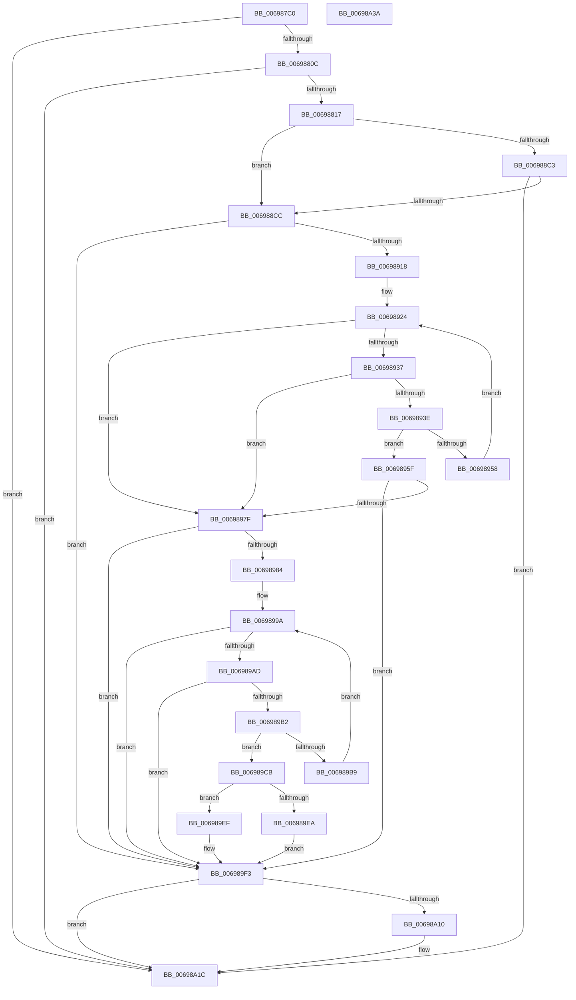

# MiComputeIdealLargePage

- RVA: `0x006987C0`–`0x00698A3B` (길이 `635` bytes)
- VA: `0x00000001406987C0`
- 실행 섹션: `.text`
- PDB 이름 있음: `예`; PDB Function 태그: `아니요`
- unwind 정보 RVA: `0x0007BBB4`
- 디코드: `165`개 명령, `635/635` bytes 표시
- 미해석 바이트: `0` (있으면 어셈블리에 `.byte`로 보존)

> 이 문서는 커널 이미지의 기계어와 PDB 기호를 분석해 생성했습니다. 4번과 5번은 함수 원형과 자료형을 바이너리 사용 방식에서 추정한 C 해석이며 원본 소스 복구 결과는 아닙니다.

## 1. Dependencies

- 직접 호출 지점: **7**; 고유 호출 대상: **5**
- 직접 호출자로 확인된 함수: **1**
- RIP 상대 이미지 참조: **1**

### Outgoing calls
- `0x00698840` → [MiGetVadPte](MiGetVadPte_function_00699388.md) (function, `0x00699388`)
- `0x00698887` → [MiGetVadPte](MiGetVadPte_function_00699388.md) (function, `0x00699388`)
- `0x006988B2` → [MiGetVadPte](MiGetVadPte_function_00699388.md) (function, `0x00699388`)
- `0x006988CF` → [MiLockWorkingSetShared](../27/MiLockWorkingSetShared_function_0027CBF0.md) (function, `0x0027CBF0`)
- `0x006988E6` → [MiLockLowestValidPageTableEx](../28/MiLockLowestValidPageTableEx_function_00280D10.md) (function, `0x00280D10`)
- `0x006989F9` → [MiUnlockPageTable](../21/MiUnlockPageTable_function_00216EC0.md) (function, `0x00216EC0`)
- `0x00698A05` → [MiUnlockWorkingSetShared](../27/MiUnlockWorkingSetShared_function_0027D690.md) (function, `0x0027D690`)

### Direct callers
- [MiCreateLargePfnList](../3D/MiCreateLargePfnList_function_003D2DA8.md) at `0x003D311C`

### Static image references
- `0x006987E6` → RVA `0x00000000` (`image boundary/outside`; read)

## 2. Other-region calls and transfers

- 다른 실행 섹션으로 향하는 call: **0**
- 별도 외부 분기/꼬리 이동을 확인하지 못했습니다.

## 3. Assembly (complete function range)

```asm
006987C0  48 89 5C 24 10                  mov qword ptr [rsp + 0x10], rbx
006987C5  48 89 6C 24 18                  mov qword ptr [rsp + 0x18], rbp
006987CA  48 89 74 24 20                  mov qword ptr [rsp + 0x20], rsi
006987CF  57                              push rdi
006987D0  41 54                           push r12
006987D2  41 55                           push r13
006987D4  41 56                           push r14
006987D6  41 57                           push r15
006987D8  48 83 EC 40                     sub rsp, 0x40
006987DC  44 8B 51 30                     mov r10d, dword ptr [rcx + 0x30]
006987E0  4C 8B D9                        mov r11, rcx
006987E3  41 8B C2                        mov eax, r10d
006987E6  48 8D 0D 13 78 96 FF            lea rcx, [rip - 0x6987ed]
006987ED  48 C1 E8 13                     shr rax, 0x13
006987F1  4D 8B F9                        mov r15, r9
006987F4  83 E0 03                        and eax, 3
006987F7  49 8B F0                        mov rsi, r8
006987FA  4C 8B B4 C1 78 45 01 00         mov r14, qword ptr [rcx + rax*8 + 0x14578]
00698802  49 83 FE 10                     cmp r14, 0x10
00698806  0F 82 10 02 00 00               jb 0x140698a1c
0069880C  41 0F BA E2 17                  bt r10d, 0x17
00698811  0F 83 05 02 00 00               jae 0x140698a1c
00698817  8B 84 81 10 3F 01 00            mov eax, dword ptr [rcx + rax*4 + 0x13f10]
0069881E  48 83 CB FF                     or rbx, 0xffffffffffffffff
00698822  89 44 24 20                     mov dword ptr [rsp + 0x20], eax
00698826  49 8B CB                        mov rcx, r11
00698829  65 48 8B 04 25 88 01 00 00      mov rax, qword ptr gs:[0x188]
00698832  48 8B A8 B8 00 00 00            mov rbp, qword ptr [rax + 0xb8]
00698839  48 81 C5 00 04 00 00            add rbp, 0x400
00698840  E8 43 0B 00 00                  call 0x140699388
00698845  41 0F B6 53 20                  movzx edx, byte ptr [r11 + 0x20]
0069884A  48 8B F8                        mov rdi, rax
0069884D  8D 43 02                        lea eax, [rbx + 2]
00698850  49 83 FE 10                     cmp r14, 0x10
00698854  4D 8B EE                        mov r13, r14
00698857  48 8B CF                        mov rcx, rdi
0069885A  4C 0F 44 E8                     cmove r13, rax
0069885E  41 BC 00 02 00 00               mov r12d, 0x200
00698864  41 8B 43 18                     mov eax, dword ptr [r11 + 0x18]
00698868  48 C1 E9 03                     shr rcx, 3
0069886C  48 C1 E2 20                     shl rdx, 0x20
00698870  81 E1 FF 01 00 00               and ecx, 0x1ff
00698876  4C 2B E1                        sub r12, rcx
00698879  48 0B D0                        or rdx, rax
0069887C  49 8B CB                        mov rcx, r11
0069887F  48 C1 E2 0C                     shl rdx, 0xc
00698883  4D 0F AF E5                     imul r12, r13
00698887  E8 FC 0A 00 00                  call 0x140699388
0069888C  41 8B 4B 1C                     mov ecx, dword ptr [r11 + 0x1c]
00698890  41 0F B6 53 21                  movzx edx, byte ptr [r11 + 0x21]
00698895  48 C1 E2 20                     shl rdx, 0x20
00698899  48 0B D1                        or rdx, rcx
0069889C  48 89 44 24 30                  mov qword ptr [rsp + 0x30], rax
006988A1  48 C1 E2 0C                     shl rdx, 0xc
006988A5  49 8B CB                        mov rcx, r11
006988A8  48 81 CA FF 0F 00 00            or rdx, 0xfff
006988AF  48 FF C2                        inc rdx
006988B2  E8 D1 0A 00 00                  call 0x140699388
006988B7  48 89 44 24 38                  mov qword ptr [rsp + 0x38], rax
006988BC  48 3B 7C 24 30                  cmp rdi, qword ptr [rsp + 0x30]
006988C1  75 09                           jne 0x1406988cc
006988C3  49 3B F4                        cmp rsi, r12
006988C6  0F 83 50 01 00 00               jae 0x140698a1c
006988CC  48 8B CD                        mov rcx, rbp
006988CF  E8 1C 43 BE FF                  call 0x14027cbf0
006988D4  45 33 C9                        xor r9d, r9d
006988D7  88 44 24 70                     mov byte ptr [rsp + 0x70], al
006988DB  4C 8D 44 24 28                  lea r8, [rsp + 0x28]
006988E0  48 8B D7                        mov rdx, rdi
006988E3  48 8B CD                        mov rcx, rbp
006988E6  E8 25 84 BE FF                  call 0x140280d10
006988EB  48 8B CF                        mov rcx, rdi
006988EE  4C 8B C0                        mov r8, rax
006988F1  48 C1 E9 09                     shr rcx, 9
006988F5  48 B8 F8 FF FF FF 7F 00 00 00   movabs rax, 0x7ffffffff8
006988FF  48 23 C8                        and rcx, rax
00698902  48 B8 00 00 00 00 80 F6 FF FF   movabs rax, 0xfffff68000000000
0069890C  48 03 C8                        add rcx, rax
0069890F  4C 3B C1                        cmp r8, rcx
00698912  0F 85 DB 00 00 00               jne 0x1406989f3
00698918  BA 08 00 00 00                  mov edx, 8
0069891D  48 8B CF                        mov rcx, rdi
00698920  44 8D 5A 78                     lea r11d, [rdx + 0x78]
00698924  49 BA FF FF FF FF FF 00 00 00   movabs r10, 0xffffffffff
0069892E  48 F7 C1 FF 0F 00 00            test rcx, 0xfff
00698935  74 48                           je 0x14069897f
00698937  48 3B 4C 24 30                  cmp rcx, qword ptr [rsp + 0x30]
0069893C  74 41                           je 0x14069897f
0069893E  49 83 FE 10                     cmp r14, 0x10
00698942  49 8B C3                        mov rax, r11
00698945  48 0F 45 C2                     cmovne rax, rdx
00698949  48 2B C8                        sub rcx, rax
0069894C  48 89 4C 24 28                  mov qword ptr [rsp + 0x28], rcx
00698951  48 8B 01                        mov rax, qword ptr [rcx]
00698954  A8 01                           test al, 1
00698956  75 07                           jne 0x14069895f
00698958  48 8B 4C 24 28                  mov rcx, qword ptr [rsp + 0x28]
0069895D  EB C5                           jmp 0x140698924
0069895F  48 C1 E8 0C                     shr rax, 0xc
00698963  48 8B DF                        mov rbx, rdi
00698966  48 2B 5C 24 28                  sub rbx, qword ptr [rsp + 0x28]
0069896B  49 23 C2                        and rax, r10
0069896E  48 C1 FB 03                     sar rbx, 3
00698972  49 0F AF DD                     imul rbx, r13
00698976  48 03 D8                        add rbx, rax
00698979  48 83 FB FF                     cmp rbx, -1
0069897D  75 74                           jne 0x1406989f3
0069897F  49 3B F4                        cmp rsi, r12
00698982  73 6F                           jae 0x1406989f3
00698984  4C 8B 4C 24 38                  mov r9, qword ptr [rsp + 0x38]
00698989  48 8B C6                        mov rax, rsi
0069898C  33 D2                           xor edx, edx
0069898E  BE 08 00 00 00                  mov esi, 8
00698993  49 F7 F5                        div r13
00698996  48 8D 0C C7                     lea rcx, [rdi + rax*8]
0069899A  48 8B C1                        mov rax, rcx
0069899D  48 89 4C 24 28                  mov qword ptr [rsp + 0x28], rcx
006989A2  48 8B D1                        mov rdx, rcx
006989A5  48 A9 FF 0F 00 00               test rax, 0xfff
006989AB  74 46                           je 0x1406989f3
006989AD  49 3B C9                        cmp rcx, r9
006989B0  73 41                           jae 0x1406989f3
006989B2  48 8B 01                        mov rax, qword ptr [rcx]
006989B5  A8 01                           test al, 1
006989B7  75 12                           jne 0x1406989cb
006989B9  49 83 FE 10                     cmp r14, 0x10
006989BD  49 8B CB                        mov rcx, r11
006989C0  48 0F 45 CE                     cmovne rcx, rsi
006989C4  48 03 4C 24 28                  add rcx, qword ptr [rsp + 0x28]
006989C9  EB CF                           jmp 0x14069899a
006989CB  48 8B D8                        mov rbx, rax
006989CE  48 8B 44 24 28                  mov rax, qword ptr [rsp + 0x28]
006989D3  48 2B C7                        sub rax, rdi
006989D6  48 C1 EB 0C                     shr rbx, 0xc
006989DA  48 C1 F8 03                     sar rax, 3
006989DE  49 23 DA                        and rbx, r10
006989E1  49 0F AF C5                     imul rax, r13
006989E5  48 3B D8                        cmp rbx, rax
006989E8  72 05                           jb 0x1406989ef
006989EA  48 2B D8                        sub rbx, rax
006989ED  EB 04                           jmp 0x1406989f3
006989EF  48 83 CB FF                     or rbx, 0xffffffffffffffff
006989F3  49 8B D0                        mov rdx, r8
006989F6  48 8B CD                        mov rcx, rbp
006989F9  E8 C2 E4 B7 FF                  call 0x140216ec0
006989FE  8A 54 24 70                     mov dl, byte ptr [rsp + 0x70]
00698A02  48 8B CD                        mov rcx, rbp
00698A05  E8 86 4C BE FF                  call 0x14027d690
00698A0A  48 83 FB FF                     cmp rbx, -1
00698A0E  74 0C                           je 0x140698a1c
00698A10  8B 44 24 20                     mov eax, dword ptr [rsp + 0x20]
00698A14  41 89 47 30                     mov dword ptr [r15 + 0x30], eax
00698A18  49 89 5F 28                     mov qword ptr [r15 + 0x28], rbx
00698A1C  4C 8D 5C 24 40                  lea r11, [rsp + 0x40]
00698A21  49 8B 5B 38                     mov rbx, qword ptr [r11 + 0x38]
00698A25  49 8B 6B 40                     mov rbp, qword ptr [r11 + 0x40]
00698A29  49 8B 73 48                     mov rsi, qword ptr [r11 + 0x48]
00698A2D  49 8B E3                        mov rsp, r11
00698A30  41 5F                           pop r15
00698A32  41 5E                           pop r14
00698A34  41 5D                           pop r13
00698A36  41 5C                           pop r12
00698A38  5F                              pop rdi
00698A39  C3                              ret
00698A3A  CC                              int3
```

## 4. C-style interpretation (structured pseudocode)

```c
__int64 __fastcall MiComputeIdealLargePage(__int64 a1, __int64 a2, __int64 a3, __int64 a4)
{
    __int64 result;
    __int64 v_r12;
    __int64 v_r13;
    __int64 v_rbp;
    __int64 v_rbx;
    __int64 v_rsp;
    unsigned __int64 v_stack_m28;
    unsigned __int64 v_stack_m30;
    unsigned __int64 v_stack_m38;
    unsigned __int64 v_stack_m40;
    unsigned int v_stack_m48;
    unsigned __int64 v_stack_p10;
    unsigned __int64 v_stack_p18;
    unsigned __int64 v_stack_p20;
    unsigned __int8 v_stack_p8;

    v_stack_p10 = v_rbx;
    v_stack_p18 = v_rbp;
    v_stack_p20 = v_rsi;
    v_rsp = (v_rsp) - (64);
    result = ((unsigned int)((unsigned int)((unsigned int)(*(unsigned int *)(a1 + 48))))) >> (19);
    result = (unsigned int)((result) & (3));
    if ((*(unsigned __int64 *)(v_rip - 6916077 + result * 8 + 83320)) < 16) goto loc_00698A1C;
    if ((*(unsigned __int64 *)(v_rip - 6916077 + result * 8 + 83320)) >= 16) goto loc_00698A1C;
    v_rbx = (v_rbx) | (-1);
    v_stack_m48 = (unsigned int)((unsigned int)(*(unsigned int *)(v_rip - 6916077 + result * 4 + 81680)));
    v_rbp = (*(unsigned __int64 *)(*(unsigned __int64 *)(gs_base + (0 + 392)) + 184)) + (0x400ULL);
    result = MiGetVadPte(a1, a2, a3, a4);
    v_r13 = *(unsigned __int64 *)(v_rip - 6916077 + result * 8 + 83320);
    if ((*(unsigned __int64 *)(v_rip - 6916077 + result * 8 + 83320)) == 16) { v_r13 = v_rbx + 2; }
    a1 = (result) >> (3);
    a2 = (*(unsigned __int8 *)(a1 + 32)) << (32);
    a1 = (unsigned int)((a1) & (511));
    v_r12 = (512) - (a1);
    a2 = (a2) | ((unsigned int)(*(unsigned int *)(a1 + 24)));
    a2 = (a2) << (12);
    v_r12 = (v_r12) * (v_r13);
    result = MiGetVadPte(a1, a2, a3, a4);
    a2 = (*(unsigned __int8 *)(a1 + 33)) << (32);
    a2 = (a2) | ((unsigned int)(*(unsigned int *)(a1 + 28)));
    v_stack_m38 = result;
    a2 = (a2) << (12);
    a2 = (a2) | (0xFFFULL);
    a2 = (a2) + 1;
    result = MiGetVadPte(a1, a2, a3, a4);
    v_stack_m30 = result;
    if (result != v_stack_m38) goto loc_006988CC;
    if (a3 >= v_r12) goto loc_00698A1C;
loc_006988CC:
    result = MiLockWorkingSetShared(v_rbp, a2, a3, a4);
    a4 = 0;
    v_stack_p8 = (unsigned __int8)(result);
    result = MiLockLowestValidPageTableEx(v_rbp, result, v_stack_m40, a4);
    a1 = (result) >> (9);
    a1 = (a1) & (result);
    a1 = (a1) + (result);
    if (result != a1) goto loc_006989F3;
loc_00698924:
    if (((result) & (0xFFFULL)) == 0) goto loc_0069897F;
    if (result == v_stack_m38) goto loc_0069897F;
    result = 8 + 120;
    if ((*(unsigned __int64 *)(v_rip - 6916077 + result * 8 + 83320)) != 16) { result = 8; }
    a1 = (result) - (result);
    v_stack_m40 = a1;
    if ((((unsigned __int8)(*(unsigned __int64 *)(a1))) & (1)) != 0) goto loc_0069895F;
    goto loc_00698924;
loc_0069895F:
    result = (*(unsigned __int64 *)(a1)) >> (12);
    v_rbx = (result) - (v_stack_m40);
    result = (result) & ((unsigned int)(*(unsigned int *)(a1 + 48)));
    v_rbx = (v_rbx) >> (3);
    v_rbx = (v_rbx) * (v_r13);
    v_rbx = (v_rbx) + (result);
    if (v_rbx != -1) goto loc_006989F3;
loc_0069897F:
    if (a3 >= v_r12) goto loc_006989F3;
    a2 = 0;
loc_0069899A:
    v_stack_m40 = result + a3 * 8;
    if (((result + a3 * 8) & (0xFFFULL)) == 0) goto loc_006989F3;
    if ((result + a3 * 8) >= v_stack_m30) goto loc_006989F3;
    if ((((unsigned __int8)(*(unsigned __int64 *)(result + a3 * 8))) & (1)) != 0) goto loc_006989CB;
    a1 = 8 + 120;
    if ((*(unsigned __int64 *)(v_rip - 6916077 + result * 8 + 83320)) != 16) { a1 = 8; }
    a1 = (a1) + (v_stack_m40);
    goto loc_0069899A;
loc_006989CB:
    result = (v_stack_m40) - (result);
    v_rbx = (*(unsigned __int64 *)(result + a3 * 8)) >> (12);
    result = (result) >> (3);
    v_rbx = (v_rbx) & ((unsigned int)(*(unsigned int *)(a1 + 48)));
    result = (result) * (v_r13);
    if (v_rbx < result) goto loc_006989EF;
    v_rbx = (v_rbx) - (result);
    goto loc_006989F3;
loc_006989EF:
    v_rbx = (v_rbx) | (-1);
loc_006989F3:
    result = MiUnlockPageTable(v_rbp, result, result, v_stack_m30);
    result = MiUnlockWorkingSetShared(v_rbp, v_stack_p8, result, v_stack_m30);
    if (v_rbx != -1) {
        result = v_stack_m48;
        *(unsigned int *)(a4 + 48) = (unsigned int)(result);
        *(unsigned __int64 *)(a4 + 40) = v_rbx;
    }
    return result;
}
```

## 5. (Beta) C Style

```c
int64_t MiComputeIdealLargePage(void *Arg1, int64_t Arg2, int64_t Arg3, void *Arg4)
{
    uint8_t *arg1 = (uint8_t *)Arg1;
    uint8_t *arg4 = (uint8_t *)Arg4;

    int64_t result;
    int64_t local_r12;
    int64_t local_r13;
    int64_t local_rbp;
    int64_t local_rbx;
    int64_t local_rsp;
    uint64_t v_stack_m28;
    uint64_t v_stack_m30;
    uint64_t v_stack_m38;
    uint64_t v_stack_m40;
    uint32_t v_stack_m48;
    uint64_t v_stack_p10;
    uint64_t v_stack_p18;
    uint64_t v_stack_p20;
    uint8_t v_stack_p8;

    v_stack_p10 = local_rbx;
    v_stack_p18 = local_rbp;
    v_stack_p20 = local_rsi;
    local_rsp = (local_rsp) - (64);
    result = ((uint32_t)((uint32_t)((uint32_t)(*(uint32_t *)(arg1 + 0x30))))) >> (19);
    result = (uint32_t)((result) & (3));
    if ((*(uint64_t *)(v_rip - 0x6987ED + result * 8 + 0x14578)) < 16) goto loc_00698A1C;
    if ((*(uint64_t *)(v_rip - 0x6987ED + result * 8 + 0x14578)) >= 16) goto loc_00698A1C;
    local_rbx = (local_rbx) | (-1);
    v_stack_m48 = (uint32_t)((uint32_t)(*(uint32_t *)(v_rip - 0x6987ED + result * 4 + 0x13F10)));
    local_rbp = (*(uint64_t *)(*(uint64_t *)(gs_base + (0 + 0x188)) + 0xB8)) + (0x400ULL);
    result = MiGetVadPte(Arg1, Arg2, Arg3, Arg4);
    local_r13 = *(uint64_t *)(v_rip - 0x6987ED + result * 8 + 0x14578);
    if ((*(uint64_t *)(v_rip - 0x6987ED + result * 8 + 0x14578)) == 16) { local_r13 = local_rbx + 2; }
    Arg1 = (result) >> (3);
    Arg2 = (*(uint8_t *)(arg1 + 0x20)) << (32);
    Arg1 = (uint32_t)((Arg1) & (511));
    local_r12 = (512) - (Arg1);
    Arg2 = (Arg2) | ((uint32_t)(*(uint32_t *)(arg1 + 0x18)));
    Arg2 = (Arg2) << (12);
    local_r12 = (local_r12) * (local_r13);
    result = MiGetVadPte(Arg1, Arg2, Arg3, Arg4);
    Arg2 = (*(uint8_t *)(arg1 + 0x21)) << (32);
    Arg2 = (Arg2) | ((uint32_t)(*(uint32_t *)(arg1 + 0x1C)));
    v_stack_m38 = result;
    Arg2 = (Arg2) << (12);
    Arg2 = (Arg2) | (0xFFFULL);
    Arg2 = (Arg2) + 1;
    result = MiGetVadPte(Arg1, Arg2, Arg3, Arg4);
    v_stack_m30 = result;
    if (result != v_stack_m38) goto loc_006988CC;
    if (Arg3 >= local_r12) goto loc_00698A1C;
loc_006988CC:
    result = MiLockWorkingSetShared(local_rbp, Arg2, Arg3, Arg4);
    Arg4 = 0;
    v_stack_p8 = (uint8_t)(result);
    result = MiLockLowestValidPageTableEx(local_rbp, result, v_stack_m40, Arg4);
    Arg1 = (result) >> (9);
    Arg1 = (Arg1) & (result);
    Arg1 = (Arg1) + (result);
    if (result != Arg1) goto loc_006989F3;
loc_00698924:
    if (((result) & (0xFFFULL)) == 0) goto loc_0069897F;
    if (result == v_stack_m38) goto loc_0069897F;
    result = 8 + 120;
    if ((*(uint64_t *)(v_rip - 0x6987ED + result * 8 + 0x14578)) != 16) { result = 8; }
    Arg1 = (result) - (result);
    v_stack_m40 = Arg1;
    if ((((uint8_t)(*(uint64_t *)(arg1))) & (1)) != 0) goto loc_0069895F;
    goto loc_00698924;
loc_0069895F:
    result = (*(uint64_t *)(arg1)) >> (12);
    local_rbx = (result) - (v_stack_m40);
    result = (result) & ((uint32_t)(*(uint32_t *)(arg1 + 0x30)));
    local_rbx = (local_rbx) >> (3);
    local_rbx = (local_rbx) * (local_r13);
    local_rbx = (local_rbx) + (result);
    if (local_rbx != -1) goto loc_006989F3;
loc_0069897F:
    if (Arg3 >= local_r12) goto loc_006989F3;
    Arg2 = 0;
loc_0069899A:
    v_stack_m40 = result + Arg3 * 8;
    if (((result + Arg3 * 8) & (0xFFFULL)) == 0) goto loc_006989F3;
    if ((result + Arg3 * 8) >= v_stack_m30) goto loc_006989F3;
    if ((((uint8_t)(*(uint64_t *)(result + Arg3 * 8))) & (1)) != 0) goto loc_006989CB;
    Arg1 = 8 + 120;
    if ((*(uint64_t *)(v_rip - 0x6987ED + result * 8 + 0x14578)) != 16) { Arg1 = 8; }
    Arg1 = (Arg1) + (v_stack_m40);
    goto loc_0069899A;
loc_006989CB:
    result = (v_stack_m40) - (result);
    local_rbx = (*(uint64_t *)(result + Arg3 * 8)) >> (12);
    result = (result) >> (3);
    local_rbx = (local_rbx) & ((uint32_t)(*(uint32_t *)(arg1 + 0x30)));
    result = (result) * (local_r13);
    if (local_rbx < result) goto loc_006989EF;
    local_rbx = (local_rbx) - (result);
    goto loc_006989F3;
loc_006989EF:
    local_rbx = (local_rbx) | (-1);
loc_006989F3:
    result = MiUnlockPageTable(local_rbp, result, result, v_stack_m30);
    result = MiUnlockWorkingSetShared(local_rbp, v_stack_p8, result, v_stack_m30);
    if (local_rbx != -1) {
        result = v_stack_m48;
        *(uint32_t *)(arg4 + 0x30) = (uint32_t)(result);
        *(uint64_t *)(arg4 + 0x28) = local_rbx;
    }
    return result;
}
```

### 관측된 메모리 오프셋

구조체 형식이 확인되지 않은 접근은 인자 기준의 오프셋으로만 기록했습니다.

| 기준 인자 | 오프셋 표현 | 폭 (bit) | 접근 |
|---|---:|---:|---|
| `Arg1` | `+ 0x30` | `32` | `R` |
| `Arg4` | `+ 0x28` | `64` | `W` |
| `Arg4` | `+ 0x30` | `32` | `W` |

## 6. Execution-region graph

[열기: 2D/3D 그래프와 함수 탐색 컨트롤 패널](../../../control-panel.html?section=text&rva=0x006987C0&view=graph)

- 2D 그래프는 위에서 아래로 흐르고, 3D 그래프는 빈 공간을 드래그해 회전합니다. Shift+드래그는 이동, 휠은 확대·축소, 함수 노드 선택은 대상 보고서 이동입니다.

### Static fallback


