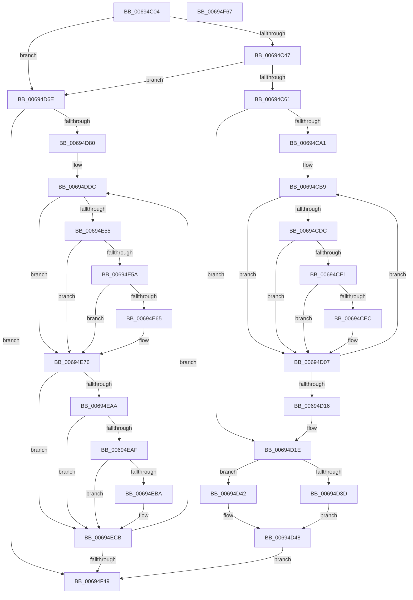

# MiCopyMemoryPagefileData

- RVA: `0x00694C04`–`0x00694F68` (길이 `868` bytes)
- VA: `0x0000000140694C04`
- 실행 섹션: `.text`
- PDB 이름 있음: `예`; PDB Function 태그: `아니요`
- unwind 정보 RVA: `0x000BA55C`
- 디코드: `217`개 명령, `868/868` bytes 표시
- 미해석 바이트: `0` (있으면 어셈블리에 `.byte`로 보존)

> 이 문서는 커널 이미지의 기계어와 PDB 기호를 분석해 생성했습니다. 4번과 5번은 함수 원형과 자료형을 바이너리 사용 방식에서 추정한 C 해석이며 원본 소스 복구 결과는 아닙니다.

## 1. Dependencies

- 직접 호출 지점: **14**; 고유 호출 대상: **9**
- 직접 호출자로 확인된 함수: **1**
- RIP 상대 이미지 참조: **3**

### Outgoing calls
- `0x00694C50` → [MiReservePtes](../31/MiReservePtes_function_00318D20.md) (function, `0x00318D20`)
- `0x00694C83` → [MiMakeValidPte](../2C/MiMakeValidPte_function_002C5590.md) (function, `0x002C5590`)
- `0x00694CF8` → [MiCheckLinearProtectedPteAccessedBit](../29/MiCheckLinearProtectedPteAccessedBit_function_00292D80.md) (function, `0x00292D80`)
- `0x00694D52` → [memcpy](../6C/memcpy_function_006C6840.md) (function, `0x006C6840`)
- `0x00694D64` → [MiReleasePtes](../24/MiReleasePtes_function_00247240.md) (function, `0x00247240`)
- `0x00694DE8` → [MiGetPteMappingSet](../32/MiGetPteMappingSet_function_00322EB0.md) (function, `0x00322EB0`)
- `0x00694E2F` → [MiMakeProtectionPfnCompatible](../22/MiMakeProtectionPfnCompatible_function_00229CD0.md) (function, `0x00229CD0`)
- `0x00694E42` → [MiMakeValidPte](../2C/MiMakeValidPte_function_002C5590.md) (function, `0x002C5590`)
- `0x00694E71` → [MiCheckLinearProtectedPteAccessedBit](../29/MiCheckLinearProtectedPteAccessedBit_function_00292D80.md) (function, `0x00292D80`)
- `0x00694E84` → [MiMakeProtectionPfnCompatible](../22/MiMakeProtectionPfnCompatible_function_00229CD0.md) (function, `0x00229CD0`)
- `0x00694E97` → [MiMakeValidPte](../2C/MiMakeValidPte_function_002C5590.md) (function, `0x002C5590`)
- `0x00694EC6` → [MiCheckLinearProtectedPteAccessedBit](../29/MiCheckLinearProtectedPteAccessedBit_function_00292D80.md) (function, `0x00292D80`)
- `0x00694F08` → [KeCopyPage](../6B/KeCopyPage_function_006BA0F0.md) (function, `0x006BA0F0`)
- `0x00694F2A` → [MiReturnPteMappingSet](../2B/MiReturnPteMappingSet_function_002B2600.md) (function, `0x002B2600`)

### Direct callers
- [MiTransferMemoryPagefileData](../4D/MiTransferMemoryPagefileData_function_004DB6FC.md) at `0x004DB7A5`

### Static image references
- `0x00694C49` → RVA `0x00E37668` (`.data`; read)
- `0x00694CD3` → RVA `0x00FC6A88` (`ALMOSTRO`; read)
- `0x00694F12` → RVA `0x00010880` (`.rdata`; read)

## 2. Other-region calls and transfers

- 다른 실행 섹션으로 향하는 call: **0**
- 별도 외부 분기/꼬리 이동을 확인하지 못했습니다.

## 3. Assembly (complete function range)

```asm
00694C04  4C 8B DC                        mov r11, rsp
00694C07  49 89 5B 08                     mov qword ptr [r11 + 8], rbx
00694C0B  49 89 6B 18                     mov qword ptr [r11 + 0x18], rbp
00694C0F  49 89 73 20                     mov qword ptr [r11 + 0x20], rsi
00694C13  49 89 53 10                     mov qword ptr [r11 + 0x10], rdx
00694C17  57                              push rdi
00694C18  41 54                           push r12
00694C1A  41 55                           push r13
00694C1C  41 56                           push r14
00694C1E  41 57                           push r15
00694C20  48 83 EC 60                     sub rsp, 0x60
00694C24  33 C0                           xor eax, eax
00694C26  0F 57 C0                        xorps xmm0, xmm0
00694C29  49 8B E9                        mov rbp, r9
00694C2C  4D 8B F8                        mov r15, r8
00694C2F  4C 8B F2                        mov r14, rdx
00694C32  48 8B F1                        mov rsi, rcx
00694C35  0F 11 44 24 48                  movups xmmword ptr [rsp + 0x48], xmm0
00694C3A  49 89 43 D0                     mov qword ptr [r11 - 0x30], rax
00694C3E  48 85 D2                        test rdx, rdx
00694C41  0F 84 27 01 00 00               je 0x140694d6e
00694C47  8B D5                           mov edx, ebp
00694C49  48 8D 0D 18 2A 7A 00            lea rcx, [rip + 0x7a2a18]
00694C50  E8 CB 40 C8 FF                  call 0x140318d20
00694C55  48 8B F8                        mov rdi, rax
00694C58  48 85 C0                        test rax, rax
00694C5B  0F 84 0D 01 00 00               je 0x140694d6e
00694C61  8B 8C 24 B0 00 00 00            mov ecx, dword ptr [rsp + 0xb0]
00694C68  F7 D9                           neg ecx
00694C6A  48 8B C8                        mov rcx, rax
00694C6D  45 1B C0                        sbb r8d, r8d
00694C70  48 83 CA FF                     or rdx, 0xffffffffffffffff
00694C74  41 83 E0 FD                     and r8d, 0xfffffffd
00694C78  41 83 C0 04                     add r8d, 4
00694C7C  41 81 C8 00 00 00 A0            or r8d, 0xa0000000
00694C83  E8 08 09 C3 FF                  call 0x1402c5590
00694C88  48 8B D8                        mov rbx, rax
00694C8B  49 BC 00 00 00 00 80 F6 FF FF   movabs r12, 0xfffff68000000000
00694C95  48 8D 04 EF                     lea rax, [rdi + rbp*8]
00694C99  48 8B F7                        mov rsi, rdi
00694C9C  48 3B F8                        cmp rdi, rax
00694C9F  73 7D                           jae 0x140694d1e
00694CA1  48 BA 00 00 00 00 10 00 00 00   movabs rdx, 0x1000000000
00694CAB  4C 8D 34 EF                     lea r14, [rdi + rbp*8]
00694CAF  49 BD 00 00 00 00 40 00 00 00   movabs r13, 0x4000000000
00694CB9  49 8B CF                        mov rcx, r15
00694CBC  49 B8 FF 0F 00 00 00 00 F0 FF   movabs r8, 0xfff0000000000fff
00694CC6  48 C1 E1 0C                     shl rcx, 0xc
00694CCA  48 33 D9                        xor rbx, rcx
00694CCD  49 23 D8                        and rbx, r8
00694CD0  48 33 D9                        xor rbx, rcx
00694CD3  48 85 15 AE 1D 93 00            test qword ptr [rip + 0x931dae], rdx
00694CDA  74 2B                           je 0x140694d07
00694CDC  F6 C3 20                        test bl, 0x20
00694CDF  75 26                           jne 0x140694d07
00694CE1  49 8B C4                        mov rax, r12
00694CE4  49 03 C5                        add rax, r13
00694CE7  48 3B F0                        cmp rsi, rax
00694CEA  72 1B                           jb 0x140694d07
00694CEC  41 B8 80 00 00 00               mov r8d, 0x80
00694CF2  48 8B D3                        mov rdx, rbx
00694CF5  48 8B CE                        mov rcx, rsi
00694CF8  E8 83 E0 BF FF                  call 0x140292d80
00694CFD  48 BA 00 00 00 00 10 00 00 00   movabs rdx, 0x1000000000
00694D07  48 89 1E                        mov qword ptr [rsi], rbx
00694D0A  49 FF C7                        inc r15
00694D0D  48 83 C6 08                     add rsi, 8
00694D11  49 3B F6                        cmp rsi, r14
00694D14  72 A3                           jb 0x140694cb9
00694D16  4C 8B B4 24 98 00 00 00         mov r14, qword ptr [rsp + 0x98]
00694D1E  48 8B CF                        mov rcx, rdi
00694D21  48 C1 E1 19                     shl rcx, 0x19
00694D25  49 8B C4                        mov rax, r12
00694D28  48 C1 E0 19                     shl rax, 0x19
00694D2C  48 2B C8                        sub rcx, rax
00694D2F  48 C1 F9 10                     sar rcx, 0x10
00694D33  83 BC 24 B0 00 00 00 00         cmp dword ptr [rsp + 0xb0], 0
00694D3B  74 05                           je 0x140694d42
00694D3D  48 8B D1                        mov rdx, rcx
00694D40  EB 06                           jmp 0x140694d48
00694D42  49 8B D6                        mov rdx, r14
00694D45  4C 8B F1                        mov r14, rcx
00694D48  4C 8B C5                        mov r8, rbp
00694D4B  49 8B CE                        mov rcx, r14
00694D4E  49 C1 E0 0C                     shl r8, 0xc
00694D52  E8 E9 1A 03 00                  call 0x1406c6840
00694D57  44 8B C5                        mov r8d, ebp
00694D5A  48 8D 0D 07 29 7A 00            lea rcx, [rip + 0x7a2907]
00694D61  48 8B D7                        mov rdx, rdi
00694D64  E8 D7 24 BB FF                  call 0x140247240
00694D69  E9 DB 01 00 00                  jmp 0x140694f49
00694D6E  48 8D 04 EE                     lea rax, [rsi + rbp*8]
00694D72  48 89 44 24 30                  mov qword ptr [rsp + 0x30], rax
00694D77  48 3B F0                        cmp rsi, rax
00694D7A  0F 83 C9 01 00 00               jae 0x140694f49
00694D80  8B 84 24 B0 00 00 00            mov eax, dword ptr [rsp + 0xb0]
00694D87  F7 D8                           neg eax
00694D89  49 BC 00 00 00 00 80 F6 FF FF   movabs r12, 0xfffff68000000000
00694D93  8B 84 24 B0 00 00 00            mov eax, dword ptr [rsp + 0xb0]
00694D9A  1B DB                           sbb ebx, ebx
00694D9C  83 E3 03                        and ebx, 3
00694D9F  FF C3                           inc ebx
00694DA1  F7 D8                           neg eax
00694DA3  89 5C 24 20                     mov dword ptr [rsp + 0x20], ebx
00694DA7  45 1B F6                        sbb r14d, r14d
00694DAA  41 83 E6 FD                     and r14d, 0xfffffffd
00694DAE  49 8B C4                        mov rax, r12
00694DB1  48 C1 E0 19                     shl rax, 0x19
00694DB5  4B 8D 2C 7F                     lea rbp, [r15 + r15*2]
00694DB9  48 89 44 24 28                  mov qword ptr [rsp + 0x28], rax
00694DBE  48 B8 00 00 00 00 00 DE FF FF   movabs rax, 0xffffde0000000000
00694DC8  48 C1 E5 04                     shl rbp, 4
00694DCC  48 8B C0                        mov rax, rax
00694DCF  48 03 E8                        add rbp, rax
00694DD2  49 BD 00 00 00 00 40 00 00 00   movabs r13, 0x4000000000
00694DDC  4C 8D 44 24 48                  lea r8, [rsp + 0x48]
00694DE1  BA 02 00 00 00                  mov edx, 2
00694DE6  33 C9                           xor ecx, ecx
00694DE8  E8 C3 E0 C8 FF                  call 0x140322eb0
00694DED  4C 8B 0E                        mov r9, qword ptr [rsi]
00694DF0  48 8B 7C 24 58                  mov rdi, qword ptr [rsp + 0x58]
00694DF5  48 B8 00 00 00 00 00 DE FF FF   movabs rax, 0xffffde0000000000
00694DFF  4B 8D 14 49                     lea rdx, [r9 + r9*2]
00694E03  48 C1 E2 04                     shl rdx, 4
00694E07  48 8B C0                        mov rax, rax
00694E0A  48 03 D0                        add rdx, rax
00694E0D  B9 01 00 00 00                  mov ecx, 1
00694E12  8B 42 20                        mov eax, dword ptr [rdx + 0x20]
00694E15  C1 E8 10                        shr eax, 0x10
00694E18  24 C0                           and al, 0xc0
00694E1A  3C 40                           cmp al, 0x40
00694E1C  48 C7 C0 FF FF FF FF            mov rax, 0xffffffffffffffff
00694E23  0F 45 C8                        cmovne ecx, eax
00694E26  89 8C 24 98 00 00 00            mov dword ptr [rsp + 0x98], ecx
00694E2D  8B CB                           mov ecx, ebx
00694E2F  E8 9C 4E B9 FF                  call 0x140229cd0
00694E34  0D 00 00 00 A0                  or eax, 0xa0000000
00694E39  49 8B D1                        mov rdx, r9
00694E3C  44 8B C0                        mov r8d, eax
00694E3F  48 8B CF                        mov rcx, rdi
00694E42  E8 49 07 C3 FF                  call 0x1402c5590
00694E47  48 0F BA 25 38 1C 93 00 24      bt qword ptr [rip + 0x931c38], 0x24
00694E50  48 8B D8                        mov rbx, rax
00694E53  73 21                           jae 0x140694e76
00694E55  F6 C3 20                        test bl, 0x20
00694E58  75 1C                           jne 0x140694e76
00694E5A  49 8B C4                        mov rax, r12
00694E5D  49 03 C5                        add rax, r13
00694E60  48 3B F8                        cmp rdi, rax
00694E63  72 11                           jb 0x140694e76
00694E65  41 B8 80 00 00 00               mov r8d, 0x80
00694E6B  48 8B D3                        mov rdx, rbx
00694E6E  48 8B CF                        mov rcx, rdi
00694E71  E8 0A DF BF FF                  call 0x140292d80
00694E76  48 89 1F                        mov qword ptr [rdi], rbx
00694E79  41 8D 4E 04                     lea ecx, [r14 + 4]
00694E7D  48 8B D5                        mov rdx, rbp
00694E80  48 83 C7 08                     add rdi, 8
00694E84  E8 47 4E B9 FF                  call 0x140229cd0
00694E89  0D 00 00 00 A0                  or eax, 0xa0000000
00694E8E  49 8B D7                        mov rdx, r15
00694E91  44 8B C0                        mov r8d, eax
00694E94  48 8B CF                        mov rcx, rdi
00694E97  E8 F4 06 C3 FF                  call 0x1402c5590
00694E9C  48 0F BA 25 E3 1B 93 00 24      bt qword ptr [rip + 0x931be3], 0x24
00694EA5  48 8B D8                        mov rbx, rax
00694EA8  73 21                           jae 0x140694ecb
00694EAA  F6 C3 20                        test bl, 0x20
00694EAD  75 1C                           jne 0x140694ecb
00694EAF  49 8B C4                        mov rax, r12
00694EB2  49 03 C5                        add rax, r13
00694EB5  48 3B F8                        cmp rdi, rax
00694EB8  72 11                           jb 0x140694ecb
00694EBA  41 B8 80 00 00 00               mov r8d, 0x80
00694EC0  48 8B D3                        mov rdx, rbx
00694EC3  48 8B CF                        mov rcx, rdi
00694EC6  E8 B5 DE BF FF                  call 0x140292d80
00694ECB  8B 84 24 B0 00 00 00            mov eax, dword ptr [rsp + 0xb0]
00694ED2  48 8D 4F F8                     lea rcx, [rdi - 8]
00694ED6  44 8B 84 24 98 00 00 00         mov r8d, dword ptr [rsp + 0x98]
00694EDE  48 C1 E1 19                     shl rcx, 0x19
00694EE2  48 2B 4C 24 28                  sub rcx, qword ptr [rsp + 0x28]
00694EE7  48 89 1F                        mov qword ptr [rdi], rbx
00694EEA  48 C1 F9 10                     sar rcx, 0x10
00694EEE  48 C1 E7 19                     shl rdi, 0x19
00694EF2  48 2B 7C 24 28                  sub rdi, qword ptr [rsp + 0x28]
00694EF7  48 C1 FF 10                     sar rdi, 0x10
00694EFB  85 C0                           test eax, eax
00694EFD  48 8B D7                        mov rdx, rdi
00694F00  48 0F 44 D1                     cmove rdx, rcx
00694F04  48 0F 44 CF                     cmove rcx, rdi
00694F08  E8 E3 51 02 00                  call 0x1406ba0f0
00694F0D  48 8B 4C 24 58                  mov rcx, qword ptr [rsp + 0x58]
00694F12  48 8B 05 67 B9 97 FF            mov rax, qword ptr [rip - 0x684699]
00694F19  48 89 01                        mov qword ptr [rcx], rax
00694F1C  48 8B 4C 24 58                  mov rcx, qword ptr [rsp + 0x58]
00694F21  48 89 41 08                     mov qword ptr [rcx + 8], rax
00694F25  48 8D 4C 24 48                  lea rcx, [rsp + 0x48]
00694F2A  E8 D1 D6 C1 FF                  call 0x1402b2600
00694F2F  8B 5C 24 20                     mov ebx, dword ptr [rsp + 0x20]
00694F33  48 83 C6 08                     add rsi, 8
00694F37  49 FF C7                        inc r15
00694F3A  48 83 C5 30                     add rbp, 0x30
00694F3E  48 3B 74 24 30                  cmp rsi, qword ptr [rsp + 0x30]
00694F43  0F 82 93 FE FF FF               jb 0x140694ddc
00694F49  4C 8D 5C 24 60                  lea r11, [rsp + 0x60]
00694F4E  49 8B 5B 30                     mov rbx, qword ptr [r11 + 0x30]
00694F52  49 8B 6B 40                     mov rbp, qword ptr [r11 + 0x40]
00694F56  49 8B 73 48                     mov rsi, qword ptr [r11 + 0x48]
00694F5A  49 8B E3                        mov rsp, r11
00694F5D  41 5F                           pop r15
00694F5F  41 5E                           pop r14
00694F61  41 5D                           pop r13
00694F63  41 5C                           pop r12
00694F65  5F                              pop rdi
00694F66  C3                              ret
00694F67  CC                              int3
```

## 4. C-style interpretation (structured pseudocode)

```c
__int64 __fastcall MiCopyMemoryPagefileData(__int64 a1, __int64 a2, __int64 a3, __int64 a4, unsigned int a5)
{
    __int64 result;
    __int64 v_r14;
    __int64 v_r15;
    __int64 v_rbp;
    __int64 v_rbx;
    __int64 v_rdi;
    __int64 v_rsi;
    __int64 v_rsp;
    unsigned __int64 v_stack_m28;
    unsigned __int64 v_stack_m30;
    unsigned __int64 v_stack_m40;
    unsigned __int64 v_stack_m58;
    unsigned __int64 v_stack_m60;
    unsigned int v_stack_m68;
    unsigned __int64 v_stack_p10;

    *(unsigned __int64 *)(v_rsp + 8) = v_rbx;
    *(unsigned __int64 *)(v_rsp + 24) = v_rbp;
    *(unsigned __int64 *)(v_rsp + 32) = v_rsi;
    *(unsigned __int64 *)(v_rsp + 16) = a2;
    v_rsp = (v_rsp) - (96);
    result = 0;
    v_stack_m40 = v_xmm0;
    *(unsigned __int64 *)(v_rsp - 48) = 0;
    if (a2 == 0) goto loc_00694D6E;
    result = MiReservePtes(v_rip + 8006168, (unsigned int)((unsigned int)(a4)), a3, a4);
    if (result == 0) goto loc_00694D6E;
    a1 = (unsigned int)(-((unsigned int)(a5)));
    a2 = ((unsigned int)((unsigned int)(a4))) | (-1);
    a3 = (unsigned int)((a3) & (0xFFFFFFFDULL));
    a3 = (unsigned int)((a3) + (4));
    a3 = (unsigned int)((a3) | (0xA0000000ULL));
    result = MiMakeValidPte(result, a2, a3, a4);
    if (result >= (result + a4 * 8)) goto loc_00694D1E;
loc_00694CB9:
    a1 = (a3) << (12);
    v_rbx = (result) ^ (a1);
    v_rbx = (v_rbx) & (a3);
    v_rbx = (v_rbx) ^ (a1);
    if (((*(unsigned __int64 *)(v_rip + 9641390)) & (a2)) == 0) goto loc_00694D07;
    if ((((unsigned __int8)(v_rbx)) & (32)) != 0) goto loc_00694D07;
    result = (v_r12) + (v_r13);
    if (result >= result) {
        a3 = 128;
        a2 = v_rbx;
        a1 = result;
        result = MiCheckLinearProtectedPteAccessedBit(a1, a2, a3, a4);
    }
    *(unsigned __int64 *)(result) = v_rbx;
    v_r15 = (a3) + 1;
    v_rsi = (result) + (8);
    if (v_rsi < (result + a4 * 8)) goto loc_00694CB9;
loc_00694D1E:
    a1 = (result) << (25);
    result = (v_r12) << (25);
    a1 = (a1) - (result);
    a1 = (a1) >> (16);
    if (a5 == 0) goto loc_00694D42;
    goto loc_00694D48;
loc_00694D42:
loc_00694D48:
    a3 = (a4) << (12);
    result = memcpy(a1, v_stack_p10, a3, a4);
    result = MiReleasePtes(v_rip + 8005895, result, (unsigned int)((unsigned int)(a4)), a4);
    goto loc_00694F49;
loc_00694D6E:
    v_stack_m58 = v_rsi + a4 * 8;
    if (v_rsi >= (v_rsi + a4 * 8)) goto loc_00694F49;
    result = (unsigned int)(-((unsigned int)(a5)));
    v_rbx = (unsigned int)((v_rbx) & (3));
    v_rbx = (unsigned int)((v_rbx) + 1);
    result = (unsigned int)(-((unsigned int)(a5)));
    v_stack_m68 = (unsigned int)(v_rbx);
    v_r14 = (unsigned int)((a1) & (0xFFFFFFFDULL));
    result = (v_r12) << (25);
    v_stack_m60 = result;
    v_rbp = (v_r15 + v_r15 * 2) << (4);
    v_rbp = (v_rbp) + (result);
loc_00694DDC:
    a1 = 0;
    result = MiGetPteMappingSet(a1, 2, v_stack_m40, a4);
    a2 = (*(unsigned __int64 *)(v_rsi) + *(unsigned __int64 *)(v_rsi) * 2) << (4);
    a2 = (a2) + (result);
    result = (unsigned int)(((unsigned int)(*(unsigned int *)(a2 + 32))) >> (16));
    result = (unsigned __int8)((result) & (192));
    a1 = 1;
    if (((unsigned __int8)(result)) != 64) { a1 = -1; }
    v_stack_p10 = (unsigned int)(a1);
    result = MiMakeProtectionPfnCompatible((unsigned int)((unsigned int)(v_rbx)), a2, v_stack_m40, *(unsigned __int64 *)(v_rsi));
    result = (unsigned int)((result) | (0xA0000000ULL));
    result = MiMakeValidPte(v_stack_m30, *(unsigned __int64 *)(v_rsi), (unsigned int)((unsigned int)(result)), *(unsigned __int64 *)(v_rsi));
    if (condition_is_above_or_equal) goto loc_00694E76;
    if ((((unsigned __int8)(result)) & (32)) != 0) goto loc_00694E76;
    result = (v_r12) + (v_r13);
    if (v_stack_m30 >= result) {
        a3 = 128;
        a2 = result;
        a1 = v_stack_m30;
        result = MiCheckLinearProtectedPteAccessedBit(a1, a2, a3, *(unsigned __int64 *)(v_rsi));
    }
    *(unsigned __int64 *)(v_stack_m30) = result;
    v_rdi = (v_stack_m30) + (8);
    result = MiMakeProtectionPfnCompatible(v_r14 + 4, v_rbp, a3, *(unsigned __int64 *)(v_rsi));
    result = (unsigned int)((result) | (0xA0000000ULL));
    result = MiMakeValidPte(v_rdi, v_r15, (unsigned int)((unsigned int)(result)), *(unsigned __int64 *)(v_rsi));
    if (condition_is_above_or_equal) goto loc_00694ECB;
    if ((((unsigned __int8)(result)) & (32)) != 0) goto loc_00694ECB;
    result = (v_r12) + (v_r13);
    if (v_rdi >= result) {
        a3 = 128;
        a2 = result;
        a1 = v_rdi;
        result = MiCheckLinearProtectedPteAccessedBit(a1, a2, a3, *(unsigned __int64 *)(v_rsi));
    }
    a1 = (v_rdi - 8) << (25);
    a1 = (a1) - (v_stack_m60);
    *(unsigned __int64 *)(v_rdi) = result;
    a1 = (a1) >> (16);
    v_rdi = (v_rdi) << (25);
    v_rdi = (v_rdi) - (v_stack_m60);
    v_rdi = (v_rdi) >> (16);
    a2 = v_rdi;
    if ((unsigned int)((unsigned int)(a5)) == 0) {
        a2 = a1;
        a1 = v_rdi;
    }
    result = KeCopyPage(a1, a2, (unsigned int)(v_stack_p10), *(unsigned __int64 *)(v_rsi));
    *(unsigned __int64 *)(v_stack_m30) = *(unsigned __int64 *)(v_rip - 6833817);
    *(unsigned __int64 *)(v_stack_m30 + 8) = *(unsigned __int64 *)(v_rip - 6833817);
    result = MiReturnPteMappingSet(v_stack_m40, a2, (unsigned int)(v_stack_p10), *(unsigned __int64 *)(v_rsi));
    v_rsi = (v_rsi) + (8);
    v_r15 = (v_r15) + 1;
    v_rbp = (v_rbp) + (48);
    if (v_rsi < v_stack_m58) goto loc_00694DDC;
loc_00694F49:
    return result;
}
```

## 5. (Beta) C Style

```c
int64_t MiCopyMemoryPagefileData(void *Arg1, int64_t Arg2, void *Arg3, int64_t Arg4, uint32_t Arg5)
{
    uint8_t *arg1 = (uint8_t *)Arg1;
    uint8_t *arg3 = (uint8_t *)Arg3;

    int64_t result;
    int64_t local_r14;
    int64_t local_r15;
    int64_t local_rbp;
    int64_t local_rbx;
    int64_t local_rdi;
    int64_t local_rsi;
    int64_t local_rsp;
    uint64_t v_stack_m28;
    uint64_t v_stack_m30;
    uint64_t v_stack_m40;
    uint64_t v_stack_m58;
    uint64_t v_stack_m60;
    uint32_t v_stack_m68;
    uint64_t v_stack_p10;

    *(uint64_t *)(local_rsp + 0x8) = local_rbx;
    *(uint64_t *)(local_rsp + 0x18) = local_rbp;
    *(uint64_t *)(local_rsp + 0x20) = local_rsi;
    *(uint64_t *)(local_rsp + 0x10) = Arg2;
    local_rsp = (local_rsp) - (96);
    result = 0;
    v_stack_m40 = v_xmm0;
    *(uint64_t *)(local_rsp - 0x30) = 0;
    if (Arg2 == 0) goto loc_00694D6E;
    result = MiReservePtes(v_rip + 8006168, (uint32_t)((uint32_t)(Arg4)), Arg3, Arg4);
    if (result == 0) goto loc_00694D6E;
    Arg1 = (uint32_t)(-((uint32_t)(Arg5)));
    Arg2 = ((uint32_t)((uint32_t)(Arg4))) | (-1);
    Arg3 = (uint32_t)((Arg3) & (0xFFFFFFFDULL));
    Arg3 = (uint32_t)((Arg3) + (4));
    Arg3 = (uint32_t)((Arg3) | (0xA0000000ULL));
    result = MiMakeValidPte(result, Arg2, Arg3, Arg4);
    if (result >= (result + Arg4 * 8)) goto loc_00694D1E;
loc_00694CB9:
    Arg1 = (Arg3) << (12);
    local_rbx = (result) ^ (Arg1);
    local_rbx = (local_rbx) & (Arg3);
    local_rbx = (local_rbx) ^ (Arg1);
    if (((*(uint64_t *)(v_rip + 0x931DAE)) & (Arg2)) == 0) goto loc_00694D07;
    if ((((uint8_t)(local_rbx)) & (32)) != 0) goto loc_00694D07;
    result = (local_r12) + (local_r13);
    if (result >= result) {
        Arg3 = 128;
        Arg2 = local_rbx;
        Arg1 = result;
        result = MiCheckLinearProtectedPteAccessedBit(Arg1, Arg2, Arg3, Arg4);
    }
    *(uint64_t *)(result) = local_rbx;
    local_r15 = (Arg3) + 1;
    local_rsi = (result) + (8);
    if (local_rsi < (result + Arg4 * 8)) goto loc_00694CB9;
loc_00694D1E:
    Arg1 = (result) << (25);
    result = (local_r12) << (25);
    Arg1 = (Arg1) - (result);
    Arg1 = (Arg1) >> (16);
    if (Arg5 == 0) goto loc_00694D42;
    goto loc_00694D48;
loc_00694D42:
loc_00694D48:
    Arg3 = (Arg4) << (12);
    result = memcpy(Arg1, v_stack_p10, Arg3, Arg4);
    result = MiReleasePtes(v_rip + 8005895, result, (uint32_t)((uint32_t)(Arg4)), Arg4);
    goto loc_00694F49;
loc_00694D6E:
    v_stack_m58 = local_rsi + Arg4 * 8;
    if (local_rsi >= (local_rsi + Arg4 * 8)) goto loc_00694F49;
    result = (uint32_t)(-((uint32_t)(Arg5)));
    local_rbx = (uint32_t)((local_rbx) & (3));
    local_rbx = (uint32_t)((local_rbx) + 1);
    result = (uint32_t)(-((uint32_t)(Arg5)));
    v_stack_m68 = (uint32_t)(local_rbx);
    local_r14 = (uint32_t)((Arg1) & (0xFFFFFFFDULL));
    result = (local_r12) << (25);
    v_stack_m60 = result;
    local_rbp = (local_r15 + local_r15 * 2) << (4);
    local_rbp = (local_rbp) + (result);
loc_00694DDC:
    Arg1 = 0;
    result = MiGetPteMappingSet(Arg1, 2, v_stack_m40, Arg4);
    Arg2 = (*(uint64_t *)(local_rsi) + *(uint64_t *)(local_rsi) * 2) << (4);
    Arg2 = (Arg2) + (result);
    result = (uint32_t)(((uint32_t)(*(uint32_t *)(Arg2 + 0x20))) >> (16));
    result = (uint8_t)((result) & (192));
    Arg1 = 1;
    if (((uint8_t)(result)) != 64) { Arg1 = -1; }
    v_stack_p10 = (uint32_t)(Arg1);
    result = MiMakeProtectionPfnCompatible((uint32_t)((uint32_t)(local_rbx)), Arg2, v_stack_m40, *(uint64_t *)(local_rsi));
    result = (uint32_t)((result) | (0xA0000000ULL));
    result = MiMakeValidPte(v_stack_m30, *(uint64_t *)(local_rsi), (uint32_t)((uint32_t)(result)), *(uint64_t *)(local_rsi));
    if (condition_is_above_or_equal) goto loc_00694E76;
    if ((((uint8_t)(result)) & (32)) != 0) goto loc_00694E76;
    result = (local_r12) + (local_r13);
    if (v_stack_m30 >= result) {
        Arg3 = 128;
        Arg2 = result;
        Arg1 = v_stack_m30;
        result = MiCheckLinearProtectedPteAccessedBit(Arg1, Arg2, Arg3, *(uint64_t *)(local_rsi));
    }
    *(uint64_t *)(v_stack_m30) = result;
    local_rdi = (v_stack_m30) + (8);
    result = MiMakeProtectionPfnCompatible(local_r14 + 4, local_rbp, Arg3, *(uint64_t *)(local_rsi));
    result = (uint32_t)((result) | (0xA0000000ULL));
    result = MiMakeValidPte(local_rdi, local_r15, (uint32_t)((uint32_t)(result)), *(uint64_t *)(local_rsi));
    if (condition_is_above_or_equal) goto loc_00694ECB;
    if ((((uint8_t)(result)) & (32)) != 0) goto loc_00694ECB;
    result = (local_r12) + (local_r13);
    if (local_rdi >= result) {
        Arg3 = 128;
        Arg2 = result;
        Arg1 = local_rdi;
        result = MiCheckLinearProtectedPteAccessedBit(Arg1, Arg2, Arg3, *(uint64_t *)(local_rsi));
    }
    Arg1 = (local_rdi - 8) << (25);
    Arg1 = (Arg1) - (v_stack_m60);
    *(uint64_t *)(local_rdi) = result;
    Arg1 = (Arg1) >> (16);
    local_rdi = (local_rdi) << (25);
    local_rdi = (local_rdi) - (v_stack_m60);
    local_rdi = (local_rdi) >> (16);
    Arg2 = local_rdi;
    if ((uint32_t)((uint32_t)(Arg5)) == 0) {
        Arg2 = Arg1;
        Arg1 = local_rdi;
    }
    result = KeCopyPage(Arg1, Arg2, (uint32_t)(v_stack_p10), *(uint64_t *)(local_rsi));
    *(uint64_t *)(v_stack_m30) = *(uint64_t *)(v_rip - 0x684699);
    *(uint64_t *)(v_stack_m30 + 0x8) = *(uint64_t *)(v_rip - 0x684699);
    result = MiReturnPteMappingSet(v_stack_m40, Arg2, (uint32_t)(v_stack_p10), *(uint64_t *)(local_rsi));
    local_rsi = (local_rsi) + (8);
    local_r15 = (local_r15) + 1;
    local_rbp = (local_rbp) + (48);
    if (local_rsi < v_stack_m58) goto loc_00694DDC;
loc_00694F49:
    return result;
}
```

### 관측된 메모리 오프셋

구조체 형식이 확인되지 않은 접근은 인자 기준의 오프셋으로만 기록했습니다.

| 기준 인자 | 오프셋 표현 | 폭 (bit) | 접근 |
|---|---:|---:|---|
| `Arg1` | `+ 0x0 + rbp*8` | `64` | `R` |
| `Arg3` | `+ 0x0 + r15*2` | `64` | `R` |

## 6. Execution-region graph

[열기: 2D/3D 그래프와 함수 탐색 컨트롤 패널](../../../control-panel.html?section=text&rva=0x00694C04&view=graph)

- 2D 그래프는 위에서 아래로 흐르고, 3D 그래프는 빈 공간을 드래그해 회전합니다. Shift+드래그는 이동, 휠은 확대·축소, 함수 노드 선택은 대상 보고서 이동입니다.

### Static fallback


