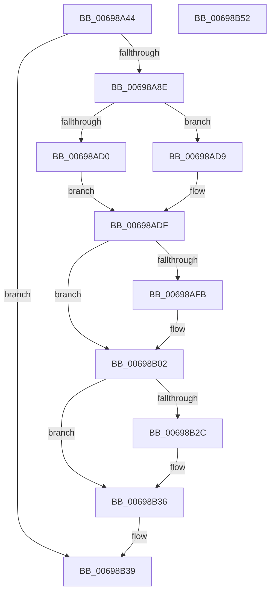

# MiCreateProcessLargePageCacheAnchor

- RVA: `0x00698A44`–`0x00698B53` (길이 `271` bytes)
- VA: `0x0000000140698A44`
- 실행 섹션: `.text`
- PDB 이름 있음: `예`; PDB Function 태그: `아니요`
- unwind 정보 RVA: `0x00060300`
- 디코드: `67`개 명령, `271/271` bytes 표시
- 미해석 바이트: `0` (있으면 어셈블리에 `.byte`로 보존)

> 이 문서는 커널 이미지의 기계어와 PDB 기호를 분석해 생성했습니다. 4번과 5번은 함수 원형과 자료형을 바이너리 사용 방식에서 추정한 C 해석이며 원본 소스 복구 결과는 아닙니다.

## 1. Dependencies

- 직접 호출 지점: **6**; 고유 호출 대상: **6**
- 직접 호출자로 확인된 함수: **1**
- RIP 상대 이미지 참조: **1**

### Outgoing calls
- `0x00698A7D` → [MiAllocatePool](../35/MiAllocatePool_function_0035B540.md) (function, `0x0035B540`)
- `0x00698ABC` → [ExAcquireSpinLockExclusive](../24/ExAcquireSpinLockExclusive_function_00248690.md) (function, `0x00248690`)
- `0x00698AE6` → [ExAcquireSpinLockExclusiveAtDpcLevel](../24/ExAcquireSpinLockExclusiveAtDpcLevel_function_00248E80.md) (function, `0x00248E80`)
- `0x00698B17` → [ExReleaseSpinLockExclusiveFromDpcLevel](../24/ExReleaseSpinLockExclusiveFromDpcLevel_function_002497E0.md) (function, `0x002497E0`)
- `0x00698B22` → [MiReleaseSpinLockExclusive](../24/MiReleaseSpinLockExclusive_function_002482C0.md) (function, `0x002482C0`)
- `0x00698B31` → [ExFreePoolWithTag](../../poolcode/B8/ExFreePoolWithTag_function_00B82870.md) (function, `0x00B82870`)

### Direct callers
- [MiAllocateLargeProcessPagesFromCache](MiAllocateLargeProcessPagesFromCache_function_0069818C.md) at `0x00698290`

### Static image references
- `0x00698A5C` → RVA `0x00FC5000` (`ALMOSTRO`; read)

## 2. Other-region calls and transfers

- 다른 실행 섹션으로 향하는 call: **1**
  - `0x00698B31` → [ExFreePoolWithTag](../../poolcode/B8/ExFreePoolWithTag_function_00B82870.md) (`.text` → `POOLCODE`)
- 별도 외부 분기/꼬리 이동을 확인하지 못했습니다.

## 3. Assembly (complete function range)

```asm
00698A44  48 89 5C 24 08                  mov qword ptr [rsp + 8], rbx
00698A49  48 89 6C 24 10                  mov qword ptr [rsp + 0x10], rbp
00698A4E  48 89 74 24 18                  mov qword ptr [rsp + 0x18], rsi
00698A53  57                              push rdi
00698A54  41 56                           push r14
00698A56  41 57                           push r15
00698A58  48 83 EC 20                     sub rsp, 0x20
00698A5C  0F B7 05 9D C5 92 00            movzx eax, word ptr [rip + 0x92c59d]
00698A63  48 8B E9                        mov rbp, rcx
00698A66  B9 40 00 00 00                  mov ecx, 0x40
00698A6B  41 B8 4D 69 4C 70               mov r8d, 0x704c694d
00698A71  48 8D 14 40                     lea rdx, [rax + rax*2]
00698A75  48 C1 E2 06                     shl rdx, 6
00698A79  48 83 C2 20                     add rdx, 0x20
00698A7D  E8 BE 2A CC FF                  call 0x14035b540
00698A82  48 8B D8                        mov rbx, rax
00698A85  48 85 C0                        test rax, rax
00698A88  0F 84 AB 00 00 00               je 0x140698b39
00698A8E  65 48 8B 04 25 88 01 00 00      mov rax, qword ptr gs:[0x188]
00698A97  4C 8D B5 40 40 00 00            lea r14, [rbp + 0x4040]
00698A9E  33 F6                           xor esi, esi
00698AA0  48 8B 88 B8 00 00 00            mov rcx, qword ptr [rax + 0xb8]
00698AA7  48 8B B9 10 04 00 00            mov rdi, qword ptr [rcx + 0x410]
00698AAE  49 8B CE                        mov rcx, r14
00698AB1  48 81 C7 00 03 00 00            add rdi, 0x300
00698AB8  48 89 7B 10                     mov qword ptr [rbx + 0x10], rdi
00698ABC  E8 CF FB BA FF                  call 0x140248690
00698AC1  48 8B 8F 18 01 00 00            mov rcx, qword ptr [rdi + 0x118]
00698AC8  44 8A F8                        mov r15b, al
00698ACB  48 85 C9                        test rcx, rcx
00698ACE  75 09                           jne 0x140698ad9
00698AD0  48 89 9F 18 01 00 00            mov qword ptr [rdi + 0x118], rbx
00698AD7  EB 06                           jmp 0x140698adf
00698AD9  48 8B F3                        mov rsi, rbx
00698ADC  48 8B D9                        mov rbx, rcx
00698ADF  48 8D 8F 20 01 00 00            lea rcx, [rdi + 0x120]
00698AE6  E8 95 03 BB FF                  call 0x140248e80
00698AEB  48 8D 85 48 40 00 00            lea rax, [rbp + 0x4048]
00698AF2  48 8B 48 08                     mov rcx, qword ptr [rax + 8]
00698AF6  48 39 01                        cmp qword ptr [rcx], rax
00698AF9  74 07                           je 0x140698b02
00698AFB  B9 03 00 00 00                  mov ecx, 3
00698B00  CD 29                           int 0x29
00698B02  48 89 4B 08                     mov qword ptr [rbx + 8], rcx
00698B06  48 89 03                        mov qword ptr [rbx], rax
00698B09  48 89 19                        mov qword ptr [rcx], rbx
00698B0C  48 8D 8F 20 01 00 00            lea rcx, [rdi + 0x120]
00698B13  48 89 58 08                     mov qword ptr [rax + 8], rbx
00698B17  E8 C4 0C BB FF                  call 0x1402497e0
00698B1C  41 8A D7                        mov dl, r15b
00698B1F  49 8B CE                        mov rcx, r14
00698B22  E8 99 F7 BA FF                  call 0x1402482c0
00698B27  48 85 F6                        test rsi, rsi
00698B2A  74 0A                           je 0x140698b36
00698B2C  33 D2                           xor edx, edx
00698B2E  48 8B CE                        mov rcx, rsi
00698B31  E8 3A 9D 4E 00                  call 0x140b82870
00698B36  48 8B C3                        mov rax, rbx
00698B39  48 8B 5C 24 40                  mov rbx, qword ptr [rsp + 0x40]
00698B3E  48 8B 6C 24 48                  mov rbp, qword ptr [rsp + 0x48]
00698B43  48 8B 74 24 50                  mov rsi, qword ptr [rsp + 0x50]
00698B48  48 83 C4 20                     add rsp, 0x20
00698B4C  41 5F                           pop r15
00698B4E  41 5E                           pop r14
00698B50  5F                              pop rdi
00698B51  C3                              ret
00698B52  CC                              int3
```

## 4. C-style interpretation (structured pseudocode)

```c
__int64 __fastcall MiCreateProcessLargePageCacheAnchor(__int64 a1)
{
    __int64 result;
    __int64 v_rdi;
    __int64 v_rsi;
    __int64 v_rsp;
    unsigned __int64 v_stack_p10;
    unsigned __int64 v_stack_p18;
    unsigned __int64 v_stack_p8;

    v_stack_p8 = v_rbx;
    v_stack_p10 = v_rbp;
    v_stack_p18 = v_rsi;
    v_rsp = (v_rsp) - (32);
    a2 = (*(unsigned __int16 *)(v_rip + 9618845) + *(unsigned __int16 *)(v_rip + 9618845) * 2) << (6);
    a2 = (a2) + (32);
    result = MiAllocatePool(64, a2, (unsigned int)(0x704C694DULL), a4);
    if (result == 0) goto loc_00698B39;
    v_rsi = 0;
    v_rdi = (*(unsigned __int64 *)(*(unsigned __int64 *)(*(unsigned __int64 *)(gs_base + (0 + 392)) + 184) + 1040)) + (768);
    *(unsigned __int64 *)(result + 16) = v_rdi;
    result = ExAcquireSpinLockExclusive(a1 + 16448, a2, (unsigned int)(0x704C694DULL), a4);
    if (*(unsigned __int64 *)(v_rdi + 280) != 0) goto loc_00698AD9;
    *(unsigned __int64 *)(v_rdi + 280) = result;
    goto loc_00698ADF;
loc_00698AD9:
loc_00698ADF:
    result = ExAcquireSpinLockExclusiveAtDpcLevel(v_rdi + 288, a2, (unsigned int)(0x704C694DULL), a4);
    if ((*(unsigned __int64 *)(*(unsigned __int64 *)(a1 + 16456 + 8))) != (a1 + 16456)) {
        a1 = 3;
    }
    *(unsigned __int64 *)(*(unsigned __int64 *)(v_rdi + 280) + 8) = a1;
    *(unsigned __int64 *)(*(unsigned __int64 *)(v_rdi + 280)) = a1 + 16456;
    *(unsigned __int64 *)(a1) = *(unsigned __int64 *)(v_rdi + 280);
    *(unsigned __int64 *)(a1 + 16456 + 8) = *(unsigned __int64 *)(v_rdi + 280);
    result = ExReleaseSpinLockExclusiveFromDpcLevel(v_rdi + 288, a2, (unsigned int)(0x704C694DULL), a4);
    result = MiReleaseSpinLockExclusive(a1 + 16448, (unsigned __int8)((unsigned __int8)(result)), (unsigned int)(0x704C694DULL), a4);
    if (result != 0) {
        a2 = 0;
        a1 = result;
        result = ExFreePoolWithTag(a1, a2, (unsigned int)(0x704C694DULL), a4);
    }
loc_00698B39:
    v_rsp = (v_rsp) + (32);
    return *(unsigned __int64 *)(v_rdi + 280);
}
```

## 5. (Beta) C Style

```c
int64_t MiCreateProcessLargePageCacheAnchor(void *Arg1)
{
    uint8_t *arg1 = (uint8_t *)Arg1;

    int64_t result;
    int64_t local_rdi;
    int64_t local_rsi;
    int64_t local_rsp;
    uint64_t v_stack_p10;
    uint64_t v_stack_p18;
    uint64_t v_stack_p8;

    v_stack_p8 = local_rbx;
    v_stack_p10 = local_rbp;
    v_stack_p18 = local_rsi;
    local_rsp = (local_rsp) - (32);
    a2 = (*(uint16_t *)(v_rip + 0x92C59D) + *(uint16_t *)(v_rip + 0x92C59D) * 2) << (6);
    a2 = (a2) + (32);
    result = MiAllocatePool(64, a2, (uint32_t)(0x704C694DULL), a4);
    if (result == 0) goto loc_00698B39;
    local_rsi = 0;
    local_rdi = (*(uint64_t *)(*(uint64_t *)(*(uint64_t *)(gs_base + (0 + 0x188)) + 0xB8) + 0x410)) + (768);
    *(uint64_t *)(result + 0x10) = local_rdi;
    result = ExAcquireSpinLockExclusive(Arg1 + 16448, a2, (uint32_t)(0x704C694DULL), a4);
    if (*(uint64_t *)(local_rdi + 0x118) != 0) goto loc_00698AD9;
    *(uint64_t *)(local_rdi + 0x118) = result;
    goto loc_00698ADF;
loc_00698AD9:
loc_00698ADF:
    result = ExAcquireSpinLockExclusiveAtDpcLevel(local_rdi + 288, a2, (uint32_t)(0x704C694DULL), a4);
    if ((*(uint64_t *)(*(uint64_t *)(arg1 + 0x4048 + 0x8))) != (Arg1 + 16456)) {
        Arg1 = 3;
    }
    *(void **)(*(uint64_t *)(local_rdi + 0x118) + 0x8) = Arg1;
    *(void **)(*(uint64_t *)(local_rdi + 0x118)) = Arg1 + 16456;
    *(uint64_t *)(arg1) = *(uint64_t *)(local_rdi + 0x118);
    *(uint64_t *)(arg1 + 0x4048 + 0x8) = *(uint64_t *)(local_rdi + 0x118);
    result = ExReleaseSpinLockExclusiveFromDpcLevel(local_rdi + 288, a2, (uint32_t)(0x704C694DULL), a4);
    result = MiReleaseSpinLockExclusive(Arg1 + 16448, (uint8_t)((uint8_t)(result)), (uint32_t)(0x704C694DULL), a4);
    if (result != 0) {
        a2 = 0;
        Arg1 = result;
        result = ExFreePoolWithTag(Arg1, a2, (uint32_t)(0x704C694DULL), a4);
    }
loc_00698B39:
    local_rsp = (local_rsp) + (32);
    return *(uint64_t *)(local_rdi + 0x118);
}
```

### 관측된 메모리 오프셋

구조체 형식이 확인되지 않은 접근은 인자 기준의 오프셋으로만 기록했습니다.

| 기준 인자 | 오프셋 표현 | 폭 (bit) | 접근 |
|---|---:|---:|---|
| `Arg1` | `+ 0x8` | `64` | `R` |
| `Arg1` | `+ 0x8` | `64` | `W` |
| `Arg1` | `+ 0x4040` | `64` | `R` |
| `Arg1` | `+ 0x4048` | `64` | `R` |

## 6. Execution-region graph

[열기: 2D/3D 그래프와 함수 탐색 컨트롤 패널](../../../control-panel.html?section=text&rva=0x00698A44&view=graph)

- 2D 그래프는 위에서 아래로 흐르고, 3D 그래프는 빈 공간을 드래그해 회전합니다. Shift+드래그는 이동, 휠은 확대·축소, 함수 노드 선택은 대상 보고서 이동입니다.

### Static fallback


