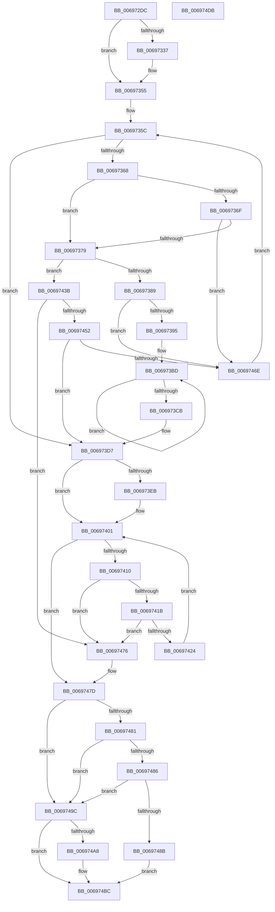

# MiDeleteHardwareAccelerators

- RVA: `0x006972DC`–`0x006974DC` (길이 `512` bytes)
- VA: `0x00000001406972DC`
- 실행 섹션: `.text`
- PDB 이름 있음: `예`; PDB Function 태그: `아니요`
- unwind 정보 RVA: `0x000D95EC`
- 디코드: `133`개 명령, `512/512` bytes 표시
- 미해석 바이트: `0` (있으면 어셈블리에 `.byte`로 보존)

> 이 문서는 커널 이미지의 기계어와 PDB 기호를 분석해 생성했습니다. 4번과 5번은 함수 원형과 자료형을 바이너리 사용 방식에서 추정한 C 해석이며 원본 소스 복구 결과는 아닙니다.

## 1. Dependencies

- 직접 호출 지점: **11**; 고유 호출 대상: **8**
- 직접 호출자로 확인된 함수: **2**
- RIP 상대 이미지 참조: **7**

### Outgoing calls
- `0x0069732B` → [ExAcquireSpinLockExclusive](../24/ExAcquireSpinLockExclusive_function_00248690.md) (function, `0x00248690`)
- `0x00697343` → [MiReleaseSpinLockExclusive](../24/MiReleaseSpinLockExclusive_function_002482C0.md) (function, `0x002482C0`)
- `0x00697348` → [MiWakeAllZeroConductors](MiWakeAllZeroConductors_function_00696724.md) (function, `0x00696724`)
- `0x00697350` → [ExAcquireSpinLockExclusive](../24/ExAcquireSpinLockExclusive_function_00248690.md) (function, `0x00248690`)
- `0x006973E1` → [MiReleaseSpinLockExclusive](../24/MiReleaseSpinLockExclusive_function_002482C0.md) (function, `0x002482C0`)
- `0x006973EB` → [MiWakeAllZeroConductors](MiWakeAllZeroConductors_function_00696724.md) (function, `0x00696724`)
- `0x006973FC` → [KeWaitForGate](../2C/KeWaitForGate_function_002CA794.md) (function, `0x002CA794`)
- `0x00697434` → [ExFreePoolWithTag](../../poolcode/B8/ExFreePoolWithTag_function_00B82870.md) (function, `0x00B82870`)
- `0x0069743E` → [MiUnlinkAccelerator](MiUnlinkAccelerator_function_00697860.md) (function, `0x00697860`)
- `0x0069748E` → `ext-ms-win-accel-api-km-l1-1-0.dll!AccelCloseResource` (import, 간접 대상; import `ext-ms-win-accel-api-km-l1-1-0.dll!AccelCloseResource`)
- `0x006974A8` → `ext-ms-win-accel-api-km-l1-1-0.dll!AccelDestroyOffloadWorkspace` (import, 간접 대상; import `ext-ms-win-accel-api-km-l1-1-0.dll!AccelDestroyOffloadWorkspace`)

### Direct callers
- [MmAcceleratorCallbackRoutine](../../page/81/MmAcceleratorCallbackRoutine_function_00811520.md) at `0x00811550`
- [MiShutdownSystem](../../pagelk/B7/MiShutdownSystem_function_00B73934.md) at `0x00B73964`

### Static image references
- `0x00697304` → RVA `0x00E37568` (`.data`; read)
- `0x00697339` → RVA `0x00E37554` (`.data`; write)
- `0x00697355` → RVA `0x00E37540` (`.data`; read)
- `0x0069748E` → RVA `0x00151198` (`ext-ms-win-accel-api-km-l1-1-0.dll!AccelCloseResource (IAT)`; read)
- `0x0069749C` → RVA `0x00E37560` (`.data`; read)
- `0x006974A8` → RVA `0x00151180` (`ext-ms-win-accel-api-km-l1-1-0.dll!AccelDestroyOffloadWorkspace (IAT)`; read)
- `0x006974B4` → RVA `0x00E37560` (`.data`; read/write)

## 2. Other-region calls and transfers

- 다른 실행 섹션으로 향하는 call: **1**
  - `0x00697434` → [ExFreePoolWithTag](../../poolcode/B8/ExFreePoolWithTag_function_00B82870.md) (`.text` → `POOLCODE`)
- 별도 외부 분기/꼬리 이동을 확인하지 못했습니다.

## 3. Assembly (complete function range)

```asm
006972DC  4C 8B DC                        mov r11, rsp
006972DF  49 89 5B 08                     mov qword ptr [r11 + 8], rbx
006972E3  49 89 73 10                     mov qword ptr [r11 + 0x10], rsi
006972E7  49 89 7B 18                     mov qword ptr [r11 + 0x18], rdi
006972EB  4D 89 63 20                     mov qword ptr [r11 + 0x20], r12
006972EF  41 55                           push r13
006972F1  41 56                           push r14
006972F3  41 57                           push r15
006972F5  48 83 EC 50                     sub rsp, 0x50
006972F9  49 8D 43 B8                     lea rax, [r11 - 0x48]
006972FD  0F 57 C0                        xorps xmm0, xmm0
00697300  49 89 43 C0                     mov qword ptr [r11 - 0x40], rax
00697304  48 8D 1D 5D 02 7A 00            lea rbx, [rip + 0x7a025d]
0069730B  49 8D 43 B8                     lea rax, [r11 - 0x48]
0069730F  48 8B F1                        mov rsi, rcx
00697312  48 8B CB                        mov rcx, rbx
00697315  49 89 43 B8                     mov qword ptr [r11 - 0x48], rax
00697319  8B FA                           mov edi, edx
0069731B  45 33 FF                        xor r15d, r15d
0069731E  0F 11 44 24 30                  movups xmmword ptr [rsp + 0x30], xmm0
00697323  45 33 ED                        xor r13d, r13d
00697326  0F 11 44 24 40                  movups xmmword ptr [rsp + 0x40], xmm0
0069732B  E8 60 13 BB FF                  call 0x140248690
00697330  44 8A E0                        mov r12b, al
00697333  85 FF                           test edi, edi
00697335  74 1E                           je 0x140697355
00697337  8A D0                           mov dl, al
00697339  C6 05 14 02 7A 00 01            mov byte ptr [rip + 0x7a0214], 1
00697340  48 8B CB                        mov rcx, rbx
00697343  E8 78 0F BB FF                  call 0x1402482c0
00697348  E8 D7 F3 FF FF                  call 0x140696724
0069734D  48 8B CB                        mov rcx, rbx
00697350  E8 3B 13 BB FF                  call 0x140248690
00697355  48 8B 1D E4 01 7A 00            mov rbx, qword ptr [rip + 0x7a01e4]
0069735C  48 8D 05 DD 01 7A 00            lea rax, [rip + 0x7a01dd]
00697363  48 3B D8                        cmp rbx, rax
00697366  74 6F                           je 0x1406973d7
00697368  4C 8B 33                        mov r14, qword ptr [rbx]
0069736B  85 FF                           test edi, edi
0069736D  75 0A                           jne 0x140697379
0069736F  48 39 73 10                     cmp qword ptr [rbx + 0x10], rsi
00697373  0F 85 F5 00 00 00               jne 0x14069746e
00697379  41 BD 01 00 00 00               mov r13d, 1
0069737F  44 39 7B 30                     cmp dword ptr [rbx + 0x30], r15d
00697383  0F 84 B2 00 00 00               je 0x14069743b
00697389  44 09 6B 34                     or dword ptr [rbx + 0x34], r13d
0069738D  85 FF                           test edi, edi
0069738F  0F 85 D9 00 00 00               jne 0x14069746e
00697395  44 21 7C 24 3C                  and dword ptr [rsp + 0x3c], r15d
0069739A  48 8D 44 24 40                  lea rax, [rsp + 0x40]
0069739F  48 89 44 24 48                  mov qword ptr [rsp + 0x48], rax
006973A4  8D 57 02                        lea edx, [rdi + 2]
006973A7  48 8D 44 24 40                  lea rax, [rsp + 0x40]
006973AC  66 C7 44 24 38 07 01            mov word ptr [rsp + 0x38], 0x107
006973B3  48 89 44 24 40                  mov qword ptr [rsp + 0x40], rax
006973B8  C6 44 24 3A 06                  mov byte ptr [rsp + 0x3a], 6
006973BD  48 8B 43 28                     mov rax, qword ptr [rbx + 0x28]
006973C1  48 89 44 24 30                  mov qword ptr [rsp + 0x30], rax
006973C6  49 2B D5                        sub rdx, r13
006973C9  75 F2                           jne 0x1406973bd
006973CB  48 8D 44 24 30                  lea rax, [rsp + 0x30]
006973D0  45 8B FD                        mov r15d, r13d
006973D3  48 89 43 28                     mov qword ptr [rbx + 0x28], rax
006973D7  41 8A D4                        mov dl, r12b
006973DA  48 8D 0D 87 01 7A 00            lea rcx, [rip + 0x7a0187]
006973E1  E8 DA 0E BB FF                  call 0x1402482c0
006973E6  45 85 FF                        test r15d, r15d
006973E9  74 16                           je 0x140697401
006973EB  E8 34 F3 FF FF                  call 0x140696724
006973F0  45 33 C0                        xor r8d, r8d
006973F3  48 8D 4C 24 38                  lea rcx, [rsp + 0x38]
006973F8  41 8D 50 13                     lea edx, [r8 + 0x13]
006973FC  E8 93 33 C3 FF                  call 0x1402ca794
00697401  48 8B 4C 24 20                  mov rcx, qword ptr [rsp + 0x20]
00697406  48 8D 44 24 20                  lea rax, [rsp + 0x20]
0069740B  48 3B C8                        cmp rcx, rax
0069740E  74 6D                           je 0x14069747d
00697410  48 8D 44 24 20                  lea rax, [rsp + 0x20]
00697415  48 39 41 08                     cmp qword ptr [rcx + 8], rax
00697419  75 5B                           jne 0x140697476
0069741B  48 8B 01                        mov rax, qword ptr [rcx]
0069741E  48 39 48 08                     cmp qword ptr [rax + 8], rcx
00697422  75 52                           jne 0x140697476
00697424  48 8D 54 24 20                  lea rdx, [rsp + 0x20]
00697429  48 89 44 24 20                  mov qword ptr [rsp + 0x20], rax
0069742E  48 89 50 08                     mov qword ptr [rax + 8], rdx
00697432  33 D2                           xor edx, edx
00697434  E8 37 B4 4E 00                  call 0x140b82870
00697439  EB C6                           jmp 0x140697401
0069743B  48 8B CB                        mov rcx, rbx
0069743E  E8 1D 04 00 00                  call 0x140697860
00697443  48 8B 44 24 28                  mov rax, qword ptr [rsp + 0x28]
00697448  48 8D 4C 24 20                  lea rcx, [rsp + 0x20]
0069744D  48 39 08                        cmp qword ptr [rax], rcx
00697450  75 24                           jne 0x140697476
00697452  48 89 43 08                     mov qword ptr [rbx + 8], rax
00697456  48 8D 4C 24 20                  lea rcx, [rsp + 0x20]
0069745B  48 89 0B                        mov qword ptr [rbx], rcx
0069745E  48 89 18                        mov qword ptr [rax], rbx
00697461  48 89 5C 24 28                  mov qword ptr [rsp + 0x28], rbx
00697466  85 FF                           test edi, edi
00697468  0F 84 69 FF FF FF               je 0x1406973d7
0069746E  49 8B DE                        mov rbx, r14
00697471  E9 E6 FE FF FF                  jmp 0x14069735c
00697476  B9 03 00 00 00                  mov ecx, 3
0069747B  CD 29                           int 0x29
0069747D  85 FF                           test edi, edi
0069747F  75 1B                           jne 0x14069749c
00697481  45 85 ED                        test r13d, r13d
00697484  74 16                           je 0x14069749c
00697486  48 85 F6                        test rsi, rsi
00697489  74 11                           je 0x14069749c
0069748B  48 8B CE                        mov rcx, rsi
0069748E  48 FF 15 03 9D AB FF            call qword ptr [rip - 0x5462fd]
00697495  0F 1F 44 00 00                  nop dword ptr [rax + rax]
0069749A  EB 20                           jmp 0x1406974bc
0069749C  48 8B 0D BD 00 7A 00            mov rcx, qword ptr [rip + 0x7a00bd]
006974A3  48 85 C9                        test rcx, rcx
006974A6  74 14                           je 0x1406974bc
006974A8  48 FF 15 D1 9C AB FF            call qword ptr [rip - 0x54632f]
006974AF  0F 1F 44 00 00                  nop dword ptr [rax + rax]
006974B4  48 83 25 A4 00 7A 00 00         and qword ptr [rip + 0x7a00a4], 0
006974BC  4C 8D 5C 24 50                  lea r11, [rsp + 0x50]
006974C1  49 8B 5B 20                     mov rbx, qword ptr [r11 + 0x20]
006974C5  49 8B 73 28                     mov rsi, qword ptr [r11 + 0x28]
006974C9  49 8B 7B 30                     mov rdi, qword ptr [r11 + 0x30]
006974CD  4D 8B 63 38                     mov r12, qword ptr [r11 + 0x38]
006974D1  49 8B E3                        mov rsp, r11
006974D4  41 5F                           pop r15
006974D6  41 5E                           pop r14
006974D8  41 5D                           pop r13
006974DA  C3                              ret
006974DB  CC                              int3
```

## 4. C-style interpretation (structured pseudocode)

```c
__int64 __fastcall MiDeleteHardwareAccelerators(__int64 a1, int a2, int a3)
{
    __int64 result;
    __int64 v_r13;
    __int64 v_r15;
    __int64 v_rsp;
    unsigned __int64 v_stack_m18;
    unsigned __int64 v_stack_m20;
    unsigned __int64 v_stack_m28;
    unsigned int v_stack_m2C;
    unsigned __int8 v_stack_m2E;
    unsigned __int16 v_stack_m30;
    unsigned __int64 v_stack_m38;
    unsigned __int64 v_stack_m40;
    unsigned __int64 v_stack_m48;

    *(unsigned __int64 *)(v_rsp + 8) = v_rbx;
    *(unsigned __int64 *)(v_rsp + 16) = v_rsi;
    *(unsigned __int64 *)(v_rsp + 24) = v_rdi;
    *(unsigned __int64 *)(v_rsp + 32) = v_r12;
    v_rsp = (v_rsp) - (80);
    *(unsigned __int64 *)(v_rsp - 64) = v_rsp - 72;
    *(unsigned __int64 *)(v_rsp - 72) = v_rsp - 72;
    v_r15 = 0;
    v_stack_m38 = v_xmm0;
    v_r13 = 0;
    v_stack_m28 = v_xmm0;
    result = ExAcquireSpinLockExclusive(v_rip + 7995997, a2, a3, a4);
    if ((unsigned int)((unsigned int)(a2)) != 0) {
        a2 = (unsigned __int8)(result);
        *(unsigned __int8 *)(v_rip + 7995924) = 1;
        a1 = v_rip + 7995997;
        result = MiReleaseSpinLockExclusive(a1, a2, a3, a4);
        result = MiWakeAllZeroConductors(a1, a2, a3, a4);
        a1 = v_rip + 7995997;
        result = ExAcquireSpinLockExclusive(a1, a2, a3, a4);
    }
loc_0069735C:
    if ((*(unsigned __int64 *)(v_rip + 7995876)) == (v_rip + 7995869)) goto loc_006973D7;
    if ((unsigned int)((unsigned int)(a2)) != 0) goto loc_00697379;
    if ((*(unsigned __int64 *)(*(unsigned __int64 *)(v_rip + 7995876) + 16)) != a1) goto loc_0069746E;
loc_00697379:
    if ((*(unsigned int *)(*(unsigned __int64 *)(v_rip + 7995876) + 48)) == 0) goto loc_0069743B;
    if ((unsigned int)((unsigned int)(a2)) != 0) goto loc_0069746E;
    v_stack_m20 = v_stack_m28;
    v_stack_m30 = 263;
    v_stack_m28 = v_stack_m28;
    v_stack_m2E = 6;
loc_006973BD:
    v_stack_m38 = *(unsigned __int64 *)(*(unsigned __int64 *)(v_rip + 7995876) + 40);
    a2 = ((unsigned int)(a2) + 2) - (1);
    if (condition_is_not_equal) goto loc_006973BD;
    *(unsigned __int64 *)(*(unsigned __int64 *)(v_rip + 7995876) + 40) = v_stack_m38;
loc_006973D7:
    result = MiReleaseSpinLockExclusive(v_rip + 7995783, (unsigned __int8)((unsigned __int8)(result)), a3, a4);
    if (1 != 0) {
        result = MiWakeAllZeroConductors(v_rip + 7995783, (unsigned __int8)((unsigned __int8)(result)), a3, a4);
        a3 = 0;
        a1 = v_stack_m30;
        a2 = a3 + 19;
        result = KeWaitForGate(a1, a2, a3, a4);
    }
    if (v_stack_m48 == v_stack_m48) goto loc_0069747D;
    if ((*(unsigned __int64 *)(v_stack_m48 + 8)) != v_stack_m48) goto loc_00697476;
    if ((*(unsigned __int64 *)(*(unsigned __int64 *)(v_stack_m48) + 8)) != v_stack_m48) goto loc_00697476;
    v_stack_m48 = *(unsigned __int64 *)(v_stack_m48);
    *(unsigned __int64 *)(*(unsigned __int64 *)(v_stack_m48) + 8) = v_stack_m48;
    a2 = 0;
    result = ExFreePoolWithTag(v_stack_m48, a2, a3, a4);
    goto loc_00697401;
loc_0069743B:
    result = MiUnlinkAccelerator(*(unsigned __int64 *)(v_rip + 7995876), a2, a3, a4);
    if ((*(unsigned __int64 *)(v_stack_m40)) != v_stack_m48) goto loc_00697476;
    *(unsigned __int64 *)(*(unsigned __int64 *)(v_rip + 7995876) + 8) = v_stack_m40;
    *(unsigned __int64 *)(*(unsigned __int64 *)(v_rip + 7995876)) = v_stack_m48;
    *(unsigned __int64 *)(v_stack_m40) = *(unsigned __int64 *)(v_rip + 7995876);
    v_stack_m40 = *(unsigned __int64 *)(v_rip + 7995876);
    if ((unsigned int)((unsigned int)(a2)) == 0) goto loc_006973D7;
loc_0069746E:
    goto loc_0069735C;
loc_00697476:
loc_0069747D:
    if ((unsigned int)((unsigned int)(a2)) != 0) goto loc_0069749C;
    if (1 == 0) goto loc_0069749C;
    if (a1 == 0) goto loc_0069749C;
    result = ext_ms_win_accel_api_km_l1_1_0_dll_AccelCloseResource(a1, a2, a3, a4);
    goto loc_006974BC;
loc_0069749C:
    if (*(unsigned __int64 *)(v_rip + 7995581) != 0) {
        result = ext_ms_win_accel_api_km_l1_1_0_dll_AccelDestroyOffloadWorkspace(*(unsigned __int64 *)(v_rip + 7995581), a2, a3, a4);
    }
    return result;
}
```

## 5. (Beta) C Style

```c
int64_t MiDeleteHardwareAccelerators(int64_t Arg1, int32_t Arg2, int32_t Arg3)
{
    int64_t result;
    int64_t local_r13;
    int64_t local_r15;
    int64_t local_rsp;
    uint64_t v_stack_m18;
    uint64_t v_stack_m20;
    uint64_t v_stack_m28;
    uint32_t v_stack_m2C;
    uint8_t v_stack_m2E;
    uint16_t v_stack_m30;
    uint64_t v_stack_m38;
    uint64_t v_stack_m40;
    uint64_t v_stack_m48;

    *(uint64_t *)(local_rsp + 0x8) = local_rbx;
    *(uint64_t *)(local_rsp + 0x10) = local_rsi;
    *(uint64_t *)(local_rsp + 0x18) = local_rdi;
    *(uint64_t *)(local_rsp + 0x20) = local_r12;
    local_rsp = (local_rsp) - (80);
    *(uint64_t *)(local_rsp - 0x40) = local_rsp - 72;
    *(uint64_t *)(local_rsp - 0x48) = local_rsp - 72;
    local_r15 = 0;
    v_stack_m38 = v_xmm0;
    local_r13 = 0;
    v_stack_m28 = v_xmm0;
    result = ExAcquireSpinLockExclusive(v_rip + 7995997, Arg2, Arg3, a4);
    if ((uint32_t)((uint32_t)(Arg2)) != 0) {
        Arg2 = (uint8_t)(result);
        *(uint8_t *)(v_rip + 0x7A0214) = 1;
        Arg1 = v_rip + 7995997;
        result = MiReleaseSpinLockExclusive(Arg1, Arg2, Arg3, a4);
        result = MiWakeAllZeroConductors(Arg1, Arg2, Arg3, a4);
        Arg1 = v_rip + 7995997;
        result = ExAcquireSpinLockExclusive(Arg1, Arg2, Arg3, a4);
    }
loc_0069735C:
    if ((*(uint64_t *)(v_rip + 0x7A01E4)) == (v_rip + 7995869)) goto loc_006973D7;
    if ((uint32_t)((uint32_t)(Arg2)) != 0) goto loc_00697379;
    if ((*(uint64_t *)(*(uint64_t *)(v_rip + 0x7A01E4) + 0x10)) != Arg1) goto loc_0069746E;
loc_00697379:
    if ((*(uint32_t *)(*(uint64_t *)(v_rip + 0x7A01E4) + 0x30)) == 0) goto loc_0069743B;
    if ((uint32_t)((uint32_t)(Arg2)) != 0) goto loc_0069746E;
    v_stack_m20 = v_stack_m28;
    v_stack_m30 = 263;
    v_stack_m28 = v_stack_m28;
    v_stack_m2E = 6;
loc_006973BD:
    v_stack_m38 = *(uint64_t *)(*(uint64_t *)(v_rip + 0x7A01E4) + 0x28);
    Arg2 = ((uint32_t)(Arg2) + 2) - (1);
    if (condition_is_not_equal) goto loc_006973BD;
    *(uint64_t *)(*(uint64_t *)(v_rip + 0x7A01E4) + 0x28) = v_stack_m38;
loc_006973D7:
    result = MiReleaseSpinLockExclusive(v_rip + 7995783, (uint8_t)((uint8_t)(result)), Arg3, a4);
    if (1 != 0) {
        result = MiWakeAllZeroConductors(v_rip + 7995783, (uint8_t)((uint8_t)(result)), Arg3, a4);
        Arg3 = 0;
        Arg1 = v_stack_m30;
        Arg2 = Arg3 + 19;
        result = KeWaitForGate(Arg1, Arg2, Arg3, a4);
    }
    if (v_stack_m48 == v_stack_m48) goto loc_0069747D;
    if ((*(uint64_t *)(v_stack_m48 + 0x8)) != v_stack_m48) goto loc_00697476;
    if ((*(uint64_t *)(*(uint64_t *)(v_stack_m48) + 0x8)) != v_stack_m48) goto loc_00697476;
    v_stack_m48 = *(uint64_t *)(v_stack_m48);
    *(uint64_t *)(*(uint64_t *)(v_stack_m48) + 0x8) = v_stack_m48;
    Arg2 = 0;
    result = ExFreePoolWithTag(v_stack_m48, Arg2, Arg3, a4);
    goto loc_00697401;
loc_0069743B:
    result = MiUnlinkAccelerator(*(uint64_t *)(v_rip + 0x7A01E4), Arg2, Arg3, a4);
    if ((*(uint64_t *)(v_stack_m40)) != v_stack_m48) goto loc_00697476;
    *(uint64_t *)(*(uint64_t *)(v_rip + 0x7A01E4) + 0x8) = v_stack_m40;
    *(uint64_t *)(*(uint64_t *)(v_rip + 0x7A01E4)) = v_stack_m48;
    *(uint64_t *)(v_stack_m40) = *(uint64_t *)(v_rip + 0x7A01E4);
    v_stack_m40 = *(uint64_t *)(v_rip + 0x7A01E4);
    if ((uint32_t)((uint32_t)(Arg2)) == 0) goto loc_006973D7;
loc_0069746E:
    goto loc_0069735C;
loc_00697476:
loc_0069747D:
    if ((uint32_t)((uint32_t)(Arg2)) != 0) goto loc_0069749C;
    if (1 == 0) goto loc_0069749C;
    if (Arg1 == 0) goto loc_0069749C;
    result = kernel_indirect_call(Arg1, Arg2, Arg3, a4);
    goto loc_006974BC;
loc_0069749C:
    if (*(uint64_t *)(v_rip + 0x7A00BD) != 0) {
        result = kernel_indirect_call(*(uint64_t *)(v_rip + 0x7A00BD), Arg2, Arg3, a4);
    }
    return result;
}
```

## 6. Execution-region graph

[열기: 2D/3D 그래프와 함수 탐색 컨트롤 패널](../../../control-panel.html?section=text&rva=0x006972DC&view=graph)

- 2D 그래프는 위에서 아래로 흐르고, 3D 그래프는 빈 공간을 드래그해 회전합니다. Shift+드래그는 이동, 휠은 확대·축소, 함수 노드 선택은 대상 보고서 이동입니다.

### Static fallback


