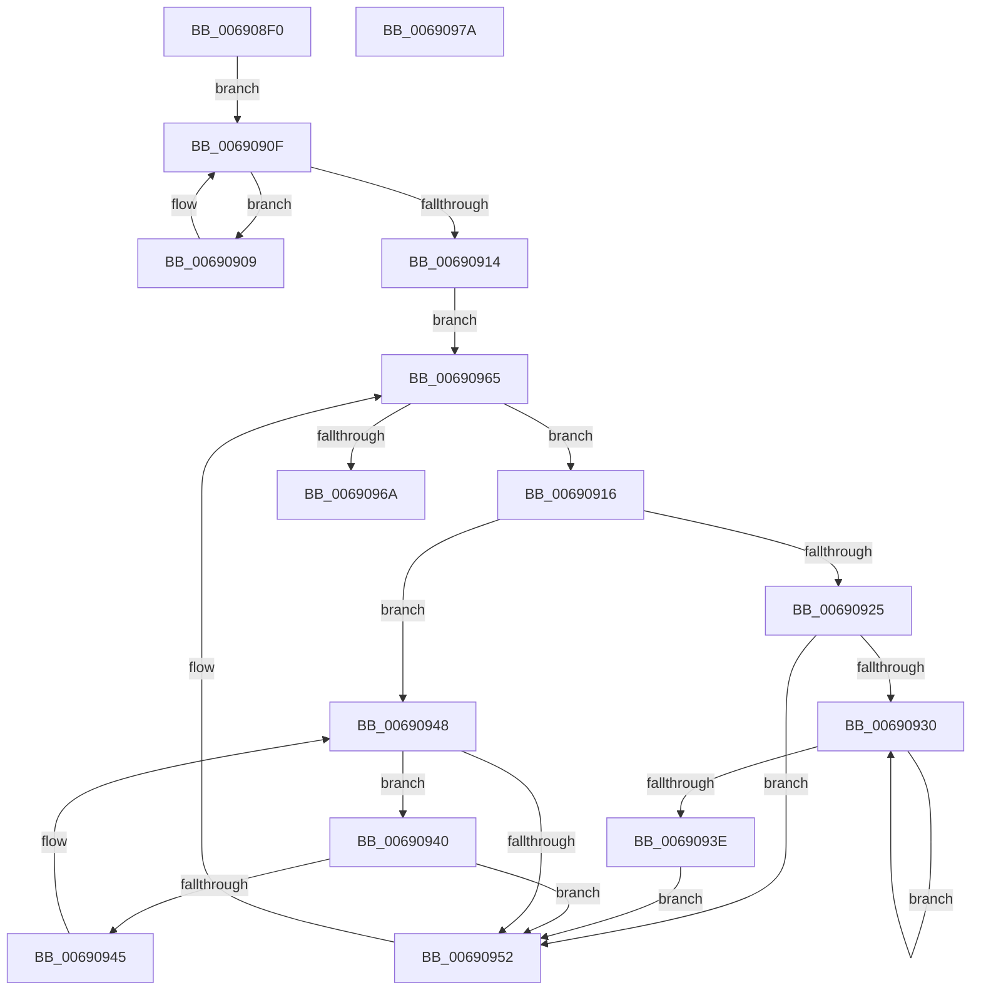

# MiDeletePartitionPageNodes

- RVA: `0x006908F0`–`0x0069097B` (길이 `139` bytes)
- VA: `0x00000001406908F0`
- 실행 섹션: `.text`
- PDB 이름 있음: `예`; PDB Function 태그: `아니요`
- unwind 정보 RVA: `0x00060BC4`
- 디코드: `47`개 명령, `139/139` bytes 표시
- 미해석 바이트: `0` (있으면 어셈블리에 `.byte`로 보존)

> 이 문서는 커널 이미지의 기계어와 PDB 기호를 분석해 생성했습니다. 4번과 5번은 함수 원형과 자료형을 바이너리 사용 방식에서 추정한 C 해석이며 원본 소스 복구 결과는 아닙니다.

## 1. Dependencies

- 직접 호출 지점: **2**; 고유 호출 대상: **2**
- 직접 호출자로 확인된 함수: **5**
- RIP 상대 이미지 참조: **0**

### Outgoing calls
- `0x00690958` → [RtlAvlRemoveNode](../29/RtlAvlRemoveNode_function_00296650.md) (function, `0x00296650`)
- `0x00690960` → [MiDeletePartitionPageNode](MiDeletePartitionPageNode_function_006908C4.md) (function, `0x006908C4`)

### Direct callers
- [MiReturnAddMemoryResources](../67/MiReturnAddMemoryResources_function_00673BC0.md) at `0x00673C3D`
- [MiClearPartitionPageBitMap](MiClearPartitionPageBitMap_function_00690614.md) at `0x0069070B`
- [MiDuplicatePartitionNodeTree](MiDuplicatePartitionNodeTree_function_00690B54.md) at `0x00690BDE`
- [MiInsertPartitionPages](MiInsertPartitionPages_function_006911A0.md) at `0x0069159C`
- [MmRemovePhysicalMemory](../../page/7F/MmRemovePhysicalMemory_function_007FB560.md) at `0x007FB782`

### Static image references
- 디코드된 RIP-relative 메모리 참조가 없습니다.

## 2. Other-region calls and transfers

- 다른 실행 섹션으로 향하는 call: **0**
- 별도 외부 분기/꼬리 이동을 확인하지 못했습니다.

## 3. Assembly (complete function range)

```asm
006908F0  48 89 5C 24 08                  mov qword ptr [rsp + 8], rbx
006908F5  48 89 74 24 10                  mov qword ptr [rsp + 0x10], rsi
006908FA  57                              push rdi
006908FB  48 83 EC 20                     sub rsp, 0x20
006908FF  48 8B 01                        mov rax, qword ptr [rcx]
00690902  48 8B F9                        mov rdi, rcx
00690905  33 DB                           xor ebx, ebx
00690907  EB 06                           jmp 0x14069090f
00690909  48 8B D8                        mov rbx, rax
0069090C  48 8B 00                        mov rax, qword ptr [rax]
0069090F  48 85 C0                        test rax, rax
00690912  75 F5                           jne 0x140690909
00690914  EB 4F                           jmp 0x140690965
00690916  48 8B 43 08                     mov rax, qword ptr [rbx + 8]
0069091A  48 8B F3                        mov rsi, rbx
0069091D  48 8B CB                        mov rcx, rbx
00690920  48 85 C0                        test rax, rax
00690923  74 23                           je 0x140690948
00690925  48 8B 08                        mov rcx, qword ptr [rax]
00690928  48 8B D8                        mov rbx, rax
0069092B  48 85 C9                        test rcx, rcx
0069092E  74 22                           je 0x140690952
00690930  48 8B 01                        mov rax, qword ptr [rcx]
00690933  48 8B D9                        mov rbx, rcx
00690936  48 8B C8                        mov rcx, rax
00690939  48 85 C0                        test rax, rax
0069093C  75 F2                           jne 0x140690930
0069093E  EB 12                           jmp 0x140690952
00690940  48 39 0B                        cmp qword ptr [rbx], rcx
00690943  74 0D                           je 0x140690952
00690945  48 8B CB                        mov rcx, rbx
00690948  48 8B 5B 10                     mov rbx, qword ptr [rbx + 0x10]
0069094C  48 83 E3 FC                     and rbx, 0xfffffffffffffffc
00690950  75 EE                           jne 0x140690940
00690952  48 8B D6                        mov rdx, rsi
00690955  48 8B CF                        mov rcx, rdi
00690958  E8 F3 5C C0 FF                  call 0x140296650
0069095D  48 8B CE                        mov rcx, rsi
00690960  E8 5F FF FF FF                  call 0x1406908c4
00690965  48 85 DB                        test rbx, rbx
00690968  75 AC                           jne 0x140690916
0069096A  48 8B 5C 24 30                  mov rbx, qword ptr [rsp + 0x30]
0069096F  48 8B 74 24 38                  mov rsi, qword ptr [rsp + 0x38]
00690974  48 83 C4 20                     add rsp, 0x20
00690978  5F                              pop rdi
00690979  C3                              ret
0069097A  CC                              int3
```

## 4. C-style interpretation (structured pseudocode)

```c
__int64 __fastcall MiDeletePartitionPageNodes(__int64 a1)
{
    __int64 result;
    __int64 v_rbx;
    __int64 v_rsp;
    unsigned __int64 v_stack_p10;
    unsigned __int64 v_stack_p8;

    v_stack_p8 = v_rbx;
    v_stack_p10 = v_rsi;
    v_rsp = (v_rsp) - (32);
    v_rbx = 0;
    goto loc_0069090F;
loc_00690909:
loc_0069090F:
    if (*(unsigned __int64 *)(*(unsigned __int64 *)(a1)) != 0) goto loc_00690909;
    goto loc_00690965;
loc_00690916:
    if (*(unsigned __int64 *)(*(unsigned __int64 *)(a1) + 8) == 0) goto loc_00690948;
    if (*(unsigned __int64 *)(*(unsigned __int64 *)(*(unsigned __int64 *)(a1) + 8)) == 0) goto loc_00690952;
loc_00690930:
    if (*(unsigned __int64 *)(*(unsigned __int64 *)(*(unsigned __int64 *)(*(unsigned __int64 *)(a1) + 8))) != 0) goto loc_00690930;
    goto loc_00690952;
loc_00690940:
    if ((*(unsigned __int64 *)(*(unsigned __int64 *)(*(unsigned __int64 *)(*(unsigned __int64 *)(a1) + 8)))) == (*(unsigned __int64 *)(*(unsigned __int64 *)(*(unsigned __int64 *)(*(unsigned __int64 *)(a1) + 8))))) goto loc_00690952;
loc_00690948:
    v_rbx = (*(unsigned __int64 *)(*(unsigned __int64 *)(*(unsigned __int64 *)(*(unsigned __int64 *)(a1) + 8)) + 16)) & (-4);
    if (condition_is_not_equal) goto loc_00690940;
loc_00690952:
    result = RtlAvlRemoveNode(a1, *(unsigned __int64 *)(a1), a3, a4);
    result = MiDeletePartitionPageNode(*(unsigned __int64 *)(a1), *(unsigned __int64 *)(a1), a3, a4);
loc_00690965:
    if (v_rbx != 0) goto loc_00690916;
    v_rsp = (v_rsp) + (32);
    return result;
}
```

## 5. (Beta) C Style

```c
int64_t MiDeletePartitionPageNodes(void *Arg1)
{
    uint8_t *arg1 = (uint8_t *)Arg1;

    int64_t result;
    int64_t local_rbx;
    int64_t local_rsp;
    uint64_t v_stack_p10;
    uint64_t v_stack_p8;

    v_stack_p8 = local_rbx;
    v_stack_p10 = local_rsi;
    local_rsp = (local_rsp) - (32);
    local_rbx = 0;
    goto loc_0069090F;
loc_00690909:
loc_0069090F:
    if (*(uint64_t *)(*(uint64_t *)(arg1)) != 0) goto loc_00690909;
    goto loc_00690965;
loc_00690916:
    if (*(uint64_t *)(*(uint64_t *)(arg1) + 0x8) == 0) goto loc_00690948;
    if (*(uint64_t *)(*(uint64_t *)(*(uint64_t *)(arg1) + 0x8)) == 0) goto loc_00690952;
loc_00690930:
    if (*(uint64_t *)(*(uint64_t *)(*(uint64_t *)(*(uint64_t *)(arg1) + 0x8))) != 0) goto loc_00690930;
    goto loc_00690952;
loc_00690940:
    if ((*(uint64_t *)(*(uint64_t *)(*(uint64_t *)(*(uint64_t *)(arg1) + 0x8)))) == (*(uint64_t *)(*(uint64_t *)(*(uint64_t *)(*(uint64_t *)(arg1) + 0x8))))) goto loc_00690952;
loc_00690948:
    local_rbx = (*(uint64_t *)(*(uint64_t *)(*(uint64_t *)(*(uint64_t *)(arg1) + 0x8)) + 0x10)) & (-4);
    if (condition_is_not_equal) goto loc_00690940;
loc_00690952:
    result = RtlAvlRemoveNode(Arg1, *(uint64_t *)(arg1), a3, a4);
    result = MiDeletePartitionPageNode(*(uint64_t *)(arg1), *(uint64_t *)(arg1), a3, a4);
loc_00690965:
    if (local_rbx != 0) goto loc_00690916;
    local_rsp = (local_rsp) + (32);
    return result;
}
```

### 관측된 메모리 오프셋

구조체 형식이 확인되지 않은 접근은 인자 기준의 오프셋으로만 기록했습니다.

| 기준 인자 | 오프셋 표현 | 폭 (bit) | 접근 |
|---|---:|---:|---|
| `Arg1` | `+ 0x0` | `64` | `R` |

## 6. Execution-region graph

[열기: 2D/3D 그래프와 함수 탐색 컨트롤 패널](../../../control-panel.html?section=text&rva=0x006908F0&view=graph)

- 2D 그래프는 위에서 아래로 흐르고, 3D 그래프는 빈 공간을 드래그해 회전합니다. Shift+드래그는 이동, 휠은 확대·축소, 함수 노드 선택은 대상 보고서 이동입니다.

### Static fallback


