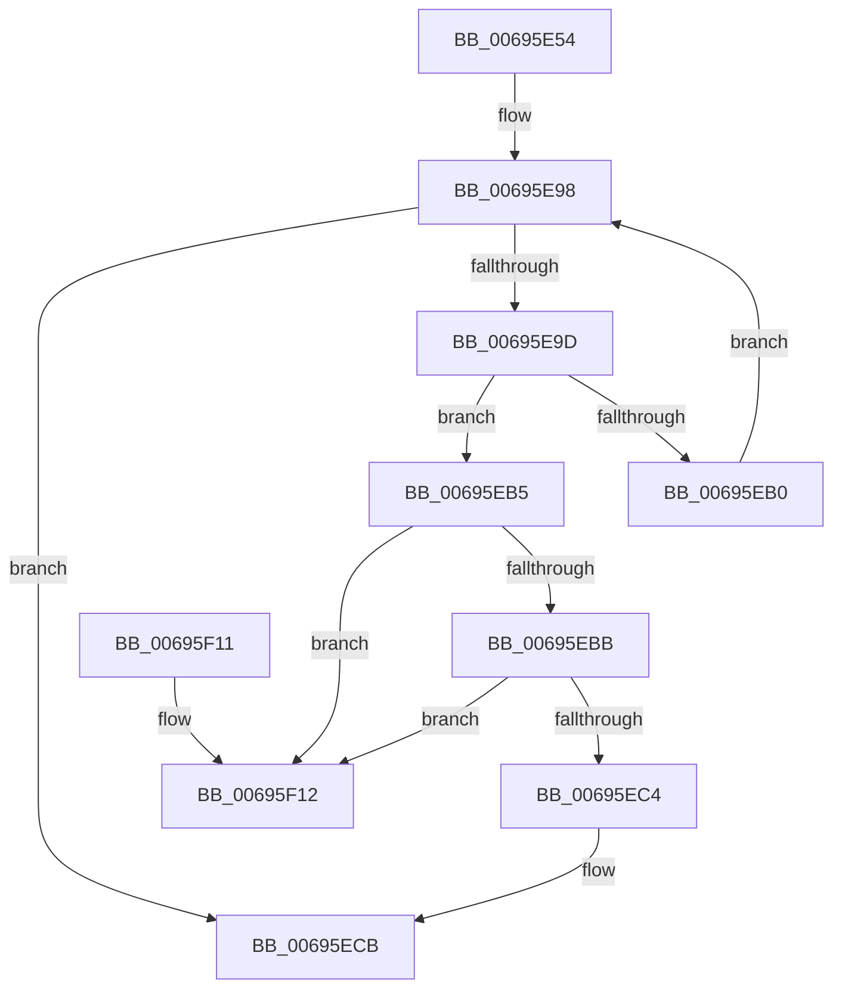

# MiDeleteThreadContext

- RVA: `0x00695E54`–`0x00695F19` (길이 `197` bytes)
- VA: `0x0000000140695E54`
- 실행 섹션: `.text`
- PDB 이름 있음: `예`; PDB Function 태그: `아니요`
- unwind 정보 RVA: `0x00069AD0`
- 디코드: `53`개 명령, `197/197` bytes 표시
- 미해석 바이트: `0` (있으면 어셈블리에 `.byte`로 보존)

> 이 문서는 커널 이미지의 기계어와 PDB 기호를 분석해 생성했습니다. 4번과 5번은 함수 원형과 자료형을 바이너리 사용 방식에서 추정한 C 해석이며 원본 소스 복구 결과는 아닙니다.

## 1. Dependencies

- 직접 호출 지점: **5**; 고유 호출 대상: **5**
- 직접 호출자로 확인된 함수: **1**
- RIP 상대 이미지 참조: **0**

### Outgoing calls
- `0x00695E89` → [ExAcquireSpinLockExclusive](../24/ExAcquireSpinLockExclusive_function_00248690.md) (function, `0x00248690`)
- `0x00695ED5` → [MiReleaseSpinLockExclusive](../24/MiReleaseSpinLockExclusive_function_002482C0.md) (function, `0x002482C0`)
- `0x00695EE0` → [MiRemoveConductorListZeroThread](../../page/81/MiRemoveConductorListZeroThread_function_00810C60.md) (function, `0x00810C60`)
- `0x00695EED` → [ObfDereferenceObjectWithTag](../2F/ObfDereferenceObjectWithTag_function_002F78E0.md) (function, `0x002F78E0`)
- `0x00695EF7` → [ExFreePoolWithTag](../../poolcode/B8/ExFreePoolWithTag_function_00B82870.md) (function, `0x00B82870`)

### Direct callers
- [MiZeroNodeConductorWait](MiZeroNodeConductorWait_function_006968E8.md) at `0x006969BA`

### Static image references
- 디코드된 RIP-relative 메모리 참조가 없습니다.

## 2. Other-region calls and transfers

- 다른 실행 섹션으로 향하는 call: **2**
  - `0x00695EE0` → [MiRemoveConductorListZeroThread](../../page/81/MiRemoveConductorListZeroThread_function_00810C60.md) (`.text` → `PAGE`)
  - `0x00695EF7` → [ExFreePoolWithTag](../../poolcode/B8/ExFreePoolWithTag_function_00B82870.md) (`.text` → `POOLCODE`)
- 별도 외부 분기/꼬리 이동을 확인하지 못했습니다.

## 3. Assembly (complete function range)

```asm
00695E54  48 89 5C 24 08                  mov qword ptr [rsp + 8], rbx
00695E59  48 89 6C 24 10                  mov qword ptr [rsp + 0x10], rbp
00695E5E  48 89 74 24 18                  mov qword ptr [rsp + 0x18], rsi
00695E63  57                              push rdi
00695E64  48 83 EC 20                     sub rsp, 0x20
00695E68  8B 41 38                        mov eax, dword ptr [rcx + 0x38]
00695E6B  48 8B F1                        mov rsi, rcx
00695E6E  48 69 E8 80 DF 00 00            imul rbp, rax, 0xdf80
00695E75  48 8B 41 30                     mov rax, qword ptr [rcx + 0x30]
00695E79  33 DB                           xor ebx, ebx
00695E7B  48 8B FA                        mov rdi, rdx
00695E7E  48 03 68 10                     add rbp, qword ptr [rax + 0x10]
00695E82  48 8D 8D B0 3B 00 00            lea rcx, [rbp + 0x3bb0]
00695E89  E8 02 28 BB FF                  call 0x140248690
00695E8E  48 8D 56 70                     lea rdx, [rsi + 0x70]
00695E92  44 8A C8                        mov r9b, al
00695E95  4C 8B 02                        mov r8, qword ptr [rdx]
00695E98  4C 3B C2                        cmp r8, rdx
00695E9B  74 2E                           je 0x140695ecb
00695E9D  49 8B 08                        mov rcx, qword ptr [r8]
00695EA0  49 8D 98 60 FE FF FF            lea rbx, [r8 - 0x1a0]
00695EA7  48 39 BB 48 01 00 00            cmp qword ptr [rbx + 0x148], rdi
00695EAE  74 05                           je 0x140695eb5
00695EB0  4C 8B C1                        mov r8, rcx
00695EB3  EB E3                           jmp 0x140695e98
00695EB5  4C 39 41 08                     cmp qword ptr [rcx + 8], r8
00695EB9  75 57                           jne 0x140695f12
00695EBB  49 8B 40 08                     mov rax, qword ptr [r8 + 8]
00695EBF  4C 39 00                        cmp qword ptr [rax], r8
00695EC2  75 4E                           jne 0x140695f12
00695EC4  48 89 08                        mov qword ptr [rax], rcx
00695EC7  48 89 41 08                     mov qword ptr [rcx + 8], rax
00695ECB  41 8A D1                        mov dl, r9b
00695ECE  48 8D 8D B0 3B 00 00            lea rcx, [rbp + 0x3bb0]
00695ED5  E8 E6 23 BB FF                  call 0x1402482c0
00695EDA  48 8B D7                        mov rdx, rdi
00695EDD  48 8B CE                        mov rcx, rsi
00695EE0  E8 7B AD 17 00                  call 0x140810c60
00695EE5  BA 4D 6D 5A 65                  mov edx, 0x655a6d4d
00695EEA  48 8B CF                        mov rcx, rdi
00695EED  E8 EE 19 C6 FF                  call 0x1402f78e0
00695EF2  33 D2                           xor edx, edx
00695EF4  48 8B CB                        mov rcx, rbx
00695EF7  E8 74 C9 4E 00                  call 0x140b82870
00695EFC  48 8B 5C 24 30                  mov rbx, qword ptr [rsp + 0x30]
00695F01  48 8B 6C 24 38                  mov rbp, qword ptr [rsp + 0x38]
00695F06  48 8B 74 24 40                  mov rsi, qword ptr [rsp + 0x40]
00695F0B  48 83 C4 20                     add rsp, 0x20
00695F0F  5F                              pop rdi
00695F10  C3                              ret
00695F11  CC                              int3
00695F12  B9 03 00 00 00                  mov ecx, 3
00695F17  CD 29                           int 0x29
```

## 4. C-style interpretation (structured pseudocode)

```c
__int64 __fastcall MiDeleteThreadContext(__int64 a1, __int64 a2)
{
    __int64 result;
    __int64 v_rbp;
    __int64 v_rbx;
    __int64 v_rsp;
    unsigned __int64 v_stack_p10;
    unsigned __int64 v_stack_p18;
    unsigned __int64 v_stack_p8;

    v_stack_p8 = v_rbx;
    v_stack_p10 = v_rbp;
    v_stack_p18 = v_rsi;
    v_rsp = (v_rsp) - (32);
    v_rbp = (v_rbp) * ((unsigned int)(*(unsigned int *)(a1 + 56)));
    v_rbx = 0;
    v_rbp = (v_rbp) + (*(unsigned __int64 *)(*(unsigned __int64 *)(a1 + 48) + 16));
    result = ExAcquireSpinLockExclusive(v_rbp + 15280, a2, a3, a4);
loc_00695E98:
    if ((*(unsigned __int64 *)(a1 + 112)) == (a1 + 112)) goto loc_00695ECB;
    if ((*(unsigned __int64 *)(*(unsigned __int64 *)(a1 + 112) - 416 + 328)) == a2) goto loc_00695EB5;
    goto loc_00695E98;
loc_00695EB5:
    if ((*(unsigned __int64 *)(*(unsigned __int64 *)(*(unsigned __int64 *)(a1 + 112)) + 8)) != (*(unsigned __int64 *)(*(unsigned __int64 *)(a1 + 112)))) goto loc_00695F12;
    if ((*(unsigned __int64 *)(*(unsigned __int64 *)(*(unsigned __int64 *)(*(unsigned __int64 *)(a1 + 112)) + 8))) != (*(unsigned __int64 *)(*(unsigned __int64 *)(a1 + 112)))) goto loc_00695F12;
    *(unsigned __int64 *)(*(unsigned __int64 *)(*(unsigned __int64 *)(*(unsigned __int64 *)(a1 + 112)) + 8)) = *(unsigned __int64 *)(*(unsigned __int64 *)(a1 + 112));
    *(unsigned __int64 *)(*(unsigned __int64 *)(*(unsigned __int64 *)(a1 + 112)) + 8) = *(unsigned __int64 *)(*(unsigned __int64 *)(*(unsigned __int64 *)(a1 + 112)) + 8);
loc_00695ECB:
    result = MiReleaseSpinLockExclusive(v_rbp + 15280, (unsigned __int8)((unsigned __int8)(result)), *(unsigned __int64 *)(*(unsigned __int64 *)(a1 + 112)), (unsigned __int8)(result));
    result = MiRemoveConductorListZeroThread(a1, a2, *(unsigned __int64 *)(*(unsigned __int64 *)(a1 + 112)), (unsigned __int8)(result));
    result = ObfDereferenceObjectWithTag(a2, (unsigned int)(0x655A6D4DULL), *(unsigned __int64 *)(*(unsigned __int64 *)(a1 + 112)), (unsigned __int8)(result));
    a2 = 0;
    result = ExFreePoolWithTag(*(unsigned __int64 *)(a1 + 112) - 416, a2, *(unsigned __int64 *)(*(unsigned __int64 *)(a1 + 112)), (unsigned __int8)(result));
    v_rsp = (v_rsp) + (32);
    return result;
loc_00695F12:
    return result;
}
```

## 5. (Beta) C Style

```c
int64_t MiDeleteThreadContext(void *Arg1, int64_t Arg2)
{
    uint8_t *arg1 = (uint8_t *)Arg1;

    int64_t result;
    int64_t local_rbp;
    int64_t local_rbx;
    int64_t local_rsp;
    uint64_t v_stack_p10;
    uint64_t v_stack_p18;
    uint64_t v_stack_p8;

    v_stack_p8 = local_rbx;
    v_stack_p10 = local_rbp;
    v_stack_p18 = local_rsi;
    local_rsp = (local_rsp) - (32);
    local_rbp = (local_rbp) * ((uint32_t)(*(uint32_t *)(arg1 + 0x38)));
    local_rbx = 0;
    local_rbp = (local_rbp) + (*(uint64_t *)(*(uint64_t *)(arg1 + 0x30) + 0x10));
    result = ExAcquireSpinLockExclusive(local_rbp + 15280, Arg2, a3, a4);
loc_00695E98:
    if ((*(uint64_t *)(arg1 + 0x70)) == (Arg1 + 112)) goto loc_00695ECB;
    if ((*(uint64_t *)(*(uint64_t *)(arg1 + 0x70) - 0x1A0 + 0x148)) == Arg2) goto loc_00695EB5;
    goto loc_00695E98;
loc_00695EB5:
    if ((*(uint64_t *)(*(uint64_t *)(*(uint64_t *)(arg1 + 0x70)) + 0x8)) != (*(uint64_t *)(*(uint64_t *)(arg1 + 0x70)))) goto loc_00695F12;
    if ((*(uint64_t *)(*(uint64_t *)(*(uint64_t *)(*(uint64_t *)(arg1 + 0x70)) + 0x8))) != (*(uint64_t *)(*(uint64_t *)(arg1 + 0x70)))) goto loc_00695F12;
    *(uint64_t *)(*(uint64_t *)(*(uint64_t *)(*(uint64_t *)(arg1 + 0x70)) + 0x8)) = *(uint64_t *)(*(uint64_t *)(arg1 + 0x70));
    *(uint64_t *)(*(uint64_t *)(*(uint64_t *)(arg1 + 0x70)) + 0x8) = *(uint64_t *)(*(uint64_t *)(*(uint64_t *)(arg1 + 0x70)) + 0x8);
loc_00695ECB:
    result = MiReleaseSpinLockExclusive(local_rbp + 15280, (uint8_t)((uint8_t)(result)), *(uint64_t *)(*(uint64_t *)(arg1 + 0x70)), (uint8_t)(result));
    result = MiRemoveConductorListZeroThread(Arg1, Arg2, *(uint64_t *)(*(uint64_t *)(arg1 + 0x70)), (uint8_t)(result));
    result = ObfDereferenceObjectWithTag(Arg2, (uint32_t)(0x655A6D4DULL), *(uint64_t *)(*(uint64_t *)(arg1 + 0x70)), (uint8_t)(result));
    Arg2 = 0;
    result = ExFreePoolWithTag(*(uint64_t *)(arg1 + 0x70) - 416, Arg2, *(uint64_t *)(*(uint64_t *)(arg1 + 0x70)), (uint8_t)(result));
    local_rsp = (local_rsp) + (32);
    return result;
loc_00695F12:
    return result;
}
```

### 관측된 메모리 오프셋

구조체 형식이 확인되지 않은 접근은 인자 기준의 오프셋으로만 기록했습니다.

| 기준 인자 | 오프셋 표현 | 폭 (bit) | 접근 |
|---|---:|---:|---|
| `Arg1` | `+ 0x0` | `64` | `R` |
| `Arg1` | `+ 0x30` | `64` | `R` |
| `Arg1` | `+ 0x38` | `32` | `R` |
| `Arg1` | `+ 0x70` | `64` | `R` |

## 6. Execution-region graph

[열기: 2D/3D 그래프와 함수 탐색 컨트롤 패널](../../../control-panel.html?section=text&rva=0x00695E54&view=graph)

- 2D 그래프는 위에서 아래로 흐르고, 3D 그래프는 빈 공간을 드래그해 회전합니다. Shift+드래그는 이동, 휠은 확대·축소, 함수 노드 선택은 대상 보고서 이동입니다.

### Static fallback


