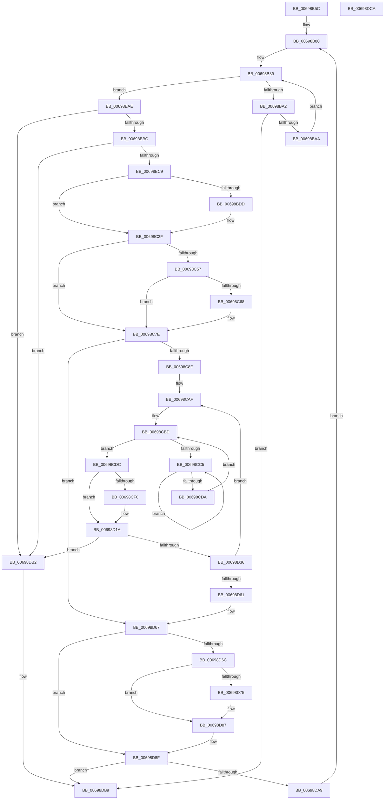

# MiDemotePfnListChain

- RVA: `0x00698B5C`–`0x00698DCB` (길이 `623` bytes)
- VA: `0x0000000140698B5C`
- 실행 섹션: `.text`
- PDB 이름 있음: `예`; PDB Function 태그: `아니요`
- unwind 정보 RVA: `0x0008C448`
- 디코드: `162`개 명령, `623/623` bytes 표시
- 미해석 바이트: `0` (있으면 어셈블리에 `.byte`로 보존)

> 이 문서는 커널 이미지의 기계어와 PDB 기호를 분석해 생성했습니다. 4번과 5번은 함수 원형과 자료형을 바이너리 사용 방식에서 추정한 C 해석이며 원본 소스 복구 결과는 아닙니다.

## 1. Dependencies

- 직접 호출 지점: **5**; 고유 호출 대상: **5**
- 직접 호출자로 확인된 함수: **5**
- RIP 상대 이미지 참조: **3**

### Outgoing calls
- `0x00698C26` → [MiUpdateLargePageBitMap](../37/MiUpdateLargePageBitMap_function_0037619C.md) (function, `0x0037619C`)
- `0x00698C6E` → [KiRaiseIrqlProcessIrqlFlags](../4F/KiRaiseIrqlProcessIrqlFlags_function_004F56FC.md) (function, `0x004F56FC`)
- `0x00698CCD` → [KeYieldProcessorEx](../3F/KeYieldProcessorEx_function_003FBD00.md) (function, `0x003FBD00`)
- `0x00698CE6` → [MiUpdateDemotedSubPage](../43/MiUpdateDemotedSubPage_function_00435840.md) (function, `0x00435840`)
- `0x00698D7C` → [KiLowerIrqlProcessIrqlFlags](../4F/KiLowerIrqlProcessIrqlFlags_function_004F5698.md) (function, `0x004F5698`)

### Direct callers
- [MiMapUserLargePages](../3D/MiMapUserLargePages_function_003D26F4.md) at `0x003D2C52`
- [MiPopLargePfnList](../49/MiPopLargePfnList_function_0049C460.md) at `0x0049C4BF`
- [MiMakeLargePageTable](../4F/MiMakeLargePageTable_function_004F9198.md) at `0x004F9253`
- [MiFillUserPhysicalMdl](../68/MiFillUserPhysicalMdl_function_006887D4.md) at `0x00688854`
- [sub_006DCA72](../6D/Unknown_function_006DCA72.md) at `0x006DCBE9`

### Static image references
- `0x00698B80` → RVA `0x00011C60` (`.rdata`; read)
- `0x00698C18` → RVA `0x00E30088` (`.data`; read)
- `0x00698C5F` → RVA `0x00FC6D20` (`ALMOSTRO`; read)

## 2. Other-region calls and transfers

- 다른 실행 섹션으로 향하는 call: **0**
- 별도 외부 분기/꼬리 이동을 확인하지 못했습니다.

## 3. Assembly (complete function range)

```asm
00698B5C  89 54 24 10                     mov dword ptr [rsp + 0x10], edx
00698B60  53                              push rbx
00698B61  55                              push rbp
00698B62  56                              push rsi
00698B63  57                              push rdi
00698B64  41 54                           push r12
00698B66  41 55                           push r13
00698B68  41 56                           push r14
00698B6A  41 57                           push r15
00698B6C  48 83 EC 48                     sub rsp, 0x48
00698B70  8D 42 FF                        lea eax, [rdx - 1]
00698B73  4C 8B E9                        mov r13, rcx
00698B76  89 44 24 20                     mov dword ptr [rsp + 0x20], eax
00698B7A  41 BA 02 00 00 00               mov r10d, 2
00698B80  48 8D 35 D9 90 97 FF            lea rsi, [rip - 0x686f27]
00698B87  8B F8                           mov edi, eax
00698B89  8B D7                           mov edx, edi
00698B8B  48 8D 04 52                     lea rax, [rdx + rdx*2]
00698B8F  48 8D 0C C5 00 00 00 00         lea rcx, [rax*8]
00698B97  49 03 CD                        add rcx, r13
00698B9A  4C 8B 31                        mov r14, qword ptr [rcx]
00698B9D  4C 3B F1                        cmp r14, rcx
00698BA0  75 0C                           jne 0x140698bae
00698BA2  85 FF                           test edi, edi
00698BA4  0F 84 0F 02 00 00               je 0x140698db9
00698BAA  FF CF                           dec edi
00698BAC  EB DB                           jmp 0x140698b89
00698BAE  48 FF 49 10                     dec qword ptr [rcx + 0x10]
00698BB2  49 39 4E 08                     cmp qword ptr [r14 + 8], rcx
00698BB6  0F 85 F6 01 00 00               jne 0x140698db2
00698BBC  49 8B 06                        mov rax, qword ptr [r14]
00698BBF  4C 39 70 08                     cmp qword ptr [rax + 8], r14
00698BC3  0F 85 E9 01 00 00               jne 0x140698db2
00698BC9  48 8B 1C D6                     mov rbx, qword ptr [rsi + rdx*8]
00698BCD  48 89 01                        mov qword ptr [rcx], rax
00698BD0  48 89 48 08                     mov qword ptr [rax + 8], rcx
00698BD4  44 0F 20 C5                     mov rbp, cr8
00698BD8  83 FF 01                        cmp edi, 1
00698BDB  75 52                           jne 0x140698c2f
00698BDD  49 8B 4E 28                     mov rcx, qword ptr [r14 + 0x28]
00698BE1  44 8D 4F 05                     lea r9d, [rdi + 5]
00698BE5  41 3A EA                        cmp bpl, r10b
00698BE8  45 0F 45 CA                     cmovne r9d, r10d
00698BEC  48 B8 00 00 00 00 00 DE FF FF   movabs rax, 0xffffde0000000000
00698BF6  48 C1 E9 2B                     shr rcx, 0x2b
00698BFA  49 8B D6                        mov rdx, r14
00698BFD  48 2B D0                        sub rdx, rax
00698C00  81 E1 FF 03 00 00               and ecx, 0x3ff
00698C06  48 C1 FA 04                     sar rdx, 4
00698C0A  48 B8 AB AA AA AA AA AA AA AA   movabs rax, 0xaaaaaaaaaaaaaaab
00698C14  48 0F AF D0                     imul rdx, rax
00698C18  48 8B 05 69 74 79 00            mov rax, qword ptr [rip + 0x797469]
00698C1F  4C 8B C3                        mov r8, rbx
00698C22  48 8B 0C C8                     mov rcx, qword ptr [rax + rcx*8]
00698C26  E8 71 D5 CD FF                  call 0x14037619c
00698C2B  44 8D 57 01                     lea r10d, [rdi + 1]
00698C2F  44 8D 47 01                     lea r8d, [rdi + 1]
00698C33  33 D2                           xor edx, edx
00698C35  4E 8B 3C C6                     mov r15, qword ptr [rsi + r8*8]
00698C39  48 8B C3                        mov rax, rbx
00698C3C  49 F7 F7                        div r15
00698C3F  48 8D 34 5B                     lea rsi, [rbx + rbx*2]
00698C43  45 8B E0                        mov r12d, r8d
00698C46  48 C1 E6 04                     shl rsi, 4
00698C4A  49 03 F6                        add rsi, r14
00698C4D  48 89 44 24 28                  mov qword ptr [rsp + 0x28], rax
00698C52  41 3A EA                        cmp bpl, r10b
00698C55  74 27                           je 0x140698c7e
00698C57  44 0F 20 C5                     mov rbp, cr8
00698C5B  45 0F 22 C2                     mov cr8, r10
00698C5F  83 3D BA E0 92 00 00            cmp dword ptr [rip + 0x92e0ba], 0
00698C66  74 16                           je 0x140698c7e
00698C68  41 8A D2                        mov dl, r10b
00698C6B  40 8A CD                        mov cl, bpl
00698C6E  E8 89 CA E5 FF                  call 0x1404f56fc
00698C73  48 8B 44 24 28                  mov rax, qword ptr [rsp + 0x28]
00698C78  41 BA 02 00 00 00               mov r10d, 2
00698C7E  83 A4 24 A0 00 00 00 00         and dword ptr [rsp + 0xa0], 0
00698C86  48 85 C0                        test rax, rax
00698C89  0F 84 D8 00 00 00               je 0x140698d67
00698C8F  4F 8D 3C 7F                     lea r15, [r15 + r15*2]
00698C93  4B 8D 04 64                     lea rax, [r12 + r12*2]
00698C97  49 C1 E7 04                     shl r15, 4
00698C9B  48 8D 0C C5 00 00 00 00         lea rcx, [rax*8]
00698CA3  49 03 CD                        add rcx, r13
00698CA6  48 8D 5E 18                     lea rbx, [rsi + 0x18]
00698CAA  48 89 4C 24 30                  mov qword ptr [rsp + 0x30], rcx
00698CAF  49 2B F7                        sub rsi, r15
00698CB2  49 2B DF                        sub rbx, r15
00698CB5  83 A4 24 A8 00 00 00 00         and dword ptr [rsp + 0xa8], 0
00698CBD  F0 48 0F BA 2B 3F               lock bts qword ptr [rbx], 0x3f
00698CC3  73 17                           jae 0x140698cdc
00698CC5  48 8D 8C 24 A8 00 00 00         lea rcx, [rsp + 0xa8]
00698CCD  E8 2E 30 D6 FF                  call 0x1403fbd00
00698CD2  48 8B 03                        mov rax, qword ptr [rbx]
00698CD5  48 85 C0                        test rax, rax
00698CD8  78 EB                           js 0x140698cc5
00698CDA  EB E1                           jmp 0x140698cbd
00698CDC  44 8D 47 01                     lea r8d, [rdi + 1]
00698CE0  48 8B D6                        mov rdx, rsi
00698CE3  49 8B CE                        mov rcx, r14
00698CE6  E8 55 CB D9 FF                  call 0x140435840
00698CEB  49 3B F6                        cmp rsi, r14
00698CEE  74 2A                           je 0x140698d1a
00698CF0  8B 43 08                        mov eax, dword ptr [rbx + 8]
00698CF3  89 84 24 90 00 00 00            mov dword ptr [rsp + 0x90], eax
00698CFA  C1 E8 10                        shr eax, 0x10
00698CFD  24 FD                           and al, 0xfd
00698CFF  0C 05                           or al, 5
00698D01  88 84 24 92 00 00 00            mov byte ptr [rsp + 0x92], al
00698D08  8B 84 24 90 00 00 00            mov eax, dword ptr [rsp + 0x90]
00698D0F  89 43 08                        mov dword ptr [rbx + 8], eax
00698D12  49 8B 46 10                     mov rax, qword ptr [r14 + 0x10]
00698D16  48 89 43 F8                     mov qword ptr [rbx - 8], rax
00698D1A  48 B8 FF FF FF FF FF FF FF 7F   movabs rax, 0x7fffffffffffffff
00698D24  F0 48 21 03                     lock and qword ptr [rbx], rax
00698D28  48 8B 4C 24 30                  mov rcx, qword ptr [rsp + 0x30]
00698D2D  48 8B 01                        mov rax, qword ptr [rcx]
00698D30  48 39 48 08                     cmp qword ptr [rax + 8], rcx
00698D34  75 7C                           jne 0x140698db2
00698D36  8B 94 24 A0 00 00 00            mov edx, dword ptr [rsp + 0xa0]
00698D3D  FF C2                           inc edx
00698D3F  48 89 06                        mov qword ptr [rsi], rax
00698D42  48 89 4B F0                     mov qword ptr [rbx - 0x10], rcx
00698D46  48 89 70 08                     mov qword ptr [rax + 8], rsi
00698D4A  8B C2                           mov eax, edx
00698D4C  48 89 31                        mov qword ptr [rcx], rsi
00698D4F  89 94 24 A0 00 00 00            mov dword ptr [rsp + 0xa0], edx
00698D56  48 3B 44 24 28                  cmp rax, qword ptr [rsp + 0x28]
00698D5B  0F 82 4E FF FF FF               jb 0x140698caf
00698D61  41 BA 02 00 00 00               mov r10d, 2
00698D67  41 3A EA                        cmp bpl, r10b
00698D6A  74 23                           je 0x140698d8f
00698D6C  83 3D AD DF 92 00 00            cmp dword ptr [rip + 0x92dfad], 0
00698D73  74 12                           je 0x140698d87
00698D75  44 0F 20 C1                     mov rcx, cr8
00698D79  40 8A D5                        mov dl, bpl
00698D7C  E8 17 C9 E5 FF                  call 0x1404f5698
00698D81  41 BA 02 00 00 00               mov r10d, 2
00698D87  40 0F B6 C5                     movzx eax, bpl
00698D8B  44 0F 22 C0                     mov cr8, rax
00698D8F  48 8B 4C 24 28                  mov rcx, qword ptr [rsp + 0x28]
00698D94  4B 8D 04 64                     lea rax, [r12 + r12*2]
00698D98  49 01 4C C5 10                  add qword ptr [r13 + rax*8 + 0x10], rcx
00698D9D  8D 47 01                        lea eax, [rdi + 1]
00698DA0  3B 84 24 98 00 00 00            cmp eax, dword ptr [rsp + 0x98]
00698DA7  74 10                           je 0x140698db9
00698DA9  8B 44 24 20                     mov eax, dword ptr [rsp + 0x20]
00698DAD  E9 CE FD FF FF                  jmp 0x140698b80
00698DB2  B9 03 00 00 00                  mov ecx, 3
00698DB7  CD 29                           int 0x29
00698DB9  48 83 C4 48                     add rsp, 0x48
00698DBD  41 5F                           pop r15
00698DBF  41 5E                           pop r14
00698DC1  41 5D                           pop r13
00698DC3  41 5C                           pop r12
00698DC5  5F                              pop rdi
00698DC6  5E                              pop rsi
00698DC7  5D                              pop rbp
00698DC8  5B                              pop rbx
00698DC9  C3                              ret
00698DCA  CC                              int3
```

## 4. C-style interpretation (structured pseudocode)

```c
__int64 __fastcall MiDemotePfnListChain(__int64 a1, __int64 a2)
{
    __int64 result;
    __int64 v_r10;
    __int64 v_r15;
    __int64 v_rbx;
    __int64 v_rdi;
    __int64 v_rsi;
    __int64 v_rsp;
    unsigned __int64 v_stack_m58;
    unsigned __int64 v_stack_m60;
    unsigned int v_stack_m68;
    unsigned int v_stack_p10;
    unsigned int v_stack_p18;
    unsigned int v_stack_p20;
    unsigned int v_stack_p8;
    unsigned __int8 v_stack_pA;

    v_stack_p10 = (unsigned int)(a2);
    v_rsp = (v_rsp) - (72);
    v_stack_m68 = (unsigned int)(a2 - 1);
loc_00698B80:
loc_00698B89:
    a1 = ((unsigned int)((unsigned int)((unsigned int)((unsigned int)(a2 - 1)))) + (unsigned int)((unsigned int)((unsigned int)((unsigned int)(a2 - 1)))) * 2 * 8) + (a1);
    if ((*(unsigned __int64 *)(a1)) != a1) goto loc_00698BAE;
    if ((unsigned int)((unsigned int)((unsigned int)(a2 - 1))) == 0) goto loc_00698DB9;
    v_rdi = (unsigned int)(((unsigned int)((unsigned int)(a2 - 1))) - 1);
    goto loc_00698B89;
loc_00698BAE:
    if ((*(unsigned __int64 *)(*(unsigned __int64 *)(a1) + 8)) != a1) goto loc_00698DB2;
    if ((*(unsigned __int64 *)(*(unsigned __int64 *)(*(unsigned __int64 *)(a1)) + 8)) != (*(unsigned __int64 *)(a1))) goto loc_00698DB2;
    *(unsigned __int64 *)(a1) = *(unsigned __int64 *)(*(unsigned __int64 *)(a1));
    *(unsigned __int64 *)(*(unsigned __int64 *)(*(unsigned __int64 *)(a1)) + 8) = a1;
    result = *(unsigned __int64 *)(*(unsigned __int64 *)(a1));
    v_r10 = 2;
    if (((unsigned int)(v_rdi)) == 1) {
        a1 = *(unsigned __int64 *)(*(unsigned __int64 *)(a1) + 40);
        a4 = v_rdi + 5;
        if (((unsigned __int8)(v_cr8)) != 2) { a4 = 2; }
        a1 = (a1) >> (43);
        a2 = *(unsigned __int64 *)(a1);
        a2 = (a2) - (*(unsigned __int64 *)(*(unsigned __int64 *)(a1)));
        a1 = (unsigned int)((a1) & (0x3FFULL));
        a2 = (a2) >> (4);
        a2 = (a2) * (*(unsigned __int64 *)(*(unsigned __int64 *)(a1)));
        result = *(unsigned __int64 *)(v_rip + 7959657);
        a3 = *(unsigned __int64 *)(v_rip - 6844199 + (unsigned int)((unsigned int)((unsigned int)((unsigned int)(a2 - 1)))) * 8);
        a1 = *(unsigned __int64 *)(result + a1 * 8);
        result = MiUpdateLargePageBitMap(a1, a2, a3, a4);
        v_r10 = v_rdi + 1;
    }
    a2 = 0;
    v_rsi = (*(unsigned __int64 *)(v_rip - 6844199 + (unsigned int)((unsigned int)((unsigned int)((unsigned int)(a2 - 1)))) * 8) + *(unsigned __int64 *)(v_rip - 6844199 + (unsigned int)((unsigned int)((unsigned int)((unsigned int)(a2 - 1)))) * 8) * 2) << (4);
    v_rsi = (v_rsi) + (*(unsigned __int64 *)(a1));
    v_stack_m60 = *(unsigned __int64 *)(v_rip - 6844199 + (unsigned int)((unsigned int)((unsigned int)((unsigned int)(a2 - 1)))) * 8);
    if (((unsigned __int8)(v_cr8)) == ((unsigned __int8)(v_r10))) goto loc_00698C7E;
    result = *(unsigned __int64 *)(v_rip - 6844199 + (unsigned int)((unsigned int)((unsigned int)((unsigned int)(a2 - 1)))) * 8);
    if ((*(unsigned int *)(v_rip + 9625786)) != 0) {
        a2 = (unsigned __int8)(v_r10);
        a1 = (unsigned __int8)(v_cr8);
        result = KiRaiseIrqlProcessIrqlFlags(a1, a2, v_rdi + 1, a4);
        result = v_stack_m60;
        v_r10 = 2;
    }
    if (result == 0) goto loc_00698D67;
    v_r15 = (*(unsigned __int64 *)(v_rip - 6844199 + v_rdi + 1 * 8) + *(unsigned __int64 *)(v_rip - 6844199 + v_rdi + 1 * 8) * 2) << (4);
    a1 = ((unsigned int)((unsigned int)(v_rdi + 1)) + (unsigned int)((unsigned int)(v_rdi + 1)) * 2 * 8) + (a1);
    v_stack_m58 = a1;
loc_00698CAF:
    v_rsi = (v_rsi) - (v_r15);
    v_rbx = (v_rsi + 24) - (v_r15);
loc_00698CBD:
    if (condition_is_above_or_equal) goto loc_00698CDC;
loc_00698CC5:
    result = KeYieldProcessorEx(v_stack_p20, a2, v_rdi + 1, a4);
    if (sign_flag) goto loc_00698CC5;
    goto loc_00698CBD;
loc_00698CDC:
    result = MiUpdateDemotedSubPage(*(unsigned __int64 *)(a1), v_rsi, v_rdi + 1, a4);
    if (v_rsi != (*(unsigned __int64 *)(a1))) {
        result = *(unsigned int *)(v_rbx + 8);
        v_stack_p8 = (unsigned int)(result);
        result = (unsigned int)((result) >> (16));
        result = (unsigned __int8)((result) & (253));
        result = (unsigned __int8)((result) | (5));
        v_stack_pA = (unsigned __int8)(result);
        result = v_stack_p8;
        *(unsigned int *)(v_rbx + 8) = (unsigned int)(result);
        result = *(unsigned __int64 *)(*(unsigned __int64 *)(a1) + 16);
        *(unsigned __int64 *)(v_rbx - 8) = result;
    }
    if ((*(unsigned __int64 *)(*(unsigned __int64 *)(v_stack_m58) + 8)) != v_stack_m58) goto loc_00698DB2;
    a2 = (unsigned int)(((unsigned int)(v_stack_p18)) + 1);
    *(unsigned __int64 *)(v_rsi) = *(unsigned __int64 *)(v_stack_m58);
    *(unsigned __int64 *)(v_rbx - 16) = v_stack_m58;
    *(unsigned __int64 *)(*(unsigned __int64 *)(v_stack_m58) + 8) = v_rsi;
    *(unsigned __int64 *)(v_stack_m58) = v_rsi;
    v_stack_p18 = (unsigned int)(a2);
    if (((unsigned int)((unsigned int)(a2))) < v_stack_m60) goto loc_00698CAF;
loc_00698D67:
    if (((unsigned __int8)(v_cr8)) == 2) goto loc_00698D8F;
    result = (unsigned int)((unsigned int)(a2));
    v_r10 = 2;
    if ((*(unsigned int *)(v_rip + 9625517)) != 0) {
        a1 = v_r10;
        a2 = (unsigned __int8)(v_cr8);
        result = KiLowerIrqlProcessIrqlFlags(a1, a2, v_rdi + 1, a4);
        v_r10 = 2;
    }
loc_00698D8F:
    if (((unsigned int)(v_rdi + 1)) == v_stack_p10) goto loc_00698DB9;
    goto loc_00698B80;
loc_00698DB2:
loc_00698DB9:
    v_rsp = (v_rsp) + (72);
    return (unsigned int)(v_stack_m68);
}
```

## 5. (Beta) C Style

```c
int64_t MiDemotePfnListChain(void *Arg1, void *Arg2)
{
    uint8_t *arg1 = (uint8_t *)Arg1;
    uint8_t *arg2 = (uint8_t *)Arg2;

    int64_t result;
    int64_t local_r10;
    int64_t local_r15;
    int64_t local_rbx;
    int64_t local_rdi;
    int64_t local_rsi;
    int64_t local_rsp;
    uint64_t v_stack_m58;
    uint64_t v_stack_m60;
    uint32_t v_stack_m68;
    uint32_t v_stack_p10;
    uint32_t v_stack_p18;
    uint32_t v_stack_p20;
    uint32_t v_stack_p8;
    uint8_t v_stack_pA;

    v_stack_p10 = (uint32_t)(Arg2);
    local_rsp = (local_rsp) - (72);
    v_stack_m68 = (uint32_t)(Arg2 - 1);
loc_00698B80:
loc_00698B89:
    Arg1 = ((uint32_t)((uint32_t)((uint32_t)((uint32_t)(Arg2 - 1)))) + (uint32_t)((uint32_t)((uint32_t)((uint32_t)(Arg2 - 1)))) * 2 * 8) + (Arg1);
    if ((*(uint64_t *)(arg1)) != Arg1) goto loc_00698BAE;
    if ((uint32_t)((uint32_t)((uint32_t)(Arg2 - 1))) == 0) goto loc_00698DB9;
    local_rdi = (uint32_t)(((uint32_t)((uint32_t)(Arg2 - 1))) - 1);
    goto loc_00698B89;
loc_00698BAE:
    if ((*(uint64_t *)(*(uint64_t *)(arg1) + 0x8)) != Arg1) goto loc_00698DB2;
    if ((*(uint64_t *)(*(uint64_t *)(*(uint64_t *)(arg1)) + 0x8)) != (*(uint64_t *)(arg1))) goto loc_00698DB2;
    *(uint64_t *)(arg1) = *(uint64_t *)(*(uint64_t *)(arg1));
    *(void **)(*(uint64_t *)(*(uint64_t *)(arg1)) + 0x8) = Arg1;
    result = *(uint64_t *)(*(uint64_t *)(arg1));
    local_r10 = 2;
    if (((uint32_t)(local_rdi)) == 1) {
        Arg1 = *(uint64_t *)(*(uint64_t *)(arg1) + 0x28);
        a4 = local_rdi + 5;
        if (((uint8_t)(v_cr8)) != 2) { a4 = 2; }
        Arg1 = (Arg1) >> (43);
        Arg2 = *(uint64_t *)(arg1);
        Arg2 = (Arg2) - (*(uint64_t *)(*(uint64_t *)(arg1)));
        Arg1 = (uint32_t)((Arg1) & (0x3FFULL));
        Arg2 = (Arg2) >> (4);
        Arg2 = (Arg2) * (*(uint64_t *)(*(uint64_t *)(arg1)));
        result = *(uint64_t *)(v_rip + 0x797469);
        a3 = *(uint64_t *)(v_rip - 0x686F27 + (uint32_t)((uint32_t)((uint32_t)((uint32_t)(arg2 - 0x1)))) * 8);
        Arg1 = *(uint64_t *)(result + arg1 * 8);
        result = MiUpdateLargePageBitMap(Arg1, Arg2, a3, a4);
        local_r10 = local_rdi + 1;
    }
    Arg2 = 0;
    local_rsi = (*(uint64_t *)(v_rip - 0x686F27 + (uint32_t)((uint32_t)((uint32_t)((uint32_t)(arg2 - 0x1)))) * 8) + *(uint64_t *)(v_rip - 0x686F27 + (uint32_t)((uint32_t)((uint32_t)((uint32_t)(arg2 - 0x1)))) * 8) * 2) << (4);
    local_rsi = (local_rsi) + (*(uint64_t *)(arg1));
    v_stack_m60 = *(uint64_t *)(v_rip - 0x686F27 + (uint32_t)((uint32_t)((uint32_t)((uint32_t)(arg2 - 0x1)))) * 8);
    if (((uint8_t)(v_cr8)) == ((uint8_t)(local_r10))) goto loc_00698C7E;
    result = *(uint64_t *)(v_rip - 0x686F27 + (uint32_t)((uint32_t)((uint32_t)((uint32_t)(arg2 - 0x1)))) * 8);
    if ((*(uint32_t *)(v_rip + 0x92E0BA)) != 0) {
        Arg2 = (uint8_t)(local_r10);
        Arg1 = (uint8_t)(v_cr8);
        result = KiRaiseIrqlProcessIrqlFlags(Arg1, Arg2, local_rdi + 1, a4);
        result = v_stack_m60;
        local_r10 = 2;
    }
    if (result == 0) goto loc_00698D67;
    local_r15 = (*(uint64_t *)(v_rip - 0x686F27 + local_rdi + 0x1 * 8) + *(uint64_t *)(v_rip - 0x686F27 + local_rdi + 0x1 * 8) * 2) << (4);
    Arg1 = ((uint32_t)((uint32_t)(local_rdi + 1)) + (uint32_t)((uint32_t)(local_rdi + 1)) * 2 * 8) + (Arg1);
    v_stack_m58 = Arg1;
loc_00698CAF:
    local_rsi = (local_rsi) - (local_r15);
    local_rbx = (local_rsi + 24) - (local_r15);
loc_00698CBD:
    if (condition_is_above_or_equal) goto loc_00698CDC;
loc_00698CC5:
    result = KeYieldProcessorEx(v_stack_p20, Arg2, local_rdi + 1, a4);
    if (sign_flag) goto loc_00698CC5;
    goto loc_00698CBD;
loc_00698CDC:
    result = MiUpdateDemotedSubPage(*(uint64_t *)(arg1), local_rsi, local_rdi + 1, a4);
    if (local_rsi != (*(uint64_t *)(arg1))) {
        result = *(uint32_t *)(local_rbx + 0x8);
        v_stack_p8 = (uint32_t)(result);
        result = (uint32_t)((result) >> (16));
        result = (uint8_t)((result) & (253));
        result = (uint8_t)((result) | (5));
        v_stack_pA = (uint8_t)(result);
        result = v_stack_p8;
        *(uint32_t *)(local_rbx + 0x8) = (uint32_t)(result);
        result = *(uint64_t *)(*(uint64_t *)(arg1) + 0x10);
        *(uint64_t *)(local_rbx - 0x8) = result;
    }
    if ((*(uint64_t *)(*(uint64_t *)(v_stack_m58) + 0x8)) != v_stack_m58) goto loc_00698DB2;
    Arg2 = (uint32_t)(((uint32_t)(v_stack_p18)) + 1);
    *(uint64_t *)(local_rsi) = *(uint64_t *)(v_stack_m58);
    *(uint64_t *)(local_rbx - 0x10) = v_stack_m58;
    *(uint64_t *)(*(uint64_t *)(v_stack_m58) + 0x8) = local_rsi;
    *(uint64_t *)(v_stack_m58) = local_rsi;
    v_stack_p18 = (uint32_t)(Arg2);
    if (((uint32_t)((uint32_t)(Arg2))) < v_stack_m60) goto loc_00698CAF;
loc_00698D67:
    if (((uint8_t)(v_cr8)) == 2) goto loc_00698D8F;
    result = (uint32_t)((uint32_t)(Arg2));
    local_r10 = 2;
    if ((*(uint32_t *)(v_rip + 0x92DFAD)) != 0) {
        Arg1 = local_r10;
        Arg2 = (uint8_t)(v_cr8);
        result = KiLowerIrqlProcessIrqlFlags(Arg1, Arg2, local_rdi + 1, a4);
        local_r10 = 2;
    }
loc_00698D8F:
    if (((uint32_t)(local_rdi + 1)) == v_stack_p10) goto loc_00698DB9;
    goto loc_00698B80;
loc_00698DB2:
loc_00698DB9:
    local_rsp = (local_rsp) + (72);
    return (uint32_t)(v_stack_m68);
}
```

### 관측된 메모리 오프셋

구조체 형식이 확인되지 않은 접근은 인자 기준의 오프셋으로만 기록했습니다.

| 기준 인자 | 오프셋 표현 | 폭 (bit) | 접근 |
|---|---:|---:|---|
| `Arg1` | `+ 0x10 + rax*8` | `64` | `R/W` |
| `Arg2` | `- 0x1` | `32` | `R` |

## 6. Execution-region graph

[열기: 2D/3D 그래프와 함수 탐색 컨트롤 패널](../../../control-panel.html?section=text&rva=0x00698B5C&view=graph)

- 2D 그래프는 위에서 아래로 흐르고, 3D 그래프는 빈 공간을 드래그해 회전합니다. Shift+드래그는 이동, 휠은 확대·축소, 함수 노드 선택은 대상 보고서 이동입니다.

### Static fallback


