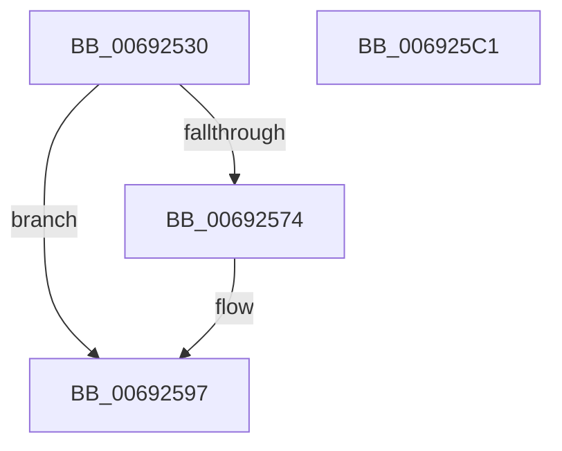

# MiDereferenceDataSubsections

- RVA: `0x00692530`–`0x006925C2` (길이 `146` bytes)
- VA: `0x0000000140692530`
- 실행 섹션: `.text`
- PDB 이름 있음: `예`; PDB Function 태그: `아니요`
- unwind 정보 RVA: `0x00095AD0`
- 디코드: `44`개 명령, `146/146` bytes 표시
- 미해석 바이트: `0` (있으면 어셈블리에 `.byte`로 보존)

> 이 문서는 커널 이미지의 기계어와 PDB 기호를 분석해 생성했습니다. 4번과 5번은 함수 원형과 자료형을 바이너리 사용 방식에서 추정한 C 해석이며 원본 소스 복구 결과는 아닙니다.

## 1. Dependencies

- 직접 호출 지점: **4**; 고유 호출 대상: **4**
- 직접 호출자로 확인된 함수: **1**
- RIP 상대 이미지 참조: **0**

### Outgoing calls
- `0x00692560` → [MiOffsetToProtos](../24/MiOffsetToProtos_function_0024D880.md) (function, `0x0024D880`)
- `0x00692587` → [MiLocateSubsectionNode](../2B/MiLocateSubsectionNode_function_002BBEE0.md) (function, `0x002BBEE0`)
- `0x00692592` → [MiDecrementLargeSubsections](../4D/MiDecrementLargeSubsections_function_004D2BE0.md) (function, `0x004D2BE0`)
- `0x006925A3` → [MiRemoveViewsFromSectionWithPfn](../29/MiRemoveViewsFromSectionWithPfn_function_002986D4.md) (function, `0x002986D4`)

### Direct callers
- [MiInsertInSystemSpace](../3B/MiInsertInSystemSpace_function_003B2F5C.md) at `0x003B35FA`

### Static image references
- 디코드된 RIP-relative 메모리 참조가 없습니다.

## 2. Other-region calls and transfers

- 다른 실행 섹션으로 향하는 call: **0**
- 별도 외부 분기/꼬리 이동을 확인하지 못했습니다.

## 3. Assembly (complete function range)

```asm
00692530  48 8B C4                        mov rax, rsp
00692533  48 89 58 08                     mov qword ptr [rax + 8], rbx
00692537  48 89 68 18                     mov qword ptr [rax + 0x18], rbp
0069253B  48 89 70 20                     mov qword ptr [rax + 0x20], rsi
0069253F  57                              push rdi
00692540  41 56                           push r14
00692542  41 57                           push r15
00692544  48 83 EC 20                     sub rsp, 0x20
00692548  48 83 60 10 00                  and qword ptr [rax + 0x10], 0
0069254D  49 8B F8                        mov rdi, r8
00692550  4C 8B F2                        mov r14, rdx
00692553  4C 8D 40 10                     lea r8, [rax + 0x10]
00692557  48 8B 12                        mov rdx, qword ptr [rdx]
0069255A  41 8B D9                        mov ebx, r9d
0069255D  4C 8B F9                        mov r15, rcx
00692560  E8 1B B3 BB FF                  call 0x14024d880
00692565  48 8B 6C 24 48                  mov rbp, qword ptr [rsp + 0x48]
0069256A  48 8B F0                        mov rsi, rax
0069256D  48 03 EF                        add rbp, rdi
00692570  85 DB                           test ebx, ebx
00692572  74 23                           je 0x140692597
00692574  49 8B 16                        mov rdx, qword ptr [r14]
00692577  45 33 C0                        xor r8d, r8d
0069257A  48 FF CA                        dec rdx
0069257D  48 C1 E7 0C                     shl rdi, 0xc
00692581  48 03 D7                        add rdx, rdi
00692584  49 8B CF                        mov rcx, r15
00692587  E8 54 99 C2 FF                  call 0x1402bbee0
0069258C  48 8B D0                        mov rdx, rax
0069258F  48 8B CE                        mov rcx, rsi
00692592  E8 49 06 E4 FF                  call 0x1404d2be0
00692597  41 B8 88 00 00 00               mov r8d, 0x88
0069259D  48 8B D5                        mov rdx, rbp
006925A0  48 8B CE                        mov rcx, rsi
006925A3  E8 2C 61 C0 FF                  call 0x1402986d4
006925A8  48 8B 5C 24 40                  mov rbx, qword ptr [rsp + 0x40]
006925AD  48 8B 6C 24 50                  mov rbp, qword ptr [rsp + 0x50]
006925B2  48 8B 74 24 58                  mov rsi, qword ptr [rsp + 0x58]
006925B7  48 83 C4 20                     add rsp, 0x20
006925BB  41 5F                           pop r15
006925BD  41 5E                           pop r14
006925BF  5F                              pop rdi
006925C0  C3                              ret
006925C1  CC                              int3
```

## 4. C-style interpretation (structured pseudocode)

```c
__int64 __fastcall MiDereferenceDataSubsections(__int64 a1, __int64 a2, __int64 a3, int a4)
{
    __int64 result;
    __int64 v_rbp;
    __int64 v_rdi;
    __int64 v_rsp;
    unsigned __int64 v_stack_p10;
    unsigned __int64 v_stack_p18;
    unsigned __int64 v_stack_p20;
    unsigned __int64 v_stack_p8;

    *(unsigned __int64 *)(v_rsp + 8) = v_rbx;
    *(unsigned __int64 *)(v_rsp + 24) = v_rbp;
    *(unsigned __int64 *)(v_rsp + 32) = v_rsi;
    v_rsp = (v_rsp) - (32);
    result = MiOffsetToProtos(a1, *(unsigned __int64 *)(a2), v_rsp + 16, a4);
    v_rbp = (v_stack_p10) + (a3);
    v_rdi = a3;
    if ((unsigned int)((unsigned int)(a4)) != 0) {
        a2 = *(unsigned __int64 *)(a2);
        a3 = 0;
        a2 = (a2) - 1;
        v_rdi = (a3) << (12);
        a2 = (a2) + (v_rdi);
        a1 = a1;
        result = MiLocateSubsectionNode(a1, a2, a3, a4);
        a2 = result;
        a1 = result;
        result = MiDecrementLargeSubsections(a1, a2, a3, a4);
    }
    result = MiRemoveViewsFromSectionWithPfn(result, v_rbp, 136, a4);
    v_rsp = (v_rsp) + (32);
    return result;
}
```

## 5. (Beta) C Style

```c
int64_t MiDereferenceDataSubsections(int64_t Arg1, void *Arg2, int64_t Arg3, int32_t Arg4)
{
    uint8_t *arg2 = (uint8_t *)Arg2;

    int64_t result;
    int64_t local_rbp;
    int64_t local_rdi;
    int64_t local_rsp;
    uint64_t v_stack_p10;
    uint64_t v_stack_p18;
    uint64_t v_stack_p20;
    uint64_t v_stack_p8;

    *(uint64_t *)(local_rsp + 0x8) = local_rbx;
    *(uint64_t *)(local_rsp + 0x18) = local_rbp;
    *(uint64_t *)(local_rsp + 0x20) = local_rsi;
    local_rsp = (local_rsp) - (32);
    result = MiOffsetToProtos(Arg1, *(uint64_t *)(arg2), local_rsp + 16, Arg4);
    local_rbp = (v_stack_p10) + (Arg3);
    local_rdi = Arg3;
    if ((uint32_t)((uint32_t)(Arg4)) != 0) {
        Arg2 = *(uint64_t *)(arg2);
        Arg3 = 0;
        Arg2 = (Arg2) - 1;
        local_rdi = (Arg3) << (12);
        Arg2 = (Arg2) + (local_rdi);
        Arg1 = Arg1;
        result = MiLocateSubsectionNode(Arg1, Arg2, Arg3, Arg4);
        Arg2 = result;
        Arg1 = result;
        result = MiDecrementLargeSubsections(Arg1, Arg2, Arg3, Arg4);
    }
    result = MiRemoveViewsFromSectionWithPfn(result, local_rbp, 136, Arg4);
    local_rsp = (local_rsp) + (32);
    return result;
}
```

### 관측된 메모리 오프셋

구조체 형식이 확인되지 않은 접근은 인자 기준의 오프셋으로만 기록했습니다.

| 기준 인자 | 오프셋 표현 | 폭 (bit) | 접근 |
|---|---:|---:|---|
| `Arg2` | `+ 0x0` | `64` | `R` |

## 6. Execution-region graph

[열기: 2D/3D 그래프와 함수 탐색 컨트롤 패널](../../../control-panel.html?section=text&rva=0x00692530&view=graph)

- 2D 그래프는 위에서 아래로 흐르고, 3D 그래프는 빈 공간을 드래그해 회전합니다. Shift+드래그는 이동, 휠은 확대·축소, 함수 노드 선택은 대상 보고서 이동입니다.

### Static fallback


