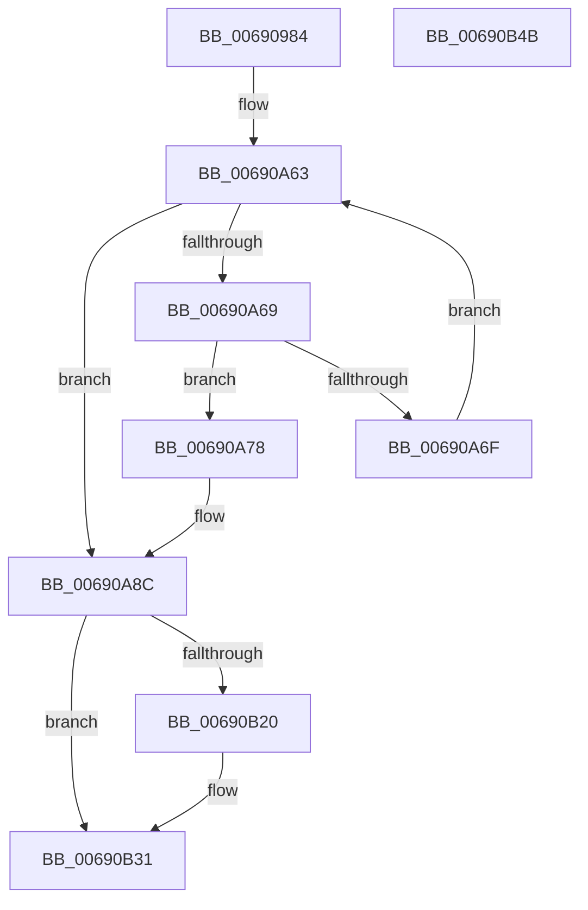

# MiDrainCrossPartitionUsage

- RVA: `0x00690984`–`0x00690B4C` (길이 `456` bytes)
- VA: `0x0000000140690984`
- 실행 섹션: `.text`
- PDB 이름 있음: `예`; PDB Function 태그: `아니요`
- unwind 정보 RVA: `0x000D78F4`
- 디코드: `109`개 명령, `456/456` bytes 표시
- 미해석 바이트: `0` (있으면 어셈블리에 `.byte`로 보존)

> 이 문서는 커널 이미지의 기계어와 PDB 기호를 분석해 생성했습니다. 4번과 5번은 함수 원형과 자료형을 바이너리 사용 방식에서 추정한 C 해석이며 원본 소스 복구 결과는 아닙니다.

## 1. Dependencies

- 직접 호출 지점: **22**; 고유 호출 대상: **15**
- 직접 호출자로 확인된 함수: **1**
- RIP 상대 이미지 참조: **1**

### Outgoing calls
- `0x006909C4` → [ExAcquireSpinLockExclusive](../24/ExAcquireSpinLockExclusive_function_00248690.md) (function, `0x00248690`)
- `0x006909D5` → [ExAcquireSpinLockExclusiveAtDpcLevel](../24/ExAcquireSpinLockExclusiveAtDpcLevel_function_00248E80.md) (function, `0x00248E80`)
- `0x006909F1` → [ExReleaseSpinLockExclusiveFromDpcLevel](../24/ExReleaseSpinLockExclusiveFromDpcLevel_function_002497E0.md) (function, `0x002497E0`)
- `0x006909FF` → [MiReleaseSpinLockExclusive](../24/MiReleaseSpinLockExclusive_function_002482C0.md) (function, `0x002482C0`)
- `0x00690A0E` → [MiDecrementControlAreaCount](../46/MiDecrementControlAreaCount_function_00467414.md) (function, `0x00467414`)
- `0x00690A1D` → [MiDecrementControlAreaCount](../46/MiDecrementControlAreaCount_function_00467414.md) (function, `0x00467414`)
- `0x00690A25` → [MiMakeUnusedSegmentDeleteOnClose](../67/MiMakeUnusedSegmentDeleteOnClose_function_00678078.md) (function, `0x00678078`)
- `0x00690A33` → [CcExitPartition](../57/CcExitPartition_function_0057E340.md) (function, `0x0057E340`)
- `0x00690A4A` → [KeWaitForSingleObject](../20/KeWaitForSingleObject_function_0020E6B0.md) (function, `0x0020E6B0`)
- `0x00690A52` → [ExAcquireSpinLockExclusive](../24/ExAcquireSpinLockExclusive_function_00248690.md) (function, `0x00248690`)
- `0x00690A7C` → [KeResetEvent](../24/KeResetEvent_function_00248350.md) (function, `0x00248350`)
- `0x00690A91` → [MiReleaseSpinLockExclusive](../24/MiReleaseSpinLockExclusive_function_002482C0.md) (function, `0x002482C0`)
- `0x00690AA8` → [KeWaitForSingleObject](../20/KeWaitForSingleObject_function_0020E6B0.md) (function, `0x0020E6B0`)
- `0x00690AB1` → [KeResetEvent](../24/KeResetEvent_function_00248350.md) (function, `0x00248350`)
- `0x00690AC4` → [MiDecrementCloneHeaderCount](../4F/MiDecrementCloneHeaderCount_function_004F60F0.md) (function, `0x004F60F0`)
- `0x00690ADB` → [KeWaitForSingleObject](../20/KeWaitForSingleObject_function_0020E6B0.md) (function, `0x0020E6B0`)
- `0x00690AE9` → [CcExitPartition](../57/CcExitPartition_function_0057E340.md) (function, `0x0057E340`)
- `0x00690AF1` → [MiStoreDeletePartition](MiStoreDeletePartition_function_006926F4.md) (function, `0x006926F4`)
- `0x00690AFD` → [SmDeletePartition](../../page/7A/SmDeletePartition_function_007A59C0.md) (function, `0x007A59C0`)
- `0x00690B0C` → [ExWaitForRundownProtectionRelease](../2A/ExWaitForRundownProtectionRelease_function_002A4CB0.md) (function, `0x002A4CB0`)
- `0x00690B20` → [ExWaitForRundownProtectionReleaseCacheAware](../46/ExWaitForRundownProtectionReleaseCacheAware_function_004643A0.md) (function, `0x004643A0`)
- `0x00690B2C` → [ExRundownCompletedCacheAware](../46/ExRundownCompletedCacheAware_function_00464360.md) (function, `0x00464360`)

### Direct callers
- [MiDeletePartition](../../page/7F/MiDeletePartition_function_007FD2BC.md) at `0x007FD2CC`

### Static image references
- `0x006909B9` → RVA `0x00E30040` (`.data`; read)

## 2. Other-region calls and transfers

- 다른 실행 섹션으로 향하는 call: **1**
  - `0x00690AFD` → [SmDeletePartition](../../page/7A/SmDeletePartition_function_007A59C0.md) (`.text` → `PAGE`)
- 별도 외부 분기/꼬리 이동을 확인하지 못했습니다.

## 3. Assembly (complete function range)

```asm
00690984  48 8B C4                        mov rax, rsp
00690987  48 89 58 08                     mov qword ptr [rax + 8], rbx
0069098B  48 89 70 10                     mov qword ptr [rax + 0x10], rsi
0069098F  48 89 78 18                     mov qword ptr [rax + 0x18], rdi
00690993  4C 89 70 20                     mov qword ptr [rax + 0x20], r14
00690997  55                              push rbp
00690998  48 8B EC                        mov rbp, rsp
0069099B  48 83 EC 50                     sub rsp, 0x50
0069099F  83 65 E4 00                     and dword ptr [rbp - 0x1c], 0
006909A3  48 8D 45 E8                     lea rax, [rbp - 0x18]
006909A7  48 89 45 F0                     mov qword ptr [rbp - 0x10], rax
006909AB  48 8B F9                        mov rdi, rcx
006909AE  48 8D 45 E8                     lea rax, [rbp - 0x18]
006909B2  C7 45 E0 00 00 06 00            mov dword ptr [rbp - 0x20], 0x60000
006909B9  48 8D 0D 80 F6 79 00            lea rcx, [rip + 0x79f680]
006909C0  48 89 45 E8                     mov qword ptr [rbp - 0x18], rax
006909C4  E8 C7 7C BB FF                  call 0x140248690
006909C9  4C 8D B7 C0 06 00 00            lea r14, [rdi + 0x6c0]
006909D0  8A D8                           mov bl, al
006909D2  49 8B CE                        mov rcx, r14
006909D5  E8 A6 84 BB FF                  call 0x140248e80
006909DA  BE 01 00 00 00                  mov esi, 1
006909DF  F0 09 77 04                     lock or dword ptr [rdi + 4], esi
006909E3  48 8D 45 E0                     lea rax, [rbp - 0x20]
006909E7  49 8B CE                        mov rcx, r14
006909EA  48 89 87 E0 0A 00 00            mov qword ptr [rdi + 0xae0], rax
006909F1  E8 EA 8D BB FF                  call 0x1402497e0
006909F6  8A D3                           mov dl, bl
006909F8  48 8D 0D 41 F6 79 00            lea rcx, [rip + 0x79f641]
006909FF  E8 BC 78 BB FF                  call 0x1402482c0
00690A04  48 8D 97 D0 06 00 00            lea rdx, [rdi + 0x6d0]
00690A0B  48 8B CF                        mov rcx, rdi
00690A0E  E8 01 6A DD FF                  call 0x140467414
00690A13  48 8D 97 C8 06 00 00            lea rdx, [rdi + 0x6c8]
00690A1A  48 8B CF                        mov rcx, rdi
00690A1D  E8 F2 69 DD FF                  call 0x140467414
00690A22  48 8B CF                        mov rcx, rdi
00690A25  E8 4E 76 FE FF                  call 0x140678078
00690A2A  48 8B 8F B8 00 00 00            mov rcx, qword ptr [rdi + 0xb8]
00690A31  33 D2                           xor edx, edx
00690A33  E8 08 D9 EE FF                  call 0x14057e340
00690A38  48 83 64 24 20 00               and qword ptr [rsp + 0x20], 0
00690A3E  48 8D 4D E0                     lea rcx, [rbp - 0x20]
00690A42  45 33 C9                        xor r9d, r9d
00690A45  45 33 C0                        xor r8d, r8d
00690A48  33 D2                           xor edx, edx
00690A4A  E8 61 DC B7 FF                  call 0x14020e6b0
00690A4F  49 8B CE                        mov rcx, r14
00690A52  E8 39 7C BB FF                  call 0x140248690
00690A57  8A D8                           mov bl, al
00690A59  8D 4E 06                        lea ecx, [rsi + 6]
00690A5C  48 8D 97 98 0A 00 00            lea rdx, [rdi + 0xa98]
00690A63  48 83 F9 09                     cmp rcx, 9
00690A67  7D 23                           jge 0x140690a8c
00690A69  48 83 3A 00                     cmp qword ptr [rdx], 0
00690A6D  75 09                           jne 0x140690a78
00690A6F  48 03 CE                        add rcx, rsi
00690A72  48 83 C2 20                     add rdx, 0x20
00690A76  EB EB                           jmp 0x140690a63
00690A78  48 8D 4D E0                     lea rcx, [rbp - 0x20]
00690A7C  E8 CF 78 BB FF                  call 0x140248350
00690A81  48 8D 45 E0                     lea rax, [rbp - 0x20]
00690A85  48 89 87 D8 0A 00 00            mov qword ptr [rdi + 0xad8], rax
00690A8C  8A D3                           mov dl, bl
00690A8E  49 8B CE                        mov rcx, r14
00690A91  E8 2A 78 BB FF                  call 0x1402482c0
00690A96  48 83 64 24 20 00               and qword ptr [rsp + 0x20], 0
00690A9C  48 8D 4D E0                     lea rcx, [rbp - 0x20]
00690AA0  45 33 C9                        xor r9d, r9d
00690AA3  45 33 C0                        xor r8d, r8d
00690AA6  33 D2                           xor edx, edx
00690AA8  E8 03 DC B7 FF                  call 0x14020e6b0
00690AAD  48 8D 4D E0                     lea rcx, [rbp - 0x20]
00690AB1  E8 9A 78 BB FF                  call 0x140248350
00690AB6  48 8D 45 E0                     lea rax, [rbp - 0x20]
00690ABA  48 8B CF                        mov rcx, rdi
00690ABD  48 89 87 E8 0A 00 00            mov qword ptr [rdi + 0xae8], rax
00690AC4  E8 27 56 E6 FF                  call 0x1404f60f0
00690AC9  48 83 64 24 20 00               and qword ptr [rsp + 0x20], 0
00690ACF  48 8D 4D E0                     lea rcx, [rbp - 0x20]
00690AD3  45 33 C9                        xor r9d, r9d
00690AD6  45 33 C0                        xor r8d, r8d
00690AD9  33 D2                           xor edx, edx
00690ADB  E8 D0 DB B7 FF                  call 0x14020e6b0
00690AE0  48 8B 8F B8 00 00 00            mov rcx, qword ptr [rdi + 0xb8]
00690AE7  8B D6                           mov edx, esi
00690AE9  E8 52 D8 EE FF                  call 0x14057e340
00690AEE  48 8B CF                        mov rcx, rdi
00690AF1  E8 FE 1B 00 00                  call 0x1406926f4
00690AF6  48 8B 8F B8 00 00 00            mov rcx, qword ptr [rdi + 0xb8]
00690AFD  E8 BE 4E 11 00                  call 0x1407a59c0
00690B02  48 8D 9F C8 47 00 00            lea rbx, [rdi + 0x47c8]
00690B09  48 8B CB                        mov rcx, rbx
00690B0C  E8 9F 41 C1 FF                  call 0x1402a4cb0
00690B11  48 87 33                        xchg qword ptr [rbx], rsi
00690B14  48 8B 8F F0 0A 00 00            mov rcx, qword ptr [rdi + 0xaf0]
00690B1B  48 85 C9                        test rcx, rcx
00690B1E  74 11                           je 0x140690b31
00690B20  E8 7B 38 DD FF                  call 0x1404643a0
00690B25  48 8B 8F F0 0A 00 00            mov rcx, qword ptr [rdi + 0xaf0]
00690B2C  E8 2F 38 DD FF                  call 0x140464360
00690B31  48 8B 5C 24 60                  mov rbx, qword ptr [rsp + 0x60]
00690B36  48 8B 74 24 68                  mov rsi, qword ptr [rsp + 0x68]
00690B3B  48 8B 7C 24 70                  mov rdi, qword ptr [rsp + 0x70]
00690B40  4C 8B 74 24 78                  mov r14, qword ptr [rsp + 0x78]
00690B45  48 83 C4 50                     add rsp, 0x50
00690B49  5D                              pop rbp
00690B4A  C3                              ret
00690B4B  CC                              int3
```

## 4. C-style interpretation (structured pseudocode)

```c
__int64 __fastcall MiDrainCrossPartitionUsage(__int64 a1, __int64 a2, int a3, int a4)
{
    __int64 result;
    __int64 v_rsp;
    unsigned __int64 v_stack_m18;
    unsigned __int64 v_stack_m20;
    unsigned int v_stack_m24;
    unsigned int v_stack_m28;
    unsigned __int64 v_stack_m38;
    unsigned __int64 v_stack_p10;
    unsigned __int64 v_stack_p18;
    unsigned __int64 v_stack_p20;
    unsigned __int64 v_stack_p8;

    *(unsigned __int64 *)(v_rsp + 8) = v_rbx;
    *(unsigned __int64 *)(v_rsp + 16) = v_rsi;
    *(unsigned __int64 *)(v_rsp + 24) = v_rdi;
    *(unsigned __int64 *)(v_rsp + 32) = v_r14;
    v_rsp = (v_rsp) - (80);
    v_stack_m18 = v_stack_m20;
    v_stack_m28 = 0x60000ULL;
    v_stack_m20 = v_stack_m20;
    result = ExAcquireSpinLockExclusive(v_rip + 7992960, a2, a3, a4);
    result = ExAcquireSpinLockExclusiveAtDpcLevel(a1 + 1728, a2, a3, a4);
    *(unsigned __int64 *)(a1 + 2784) = v_stack_m28;
    result = ExReleaseSpinLockExclusiveFromDpcLevel(a1 + 1728, a2, a3, a4);
    result = MiReleaseSpinLockExclusive(v_rip + 7992897, (unsigned __int8)((unsigned __int8)(result)), a3, a4);
    result = MiDecrementControlAreaCount(a1, a1 + 1744, a3, a4);
    result = MiDecrementControlAreaCount(a1, a1 + 1736, a3, a4);
    result = MiMakeUnusedSegmentDeleteOnClose(a1, a1 + 1736, a3, a4);
    a2 = 0;
    result = CcExitPartition(*(unsigned __int64 *)(a1 + 184), a2, a3, a4);
    a4 = 0;
    a3 = 0;
    a2 = 0;
    result = KeWaitForSingleObject(v_stack_m28, a2, a3, a4);
    result = ExAcquireSpinLockExclusive(a1 + 1728, a2, a3, a4);
loc_00690A63:
    if ((1 + 6) >= 9) goto loc_00690A8C;
    if ((*(unsigned __int64 *)(a1 + 2712)) != 0) goto loc_00690A78;
    a1 = (1 + 6) + (1);
    a2 = (a1 + 2712) + (32);
    goto loc_00690A63;
loc_00690A78:
    result = KeResetEvent(v_stack_m28, a2, a3, a4);
    *(unsigned __int64 *)(a1 + 2776) = v_stack_m28;
loc_00690A8C:
    result = MiReleaseSpinLockExclusive(a1 + 1728, (unsigned __int8)((unsigned __int8)(result)), a3, a4);
    a4 = 0;
    a3 = 0;
    a2 = 0;
    result = KeWaitForSingleObject(v_stack_m28, a2, a3, a4);
    result = KeResetEvent(v_stack_m28, a2, a3, a4);
    *(unsigned __int64 *)(a1 + 2792) = v_stack_m28;
    result = MiDecrementCloneHeaderCount(a1, a2, a3, a4);
    a4 = 0;
    a3 = 0;
    a2 = 0;
    result = KeWaitForSingleObject(v_stack_m28, a2, a3, a4);
    result = CcExitPartition(*(unsigned __int64 *)(a1 + 184), 1, a3, a4);
    result = MiStoreDeletePartition(a1, 1, a3, a4);
    result = SmDeletePartition(*(unsigned __int64 *)(a1 + 184), 1, a3, a4);
    result = ExWaitForRundownProtectionRelease(a1 + 18376, 1, a3, a4);
    if (*(unsigned __int64 *)(a1 + 2800) != 0) {
        result = ExWaitForRundownProtectionReleaseCacheAware(*(unsigned __int64 *)(a1 + 2800), 1, a3, a4);
        a1 = *(unsigned __int64 *)(a1 + 2800);
        result = ExRundownCompletedCacheAware(a1, 1, a3, a4);
    }
    v_rsp = (v_rsp) + (80);
    return result;
}
```

## 5. (Beta) C Style

```c
int64_t MiDrainCrossPartitionUsage(void *Arg1, int64_t Arg2, int32_t Arg3, int32_t Arg4)
{
    uint8_t *arg1 = (uint8_t *)Arg1;

    int64_t result;
    int64_t local_rsp;
    uint64_t v_stack_m18;
    uint64_t v_stack_m20;
    uint32_t v_stack_m24;
    uint32_t v_stack_m28;
    uint64_t v_stack_m38;
    uint64_t v_stack_p10;
    uint64_t v_stack_p18;
    uint64_t v_stack_p20;
    uint64_t v_stack_p8;

    *(uint64_t *)(local_rsp + 0x8) = local_rbx;
    *(uint64_t *)(local_rsp + 0x10) = local_rsi;
    *(uint64_t *)(local_rsp + 0x18) = local_rdi;
    *(uint64_t *)(local_rsp + 0x20) = local_r14;
    local_rsp = (local_rsp) - (80);
    v_stack_m18 = v_stack_m20;
    v_stack_m28 = 0x60000ULL;
    v_stack_m20 = v_stack_m20;
    result = ExAcquireSpinLockExclusive(v_rip + 7992960, Arg2, Arg3, Arg4);
    result = ExAcquireSpinLockExclusiveAtDpcLevel(Arg1 + 1728, Arg2, Arg3, Arg4);
    *(uint64_t *)(arg1 + 0xAE0) = v_stack_m28;
    result = ExReleaseSpinLockExclusiveFromDpcLevel(Arg1 + 1728, Arg2, Arg3, Arg4);
    result = MiReleaseSpinLockExclusive(v_rip + 7992897, (uint8_t)((uint8_t)(result)), Arg3, Arg4);
    result = MiDecrementControlAreaCount(Arg1, Arg1 + 1744, Arg3, Arg4);
    result = MiDecrementControlAreaCount(Arg1, Arg1 + 1736, Arg3, Arg4);
    result = MiMakeUnusedSegmentDeleteOnClose(Arg1, Arg1 + 1736, Arg3, Arg4);
    Arg2 = 0;
    result = CcExitPartition(*(uint64_t *)(arg1 + 0xB8), Arg2, Arg3, Arg4);
    Arg4 = 0;
    Arg3 = 0;
    Arg2 = 0;
    result = KeWaitForSingleObject(v_stack_m28, Arg2, Arg3, Arg4);
    result = ExAcquireSpinLockExclusive(Arg1 + 1728, Arg2, Arg3, Arg4);
loc_00690A63:
    if ((1 + 6) >= 9) goto loc_00690A8C;
    if ((*(uint64_t *)(arg1 + 0xA98)) != 0) goto loc_00690A78;
    Arg1 = (1 + 6) + (1);
    Arg2 = (Arg1 + 2712) + (32);
    goto loc_00690A63;
loc_00690A78:
    result = KeResetEvent(v_stack_m28, Arg2, Arg3, Arg4);
    *(uint64_t *)(arg1 + 0xAD8) = v_stack_m28;
loc_00690A8C:
    result = MiReleaseSpinLockExclusive(Arg1 + 1728, (uint8_t)((uint8_t)(result)), Arg3, Arg4);
    Arg4 = 0;
    Arg3 = 0;
    Arg2 = 0;
    result = KeWaitForSingleObject(v_stack_m28, Arg2, Arg3, Arg4);
    result = KeResetEvent(v_stack_m28, Arg2, Arg3, Arg4);
    *(uint64_t *)(arg1 + 0xAE8) = v_stack_m28;
    result = MiDecrementCloneHeaderCount(Arg1, Arg2, Arg3, Arg4);
    Arg4 = 0;
    Arg3 = 0;
    Arg2 = 0;
    result = KeWaitForSingleObject(v_stack_m28, Arg2, Arg3, Arg4);
    result = CcExitPartition(*(uint64_t *)(arg1 + 0xB8), 1, Arg3, Arg4);
    result = MiStoreDeletePartition(Arg1, 1, Arg3, Arg4);
    result = SmDeletePartition(*(uint64_t *)(arg1 + 0xB8), 1, Arg3, Arg4);
    result = ExWaitForRundownProtectionRelease(Arg1 + 18376, 1, Arg3, Arg4);
    if (*(uint64_t *)(arg1 + 0xAF0) != 0) {
        result = ExWaitForRundownProtectionReleaseCacheAware(*(uint64_t *)(arg1 + 0xAF0), 1, Arg3, Arg4);
        Arg1 = *(uint64_t *)(arg1 + 0xAF0);
        result = ExRundownCompletedCacheAware(Arg1, 1, Arg3, Arg4);
    }
    local_rsp = (local_rsp) + (80);
    return result;
}
```

### 관측된 메모리 오프셋

구조체 형식이 확인되지 않은 접근은 인자 기준의 오프셋으로만 기록했습니다.

| 기준 인자 | 오프셋 표현 | 폭 (bit) | 접근 |
|---|---:|---:|---|
| `Arg1` | `+ 0x0` | `64` | `R` |
| `Arg1` | `+ 0x0` | `64` | `R/W` |
| `Arg1` | `+ 0x4` | `32` | `R/W` |
| `Arg1` | `+ 0xB8` | `64` | `R` |
| `Arg1` | `+ 0x6C0` | `64` | `R` |
| `Arg1` | `+ 0x6C8` | `64` | `R` |
| `Arg1` | `+ 0x6D0` | `64` | `R` |
| `Arg1` | `+ 0xA98` | `64` | `R` |
| `Arg1` | `+ 0xAD8` | `64` | `W` |
| `Arg1` | `+ 0xAE0` | `64` | `W` |
| `Arg1` | `+ 0xAE8` | `64` | `W` |
| `Arg1` | `+ 0xAF0` | `64` | `R` |
| `Arg1` | `+ 0x47C8` | `64` | `R` |

## 6. Execution-region graph

[열기: 2D/3D 그래프와 함수 탐색 컨트롤 패널](../../../control-panel.html?section=text&rva=0x00690984&view=graph)

- 2D 그래프는 위에서 아래로 흐르고, 3D 그래프는 빈 공간을 드래그해 회전합니다. Shift+드래그는 이동, 휠은 확대·축소, 함수 노드 선택은 대상 보고서 이동입니다.

### Static fallback


