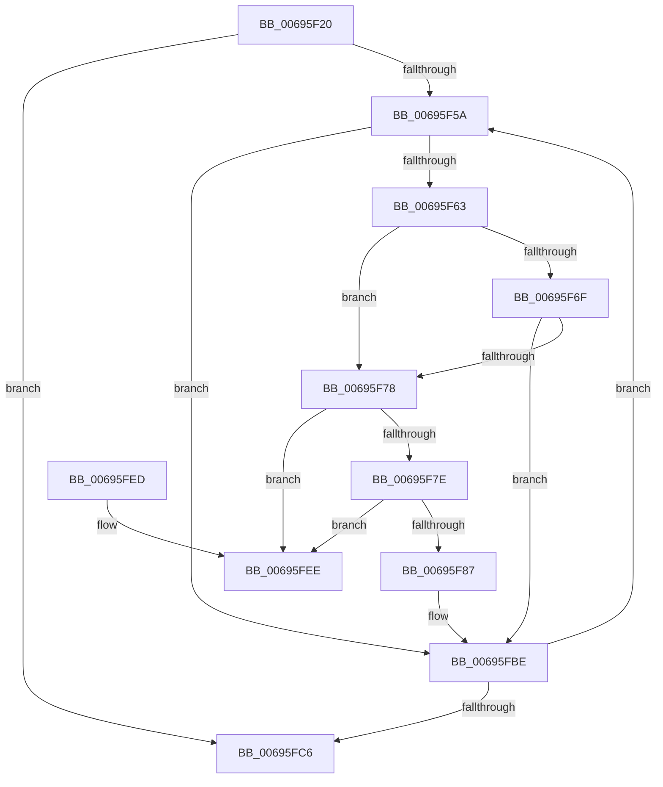

# MiDrainEngineDescriptors

- RVA: `0x00695F20`–`0x00695FF5` (길이 `213` bytes)
- VA: `0x0000000140695F20`
- 실행 섹션: `.text`
- PDB 이름 있음: `예`; PDB Function 태그: `아니요`
- unwind 정보 RVA: `0x00069AD0`
- 디코드: `58`개 명령, `213/213` bytes 표시
- 미해석 바이트: `0` (있으면 어셈블리에 `.byte`로 보존)

> 이 문서는 커널 이미지의 기계어와 PDB 기호를 분석해 생성했습니다. 4번과 5번은 함수 원형과 자료형을 바이너리 사용 방식에서 추정한 C 해석이며 원본 소스 복구 결과는 아닙니다.

## 1. Dependencies

- 직접 호출 지점: **5**; 고유 호출 대상: **3**
- 직접 호출자로 확인된 함수: **1**
- RIP 상대 이미지 참조: **1**

### Outgoing calls
- `0x00695F46` → [ExAcquireSpinLockExclusive](../24/ExAcquireSpinLockExclusive_function_00248690.md) (function, `0x00248690`)
- `0x00695F9B` → [MiReleaseSpinLockExclusive](../24/MiReleaseSpinLockExclusive_function_002482C0.md) (function, `0x002482C0`)
- `0x00695FA4` → [MiDeleteAcceleratorDescriptor](../2C/MiDeleteAcceleratorDescriptor_function_002CA560.md) (function, `0x002CA560`)
- `0x00695FB3` → [ExAcquireSpinLockExclusive](../24/ExAcquireSpinLockExclusive_function_00248690.md) (function, `0x00248690`)
- `0x00695FD3` → [MiReleaseSpinLockExclusive](../24/MiReleaseSpinLockExclusive_function_002482C0.md) (function, `0x002482C0`)

### Direct callers
- [MiAbsorbPossibleEngineChanges](MiAbsorbPossibleEngineChanges_function_006958B4.md) at `0x00695BBE`

### Static image references
- `0x00695F6F` → RVA `0x00E37554` (`.data`; read)

## 2. Other-region calls and transfers

- 다른 실행 섹션으로 향하는 call: **0**
- 별도 외부 분기/꼬리 이동을 확인하지 못했습니다.

## 3. Assembly (complete function range)

```asm
00695F20  48 89 5C 24 08                  mov qword ptr [rsp + 8], rbx
00695F25  48 89 6C 24 10                  mov qword ptr [rsp + 0x10], rbp
00695F2A  48 89 74 24 18                  mov qword ptr [rsp + 0x18], rsi
00695F2F  57                              push rdi
00695F30  48 83 EC 20                     sub rsp, 0x20
00695F34  48 8B F9                        mov rdi, rcx
00695F37  BD B0 3B 00 00                  mov ebp, 0x3bb0
00695F3C  48 8B 89 D0 00 00 00            mov rcx, qword ptr [rcx + 0xd0]
00695F43  48 03 CD                        add rcx, rbp
00695F46  E8 45 27 BB FF                  call 0x140248690
00695F4B  48 8D 77 78                     lea rsi, [rdi + 0x78]
00695F4F  44 8A C0                        mov r8b, al
00695F52  48 8B 1E                        mov rbx, qword ptr [rsi]
00695F55  48 3B DE                        cmp rbx, rsi
00695F58  74 6C                           je 0x140695fc6
00695F5A  80 7B 10 00                     cmp byte ptr [rbx + 0x10], 0
00695F5E  48 8B 13                        mov rdx, qword ptr [rbx]
00695F61  75 5B                           jne 0x140695fbe
00695F63  48 8B 43 18                     mov rax, qword ptr [rbx + 0x18]
00695F67  8B 48 34                        mov ecx, dword ptr [rax + 0x34]
00695F6A  F6 C1 01                        test cl, 1
00695F6D  75 09                           jne 0x140695f78
00695F6F  80 3D DE 15 7A 00 00            cmp byte ptr [rip + 0x7a15de], 0
00695F76  74 46                           je 0x140695fbe
00695F78  48 39 5A 08                     cmp qword ptr [rdx + 8], rbx
00695F7C  75 70                           jne 0x140695fee
00695F7E  48 8B 43 08                     mov rax, qword ptr [rbx + 8]
00695F82  48 39 18                        cmp qword ptr [rax], rbx
00695F85  75 67                           jne 0x140695fee
00695F87  48 89 10                        mov qword ptr [rax], rdx
00695F8A  48 89 42 08                     mov qword ptr [rdx + 8], rax
00695F8E  41 8A D0                        mov dl, r8b
00695F91  48 8B 8F D0 00 00 00            mov rcx, qword ptr [rdi + 0xd0]
00695F98  48 03 CD                        add rcx, rbp
00695F9B  E8 20 23 BB FF                  call 0x1402482c0
00695FA0  48 8D 4B 20                     lea rcx, [rbx + 0x20]
00695FA4  E8 B7 45 C3 FF                  call 0x1402ca560
00695FA9  48 8B 8F D0 00 00 00            mov rcx, qword ptr [rdi + 0xd0]
00695FB0  48 03 CD                        add rcx, rbp
00695FB3  E8 D8 26 BB FF                  call 0x140248690
00695FB8  48 8B 16                        mov rdx, qword ptr [rsi]
00695FBB  44 8A C0                        mov r8b, al
00695FBE  48 8B DA                        mov rbx, rdx
00695FC1  48 3B D6                        cmp rdx, rsi
00695FC4  75 94                           jne 0x140695f5a
00695FC6  48 8B 8F D0 00 00 00            mov rcx, qword ptr [rdi + 0xd0]
00695FCD  41 8A D0                        mov dl, r8b
00695FD0  48 03 CD                        add rcx, rbp
00695FD3  E8 E8 22 BB FF                  call 0x1402482c0
00695FD8  48 8B 5C 24 30                  mov rbx, qword ptr [rsp + 0x30]
00695FDD  48 8B 6C 24 38                  mov rbp, qword ptr [rsp + 0x38]
00695FE2  48 8B 74 24 40                  mov rsi, qword ptr [rsp + 0x40]
00695FE7  48 83 C4 20                     add rsp, 0x20
00695FEB  5F                              pop rdi
00695FEC  C3                              ret
00695FED  CC                              int3
00695FEE  B9 03 00 00 00                  mov ecx, 3
00695FF3  CD 29                           int 0x29
```

## 4. C-style interpretation (structured pseudocode)

```c
__int64 __fastcall MiDrainEngineDescriptors(__int64 a1)
{
    __int64 result;
    __int64 v_rsp;
    unsigned __int64 v_stack_p10;
    unsigned __int64 v_stack_p18;
    unsigned __int64 v_stack_p8;

    v_stack_p8 = v_rbx;
    v_stack_p10 = v_rbp;
    v_stack_p18 = v_rsi;
    v_rsp = (v_rsp) - (32);
    a1 = (*(unsigned __int64 *)(a1 + 208)) + ((unsigned int)(0x3BB0ULL));
    result = ExAcquireSpinLockExclusive(a1, a2, a3, a4);
    if ((*(unsigned __int64 *)(a1 + 120)) == (a1 + 120)) goto loc_00695FC6;
loc_00695F5A:
    if ((*(unsigned __int8 *)(*(unsigned __int64 *)(a1 + 120) + 16)) != 0) goto loc_00695FBE;
    if ((((unsigned __int8)((unsigned int)(*(unsigned int *)(*(unsigned __int64 *)(*(unsigned __int64 *)(a1 + 120) + 24) + 52)))) & (1)) != 0) goto loc_00695F78;
    if ((*(unsigned __int8 *)(v_rip + 8000990)) == 0) goto loc_00695FBE;
loc_00695F78:
    if ((*(unsigned __int64 *)(*(unsigned __int64 *)(*(unsigned __int64 *)(a1 + 120)) + 8)) != (*(unsigned __int64 *)(a1 + 120))) goto loc_00695FEE;
    if ((*(unsigned __int64 *)(*(unsigned __int64 *)(*(unsigned __int64 *)(a1 + 120) + 8))) != (*(unsigned __int64 *)(a1 + 120))) goto loc_00695FEE;
    *(unsigned __int64 *)(*(unsigned __int64 *)(*(unsigned __int64 *)(a1 + 120) + 8)) = *(unsigned __int64 *)(*(unsigned __int64 *)(a1 + 120));
    *(unsigned __int64 *)(*(unsigned __int64 *)(*(unsigned __int64 *)(a1 + 120)) + 8) = *(unsigned __int64 *)(*(unsigned __int64 *)(a1 + 120) + 8);
    a1 = (*(unsigned __int64 *)(a1 + 208)) + ((unsigned int)(0x3BB0ULL));
    result = MiReleaseSpinLockExclusive(a1, (unsigned __int8)((unsigned __int8)(result)), (unsigned __int8)(result), a4);
    result = MiDeleteAcceleratorDescriptor(*(unsigned __int64 *)(a1 + 120) + 32, (unsigned __int8)((unsigned __int8)(result)), (unsigned __int8)(result), a4);
    a1 = (*(unsigned __int64 *)(a1 + 208)) + ((unsigned int)(0x3BB0ULL));
    result = ExAcquireSpinLockExclusive(a1, (unsigned __int8)((unsigned __int8)(result)), (unsigned __int8)(result), a4);
loc_00695FBE:
    if ((*(unsigned __int64 *)(a1 + 120)) != (a1 + 120)) goto loc_00695F5A;
loc_00695FC6:
    a1 = (*(unsigned __int64 *)(a1 + 208)) + ((unsigned int)(0x3BB0ULL));
    result = MiReleaseSpinLockExclusive(a1, (unsigned __int8)((unsigned __int8)(result)), (unsigned __int8)(result), a4);
    v_rsp = (v_rsp) + (32);
    return result;
loc_00695FEE:
    return result;
}
```

## 5. (Beta) C Style

```c
int64_t MiDrainEngineDescriptors(void *Arg1)
{
    uint8_t *arg1 = (uint8_t *)Arg1;

    int64_t result;
    int64_t local_rsp;
    uint64_t v_stack_p10;
    uint64_t v_stack_p18;
    uint64_t v_stack_p8;

    v_stack_p8 = local_rbx;
    v_stack_p10 = local_rbp;
    v_stack_p18 = local_rsi;
    local_rsp = (local_rsp) - (32);
    Arg1 = (*(uint64_t *)(arg1 + 0xD0)) + ((uint32_t)(0x3BB0ULL));
    result = ExAcquireSpinLockExclusive(Arg1, a2, a3, a4);
    if ((*(uint64_t *)(arg1 + 0x78)) == (Arg1 + 120)) goto loc_00695FC6;
loc_00695F5A:
    if ((*(uint8_t *)(*(uint64_t *)(arg1 + 0x78) + 0x10)) != 0) goto loc_00695FBE;
    if ((((uint8_t)((uint32_t)(*(uint32_t *)(*(uint64_t *)(*(uint64_t *)(arg1 + 0x78) + 0x18) + 0x34)))) & (1)) != 0) goto loc_00695F78;
    if ((*(uint8_t *)(v_rip + 0x7A15DE)) == 0) goto loc_00695FBE;
loc_00695F78:
    if ((*(uint64_t *)(*(uint64_t *)(*(uint64_t *)(arg1 + 0x78)) + 0x8)) != (*(uint64_t *)(arg1 + 0x78))) goto loc_00695FEE;
    if ((*(uint64_t *)(*(uint64_t *)(*(uint64_t *)(arg1 + 0x78) + 0x8))) != (*(uint64_t *)(arg1 + 0x78))) goto loc_00695FEE;
    *(uint64_t *)(*(uint64_t *)(*(uint64_t *)(arg1 + 0x78) + 0x8)) = *(uint64_t *)(*(uint64_t *)(arg1 + 0x78));
    *(uint64_t *)(*(uint64_t *)(*(uint64_t *)(arg1 + 0x78)) + 0x8) = *(uint64_t *)(*(uint64_t *)(arg1 + 0x78) + 0x8);
    Arg1 = (*(uint64_t *)(arg1 + 0xD0)) + ((uint32_t)(0x3BB0ULL));
    result = MiReleaseSpinLockExclusive(Arg1, (uint8_t)((uint8_t)(result)), (uint8_t)(result), a4);
    result = MiDeleteAcceleratorDescriptor(*(uint64_t *)(arg1 + 0x78) + 32, (uint8_t)((uint8_t)(result)), (uint8_t)(result), a4);
    Arg1 = (*(uint64_t *)(arg1 + 0xD0)) + ((uint32_t)(0x3BB0ULL));
    result = ExAcquireSpinLockExclusive(Arg1, (uint8_t)((uint8_t)(result)), (uint8_t)(result), a4);
loc_00695FBE:
    if ((*(uint64_t *)(arg1 + 0x78)) != (Arg1 + 120)) goto loc_00695F5A;
loc_00695FC6:
    Arg1 = (*(uint64_t *)(arg1 + 0xD0)) + ((uint32_t)(0x3BB0ULL));
    result = MiReleaseSpinLockExclusive(Arg1, (uint8_t)((uint8_t)(result)), (uint8_t)(result), a4);
    local_rsp = (local_rsp) + (32);
    return result;
loc_00695FEE:
    return result;
}
```

### 관측된 메모리 오프셋

구조체 형식이 확인되지 않은 접근은 인자 기준의 오프셋으로만 기록했습니다.

| 기준 인자 | 오프셋 표현 | 폭 (bit) | 접근 |
|---|---:|---:|---|
| `Arg1` | `+ 0x0` | `64` | `R` |
| `Arg1` | `+ 0x78` | `64` | `R` |
| `Arg1` | `+ 0xD0` | `64` | `R` |

## 6. Execution-region graph

[열기: 2D/3D 그래프와 함수 탐색 컨트롤 패널](../../../control-panel.html?section=text&rva=0x00695F20&view=graph)

- 2D 그래프는 위에서 아래로 흐르고, 3D 그래프는 빈 공간을 드래그해 회전합니다. Shift+드래그는 이동, 휠은 확대·축소, 함수 노드 선택은 대상 보고서 이동입니다.

### Static fallback


