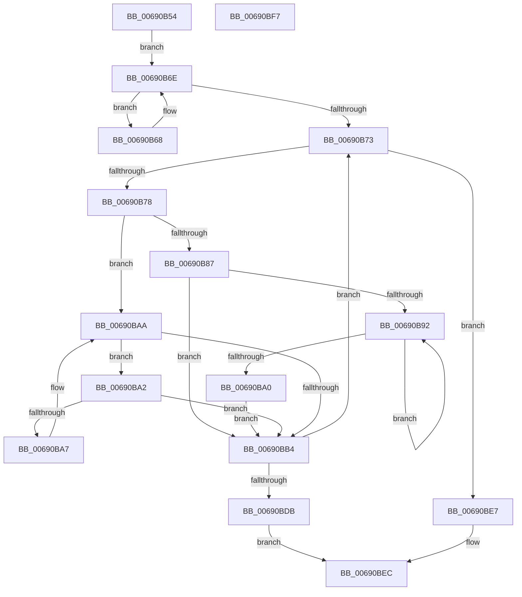

# MiDuplicatePartitionNodeTree

- RVA: `0x00690B54`–`0x00690BF8` (길이 `164` bytes)
- VA: `0x0000000140690B54`
- 실행 섹션: `.text`
- PDB 이름 있음: `예`; PDB Function 태그: `아니요`
- unwind 정보 RVA: `0x0005CAAC`
- 디코드: `53`개 명령, `164/164` bytes 표시
- 미해석 바이트: `0` (있으면 어셈블리에 `.byte`로 보존)

> 이 문서는 커널 이미지의 기계어와 PDB 기호를 분석해 생성했습니다. 4번과 5번은 함수 원형과 자료형을 바이너리 사용 방식에서 추정한 C 해석이며 원본 소스 복구 결과는 아닙니다.

## 1. Dependencies

- 직접 호출 지점: **2**; 고유 호출 대상: **2**
- 직접 호출자로 확인된 함수: **1**
- RIP 상대 이미지 참조: **0**

### Outgoing calls
- `0x00690BD2` → [MiAddRangeToPartitionTree](MiAddRangeToPartitionTree_function_0069020C.md) (function, `0x0069020C`)
- `0x00690BDE` → [MiDeletePartitionPageNodes](MiDeletePartitionPageNodes_function_006908F0.md) (function, `0x006908F0`)

### Direct callers
- [MiInsertPartitionPages](MiInsertPartitionPages_function_006911A0.md) at `0x00691218`

### Static image references
- 디코드된 RIP-relative 메모리 참조가 없습니다.

## 2. Other-region calls and transfers

- 다른 실행 섹션으로 향하는 call: **0**
- 별도 외부 분기/꼬리 이동을 확인하지 못했습니다.

## 3. Assembly (complete function range)

```asm
00690B54  48 89 5C 24 08                  mov qword ptr [rsp + 8], rbx
00690B59  57                              push rdi
00690B5A  48 83 EC 20                     sub rsp, 0x20
00690B5E  48 8B 02                        mov rax, qword ptr [rdx]
00690B61  48 8B F9                        mov rdi, rcx
00690B64  33 DB                           xor ebx, ebx
00690B66  EB 06                           jmp 0x140690b6e
00690B68  48 8B D8                        mov rbx, rax
00690B6B  48 8B 00                        mov rax, qword ptr [rax]
00690B6E  48 85 C0                        test rax, rax
00690B71  75 F5                           jne 0x140690b68
00690B73  48 85 DB                        test rbx, rbx
00690B76  74 6F                           je 0x140690be7
00690B78  48 8B 43 08                     mov rax, qword ptr [rbx + 8]
00690B7C  4C 8B C3                        mov r8, rbx
00690B7F  48 8B CB                        mov rcx, rbx
00690B82  48 85 C0                        test rax, rax
00690B85  74 23                           je 0x140690baa
00690B87  48 8B 08                        mov rcx, qword ptr [rax]
00690B8A  48 8B D8                        mov rbx, rax
00690B8D  48 85 C9                        test rcx, rcx
00690B90  74 22                           je 0x140690bb4
00690B92  48 8B 01                        mov rax, qword ptr [rcx]
00690B95  48 8B D9                        mov rbx, rcx
00690B98  48 8B C8                        mov rcx, rax
00690B9B  48 85 C0                        test rax, rax
00690B9E  75 F2                           jne 0x140690b92
00690BA0  EB 12                           jmp 0x140690bb4
00690BA2  48 39 0B                        cmp qword ptr [rbx], rcx
00690BA5  74 0D                           je 0x140690bb4
00690BA7  48 8B CB                        mov rcx, rbx
00690BAA  48 8B 5B 10                     mov rbx, qword ptr [rbx + 0x10]
00690BAE  48 83 E3 FC                     and rbx, 0xfffffffffffffffc
00690BB2  75 EE                           jne 0x140690ba2
00690BB4  49 8B 50 18                     mov rdx, qword ptr [r8 + 0x18]
00690BB8  48 B8 FF FF FF FF FF FF FF 3F   movabs rax, 0x3fffffffffffffff
00690BC2  4D 8B 40 20                     mov r8, qword ptr [r8 + 0x20]
00690BC6  48 23 D0                        and rdx, rax
00690BC9  41 B9 04 00 00 00               mov r9d, 4
00690BCF  48 8B CF                        mov rcx, rdi
00690BD2  E8 35 F6 FF FF                  call 0x14069020c
00690BD7  85 C0                           test eax, eax
00690BD9  75 98                           jne 0x140690b73
00690BDB  48 8B CF                        mov rcx, rdi
00690BDE  E8 0D FD FF FF                  call 0x1406908f0
00690BE3  33 C0                           xor eax, eax
00690BE5  EB 05                           jmp 0x140690bec
00690BE7  B8 01 00 00 00                  mov eax, 1
00690BEC  48 8B 5C 24 30                  mov rbx, qword ptr [rsp + 0x30]
00690BF1  48 83 C4 20                     add rsp, 0x20
00690BF5  5F                              pop rdi
00690BF6  C3                              ret
00690BF7  CC                              int3
```

## 4. C-style interpretation (structured pseudocode)

```c
__int64 __fastcall MiDuplicatePartitionNodeTree(__int64 a1, __int64 a2)
{
    __int64 result;
    __int64 v_rbx;
    __int64 v_rsp;
    unsigned __int64 v_stack_p8;

    v_stack_p8 = v_rbx;
    v_rsp = (v_rsp) - (32);
    v_rbx = 0;
    goto loc_00690B6E;
loc_00690B68:
loc_00690B6E:
    if (*(unsigned __int64 *)(*(unsigned __int64 *)(a2)) != 0) goto loc_00690B68;
loc_00690B73:
    if (*(unsigned __int64 *)(a2) == 0) goto loc_00690BE7;
    if (*(unsigned __int64 *)(*(unsigned __int64 *)(a2) + 8) == 0) goto loc_00690BAA;
    if (*(unsigned __int64 *)(*(unsigned __int64 *)(*(unsigned __int64 *)(a2) + 8)) == 0) goto loc_00690BB4;
loc_00690B92:
    if (*(unsigned __int64 *)(*(unsigned __int64 *)(*(unsigned __int64 *)(*(unsigned __int64 *)(a2) + 8))) != 0) goto loc_00690B92;
    goto loc_00690BB4;
loc_00690BA2:
    if ((*(unsigned __int64 *)(*(unsigned __int64 *)(*(unsigned __int64 *)(*(unsigned __int64 *)(a2) + 8)))) == (*(unsigned __int64 *)(*(unsigned __int64 *)(*(unsigned __int64 *)(*(unsigned __int64 *)(a2) + 8))))) goto loc_00690BB4;
loc_00690BAA:
    v_rbx = (*(unsigned __int64 *)(*(unsigned __int64 *)(*(unsigned __int64 *)(*(unsigned __int64 *)(a2) + 8)) + 16)) & (-4);
    if (condition_is_not_equal) goto loc_00690BA2;
loc_00690BB4:
    a2 = (*(unsigned __int64 *)(*(unsigned __int64 *)(a2) + 24)) & (*(unsigned __int64 *)(*(unsigned __int64 *)(*(unsigned __int64 *)(*(unsigned __int64 *)(a2) + 8))));
    result = MiAddRangeToPartitionTree(a1, a2, *(unsigned __int64 *)(*(unsigned __int64 *)(a2) + 32), 4);
    if ((unsigned int)(result) != 0) goto loc_00690B73;
    result = MiDeletePartitionPageNodes(a1, a2, *(unsigned __int64 *)(*(unsigned __int64 *)(a2) + 32), 4);
    result = 0;
    goto loc_00690BEC;
loc_00690BE7:
loc_00690BEC:
    v_rsp = (v_rsp) + (32);
    return 1;
}
```

## 5. (Beta) C Style

```c
int64_t MiDuplicatePartitionNodeTree(int64_t Arg1, void *Arg2)
{
    uint8_t *arg2 = (uint8_t *)Arg2;

    int64_t result;
    int64_t local_rbx;
    int64_t local_rsp;
    uint64_t v_stack_p8;

    v_stack_p8 = local_rbx;
    local_rsp = (local_rsp) - (32);
    local_rbx = 0;
    goto loc_00690B6E;
loc_00690B68:
loc_00690B6E:
    if (*(uint64_t *)(*(uint64_t *)(arg2)) != 0) goto loc_00690B68;
loc_00690B73:
    if (*(uint64_t *)(arg2) == 0) goto loc_00690BE7;
    if (*(uint64_t *)(*(uint64_t *)(arg2) + 0x8) == 0) goto loc_00690BAA;
    if (*(uint64_t *)(*(uint64_t *)(*(uint64_t *)(arg2) + 0x8)) == 0) goto loc_00690BB4;
loc_00690B92:
    if (*(uint64_t *)(*(uint64_t *)(*(uint64_t *)(*(uint64_t *)(arg2) + 0x8))) != 0) goto loc_00690B92;
    goto loc_00690BB4;
loc_00690BA2:
    if ((*(uint64_t *)(*(uint64_t *)(*(uint64_t *)(*(uint64_t *)(arg2) + 0x8)))) == (*(uint64_t *)(*(uint64_t *)(*(uint64_t *)(*(uint64_t *)(arg2) + 0x8))))) goto loc_00690BB4;
loc_00690BAA:
    local_rbx = (*(uint64_t *)(*(uint64_t *)(*(uint64_t *)(*(uint64_t *)(arg2) + 0x8)) + 0x10)) & (-4);
    if (condition_is_not_equal) goto loc_00690BA2;
loc_00690BB4:
    Arg2 = (*(uint64_t *)(*(uint64_t *)(arg2) + 0x18)) & (*(uint64_t *)(*(uint64_t *)(*(uint64_t *)(*(uint64_t *)(arg2) + 0x8))));
    result = MiAddRangeToPartitionTree(Arg1, Arg2, *(uint64_t *)(*(uint64_t *)(arg2) + 0x20), 4);
    if ((uint32_t)(result) != 0) goto loc_00690B73;
    result = MiDeletePartitionPageNodes(Arg1, Arg2, *(uint64_t *)(*(uint64_t *)(arg2) + 0x20), 4);
    result = 0;
    goto loc_00690BEC;
loc_00690BE7:
loc_00690BEC:
    local_rsp = (local_rsp) + (32);
    return 1;
}
```

### 관측된 메모리 오프셋

구조체 형식이 확인되지 않은 접근은 인자 기준의 오프셋으로만 기록했습니다.

| 기준 인자 | 오프셋 표현 | 폭 (bit) | 접근 |
|---|---:|---:|---|
| `Arg2` | `+ 0x0` | `64` | `R` |

## 6. Execution-region graph

[열기: 2D/3D 그래프와 함수 탐색 컨트롤 패널](../../../control-panel.html?section=text&rva=0x00690B54&view=graph)

- 2D 그래프는 위에서 아래로 흐르고, 3D 그래프는 빈 공간을 드래그해 회전합니다. Shift+드래그는 이동, 휠은 확대·축소, 함수 노드 선택은 대상 보고서 이동입니다.

### Static fallback


