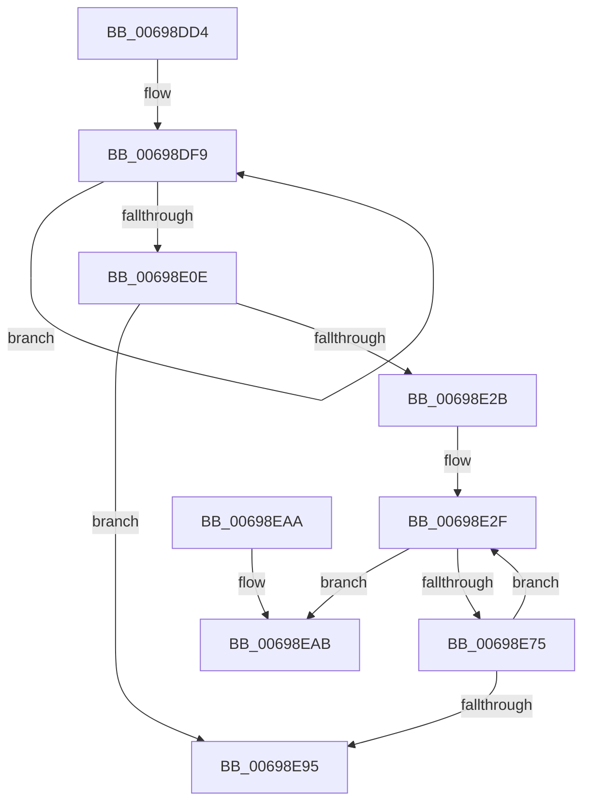

# MiEmptyCacheSlice

- RVA: `0x00698DD4`–`0x00698EB2` (길이 `222` bytes)
- VA: `0x0000000140698DD4`
- 실행 섹션: `.text`
- PDB 이름 있음: `예`; PDB Function 태그: `아니요`
- unwind 정보 RVA: `0x000D967C`
- 디코드: `62`개 명령, `222/222` bytes 표시
- 미해석 바이트: `0` (있으면 어셈블리에 `.byte`로 보존)

> 이 문서는 커널 이미지의 기계어와 PDB 기호를 분석해 생성했습니다. 4번과 5번은 함수 원형과 자료형을 바이너리 사용 방식에서 추정한 C 해석이며 원본 소스 복구 결과는 아닙니다.

## 1. Dependencies

- 직접 호출 지점: **0**; 고유 호출 대상: **0**
- 직접 호출자로 확인된 함수: **2**
- RIP 상대 이미지 참조: **0**

### Outgoing calls
- 직접 디코드된 call 명령이 없습니다.

### Direct callers
- [MiFreeLargeProcessPagesToCache](MiFreeLargeProcessPagesToCache_function_00698F24.md) at `0x006990E3`
- [MiFreeProcessLargePageCache](MiFreeProcessLargePageCache_function_00699204.md) at `0x006992E3`

### Static image references
- 디코드된 RIP-relative 메모리 참조가 없습니다.

## 2. Other-region calls and transfers

- 다른 실행 섹션으로 향하는 call: **0**
- 별도 외부 분기/꼬리 이동을 확인하지 못했습니다.

## 3. Assembly (complete function range)

```asm
00698DD4  48 8B C4                        mov rax, rsp
00698DD7  48 89 58 10                     mov qword ptr [rax + 0x10], rbx
00698DDB  48 89 68 18                     mov qword ptr [rax + 0x18], rbp
00698DDF  48 89 78 20                     mov qword ptr [rax + 0x20], rdi
00698DE3  45 8B 58 08                     mov r11d, dword ptr [r8 + 8]
00698DE7  4C 8B D2                        mov r10, rdx
00698DEA  48 89 48 08                     mov qword ptr [rax + 8], rcx
00698DEE  B9 04 00 00 00                  mov ecx, 4
00698DF3  48 8B C2                        mov rax, rdx
00698DF6  8D 69 FD                        lea ebp, [rcx - 3]
00698DF9  48 83 60 10 00                  and qword ptr [rax + 0x10], 0
00698DFE  48 89 40 08                     mov qword ptr [rax + 8], rax
00698E02  48 89 00                        mov qword ptr [rax], rax
00698E05  48 83 C0 18                     add rax, 0x18
00698E09  48 2B CD                        sub rcx, rbp
00698E0C  75 EB                           jne 0x140698df9
00698E0E  49 8B 00                        mov rax, qword ptr [r8]
00698E11  48 8D 14 40                     lea rdx, [rax + rax*2]
00698E15  48 C1 E2 04                     shl rdx, 4
00698E19  48 B8 00 00 00 00 00 DE FF FF   movabs rax, 0xffffde0000000000
00698E23  48 03 D0                        add rdx, rax
00698E26  4D 85 DB                        test r11, r11
00698E29  74 6A                           je 0x140698e95
00698E2B  49 8D 5A 30                     lea rbx, [r10 + 0x30]
00698E2F  83 64 24 08 00                  and dword ptr [rsp + 8], 0
00698E34  BF FF FF FF FF                  mov edi, 0xffffffff
00698E39  49 0F BC C3                     bsf rax, r11
00698E3D  0F B6 C0                        movzx eax, al
00698E40  0F 45 F8                        cmovne edi, eax
00698E43  41 0F B7 40 0C                  movzx eax, word ptr [r8 + 0xc]
00698E48  0F B7 C8                        movzx ecx, ax
00698E4B  66 2B CD                        sub cx, bp
00698E4E  66 33 C8                        xor cx, ax
00698E51  66 83 E1 3F                     and cx, 0x3f
00698E55  66 33 C8                        xor cx, ax
00698E58  48 0F BE C7                     movsx rax, dil
00698E5C  66 41 89 48 0C                  mov word ptr [r8 + 0xc], cx
00698E61  4C 8D 0C 40                     lea r9, [rax + rax*2]
00698E65  48 8B 43 08                     mov rax, qword ptr [rbx + 8]
00698E69  49 C1 E1 08                     shl r9, 8
00698E6D  4C 03 CA                        add r9, rdx
00698E70  48 39 18                        cmp qword ptr [rax], rbx
00698E73  75 36                           jne 0x140698eab
00698E75  49 89 41 08                     mov qword ptr [r9 + 8], rax
00698E79  40 8A CF                        mov cl, dil
00698E7C  49 89 19                        mov qword ptr [r9], rbx
00698E7F  4C 89 08                        mov qword ptr [rax], r9
00698E82  8B C5                           mov eax, ebp
00698E84  D3 E0                           shl eax, cl
00698E86  4C 89 4B 08                     mov qword ptr [rbx + 8], r9
00698E8A  F7 D0                           not eax
00698E8C  49 01 6A 40                     add qword ptr [r10 + 0x40], rbp
00698E90  4C 23 D8                        and r11, rax
00698E93  75 9A                           jne 0x140698e2f
00698E95  41 83 60 08 00                  and dword ptr [r8 + 8], 0
00698E9A  48 8B 5C 24 10                  mov rbx, qword ptr [rsp + 0x10]
00698E9F  48 8B 6C 24 18                  mov rbp, qword ptr [rsp + 0x18]
00698EA4  48 8B 7C 24 20                  mov rdi, qword ptr [rsp + 0x20]
00698EA9  C3                              ret
00698EAA  CC                              int3
00698EAB  B9 03 00 00 00                  mov ecx, 3
00698EB0  CD 29                           int 0x29
```

## 4. C-style interpretation (structured pseudocode)

```c
__int64 __fastcall MiEmptyCacheSlice(__int64 a1, __int64 a2, __int64 a3)
{
    __int64 result;
    __int64 v_r11;
    __int64 v_rdi;
    unsigned __int64 v_stack_p10;
    unsigned __int64 v_stack_p18;
    unsigned __int64 v_stack_p20;
    unsigned int v_stack_p8;

    *(unsigned __int64 *)(v_rsp + 16) = v_rbx;
    *(unsigned __int64 *)(v_rsp + 24) = v_rbp;
    *(unsigned __int64 *)(v_rsp + 32) = v_rdi;
    *(unsigned __int64 *)(v_rsp + 8) = a1;
loc_00698DF9:
    *(unsigned __int64 *)(a2 + 8) = a2;
    *(unsigned __int64 *)(a2) = a2;
    result = (a2) + (24);
    a1 = (4) - (4 - 3);
    if (condition_is_not_equal) goto loc_00698DF9;
    a2 = (*(unsigned __int64 *)(a3) + *(unsigned __int64 *)(a3) * 2) << (4);
    a2 = (a2) + (*(unsigned __int64 *)(a3));
    if ((unsigned int)(*(unsigned int *)(a3 + 8)) == 0) goto loc_00698E95;
loc_00698E2F:
    v_rdi = (unsigned int)(0xFFFFFFFFULL);
    if ((unsigned int)(*(unsigned int *)(a3 + 8)) != 0) { v_rdi = (unsigned int)((unsigned __int8)(*(unsigned __int64 *)(a3))); }
    a1 = (unsigned __int16)(((unsigned __int16)(*(unsigned __int16 *)(a3 + 12))) - ((unsigned __int16)(4 - 3)));
    a1 = (unsigned __int16)((a1) ^ ((unsigned __int16)(*(unsigned __int16 *)(a3 + 12))));
    a1 = (unsigned __int16)((a1) & (63));
    a1 = (unsigned __int16)((a1) ^ ((unsigned __int16)(*(unsigned __int16 *)(a3 + 12))));
    *(unsigned __int16 *)(a3 + 12) = (unsigned __int16)(a1);
    a4 = ((__int8)((unsigned __int8)(v_rdi)) + (__int8)((unsigned __int8)(v_rdi)) * 2) << (8);
    a4 = (a4) + (a2);
    if ((*(unsigned __int64 *)(*(unsigned __int64 *)(a2 + 48 + 8))) != (a2 + 48)) goto loc_00698EAB;
    *(unsigned __int64 *)(a4 + 8) = *(unsigned __int64 *)(a2 + 48 + 8);
    *(unsigned __int64 *)(a4) = a2 + 48;
    *(unsigned __int64 *)(*(unsigned __int64 *)(a2 + 48 + 8)) = a4;
    result = (unsigned int)(((unsigned int)((unsigned int)(4 - 3))) << ((unsigned __int8)((unsigned __int8)(v_rdi))));
    *(unsigned __int64 *)(a2 + 48 + 8) = a4;
    result = (unsigned int)(~(result));
    v_r11 = ((unsigned int)(*(unsigned int *)(a3 + 8))) & (result);
    if (condition_is_not_equal) goto loc_00698E2F;
loc_00698E95:
    return result;
loc_00698EAB:
    return result;
}
```

## 5. (Beta) C Style

```c
int64_t MiEmptyCacheSlice(int64_t Arg1, void *Arg2, void *Arg3)
{
    uint8_t *arg2 = (uint8_t *)Arg2;
    uint8_t *arg3 = (uint8_t *)Arg3;

    int64_t result;
    int64_t local_r11;
    int64_t local_rdi;
    uint64_t v_stack_p10;
    uint64_t v_stack_p18;
    uint64_t v_stack_p20;
    uint32_t v_stack_p8;

    *(uint64_t *)(local_rsp + 0x10) = local_rbx;
    *(uint64_t *)(local_rsp + 0x18) = local_rbp;
    *(uint64_t *)(local_rsp + 0x20) = local_rdi;
    *(uint64_t *)(local_rsp + 0x8) = Arg1;
loc_00698DF9:
    *(void **)(arg2 + 0x8) = Arg2;
    *(void **)(arg2) = Arg2;
    result = (Arg2) + (24);
    Arg1 = (4) - (4 - 3);
    if (condition_is_not_equal) goto loc_00698DF9;
    Arg2 = (*(uint64_t *)(arg3) + *(uint64_t *)(arg3) * 2) << (4);
    Arg2 = (Arg2) + (*(uint64_t *)(arg3));
    if ((uint32_t)(*(uint32_t *)(arg3 + 0x8)) == 0) goto loc_00698E95;
loc_00698E2F:
    local_rdi = (uint32_t)(0xFFFFFFFFULL);
    if ((uint32_t)(*(uint32_t *)(arg3 + 0x8)) != 0) { local_rdi = (uint32_t)((uint8_t)(*(uint64_t *)(arg3))); }
    Arg1 = (uint16_t)(((uint16_t)(*(uint16_t *)(arg3 + 0xC))) - ((uint16_t)(4 - 3)));
    Arg1 = (uint16_t)((Arg1) ^ ((uint16_t)(*(uint16_t *)(arg3 + 0xC))));
    Arg1 = (uint16_t)((Arg1) & (63));
    Arg1 = (uint16_t)((Arg1) ^ ((uint16_t)(*(uint16_t *)(arg3 + 0xC))));
    *(uint16_t *)(arg3 + 0xC) = (uint16_t)(Arg1);
    a4 = ((int8_t)((uint8_t)(local_rdi)) + (int8_t)((uint8_t)(local_rdi)) * 2) << (8);
    a4 = (a4) + (Arg2);
    if ((*(uint64_t *)(*(uint64_t *)(arg2 + 0x30 + 0x8))) != (Arg2 + 48)) goto loc_00698EAB;
    *(uint64_t *)(a4 + 0x8) = *(uint64_t *)(arg2 + 0x30 + 0x8);
    *(void **)(a4) = Arg2 + 48;
    *(uint64_t *)(*(uint64_t *)(arg2 + 0x30 + 0x8)) = a4;
    result = (uint32_t)(((uint32_t)((uint32_t)(4 - 3))) << ((uint8_t)((uint8_t)(local_rdi))));
    *(uint64_t *)(arg2 + 0x30 + 0x8) = a4;
    result = (uint32_t)(~(result));
    local_r11 = ((uint32_t)(*(uint32_t *)(arg3 + 0x8))) & (result);
    if (condition_is_not_equal) goto loc_00698E2F;
loc_00698E95:
    return result;
loc_00698EAB:
    return result;
}
```

### 관측된 메모리 오프셋

구조체 형식이 확인되지 않은 접근은 인자 기준의 오프셋으로만 기록했습니다.

| 기준 인자 | 오프셋 표현 | 폭 (bit) | 접근 |
|---|---:|---:|---|
| `Arg2` | `+ 0x0` | `64` | `W` |
| `Arg2` | `+ 0x8` | `64` | `R` |
| `Arg2` | `+ 0x8` | `64` | `W` |
| `Arg2` | `+ 0x10` | `64` | `R/W` |
| `Arg2` | `+ 0x30` | `64` | `R` |
| `Arg2` | `+ 0x40` | `64` | `R/W` |
| `Arg3` | `+ 0x0` | `64` | `R` |
| `Arg3` | `+ 0x8` | `32` | `R` |
| `Arg3` | `+ 0x8` | `32` | `R/W` |
| `Arg3` | `+ 0xC` | `16` | `R` |
| `Arg3` | `+ 0xC` | `16` | `W` |

## 6. Execution-region graph

[열기: 2D/3D 그래프와 함수 탐색 컨트롤 패널](../../../control-panel.html?section=text&rva=0x00698DD4&view=graph)

- 2D 그래프는 위에서 아래로 흐르고, 3D 그래프는 빈 공간을 드래그해 회전합니다. Shift+드래그는 이동, 휠은 확대·축소, 함수 노드 선택은 대상 보고서 이동입니다.

### Static fallback


