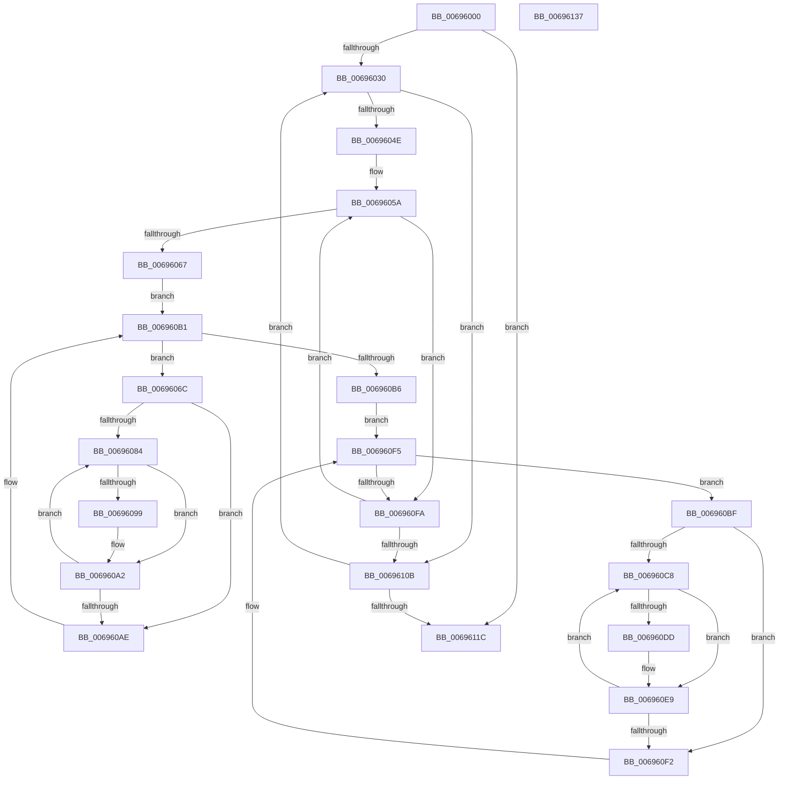

# MiFailInProgressZeroing

- RVA: `0x00696000`–`0x00696138` (길이 `312` bytes)
- VA: `0x0000000140696000`
- 실행 섹션: `.text`
- PDB 이름 있음: `예`; PDB Function 태그: `아니요`
- unwind 정보 RVA: `0x0005E6B4`
- 디코드: `78`개 명령, `312/312` bytes 표시
- 미해석 바이트: `0` (있으면 어셈블리에 `.byte`로 보존)

> 이 문서는 커널 이미지의 기계어와 PDB 기호를 분석해 생성했습니다. 4번과 5번은 함수 원형과 자료형을 바이너리 사용 방식에서 추정한 C 해석이며 원본 소스 복구 결과는 아닙니다.

## 1. Dependencies

- 직접 호출 지점: **1**; 고유 호출 대상: **1**
- 직접 호출자로 확인된 함수: **0**
- RIP 상대 이미지 참조: **1**

### Outgoing calls
- `0x00696073` → [MiGetZeroingContext](../43/MiGetZeroingContext_function_00434FB0.md) (function, `0x00434FB0`)

### Direct callers
- 이 함수 시작 RVA로 연결되는 직접 call은 확인되지 않았습니다. 간접 호출은 완전히 역산할 수 없습니다.

### Static image references
- `0x0069601F` → RVA `0x00FC5000` (`ALMOSTRO`; read)

## 2. Other-region calls and transfers

- 다른 실행 섹션으로 향하는 call: **0**
- 별도 외부 분기/꼬리 이동을 확인하지 못했습니다.

## 3. Assembly (complete function range)

```asm
00696000  48 8B C4                        mov rax, rsp
00696003  48 89 58 08                     mov qword ptr [rax + 8], rbx
00696007  48 89 68 10                     mov qword ptr [rax + 0x10], rbp
0069600B  48 89 70 18                     mov qword ptr [rax + 0x18], rsi
0069600F  48 89 78 20                     mov qword ptr [rax + 0x20], rdi
00696013  41 56                           push r14
00696015  48 83 EC 20                     sub rsp, 0x20
00696019  45 33 F6                        xor r14d, r14d
0069601C  48 8B E9                        mov rbp, rcx
0069601F  66 44 3B 35 D9 EF 92 00         cmp r14w, word ptr [rip + 0x92efd9]
00696027  41 8B D6                        mov edx, r14d
0069602A  0F 83 EC 00 00 00               jae 0x14069611c
00696030  8B C2                           mov eax, edx
00696032  48 69 C8 80 DF 00 00            imul rcx, rax, 0xdf80
00696039  48 8B 45 10                     mov rax, qword ptr [rbp + 0x10]
0069603D  48 8B BC 01 A8 3B 00 00         mov rdi, qword ptr [rcx + rax + 0x3ba8]
00696045  48 85 FF                        test rdi, rdi
00696048  0F 84 BD 00 00 00               je 0x14069610b
0069604E  4C 8D 97 48 01 00 00            lea r10, [rdi + 0x148]
00696055  BE 03 00 00 00                  mov esi, 3
0069605A  45 38 B2 5F FF FF FF            cmp byte ptr [r10 - 0xa1], r14b
00696061  0F 84 93 00 00 00               je 0x1406960fa
00696067  4D 8B 0A                        mov r9, qword ptr [r10]
0069606A  EB 45                           jmp 0x1406960b1
0069606C  49 8D 89 60 FE FF FF            lea rcx, [r9 - 0x1a0]
00696073  E8 38 EF D9 FF                  call 0x140434fb0
00696078  45 8B DE                        mov r11d, r14d
0069607B  44 39 B0 18 01 00 00            cmp dword ptr [rax + 0x118], r14d
00696082  76 2A                           jbe 0x1406960ae
00696084  41 8B DB                        mov ebx, r11d
00696087  48 8B 4C D8 18                  mov rcx, qword ptr [rax + rbx*8 + 0x18]
0069608C  44 8A C1                        mov r8b, cl
0069608F  41 80 E0 0A                     and r8b, 0xa
00696093  41 80 F8 08                     cmp r8b, 8
00696097  75 09                           jne 0x1406960a2
00696099  48 83 C9 02                     or rcx, 2
0069609D  48 89 4C D8 18                  mov qword ptr [rax + rbx*8 + 0x18], rcx
006960A2  41 FF C3                        inc r11d
006960A5  44 3B 98 18 01 00 00            cmp r11d, dword ptr [rax + 0x118]
006960AC  72 D6                           jb 0x140696084
006960AE  4D 8B 09                        mov r9, qword ptr [r9]
006960B1  4D 3B CA                        cmp r9, r10
006960B4  75 B6                           jne 0x14069606c
006960B6  4C 8D 5F 20                     lea r11, [rdi + 0x20]
006960BA  4D 8B 03                        mov r8, qword ptr [r11]
006960BD  EB 36                           jmp 0x1406960f5
006960BF  45 8B CE                        mov r9d, r14d
006960C2  45 39 70 D0                     cmp dword ptr [r8 - 0x30], r14d
006960C6  76 2A                           jbe 0x1406960f2
006960C8  41 8B D9                        mov ebx, r9d
006960CB  49 8B 84 D8 D0 FE FF FF         mov rax, qword ptr [r8 + rbx*8 - 0x130]
006960D3  8A C8                           mov cl, al
006960D5  80 E1 0A                        and cl, 0xa
006960D8  80 F9 08                        cmp cl, 8
006960DB  75 0C                           jne 0x1406960e9
006960DD  48 83 C8 02                     or rax, 2
006960E1  49 89 84 D8 D0 FE FF FF         mov qword ptr [r8 + rbx*8 - 0x130], rax
006960E9  41 FF C1                        inc r9d
006960EC  45 3B 48 D0                     cmp r9d, dword ptr [r8 - 0x30]
006960F0  72 D6                           jb 0x1406960c8
006960F2  4D 8B 00                        mov r8, qword ptr [r8]
006960F5  4D 3B C3                        cmp r8, r11
006960F8  75 C5                           jne 0x1406960bf
006960FA  49 81 C2 30 01 00 00            add r10, 0x130
00696101  48 83 EE 01                     sub rsi, 1
00696105  0F 85 4F FF FF FF               jne 0x14069605a
0069610B  0F B7 05 EE EE 92 00            movzx eax, word ptr [rip + 0x92eeee]
00696112  FF C2                           inc edx
00696114  3B D0                           cmp edx, eax
00696116  0F 82 14 FF FF FF               jb 0x140696030
0069611C  48 8B 5C 24 30                  mov rbx, qword ptr [rsp + 0x30]
00696121  48 8B 6C 24 38                  mov rbp, qword ptr [rsp + 0x38]
00696126  48 8B 74 24 40                  mov rsi, qword ptr [rsp + 0x40]
0069612B  48 8B 7C 24 48                  mov rdi, qword ptr [rsp + 0x48]
00696130  48 83 C4 20                     add rsp, 0x20
00696134  41 5E                           pop r14
00696136  C3                              ret
00696137  CC                              int3
```

## 4. C-style interpretation (structured pseudocode)

```c
__int64 __fastcall MiFailInProgressZeroing(__int64 a1)
{
    __int64 result;
    __int64 v_r10;
    __int64 v_r11;
    __int64 v_r14;
    __int64 v_rsi;
    __int64 v_rsp;
    unsigned __int64 v_stack_p10;
    unsigned __int64 v_stack_p18;
    unsigned __int64 v_stack_p20;
    unsigned __int64 v_stack_p8;

    *(unsigned __int64 *)(v_rsp + 8) = v_rbx;
    *(unsigned __int64 *)(v_rsp + 16) = v_rbp;
    *(unsigned __int64 *)(v_rsp + 24) = v_rsi;
    *(unsigned __int64 *)(v_rsp + 32) = v_rdi;
    v_rsp = (v_rsp) - (32);
    v_r14 = 0;
    if (0 >= (*(unsigned __int16 *)(v_rip + 9629657))) goto loc_0069611C;
loc_00696030:
    a1 = (a1) * (0);
    if (*(unsigned __int64 *)(a1 + *(unsigned __int64 *)(a1 + 16) * 1 + 15272) == 0) goto loc_0069610B;
loc_0069605A:
    if ((*(unsigned __int8 *)(*(unsigned __int64 *)(a1 + *(unsigned __int64 *)(a1 + 16) * 1 + 15272) + 328 - 161)) == 0) goto loc_006960FA;
    goto loc_006960B1;
loc_0069606C:
    result = MiGetZeroingContext(*(unsigned __int64 *)(*(unsigned __int64 *)(a1 + *(unsigned __int64 *)(a1 + 16) * 1 + 15272) + 328) - 416, 0, a3, *(unsigned __int64 *)(*(unsigned __int64 *)(a1 + *(unsigned __int64 *)(a1 + 16) * 1 + 15272) + 328));
    if ((*(unsigned int *)(result + 280)) <= 0) goto loc_006960AE;
loc_00696084:
    a3 = (unsigned __int8)(((unsigned __int8)(*(unsigned __int64 *)(result + 0 * 8 + 24))) & (10));
    if (((unsigned __int8)(a3)) == 8) {
        a1 = (*(unsigned __int64 *)(result + 0 * 8 + 24)) | (2);
        *(unsigned __int64 *)(result + 0 * 8 + 24) = a1;
    }
    v_r11 = (unsigned int)((0) + 1);
    if (((unsigned int)(v_r11)) < (*(unsigned int *)(result + 280))) goto loc_00696084;
loc_006960AE:
loc_006960B1:
    if ((*(unsigned __int64 *)(*(unsigned __int64 *)(*(unsigned __int64 *)(a1 + *(unsigned __int64 *)(a1 + 16) * 1 + 15272) + 328))) != (*(unsigned __int64 *)(a1 + *(unsigned __int64 *)(a1 + 16) * 1 + 15272) + 328)) goto loc_0069606C;
    goto loc_006960F5;
loc_006960BF:
    if ((*(unsigned int *)(*(unsigned __int64 *)(*(unsigned __int64 *)(a1 + *(unsigned __int64 *)(a1 + 16) * 1 + 15272) + 32) - 48)) <= 0) goto loc_006960F2;
loc_006960C8:
    a1 = (unsigned __int8)(((unsigned __int8)(*(unsigned __int64 *)(*(unsigned __int64 *)(*(unsigned __int64 *)(a1 + *(unsigned __int64 *)(a1 + 16) * 1 + 15272) + 32) + 0 * 8 - 304))) & (10));
    result = *(unsigned __int64 *)(*(unsigned __int64 *)(*(unsigned __int64 *)(a1 + *(unsigned __int64 *)(a1 + 16) * 1 + 15272) + 32) + 0 * 8 - 304);
    if (((unsigned __int8)(a1)) == 8) {
        result = (*(unsigned __int64 *)(*(unsigned __int64 *)(*(unsigned __int64 *)(a1 + *(unsigned __int64 *)(a1 + 16) * 1 + 15272) + 32) + 0 * 8 - 304)) | (2);
        *(unsigned __int64 *)(*(unsigned __int64 *)(*(unsigned __int64 *)(a1 + *(unsigned __int64 *)(a1 + 16) * 1 + 15272) + 32) + 0 * 8 - 304) = result;
    }
    a4 = (unsigned int)((0) + 1);
    if (((unsigned int)(a4)) < (*(unsigned int *)(*(unsigned __int64 *)(*(unsigned __int64 *)(a1 + *(unsigned __int64 *)(a1 + 16) * 1 + 15272) + 32) - 48))) goto loc_006960C8;
loc_006960F2:
loc_006960F5:
    if ((*(unsigned __int64 *)(*(unsigned __int64 *)(*(unsigned __int64 *)(a1 + *(unsigned __int64 *)(a1 + 16) * 1 + 15272) + 32))) != (*(unsigned __int64 *)(a1 + *(unsigned __int64 *)(a1 + 16) * 1 + 15272) + 32)) goto loc_006960BF;
loc_006960FA:
    v_r10 = (*(unsigned __int64 *)(a1 + *(unsigned __int64 *)(a1 + 16) * 1 + 15272) + 328) + (304);
    v_rsi = (3) - (1);
    if (condition_is_not_equal) goto loc_0069605A;
loc_0069610B:
    a2 = (unsigned int)((0) + 1);
    if (((unsigned int)(a2)) < ((unsigned int)(*(unsigned __int16 *)(v_rip + 9629422)))) goto loc_00696030;
loc_0069611C:
    v_rsp = (v_rsp) + (32);
    return *(unsigned __int16 *)(v_rip + 9629422);
}
```

## 5. (Beta) C Style

```c
int64_t MiFailInProgressZeroing(void *Arg1)
{
    uint8_t *arg1 = (uint8_t *)Arg1;

    int64_t result;
    int64_t local_r10;
    int64_t local_r11;
    int64_t local_r14;
    int64_t local_rsi;
    int64_t local_rsp;
    uint64_t v_stack_p10;
    uint64_t v_stack_p18;
    uint64_t v_stack_p20;
    uint64_t v_stack_p8;

    *(uint64_t *)(local_rsp + 0x8) = local_rbx;
    *(uint64_t *)(local_rsp + 0x10) = local_rbp;
    *(uint64_t *)(local_rsp + 0x18) = local_rsi;
    *(uint64_t *)(local_rsp + 0x20) = local_rdi;
    local_rsp = (local_rsp) - (32);
    local_r14 = 0;
    if (0 >= (*(uint16_t *)(v_rip + 0x92EFD9))) goto loc_0069611C;
loc_00696030:
    Arg1 = (Arg1) * (0);
    if (*(uint64_t *)(arg1 + *(uint64_t *)(arg1 + 0x10) * 1 + 0x3BA8) == 0) goto loc_0069610B;
loc_0069605A:
    if ((*(uint8_t *)(*(uint64_t *)(arg1 + *(uint64_t *)(arg1 + 0x10) * 1 + 0x3BA8) + 0x148 - 0xA1)) == 0) goto loc_006960FA;
    goto loc_006960B1;
loc_0069606C:
    result = MiGetZeroingContext(*(uint64_t *)(*(uint64_t *)(arg1 + *(uint64_t *)(arg1 + 0x10) * 1 + 0x3BA8) + 0x148) - 416, 0, a3, *(uint64_t *)(*(uint64_t *)(arg1 + *(uint64_t *)(arg1 + 0x10) * 1 + 0x3BA8) + 0x148));
    if ((*(uint32_t *)(result + 0x118)) <= 0) goto loc_006960AE;
loc_00696084:
    a3 = (uint8_t)(((uint8_t)(*(uint64_t *)(result + 0x0 * 8 + 0x18))) & (10));
    if (((uint8_t)(a3)) == 8) {
        Arg1 = (*(uint64_t *)(result + 0x0 * 8 + 0x18)) | (2);
        *(void **)(result + 0x0 * 8 + 0x18) = Arg1;
    }
    local_r11 = (uint32_t)((0) + 1);
    if (((uint32_t)(local_r11)) < (*(uint32_t *)(result + 0x118))) goto loc_00696084;
loc_006960AE:
loc_006960B1:
    if ((*(uint64_t *)(*(uint64_t *)(*(uint64_t *)(arg1 + *(uint64_t *)(arg1 + 0x10) * 1 + 0x3BA8) + 0x148))) != (*(uint64_t *)(arg1 + *(uint64_t *)(arg1 + 0x10) * 1 + 0x3BA8) + 328)) goto loc_0069606C;
    goto loc_006960F5;
loc_006960BF:
    if ((*(uint32_t *)(*(uint64_t *)(*(uint64_t *)(arg1 + *(uint64_t *)(arg1 + 0x10) * 1 + 0x3BA8) + 0x20) - 0x30)) <= 0) goto loc_006960F2;
loc_006960C8:
    Arg1 = (uint8_t)(((uint8_t)(*(uint64_t *)(*(uint64_t *)(*(uint64_t *)(arg1 + *(uint64_t *)(arg1 + 0x10) * 1 + 0x3BA8) + 0x20) + 0x0 * 8 - 0x130))) & (10));
    result = *(uint64_t *)(*(uint64_t *)(*(uint64_t *)(arg1 + *(uint64_t *)(arg1 + 0x10) * 1 + 0x3BA8) + 0x20) + 0x0 * 8 - 0x130);
    if (((uint8_t)(Arg1)) == 8) {
        result = (*(uint64_t *)(*(uint64_t *)(*(uint64_t *)(arg1 + *(uint64_t *)(arg1 + 0x10) * 1 + 0x3BA8) + 0x20) + 0x0 * 8 - 0x130)) | (2);
        *(uint64_t *)(*(uint64_t *)(*(uint64_t *)(arg1 + *(uint64_t *)(arg1 + 0x10) * 1 + 0x3BA8) + 0x20) + 0x0 * 8 - 0x130) = result;
    }
    a4 = (uint32_t)((0) + 1);
    if (((uint32_t)(a4)) < (*(uint32_t *)(*(uint64_t *)(*(uint64_t *)(arg1 + *(uint64_t *)(arg1 + 0x10) * 1 + 0x3BA8) + 0x20) - 0x30))) goto loc_006960C8;
loc_006960F2:
loc_006960F5:
    if ((*(uint64_t *)(*(uint64_t *)(*(uint64_t *)(arg1 + *(uint64_t *)(arg1 + 0x10) * 1 + 0x3BA8) + 0x20))) != (*(uint64_t *)(arg1 + *(uint64_t *)(arg1 + 0x10) * 1 + 0x3BA8) + 32)) goto loc_006960BF;
loc_006960FA:
    local_r10 = (*(uint64_t *)(arg1 + *(uint64_t *)(arg1 + 0x10) * 1 + 0x3BA8) + 328) + (304);
    local_rsi = (3) - (1);
    if (condition_is_not_equal) goto loc_0069605A;
loc_0069610B:
    a2 = (uint32_t)((0) + 1);
    if (((uint32_t)(a2)) < ((uint32_t)(*(uint16_t *)(v_rip + 0x92EEEE)))) goto loc_00696030;
loc_0069611C:
    local_rsp = (local_rsp) + (32);
    return *(uint16_t *)(v_rip + 0x92EEEE);
}
```

### 관측된 메모리 오프셋

구조체 형식이 확인되지 않은 접근은 인자 기준의 오프셋으로만 기록했습니다.

| 기준 인자 | 오프셋 표현 | 폭 (bit) | 접근 |
|---|---:|---:|---|
| `Arg1` | `+ 0x10` | `64` | `R` |

## 6. Execution-region graph

[열기: 2D/3D 그래프와 함수 탐색 컨트롤 패널](../../../control-panel.html?section=text&rva=0x00696000&view=graph)

- 2D 그래프는 위에서 아래로 흐르고, 3D 그래프는 빈 공간을 드래그해 회전합니다. Shift+드래그는 이동, 휠은 확대·축소, 함수 노드 선택은 대상 보고서 이동입니다.

### Static fallback


