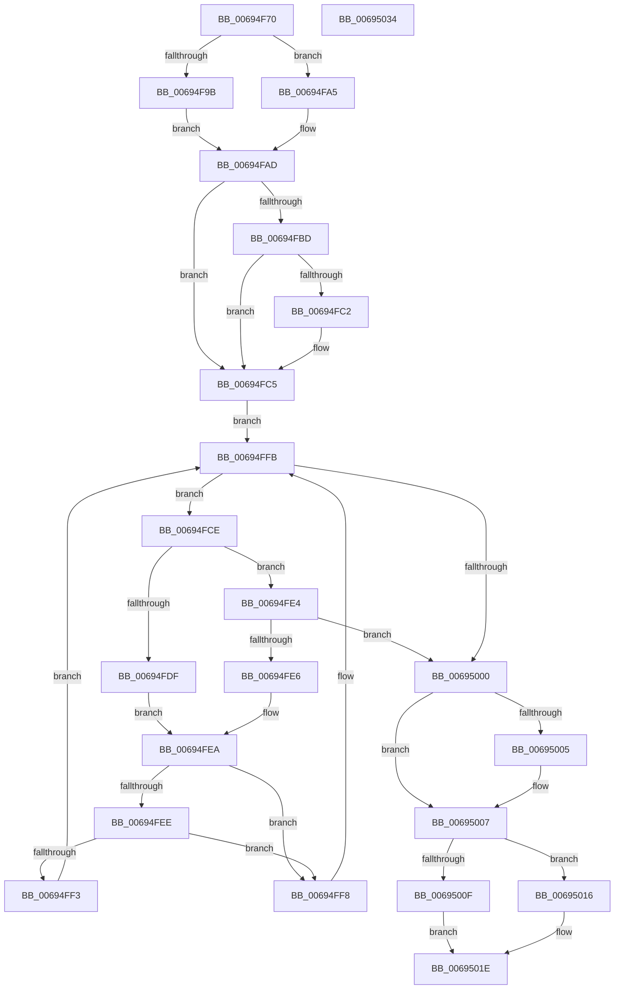

# MiFindPageFileMemoryExtent

- RVA: `0x00694F70`–`0x00695035` (길이 `197` bytes)
- VA: `0x0000000140694F70`
- 실행 섹션: `.text`
- PDB 이름 있음: `예`; PDB Function 태그: `아니요`
- unwind 정보 RVA: `0x000D938C`
- 디코드: `65`개 명령, `197/197` bytes 표시
- 미해석 바이트: `0` (있으면 어셈블리에 `.byte`로 보존)

> 이 문서는 커널 이미지의 기계어와 PDB 기호를 분석해 생성했습니다. 4번과 5번은 함수 원형과 자료형을 바이너리 사용 방식에서 추정한 C 해석이며 원본 소스 복구 결과는 아닙니다.

## 1. Dependencies

- 직접 호출 지점: **5**; 고유 호출 대상: **5**
- 직접 호출자로 확인된 함수: **1**
- RIP 상대 이미지 참조: **0**

### Outgoing calls
- `0x00694F9E` → [ExAcquireSpinLockSharedAtDpcLevel](../24/ExAcquireSpinLockSharedAtDpcLevel_function_00248E30.md) (function, `0x00248E30`)
- `0x00694FA5` → [ExAcquireSpinLockShared](../24/ExAcquireSpinLockShared_function_0024DCE0.md) (function, `0x0024DCE0`)
- `0x00694FD6` → [MiComparePageFileMemoryExtents](MiComparePageFileMemoryExtents_function_00694BE8.md) (function, `0x00694BE8`)
- `0x0069500F` → [ExReleaseSpinLockSharedFromDpcLevel](../24/ExReleaseSpinLockSharedFromDpcLevel_function_0024A590.md) (function, `0x0024A590`)
- `0x00695019` → [MiReleaseSpinLockShared](../34/MiReleaseSpinLockShared_function_00348BF0.md) (function, `0x00348BF0`)

### Direct callers
- [MiTransferMemoryPagefileData](../4D/MiTransferMemoryPagefileData_function_004DB6FC.md) at `0x004DB776`

### Static image references
- 디코드된 RIP-relative 메모리 참조가 없습니다.

## 2. Other-region calls and transfers

- 다른 실행 섹션으로 향하는 call: **0**
- 별도 외부 분기/꼬리 이동을 확인하지 못했습니다.

## 3. Assembly (complete function range)

```asm
00694F70  48 89 5C 24 08                  mov qword ptr [rsp + 8], rbx
00694F75  48 89 6C 24 18                  mov qword ptr [rsp + 0x18], rbp
00694F7A  89 54 24 10                     mov dword ptr [rsp + 0x10], edx
00694F7E  56                              push rsi
00694F7F  57                              push rdi
00694F80  41 56                           push r14
00694F82  48 83 EC 20                     sub rsp, 0x20
00694F86  48 8D B9 C8 00 00 00            lea rdi, [rcx + 0xc8]
00694F8D  48 8B D9                        mov rbx, rcx
00694F90  48 8B CF                        mov rcx, rdi
00694F93  45 8B F0                        mov r14d, r8d
00694F96  45 85 C0                        test r8d, r8d
00694F99  74 0A                           je 0x140694fa5
00694F9B  40 B5 11                        mov bpl, 0x11
00694F9E  E8 8D 3E BB FF                  call 0x140248e30
00694FA3  EB 08                           jmp 0x140694fad
00694FA5  E8 36 8D BB FF                  call 0x14024dce0
00694FAA  40 8A E8                        mov bpl, al
00694FAD  48 8D 93 E0 00 00 00            lea rdx, [rbx + 0xe0]
00694FB4  F6 42 08 01                     test byte ptr [rdx + 8], 1
00694FB8  48 8B 1A                        mov rbx, qword ptr [rdx]
00694FBB  74 08                           je 0x140694fc5
00694FBD  48 85 DB                        test rbx, rbx
00694FC0  74 03                           je 0x140694fc5
00694FC2  48 33 DA                        xor rbx, rdx
00694FC5  0F B6 72 08                     movzx esi, byte ptr [rdx + 8]
00694FC9  83 E6 01                        and esi, 1
00694FCC  EB 2D                           jmp 0x140694ffb
00694FCE  48 8B D3                        mov rdx, rbx
00694FD1  48 8D 4C 24 48                  lea rcx, [rsp + 0x48]
00694FD6  E8 0D FC FF FF                  call 0x140694be8
00694FDB  85 C0                           test eax, eax
00694FDD  79 05                           jns 0x140694fe4
00694FDF  48 8B 03                        mov rax, qword ptr [rbx]
00694FE2  EB 06                           jmp 0x140694fea
00694FE4  7E 1A                           jle 0x140695000
00694FE6  48 8B 43 08                     mov rax, qword ptr [rbx + 8]
00694FEA  85 F6                           test esi, esi
00694FEC  74 0A                           je 0x140694ff8
00694FEE  48 85 C0                        test rax, rax
00694FF1  74 05                           je 0x140694ff8
00694FF3  48 33 D8                        xor rbx, rax
00694FF6  EB 03                           jmp 0x140694ffb
00694FF8  48 8B D8                        mov rbx, rax
00694FFB  48 85 DB                        test rbx, rbx
00694FFE  75 CE                           jne 0x140694fce
00695000  48 85 DB                        test rbx, rbx
00695003  75 02                           jne 0x140695007
00695005  CD 2C                           int 0x2c
00695007  48 8B CF                        mov rcx, rdi
0069500A  45 85 F6                        test r14d, r14d
0069500D  74 07                           je 0x140695016
0069500F  E8 7C 55 BB FF                  call 0x14024a590
00695014  EB 08                           jmp 0x14069501e
00695016  40 8A D5                        mov dl, bpl
00695019  E8 D2 3B CB FF                  call 0x140348bf0
0069501E  48 8B 6C 24 50                  mov rbp, qword ptr [rsp + 0x50]
00695023  48 8B C3                        mov rax, rbx
00695026  48 8B 5C 24 40                  mov rbx, qword ptr [rsp + 0x40]
0069502B  48 83 C4 20                     add rsp, 0x20
0069502F  41 5E                           pop r14
00695031  5F                              pop rdi
00695032  5E                              pop rsi
00695033  C3                              ret
00695034  CC                              int3
```

## 4. C-style interpretation (structured pseudocode)

```c
__int64 __fastcall MiFindPageFileMemoryExtent(__int64 a1, int a2, int a3)
{
    __int64 result;
    __int64 v_rbx;
    __int64 v_rsi;
    __int64 v_rsp;
    unsigned int v_stack_p10;
    unsigned __int64 v_stack_p18;
    unsigned __int64 v_stack_p8;

    v_stack_p8 = v_rbx;
    v_stack_p18 = v_rbp;
    v_stack_p10 = a2;
    v_rsp = (v_rsp) - (32);
    if (a3 == 0) goto loc_00694FA5;
    result = ExAcquireSpinLockSharedAtDpcLevel(a1 + 200, a2, a3, a4);
    goto loc_00694FAD;
loc_00694FA5:
    result = ExAcquireSpinLockShared(a1 + 200, a2, a3, a4);
loc_00694FAD:
    if (((*(unsigned __int8 *)(a1 + 224 + 8)) & (1)) == 0) goto loc_00694FC5;
    v_rbx = *(unsigned __int64 *)(a1 + 224);
    if (*(unsigned __int64 *)(a1 + 224) != 0) {
        v_rbx = (*(unsigned __int64 *)(a1 + 224)) ^ (a1 + 224);
    }
    v_rsi = (unsigned int)((*(unsigned __int8 *)(a1 + 224 + 8)) & (1));
    goto loc_00694FFB;
loc_00694FCE:
    result = MiComparePageFileMemoryExtents(v_stack_p10, v_rbx, a3, a4);
    if (!sign_flag) goto loc_00694FE4;
    goto loc_00694FEA;
loc_00694FE4:
    if (condition_is_less_or_equal) goto loc_00695000;
loc_00694FEA:
    if ((unsigned int)(v_rsi) == 0) goto loc_00694FF8;
    if (*(unsigned __int64 *)(v_rbx + 8) == 0) goto loc_00694FF8;
    v_rbx = (v_rbx) ^ (*(unsigned __int64 *)(v_rbx + 8));
    goto loc_00694FFB;
loc_00694FF8:
loc_00694FFB:
    if (*(unsigned __int64 *)(v_rbx + 8) != 0) goto loc_00694FCE;
loc_00695000:
    if (*(unsigned __int64 *)(v_rbx + 8) == 0) {
    }
    if ((unsigned int)((unsigned int)(a3)) == 0) goto loc_00695016;
    result = ExReleaseSpinLockSharedFromDpcLevel(a1 + 200, v_rbx, a3, a4);
    goto loc_0069501E;
loc_00695016:
    result = MiReleaseSpinLockShared(a1 + 200, (unsigned __int8)((unsigned __int8)(result)), a3, a4);
loc_0069501E:
    v_rsp = (v_rsp) + (32);
    return *(unsigned __int64 *)(v_rbx + 8);
}
```

## 5. (Beta) C Style

```c
int64_t MiFindPageFileMemoryExtent(void *Arg1, int32_t Arg2, int32_t Arg3)
{
    uint8_t *arg1 = (uint8_t *)Arg1;

    int64_t result;
    int64_t local_rbx;
    int64_t local_rsi;
    int64_t local_rsp;
    uint32_t v_stack_p10;
    uint64_t v_stack_p18;
    uint64_t v_stack_p8;

    v_stack_p8 = local_rbx;
    v_stack_p18 = local_rbp;
    v_stack_p10 = Arg2;
    local_rsp = (local_rsp) - (32);
    if (Arg3 == 0) goto loc_00694FA5;
    result = ExAcquireSpinLockSharedAtDpcLevel(Arg1 + 200, Arg2, Arg3, a4);
    goto loc_00694FAD;
loc_00694FA5:
    result = ExAcquireSpinLockShared(Arg1 + 200, Arg2, Arg3, a4);
loc_00694FAD:
    if (((*(uint8_t *)(arg1 + 0xE0 + 0x8)) & (1)) == 0) goto loc_00694FC5;
    local_rbx = *(uint64_t *)(arg1 + 0xE0);
    if (*(uint64_t *)(arg1 + 0xE0) != 0) {
        local_rbx = (*(uint64_t *)(arg1 + 0xE0)) ^ (Arg1 + 224);
    }
    local_rsi = (uint32_t)((*(uint8_t *)(arg1 + 0xE0 + 0x8)) & (1));
    goto loc_00694FFB;
loc_00694FCE:
    result = MiComparePageFileMemoryExtents(v_stack_p10, local_rbx, Arg3, a4);
    if (!sign_flag) goto loc_00694FE4;
    goto loc_00694FEA;
loc_00694FE4:
    if (condition_is_less_or_equal) goto loc_00695000;
loc_00694FEA:
    if ((uint32_t)(local_rsi) == 0) goto loc_00694FF8;
    if (*(uint64_t *)(local_rbx + 0x8) == 0) goto loc_00694FF8;
    local_rbx = (local_rbx) ^ (*(uint64_t *)(local_rbx + 0x8));
    goto loc_00694FFB;
loc_00694FF8:
loc_00694FFB:
    if (*(uint64_t *)(local_rbx + 0x8) != 0) goto loc_00694FCE;
loc_00695000:
    if (*(uint64_t *)(local_rbx + 0x8) == 0) {
    }
    if ((uint32_t)((uint32_t)(Arg3)) == 0) goto loc_00695016;
    result = ExReleaseSpinLockSharedFromDpcLevel(Arg1 + 200, local_rbx, Arg3, a4);
    goto loc_0069501E;
loc_00695016:
    result = MiReleaseSpinLockShared(Arg1 + 200, (uint8_t)((uint8_t)(result)), Arg3, a4);
loc_0069501E:
    local_rsp = (local_rsp) + (32);
    return *(uint64_t *)(local_rbx + 0x8);
}
```

### 관측된 메모리 오프셋

구조체 형식이 확인되지 않은 접근은 인자 기준의 오프셋으로만 기록했습니다.

| 기준 인자 | 오프셋 표현 | 폭 (bit) | 접근 |
|---|---:|---:|---|
| `Arg1` | `+ 0x0` | `64` | `R` |
| `Arg1` | `+ 0x8` | `8` | `R` |
| `Arg1` | `+ 0xC8` | `64` | `R` |
| `Arg1` | `+ 0xE0` | `64` | `R` |

## 6. Execution-region graph

[열기: 2D/3D 그래프와 함수 탐색 컨트롤 패널](../../../control-panel.html?section=text&rva=0x00694F70&view=graph)

- 2D 그래프는 위에서 아래로 흐르고, 3D 그래프는 빈 공간을 드래그해 회전합니다. Shift+드래그는 이동, 휠은 확대·축소, 함수 노드 선택은 대상 보고서 이동입니다.

### Static fallback


