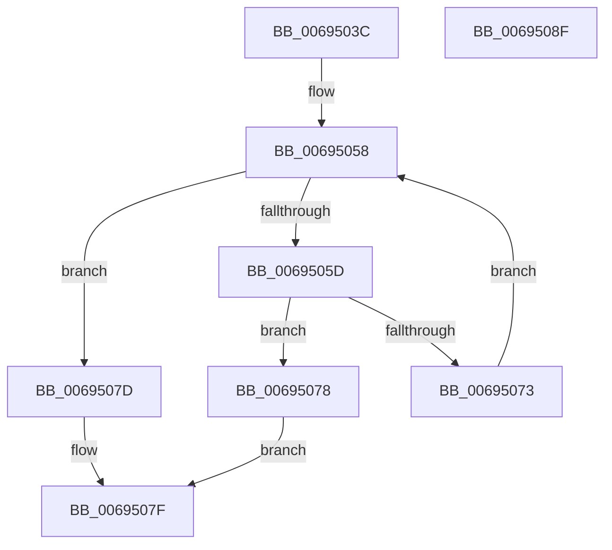

# MiFindSpecialPurposeMemoryType

- RVA: `0x0069503C`–`0x00695090` (길이 `84` bytes)
- VA: `0x000000014069503C`
- 실행 섹션: `.text`
- PDB 이름 있음: `예`; PDB Function 태그: `아니요`
- unwind 정보 RVA: `0x00060BC4`
- 디코드: `26`개 명령, `84/84` bytes 표시
- 미해석 바이트: `0` (있으면 어셈블리에 `.byte`로 보존)

> 이 문서는 커널 이미지의 기계어와 PDB 기호를 분석해 생성했습니다. 4번과 5번은 함수 원형과 자료형을 바이너리 사용 방식에서 추정한 C 해석이며 원본 소스 복구 결과는 아닙니다.

## 1. Dependencies

- 직접 호출 지점: **1**; 고유 호출 대상: **1**
- 직접 호출자로 확인된 함수: **3**
- RIP 상대 이미지 참조: **0**

### Outgoing calls
- `0x0069506A` → [memcmp](../6C/memcmp_function_006C6B10.md) (function, `0x006C6B10`)

### Direct callers
- [MiFindSpecialPurposeMemoryTypeByPartition](../../page/80/MiFindSpecialPurposeMemoryTypeByPartition_function_0080F5D8.md) at `0x0080F672`
- [MiInitializePartitionSpecialPurposeMemory](../../page/80/MiInitializePartitionSpecialPurposeMemory_function_0080F704.md) at `0x0080F73C`
- [MiInitializePartitionSpecialPurposeMemory](../../page/80/MiInitializePartitionSpecialPurposeMemory_function_0080F704.md) at `0x0080F7FC`
- [MiSpecialPurposeMemoryChangePrepare](../../page/80/MiSpecialPurposeMemoryChangePrepare_function_0080FED0.md) at `0x0080FF5F`

### Static image references
- 디코드된 RIP-relative 메모리 참조가 없습니다.

## 2. Other-region calls and transfers

- 다른 실행 섹션으로 향하는 call: **0**
- 별도 외부 분기/꼬리 이동을 확인하지 못했습니다.

## 3. Assembly (complete function range)

```asm
0069503C  48 89 5C 24 08                  mov qword ptr [rsp + 8], rbx
00695041  48 89 74 24 10                  mov qword ptr [rsp + 0x10], rsi
00695046  57                              push rdi
00695047  48 83 EC 20                     sub rsp, 0x20
0069504B  48 8D B9 D8 44 00 00            lea rdi, [rcx + 0x44d8]
00695052  48 8B F2                        mov rsi, rdx
00695055  48 8B 1F                        mov rbx, qword ptr [rdi]
00695058  48 3B DF                        cmp rbx, rdi
0069505B  74 20                           je 0x14069507d
0069505D  48 8D 4B 18                     lea rcx, [rbx + 0x18]
00695061  41 B8 20 00 00 00               mov r8d, 0x20
00695067  48 8B D6                        mov rdx, rsi
0069506A  E8 A1 1A 03 00                  call 0x1406c6b10
0069506F  85 C0                           test eax, eax
00695071  74 05                           je 0x140695078
00695073  48 8B 1B                        mov rbx, qword ptr [rbx]
00695076  EB E0                           jmp 0x140695058
00695078  48 8B C3                        mov rax, rbx
0069507B  EB 02                           jmp 0x14069507f
0069507D  33 C0                           xor eax, eax
0069507F  48 8B 5C 24 30                  mov rbx, qword ptr [rsp + 0x30]
00695084  48 8B 74 24 38                  mov rsi, qword ptr [rsp + 0x38]
00695089  48 83 C4 20                     add rsp, 0x20
0069508D  5F                              pop rdi
0069508E  C3                              ret
0069508F  CC                              int3
```

## 4. C-style interpretation (structured pseudocode)

```c
__int64 __fastcall MiFindSpecialPurposeMemoryType(__int64 a1, __int64 a2)
{
    __int64 result;
    __int64 v_rsp;
    unsigned __int64 v_stack_p10;
    unsigned __int64 v_stack_p8;

    v_stack_p8 = v_rbx;
    v_stack_p10 = v_rsi;
    v_rsp = (v_rsp) - (32);
loc_00695058:
    if ((*(unsigned __int64 *)(a1 + 17624)) == (a1 + 17624)) goto loc_0069507D;
    result = memcmp(*(unsigned __int64 *)(a1 + 17624) + 24, a2, 32, a4);
    if ((unsigned int)(result) == 0) goto loc_00695078;
    goto loc_00695058;
loc_00695078:
    goto loc_0069507F;
loc_0069507D:
    result = 0;
loc_0069507F:
    v_rsp = (v_rsp) + (32);
    return result;
}
```

## 5. (Beta) C Style

```c
int64_t MiFindSpecialPurposeMemoryType(void *Arg1, int64_t Arg2)
{
    uint8_t *arg1 = (uint8_t *)Arg1;

    int64_t result;
    int64_t local_rsp;
    uint64_t v_stack_p10;
    uint64_t v_stack_p8;

    v_stack_p8 = local_rbx;
    v_stack_p10 = local_rsi;
    local_rsp = (local_rsp) - (32);
loc_00695058:
    if ((*(uint64_t *)(arg1 + 0x44D8)) == (Arg1 + 17624)) goto loc_0069507D;
    result = memcmp(*(uint64_t *)(arg1 + 0x44D8) + 24, Arg2, 32, a4);
    if ((uint32_t)(result) == 0) goto loc_00695078;
    goto loc_00695058;
loc_00695078:
    goto loc_0069507F;
loc_0069507D:
    result = 0;
loc_0069507F:
    local_rsp = (local_rsp) + (32);
    return result;
}
```

### 관측된 메모리 오프셋

구조체 형식이 확인되지 않은 접근은 인자 기준의 오프셋으로만 기록했습니다.

| 기준 인자 | 오프셋 표현 | 폭 (bit) | 접근 |
|---|---:|---:|---|
| `Arg1` | `+ 0x0` | `64` | `R` |
| `Arg1` | `+ 0x44D8` | `64` | `R` |

## 6. Execution-region graph

[열기: 2D/3D 그래프와 함수 탐색 컨트롤 패널](../../../control-panel.html?section=text&rva=0x0069503C&view=graph)

- 2D 그래프는 위에서 아래로 흐르고, 3D 그래프는 빈 공간을 드래그해 회전합니다. Shift+드래그는 이동, 휠은 확대·축소, 함수 노드 선택은 대상 보고서 이동입니다.

### Static fallback


